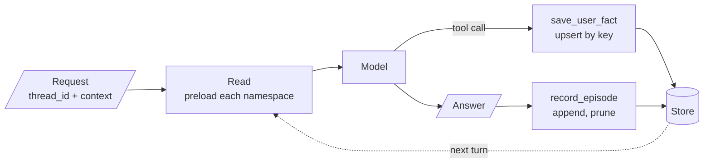

<!-- Generated by site/scripts/rag-theory-import.mjs from rag-agents-engineering. Edit the source there. -->
# Overview

A checkpointer remembers one conversation. Long-term memory remembers a person, a visit or an agent across every conversation, and the agent reads it back the way a RAG pipeline reads a handbook: by key, by recency or by similarity. The M34 notebooks build on four ideas: a store that spans threads and is split by namespace, three kinds of long-term memory with different write rules, tiers that page old context out and search it back, and libraries of skills an agent writes for itself.

The running example is a support assistant for Larkspur Cloud, the fictional host whose handbook [M11](/learn/llm-and-retrieval/rag-from-first-principles/rag-from-first-principles-overview) to [M13](/learn/ingestion-and-indexing-pipeline/chunking-and-indexing/chunking-and-indexing-overview) index. Dana runs a shop on an annual business plan. She tells the assistant facts about herself, comes back days later in a new chat, and asks billing questions the handbook answers: refunds within 30 days of purchase under 100 GB of outbound traffic, exports from Settings, then Data. The memory questions are the ones the M34 lab brief asks for: in a new thread, does the assistant still know her plan, and what it helped her with last time?

## In short

- A LangGraph `Store` holds JSON items under a namespace tuple and a key, shared by every thread. The namespace, built from trusted ids the server passes in the run's `context`, is what keeps one customer's memory away from another's.
- Semantic memory upserts facts under stable keys, episodic memory appends one item per event and prunes, procedural memory stores versioned instructions that a human approves through `interrupt()`. Same store, three write rules.
- Code should write the layers the model forgets. In the capstone's test runs gpt-4o-mini never called a `save_episode` tool (0 of 6), so a graph node records the episode after every answer.
- Preloading every item stops working as memory grows: `search()` returns 10 items unless you pass `limit=`, and every item costs prompt tokens on every call. Past that point, recall by similarity (an embedding index) or by graph traversal.
- MemGPT tiers make the agent manage its own context. In the lab, a 6-message window pages 5 of 11 messages to the archive by turn 6, and whether the agent gets a fact back depends on the words of its own search query.

## Mental model

Every turn reads memory before the model runs and writes it after. The ids decide which namespaces a turn can touch, so they come from the login and the visit, never from the conversation. Each layer has one writer: the model for facts, a graph node for episodes, the app for session items and a human for procedures.

## Interactive lab

[**The window and the archive**](/labs/rag/m34_long_term_agentic_memory/tiered-memory-lab.html): open the file in a browser. Start at a window of 6 and query `outbound traffic`: Dana's turn-2 message is in the archive and comes back at rank 1. Switch the query to `how much traffic?` and it is gone, because `traffic?` never matches `traffic`. Then slide the window to 9: the message is back in view with no search at all, and the prompt has grown from about 117 to about 156 tokens of conversation on every call.

## How it connects

- **Before:** [M10](/learn/langchain-and-langgraph-fundamentals/langgraph-runtime-persistence-hitl-and-streaming/langgraph-runtime-persistence-hitl-and-streaming-overview) teaches the checkpointer and `interrupt()` that procedural memory reuses. [M33](/learn/memory-and-multi-agent-rag/conversation-memory-and-conversational-rag/conversation-memory-and-conversational-rag-overview) gives an agent memory inside one thread; this module adds memory across threads. [M14](/learn/ingestion-and-indexing-pipeline/embeddings-and-model-selection/embeddings-and-model-selection-overview) and [M15](/learn/ingestion-and-indexing-pipeline/vector-stores-and-index-operations/vector-stores-and-index-operations-overview) cover the embeddings and vector indexes behind recall by similarity, and the golden-set method from [M11](/learn/llm-and-retrieval/rag-from-first-principles/rag-from-first-principles-overview) is how you measure whether memory helps.
- **Next:** [M35](/learn/memory-and-multi-agent-rag/multi-agent-architectures/multi-agent-architectures-overview) to [M37](/learn/memory-and-multi-agent-rag/multi-agent-applied-builds-and-deep-agents/multi-agent-applied-builds-and-deep-agents-overview) give several agents shared and private memory. [M43](/learn/hierarchical-memory-and-graph-rag/knowledge-graphs-with-neo4j/knowledge-graphs-with-neo4j-overview) stores graph memory in Neo4j, which lesson 34.4 previews.

## Key Takeaways

- Scope memory by namespace and take every id from trusted server input. The model never chooses whose memory it reads.
- Give each layer its own write rule and its own writer: upsert facts by key, append and prune episodes, expire session items, and let a human approve procedures.
- Write in code what the model forgets to write, and let code make the final yes or no on what counts as a task or a fact.
- Preload while memory is small; once it outgrows the prompt, recall by similarity or traversal, and measure that recall on cross-thread questions.
