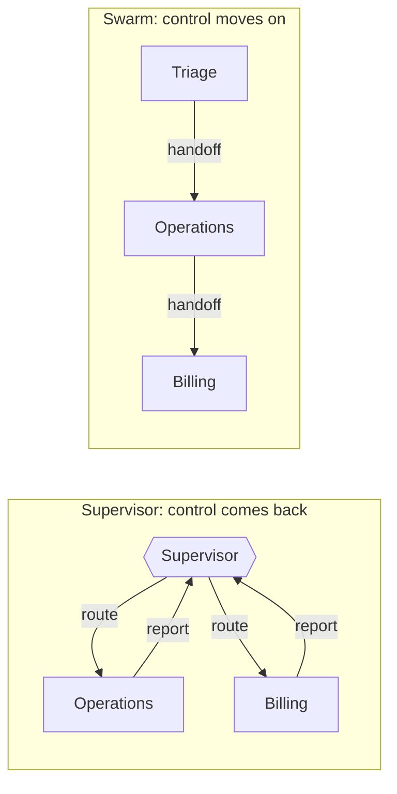

<!-- Generated by site/scripts/rag-theory-import.mjs from rag-agents-engineering. Edit the source there. -->
# Overview

One agent with every tool and every knowledge base has to pick among all of them on every step. Splitting it gives each agent a short prompt and a few tools, and adds a new problem: something has to decide which agent works next. The M35 notebooks build on four ideas: a supervisor that makes every routing decision, teams of supervisors nested as subgraphs, handoffs that let an agent pass the conversation on, and swarms that remember which agent holds it.

The running example is the Larkspur Cloud handbook from [M11](/learn/llm-and-retrieval/rag-from-first-principles/rag-from-first-principles-overview) to [M13](/learn/ingestion-and-indexing-pipeline/chunking-and-indexing/chunking-and-indexing-overview), split between three specialist RAG agents. The billing agent holds billing, cancellation, refunds and promotional credits; the operations agent holds the availability guarantee, incidents, server sizing and reboots; the data agent holds exports and retention. Three requests come back on every page and in the lab: *How long does a refund take?* (billing), *My server went down last night. Do I get service credits?* (operations, then billing) and *Can I export my data after I cancel my plan?* (data).

## In short

- Split one agent when it has more tools or sources than one prompt can choose among well. A team makes more model calls (the 35.1 notebook's specialist team costs roughly four times the monolith's), so measure it against the single agent on the same requests.
- The five LangGraph architectures share one primitive, `Command(goto=..., update=...)`: a node writes to state and names the next node. They differ in who decides what runs next.
- A supervisor decides every step and takes control back. On the outage request that costs 5 model calls, 3 of them routing, and buys one place to log, test and cap every decision.
- A hierarchy nests compiled team graphs under a top supervisor. With three specialists it only adds overhead (7 calls for the same request); it pays off when one supervisor would face too many workers.
- A handoff is a tool that returns `Command(goto=..., graph=Command.PARENT)`. A swarm stores `active_agent` per thread, so a follow-up costs 1 call against 3 for the supervisor. Nothing ends a handoff loop except `recursion_limit`, whose default is 10,007 steps.

## Mental model

Both graphs answer the outage request with the same two specialists. The supervisor decides before each specialist and once more to finish, so it spends 3 of its 5 model calls on routing. In the swarm, triage routes once and each agent hands the work on itself: 3 calls. Every architecture in this module sits somewhere between these two, and the choice is about who holds control after an agent finishes.

## Interactive lab

[**Who routes, and what it costs**](/labs/rag/m35_multi_agent_architectures/routing-cost-lab.html): open the file in a browser. Pick the outage request and step through the four architectures: the router ([M30](/learn/agentic-and-self-correcting-rag/adaptive-rag-and-query-routing/adaptive-rag-and-query-routing-overview)) is cheapest at 2 calls and never asks billing about the credits. Then pick Supervisor and Swarm in turn and move the follow-up slider to 3: the supervisor reaches 14 calls, the swarm 6, because every follow-up goes straight to the active agent.

## How it connects

- **Before:** [M25](/learn/agentic-systems/agentic-workflow-patterns/agentic-workflow-patterns-overview) introduced routing and orchestrator-worker as workflow patterns; here the workers are whole agents. [M27](/learn/agentic-systems/human-approval-and-applied-single-agent-builds/human-approval-and-applied-single-agent-builds-overview) added human approval gates, which 35.3 puts inside a supervisor loop. [M30](/learn/agentic-and-self-correcting-rag/adaptive-rag-and-query-routing/adaptive-rag-and-query-routing-overview) routed each question to one knowledge base once; the supervisor is that router run in a loop at the agent level. [M33](/learn/memory-and-multi-agent-rag/conversation-memory-and-conversational-rag/conversation-memory-and-conversational-rag-overview)'s checkpointers and threads are what let a swarm remember its active agent.
- **Next:** [M36](/learn/memory-and-multi-agent-rag/collaboration-control-and-parallel-agents/collaboration-control-and-parallel-agents-overview) covers other ways agents share work: blackboards, debate, STORM and parallel agents. [M37](/learn/memory-and-multi-agent-rag/multi-agent-applied-builds-and-deep-agents/multi-agent-applied-builds-and-deep-agents-overview) builds full multi-agent systems and hardens them against edge cases and errors.

## Key Takeaways

- Split one agent only when its tools or sources are too many to choose among well, and measure the team against the single agent on the same requests.
- Let the model choose the next agent, and let a pure function in code read that typed choice and a counter. The loop ends where the code says, whatever the model says.
- A supervisor pays a routing call per specialist plus one to finish; a swarm pays one routing call per thread and then follows `active_agent`. Pick by whether conversations stay with one specialist and whether you need one decision log.
- Pass `recursion_limit` on every run and add a counter cap to any graph that can cycle; test both with a stub or scripted model.
