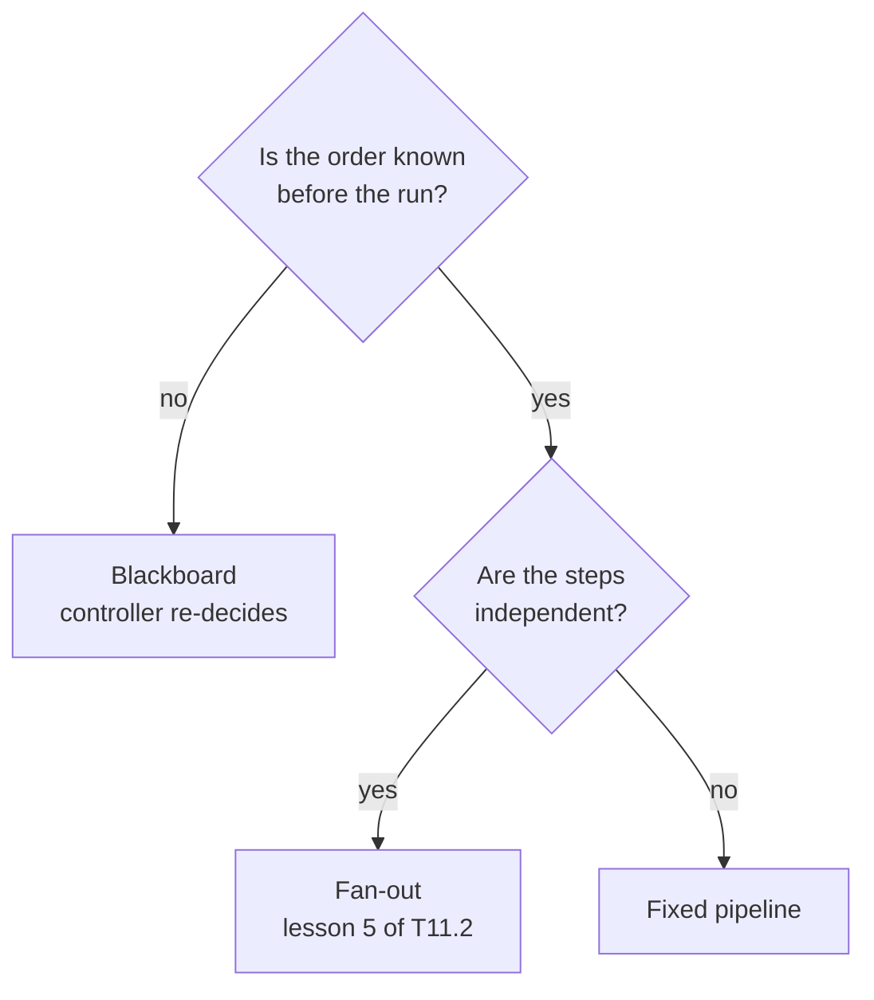

<!-- Generated by site/scripts/rag-theory-import.mjs from rag-agents-engineering. Edit the source there. -->
# Blackboard architectures

<!-- subtitle: A controller that re-reads a shared board after every post can skip the branch a fixed pipeline always pays for -->

## Blackboard

> **What you'll learn**
>
> - **Explain** how a blackboard coordinates specialists through one shared store, with a controller as the only part that decides order.
> - **Compare** a blackboard controller with a fixed pipeline on a request whose next step depends on an earlier finding.
> - **Diagnose** the ways an LLM controller goes wrong: an invalid name, an impossible step, a loop that never finishes.
> - **Choose** between a blackboard, a pipeline and a fan-out by asking when the order of work is known.

[T11.1](/learn/multi-agent-systems/multi-agent-architectures/multi-agent-architectures-overview) built supervisors and handoffs, where one agent passes control to the next. This module adds shared state: several specialists contribute to one record, and something decides who goes next.

Larkspur's support team gets an escalation: *a customer says their server went down twice this week. If the outages pushed availability below the 99.95% SLA, draft a service-credit reply, otherwise draft a reply that points to the status page and the root-cause report.* A fixed pipeline of analysts would run the credits analyst and the status analyst on every escalation, because its edges cannot skip a node. Half that work is wasted on each request, and the writer has to ignore one of the two reports.

A **blackboard system** coordinates specialists through one shared store, the **blackboard**. Specialists never call each other. Each one reads the board, does its own job and appends its result. A **controller** reads the whole board after every contribution and picks the next specialist, or `FINISH`:

```animated
<figure class="anim sheet" aria-labelledby="anim-blackboard-cap">
  <div class="anim__canvas" tabindex="0" aria-label="The blackboard loop, scrolls sideways on a narrow screen">
    <svg viewBox="0 0 800 360" role="img" aria-labelledby="anim-blackboard-title anim-blackboard-desc">
      <title id="anim-blackboard-title">The blackboard loop</title>
      <desc id="anim-blackboard-desc">An outage escalation reaches the controller. It picks the incident analyst, who posts that availability fell below the SLA. The controller re-reads the board, picks the credits analyst and skips the status analyst. The credits analyst posts the credit terms, the reply writer drafts from the board, and the controller finishes. Three specialists ran and the controller decided four times.</desc>
      <defs>
        <marker id="ah-bb" viewBox="0 0 8 8" refX="7" refY="4" markerWidth="8" markerHeight="8" markerUnits="userSpaceOnUse" orient="auto-start-reverse"><path class="ah" d="M0 0 L8 4 L0 8 z"/></marker>
      </defs>

      <g class="n-1"><rect class="box" x="20" y="160" width="110" height="44"/><text class="label" x="75" y="182">Request</text></g>
      <path class="edge e-1" d="M130 182 H167" marker-end="url(#ah-bb)"/>

      <g class="n-2 n-4 n-7"><rect class="box" x="170" y="160" width="140" height="44"/><text class="label" x="240" y="182">Controller</text></g>

      <g class="n-3"><rect class="box" x="380" y="40" width="160" height="44"/><text class="label" x="460" y="62">Incident analyst</text></g>
      <g class="n-5"><rect class="box" x="380" y="120" width="160" height="44"/><text class="label" x="460" y="142">Credits analyst</text></g>
      <g><rect class="box" x="380" y="200" width="160" height="44"/><text class="label" x="460" y="222">Status analyst</text></g>
      <g class="n-6"><rect class="box" x="380" y="280" width="160" height="44"/><text class="label" x="460" y="302">Reply writer</text></g>

      <path class="edge e-2" d="M310 182 C345 182 345 62 377 62" marker-end="url(#ah-bb)"/>
      <path class="edge e-5" d="M310 182 C345 182 345 142 377 142" marker-end="url(#ah-bb)"/>
      <path class="edge dashed" d="M310 182 C345 182 345 222 377 222" marker-end="url(#ah-bb)"/>
      <path class="edge e-6" d="M310 182 C345 182 345 302 377 302" marker-end="url(#ah-bb)"/>
      <text class="small in-4" x="460" y="260">skipped</text>

      <g>
        <path class="box" d="M610 48 a85 10 0 0 0 170 0 v264 a85 10 0 0 1 -170 0 z"/>
        <ellipse class="box" cx="695" cy="48" rx="85" ry="10"/>
        <text class="label" x="695" y="82">Blackboard</text>
      </g>
      <path class="edge e-3" d="M540 62 H607" marker-end="url(#ah-bb)"/>
      <path class="edge e-5" d="M540 142 H607" marker-end="url(#ah-bb)"/>
      <path class="edge dashed" d="M540 222 H607" marker-end="url(#ah-bb)"/>
      <path class="edge e-6" d="M540 302 H607" marker-end="url(#ah-bb)"/>
      <text class="small in-3" x="695" y="120">Incident: SLA missed</text>
      <text class="small in-5" x="695" y="160">Credits: next invoice</text>
      <text class="small in-6" x="695" y="200">Writer: draft reply</text>

      <path class="edge dashed e-4 e-6 e-7" d="M695 324 V344 H240 V207" marker-end="url(#ah-bb)"/>
      <text class="small" x="470" y="336">re-read after every post</text>

      <path class="edge e-7" d="M190 204 C190 260 160 292 133 292" marker-end="url(#ah-bb)"/>
      <g class="n-7"><rect class="box" x="20" y="270" width="110" height="44"/><text class="label" x="75" y="292">Reply</text></g>
      <text class="small in-7" x="75" y="330">FINISH</text>
    </svg>
  </div>
  <div class="anim__controls" hidden>
    <button class="anim__btn" type="button" data-act="prev">Previous</button>
    <button class="anim__btn" type="button" data-act="play" aria-pressed="false">Play</button>
    <button class="anim__btn" type="button" data-act="next">Next</button>
  </div>
  <ol class="anim__steps" id="anim-blackboard-cap">
    <li><button type="button">Request</button><span>An escalation arrives: two outages this week, a credit reply if the SLA was missed, a status-page reply if not. The board is empty.</span></li>
    <li><button type="button">Pick</button><span>The controller reads the empty board and picks the incident analyst.</span></li>
    <li><button type="button">Post</button><span>The incident analyst reads the incident log and posts that availability fell below the 99.95% SLA.</span></li>
    <li><button type="button">Re-read</button><span>The controller re-reads the board. The SLA was missed, so the status analyst is skipped.</span></li>
    <li><button type="button">Credits</button><span>The credits analyst posts the credit terms: service credits on the next invoice.</span></li>
    <li><button type="button">Write</button><span>With a finding and the credit terms on the board, the controller picks the reply writer, who drafts from them.</span></li>
    <li><button type="button">Finish</button><span>The board holds a draft, so the controller returns FINISH. Three specialists ran and the controller decided four times.</span></li>
  </ol>
</figure>
```

*Figure 1: The blackboard loop. Every specialist turn sits between two controller turns.*

The design comes from the HEARSAY-II speech-recognition system (Erman et al., 1980). In HEARSAY-II the specialists watched the board for their own trigger conditions and a scheduler chose among them. In the reference implementations the controller does all the watching.

The controller is the only part that decides order. The specialists stay narrow, and adding one means adding a node and a name the controller may choose. Nothing else is rewired.

## Branching on what the board says

The intro notebook gives both designs one request with an either/or condition: find the latest news about a company, then run a technical analysis if the news is neutral or positive, or a financial analysis if it is negative. Here are both graphs, one row per design:

| Design | Order of work | Branches that run |
|---|---|---|
| Fixed pipeline | news, technical, financial, writer | Both, on every request |
| Blackboard | controller, news, controller, one analyst, controller, writer, controller | One, chosen after the news post lands |

*Table 1: The same conditional request through both designs. The pipeline's edges fix its order before the run starts.*

The notebook does not ask another model whether the instruction was followed. It computes two checks from `steps`, the list of specialists that ran:

| Check, computed from `steps` | Sequential pipeline | Blackboard |
|---|---|---|
| Followed the either/or | Never: both branches run by construction | Whatever this run's controller chose |
| Correct branch for the sentiment | Never: both branches run | Checked against a sentiment label from the news post |

*Table 2: The code-computed comparison. The pipeline fails by structure, the blackboard can fail by judgement.*

The blackboard row can fail too, because the controller is an LLM. A run where it calls both analysts, or the wrong one, shows up as a failed check instead of a plausible report. That is why the check runs on every run rather than once.

On the Larkspur escalation the same shape plays out with three specialists. An incident analyst posts what the incident log shows. The controller reads that post and calls either the credits analyst or the status analyst. A writer drafts the reply from the board.

## Guarding an LLM controller

A controller that re-decides at every step can also loop, stall or name a step that cannot run yet. We name the three failures and reuse the names:

- **Phantom route**: the controller names a specialist that does not exist.
- **Premature step**: it names a real specialist whose input is not on the board yet, such as a writer with no findings.
- **Runaway controller**: it keeps choosing specialists and never returns `FINISH`.

The reference implementations guard each one in code. The planted cases below come from the research-team notebook, which feeds hand-written boards to its pure guard functions with no model call. All six checks pass:

| Planted case | What the guard returned | Guard |
|---|---|---|
| Fact-Checker chosen on an empty board | Refused: there is no finding to check | Precondition |
| Outline-Writer chosen with 1 verified finding | Refused: fewer than 2 verified findings | Precondition |
| `FINISH` chosen with no draft | Refused: there is no draft yet | Precondition |
| A flagged finding followed by its revision | Only the revision counts as verified | Structured posts |
| Fallback after an unchecked finding | Fact-Checker | Rule-based next step |
| Fallback after a `needs_revision` verdict | Researcher | Rule-based next step |

*Table 3: Guard checks on hand-written blackboards, from a scratch run of the research-team notebook's pure functions.*

Four guards cover the three failures:

- **A typed decision** stops the phantom route. The decision field is a `Literal` of the specialist names plus `FINISH`, so the model can only name a real node. The node writes the decision to state, and a separate, pure routing function reads it.
- **Preconditions checked in code** stop the premature step. In the research-team implementation, `precondition_problem()` rejects impossible choices and `rule_based_next()` substitutes the rule-based choice. Every override is printed and counted.
- **A cap in code** stops the runaway controller. The intro notebook's controller returns `FINISH` without calling the model once `MAX_SPECIALIST_CALLS = 6` specialists have run (the research team allows 12 contributions). LangGraph's `recursion_limit` (20 in the intro, 40 in the research team) is only the backstop: it ends the run with an error rather than a clean stop.
- **Structured contributions** let code read the board. Posts in the research team are records with `agent`, `type` and `content`. Code can then tell a finding from a fact-check from a draft, and pair each finding with its own verdict.

Specialists that search must execute their tool. The intro notebook runs each analyst as a small `create_agent` loop. Binding a tool to the model alone only lets the model request a search, and nothing runs it.

> **Pitfall: an ungrounded fact-check.** The research team's Researcher and Fact-Checker have no search tool. The Fact-Checker judges clarity and internal consistency, and a fluent but wrong finding can still come out `verified`. Give the Researcher sources and have the Fact-Checker compare claims against them before trusting the label.

## What the controller costs

Every specialist turn sits between two controller turns. A run with `k` specialists makes up to `k + 1` controller calls on top of the specialists' own. For the Larkspur escalation that looks like this:

| Run | Specialist calls | Controller model calls |
|---|---|---|
| Incident analyst, credits analyst, writer | 3 | 4 |
| Pipeline running both analysts | 4 | 0 |
| Intro notebook at its cap | 6 | 6 (the seventh decision is made in code) |

*Table 4: Calls per run, counting each specialist as one call even when its own tool loop makes more. The first two rows are illustrative.*

The blackboard saves a specialist and pays for it in controller calls. That trade pays when the skipped specialist is expensive, such as a search loop, or when its output would mislead the writer.

Traces are harder to read than a pipeline's, because the path changes from run to run. In the research-team implementation a fact-check that flags a finding sends the controller back to the Researcher, a loop-back no edge in the graph spells out. The notebook counts loop-backs and overrides from the final board. A run with zero loop-backs is valid: every finding passed its first check.

## Choosing a coordination shape

The deciding question is when the next step becomes known:



*Figure 2: A blackboard earns its controller calls only when the order depends on what earlier steps find.*

| | Fixed pipeline | Fan-out | Blackboard |
|---|---|---|---|
| Who decides order | The graph's edges | The graph's edges | An LLM controller, every turn |
| Can skip a branch | ✗ | ✗ | ✓ |
| Extra model calls | None | None | Up to `k + 1` |
| Same path every run | ✓ | ✓ | ✗ |
| Main risk | Wasted branches | Joins and shared keys | Runaway or wrong choices |

*Table 5: Three coordination shapes for several specialists.*

Use a blackboard for diagnosis, triage and research with verification. When the order is known before the run starts, a pipeline or a fan-out ([lesson 5 of T11.2](/learn/multi-agent-systems/collaboration-control-and-parallel-agents/parallel-agents-async-nodes-and-streaming)) is cheaper and easier to test.

## In practice: Larkspur's outage escalation

1. **Board**: the request and the customer's account go on the board as the first post.
2. **Incident analyst** posts what the status page probes recorded for the customer's region this month, with the month's availability.
3. **Controller** reads that post. Below 99.95% it calls the credits analyst, which posts the credit owed (10% of the month's server charges in that region, 25% below 99.0%) and the rule that credits are claimed with a Billing ticket within 30 days. At or above 99.95% it calls the status analyst, which posts the status-page link and the 72-hour root-cause report.
4. **Writer** drafts from the board, and the controller returns `FINISH` once a draft exists.
5. **Checks in code**: exactly one of the two analysts ran, it matches the availability figure, and the run stayed under the call cap.

Lesson 2 of T11.2 swaps cooperation for disagreement: two agents argue opposite sides and a judge weighs them.

## Run the notebooks

The code for this lesson is in these notebooks. Colab runs one in your browser: install the packages its first cell imports and set the API keys it reads. To run every notebook as written, clone the repository and use its uv environment.

| Notebook | GitHub | Colab |
|---|---|---|
| Blackboard intro | [Open on GitHub](https://github.com/Sourav692/rag-agents-engineering/blob/main/p10_multi_agent_systems/m36_collaboration_parallel_agents/mandatory/notebook/01a_blackboard_intro.ipynb) | [Open in Colab](https://colab.research.google.com/github/Sourav692/rag-agents-engineering/blob/main/p10_multi_agent_systems/m36_collaboration_parallel_agents/mandatory/notebook/01a_blackboard_intro.ipynb) |
| Blackboard research team (optional) | [Open on GitHub](https://github.com/Sourav692/rag-agents-engineering/blob/main/p10_multi_agent_systems/m36_collaboration_parallel_agents/optional/notebook/01b_blackboard_research_team.ipynb) | [Open in Colab](https://colab.research.google.com/github/Sourav692/rag-agents-engineering/blob/main/p10_multi_agent_systems/m36_collaboration_parallel_agents/optional/notebook/01b_blackboard_research_team.ipynb) |

## Key Takeaways

- A blackboard coordinates specialists through one shared store, and only the controller decides order. It can pick one branch from what earlier posts found, where a fixed pipeline runs every branch by construction.
- Guard the controller in code: a typed `Literal` choice against phantom routes, precondition checks against premature steps, and a specialist-call cap against a runaway controller. `recursion_limit` is only the backstop, because it ends the run with an error.
- A run with `k` specialists makes up to `k + 1` controller calls, and its path changes from run to run. When the order is known before the run, a pipeline or fan-out is cheaper and easier to test.

## Check yourself

<details>
<summary>1. A request asks for a technical or a financial analysis depending on the news sentiment. Why does the fixed pipeline never follow it, while the blackboard can?</summary>

The pipeline's edges cannot skip a node, so news, technical, financial and writer run on every request and both analyses always happen. The blackboard controller reads the news analyst's post and then picks one branch. It can still choose wrong, because it is an LLM, and the implementation computes the check from `steps` on every run.

</details>

<details>
<summary>2. In the Larkspur outage escalation, the incident analyst posts that availability stayed above the 99.95% SLA. Which specialists should run next?</summary>

The controller should call the status analyst, not the credits analyst, and then the writer drafts a reply that points to the status page and the root-cause report. That run makes three specialist calls and four controller calls. A fixed pipeline would pay for both analysts on every escalation.

</details>

<details>
<summary>3. A blackboard controller keeps picking specialists and never returns FINISH. What in the implementations stops the run, and why is that better than relying on recursion_limit?</summary>

A cap in code: once `MAX_SPECIALIST_CALLS = 6` specialists have run, the controller returns `FINISH` without calling the model, and the run ends with a reply. `recursion_limit = 20` is only the backstop, and it ends the run with an error rather than a clean stop.

</details>
