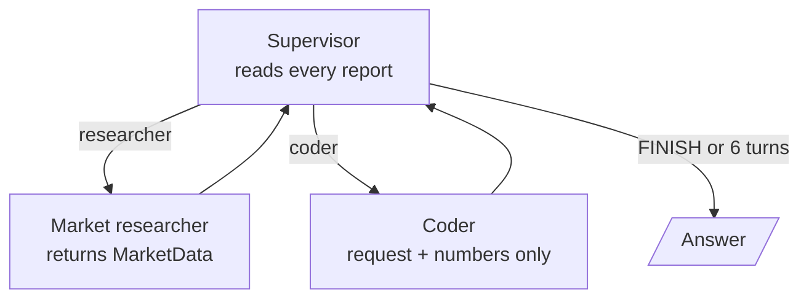
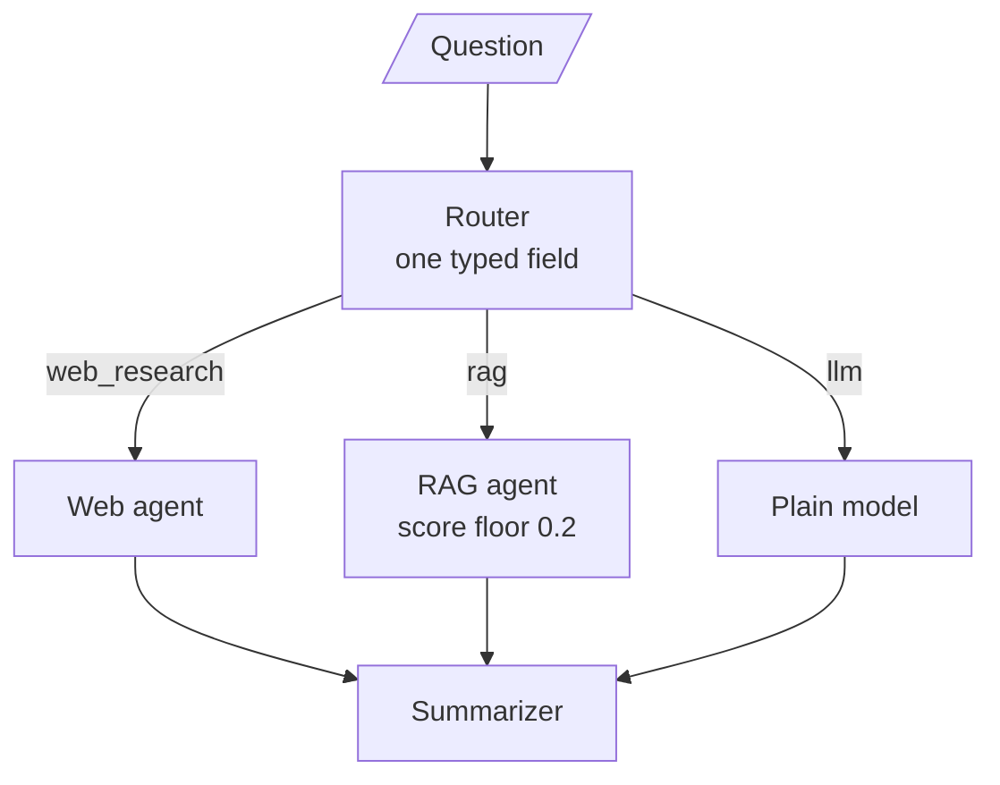
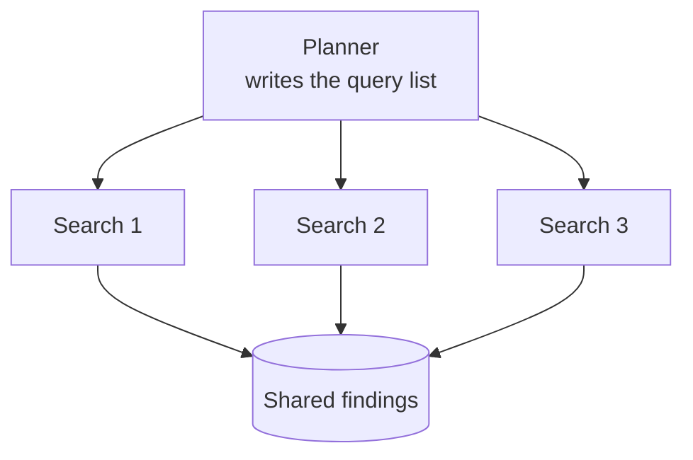
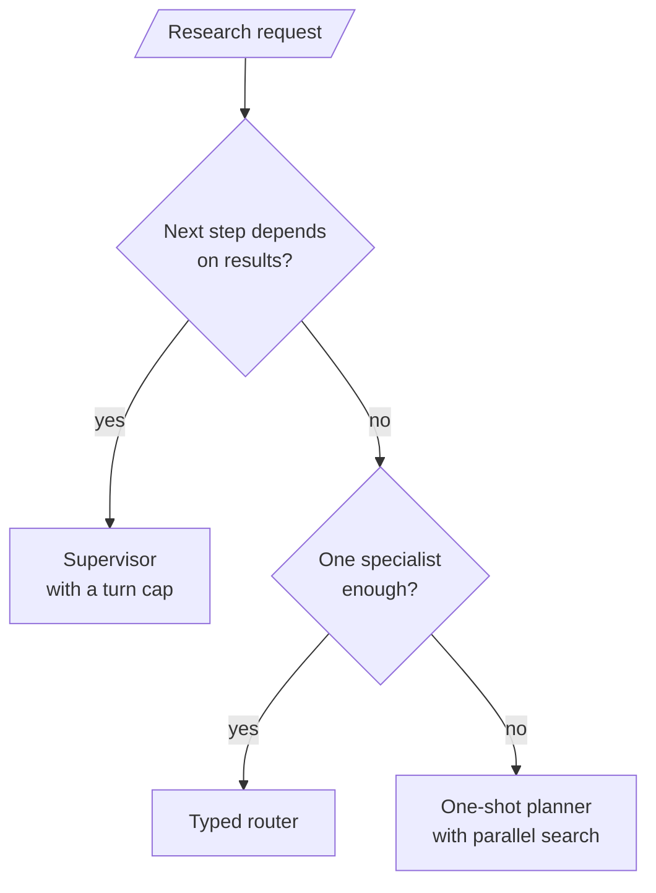

<!-- Generated by site/scripts/rag-theory-import.mjs from rag-agents-engineering. Edit the source there. -->
# Research systems: supervisor financial research, summarisation, full research system

<!-- subtitle: Pick who decides the next step, keep every finding tied to its source, and stop the review loop in code -->
<!-- format: approved -->

## Start with a refund question and two sources

> **What you'll build**
>
> - **A one-shot planner** that splits a topic into a fixed number of search queries and runs one search agent per query, in parallel.
> - **An analyst and a report writer** that work from one shared, source-tagged findings list.
> - **A quality checker** that scores each draft by its weakest criterion, with a draft cap enforced in code.
> - **Two smaller teams** to compare against: a supervisor over a market researcher and a coder, and a typed router over web, RAG and plain-model specialists.

Lesson 3 of T11.3 merged parallel hotel agents into one reply. The research builds keep that fan-out and fan-in and change the question: who decides which agent works next, and when. The full pipeline is the mandatory build; the supervisor and the typed router are the optional builds it is compared against.

Outside a notebook, a research team fails in ways a single agent does not. A Larkspur support engineer asks about the refund window for annual plans. The handbook gives the current window, and a community forum post quotes an older one. Three things can go wrong on the way to the answer: a search returns nothing useful, a source contradicts the handbook, or a provider call fails. The module's lab brief asks for exactly this team, built on the Larkspur handbook and tested on those three cases. This page covers the designs it draws on.

## Planner, supervisor or router

The three builds answer "who decides next" differently, and that choice sets how many model calls a request costs and what can go wrong.

A **supervisor** decides after every worker report. Its model returns a structured choice (researcher, coder or finish) that a pure function follows:



*Figure 1: The supervisor. It sees each result and picks again, until it finishes or reaches the turn cap.*

The supervisor is the most flexible and the hardest to bound. Its build proves the 6-turn cap with a stub supervisor that always picks the researcher. Its researcher also returns a validated market-data object, numbers only, and the coder sees just the user's request and that object. No web text reaches the agent that runs code.

A **typed router** decides once per question:



*Figure 2: The typed router. One structured-output field picks one specialist, then a summariser writes the answer.*

It is the fix for lesson 1 of T11.3's mention routing: the choice is a field whose only values are web research, RAG or the plain model, and there is no reply text to search. Its RAG specialist answers only from chunks whose relevance score reaches 0.2, out of the top 3. When nothing clears that floor, it skips the model call and says so.

A **one-shot planner** decides once, up front, and never sees a result:



*Figure 3: The one-shot planner. One `Send` per planned query, all in parallel, appending to one list.*

It cannot adapt, but its cost is known before the first search runs.

| | Supervisor | Typed router | One-shot planner |
|---|---|---|---|
| Decides | After every worker report, who acts next or whether to finish | Once per question, which one specialist runs | Once, up front, the list of search queries |
| Sees results | Yes | No | No |
| Workers per request | Any number, in sequence | Exactly one, then a summariser | One per planned query, in parallel |
| How the choice reaches the graph | The model writes `next` into state; a pure function follows it | A structured-output field with three allowed values | One `Send` per planned query |
| Bound in code | 6 supervisor turns | One route per question | 3 queries, and 2 drafts on the revision loop |

*Table 1: The three controllers compared, with the caps each build sets in code.*

The choice comes down to two questions:



*Figure 4: Choosing a controller. Adaptivity costs boundedness, so take the supervisor only when the next step really depends on what came back.*

The planner wins for a broad topic with known angles. The rest of the page follows it.

## A quality loop with a cap in code

The full pipeline has five roles. A planner splits the topic into search queries, search agents run them in parallel and append to one shared findings list, an analyst and a writer turn the findings into a report, and a quality checker sends the report back for revision until it passes or the cap is reached:

```animated
<figure class="anim sheet" aria-labelledby="anim-qloop-cap">
  <div class="anim__canvas" tabindex="0" aria-label="The research quality loop, scrolls sideways on a narrow screen">
    <svg viewBox="0 0 880 300" role="img" aria-labelledby="anim-qloop-title anim-qloop-desc">
      <title id="anim-qloop-title">Planner, parallel search and a capped quality loop</title>
      <desc id="anim-qloop-desc">A planner writes 3 search queries. Send starts one search agent per query, in parallel, each reading 3 results; their findings append to one list. An analyst reads all findings and a writer drafts the report. A quality checker scores three criteria and keeps the weakest. The gate approves at 0.7 or more with all four sections present; otherwise the report goes back to the writer, until 2 drafts have been reviewed, when the gate ends the loop whatever the scores.</desc>
      <defs>
        <marker id="ah-qloop" viewBox="0 0 8 8" refX="7" refY="4" markerWidth="8" markerHeight="8" markerUnits="userSpaceOnUse" orient="auto-start-reverse"><path class="ah" d="M0 0 L8 4 L0 8 z"/></marker>
      </defs>

      <g class="n-1"><rect class="box" x="20" y="74" width="140" height="56"/><text class="label" x="90" y="94">Planner</text><text class="small" x="90" y="114">3 queries</text></g>

      <path class="edge e-2" d="M160 102 C195 102 195 46 227 46" marker-end="url(#ah-qloop)"/>
      <path class="edge e-2" d="M160 102 H227" marker-end="url(#ah-qloop)"/>
      <path class="edge e-2" d="M160 102 C195 102 195 158 227 158" marker-end="url(#ah-qloop)"/>
      <g class="n-2"><rect class="box" x="230" y="24" width="150" height="44"/><text class="label" x="305" y="46">Search agent</text></g>
      <g class="n-2"><rect class="box" x="230" y="80" width="150" height="44"/><text class="label" x="305" y="102">Search agent</text></g>
      <g class="n-2"><rect class="box" x="230" y="136" width="150" height="44"/><text class="label" x="305" y="158">Search agent</text></g>
      <text class="small in-2" x="305" y="198">3 results each</text>

      <path class="edge e-3" d="M380 46 C415 46 415 102 447 102" marker-end="url(#ah-qloop)"/>
      <path class="edge e-3" d="M380 102 H447" marker-end="url(#ah-qloop)"/>
      <path class="edge e-3" d="M380 158 C415 158 415 102 447 102" marker-end="url(#ah-qloop)"/>
      <g class="n-3"><rect class="box" x="450" y="74" width="140" height="56"/><text class="label" x="520" y="94">Analyst</text><text class="small" x="520" y="114">all findings</text></g>

      <path class="edge e-4" d="M590 102 H657" marker-end="url(#ah-qloop)"/>
      <g class="n-4 n-6"><rect class="box" x="660" y="74" width="160" height="56"/><text class="label" x="740" y="102">Report writer</text></g>
      <text class="fig in-4" x="700" y="58">draft 1</text>
      <text class="fig in-6" x="780" y="58">draft 2</text>

      <path class="edge e-5" d="M740 130 V197" marker-end="url(#ah-qloop)"/>
      <g class="n-5 n-7"><rect class="box" x="660" y="200" width="160" height="56"/><text class="label" x="740" y="220">Quality checker</text><text class="small" x="740" y="240">weakest criterion</text></g>

      <path class="edge e-5 e-7" d="M660 228 H557" marker-end="url(#ah-qloop)"/>
      <g class="n-5 n-7">
        <path class="box" d="M500 192 L555 228 L500 264 L445 228 Z"/>
        <text class="small" x="500" y="220">Approved, or</text>
        <text class="small" x="500" y="238">2 drafts?</text>
      </g>

      <path class="edge e-6" d="M500 192 V160 H690 V133" marker-end="url(#ah-qloop)"/>
      <text class="small" x="600" y="150">no</text>

      <path class="edge e-7" d="M445 228 H383" marker-end="url(#ah-qloop)"/>
      <text class="small" x="414" y="216">yes</text>
      <g class="n-7"><rect class="box" x="230" y="205" width="150" height="46"/><text class="label" x="305" y="228">Report</text></g>
      <text class="small in-7" x="305" y="276">the cap is code, not the model</text>

      <circle class="tok" cx="0" cy="0" r="7"/>
    </svg>
  </div>
  <div class="anim__controls" hidden>
    <button class="anim__btn" type="button" data-act="prev">Previous</button>
    <button class="anim__btn" type="button" data-act="play" aria-pressed="false">Play</button>
    <button class="anim__btn" type="button" data-act="next">Next</button>
  </div>
  <ol class="anim__steps" id="anim-qloop-cap">
    <li><button type="button" data-tok="20,74">Plan</button><span>The planner writes the search queries once, and code keeps at most 3.</span></li>
    <li><button type="button" data-tok="230,80">Fan out</button><span>Send starts one search agent per query; they run at the same time and each reads 3 results.</span></li>
    <li><button type="button" data-tok="450,74">Gather</button><span>Their findings append to one list through the operator.add reducer, and the analyst reads all of them.</span></li>
    <li><button type="button" data-tok="660,74">Draft</button><span>The writer drafts a report with four required sections.</span></li>
    <li><button type="button" data-tok="660,200">Review</button><span>The checker scores three criteria and keeps the weakest. Below 0.7, or a section missing, the gate sends it back.</span></li>
    <li><button type="button" data-tok="660,74">Revise</button><span>The writer revises from its previous draft and the reviewer’s feedback.</span></li>
    <li><button type="button" data-tok="230,205">Stop</button><span>After the second review the gate ends the loop, approved or not: MAX_DRAFTS is 2.</span></li>
  </ol>
</figure>
```

*Figure 5: The research pipeline. The loop back to the writer ends on approval or at the draft cap, whichever comes first.*

The settings live in one place, and code enforces each of them:

| Setting | Value | Enforced by |
|---|---|---|
| Queries | 3 | The planner's list is cut to this length: the fan-out never depends on the model counting |
| Results per query | 3 | Each DuckDuckGo search keeps this many hits |
| Quality threshold | 0.7 | Every review criterion must reach it |
| Draft cap | 2 | The quality gate ends the loop at this many reviewed drafts, whatever the scores say |

*Table 2: The pipeline's settings and the code that enforces each one.*

| Piece | What it does | Built on |
|---|---|---|
| A reducer on the findings | Lets parallel search agents append to one list | Lesson 3 of T11.3's reducer rule |
| URL verification | Each search agent extracts 2 or 3 findings tied to a result URL; code marks whether that URL is one the search actually returned | Grounding, so an invented source shows up |
| The weakest criterion decides | The reviewer scores completeness, clarity and actionability from 0.0 to 1.0, and the quality score is the minimum; code checks that the four required sections are present | A typed verdict, as in lesson 1 of T11.3 |
| Revisions see the previous draft | The writer runs at temperature 0.7 and gets its last draft and the reviewer's feedback; at temperature 0 a revision tends to repeat the draft | Generator and critic |
| The exit is code | A pure gate approves when the minimum reaches 0.7 and no section is missing, otherwise loops back, unless the draft count has reached 2 | Lesson 2 of T11.3's pure router |

*Table 3: The design details that make the loop safe, and what each reuses.*

The four required sections are Executive Summary, Key Findings, Analysis and Recommendations. The reviewer is never asked to be lenient on a later pass; the cap does that job. Call the failure it prevents a **runaway revision loop**: a strict reviewer and a writer that cannot satisfy it, revising until the recursion limit stops the run with no report.

### Proving the loop with stubs

The build proves the wiring before it spends a token. The graph factory accepts replacement nodes, and stub nodes plan four queries with two findings each. We reran the stub cells offline with a model factory that refuses every call:

| Stub reviewer | Search agents run | Findings kept | Drafts written | Reviews |
|---|---|---|---|---|
| Always scores 0.1 | 4 | 8 | 2 | 2 |
| Always scores 0.9 | 4 | 8 | 1 | 1 |

*Table 4: Stub runs of the research graph with no model calls.*

All eight findings survive the parallel writes, every query contributes, the never-satisfied reviewer stops at 2 drafts, and the satisfied one stops at 1. The real run is then checked against its streamed updates: one search agent per planned query, every query represented in the findings, and as many drafts as reviews, never more than 2.

## Following one refund question

<div class="walkthrough learning-widget" data-stepper id="refund-walkthrough">
<p class="widget-intro">Follow the annual-plan refund question through the pipeline. The order of calls is fixed by the graph; the searches and wording are illustrative, since a live run's results change.</p>
<div class="step-controls" hidden role="group" aria-label="Pipeline stages"><button type="button" data-step="0" aria-pressed="false" aria-controls="refund-step-0">1. Plan</button><button type="button" data-step="1" aria-pressed="false" aria-controls="refund-step-1">2. Search</button><button type="button" data-step="2" aria-pressed="false" aria-controls="refund-step-2">3. Analyse</button><button type="button" data-step="3" aria-pressed="false" aria-controls="refund-step-3">4. Draft</button><button type="button" data-step="4" aria-pressed="false" aria-controls="refund-step-4">5. Review</button><button type="button" data-step="5" aria-pressed="false" aria-controls="refund-step-5">6. Gate</button></div>
<div class="step-panels"><section id="refund-step-0" class="step-panel" aria-labelledby="refund-heading-0"><h4 id="refund-heading-0">1. Plan three queries</h4><dl><dt>Who</dt><dd>Planner</dd><dt>What moves</dt><dd>The handbook policy, recent changes, customer reports. A longer list would be cut to 3 in code.</dd></dl></section><section id="refund-step-1" class="step-panel" aria-labelledby="refund-heading-1"><h4 id="refund-heading-1">2. Search in parallel</h4><dl><dt>Who</dt><dd>Three search agents</dd><dt>What moves</dt><dd>Up to 3 hits each; 2 or 3 findings each, every one tagged with its URL and whether the search returned it</dd></dl></section><section id="refund-step-2" class="step-panel" aria-labelledby="refund-heading-2"><h4 id="refund-heading-2">3. List themes and contradictions</h4><dl><dt>Who</dt><dd>Analyst</dd><dt>What moves</dt><dd>Themes, gaps and contradictions across all findings, including the forum post against the handbook</dd></dl></section><section id="refund-step-3" class="step-panel" aria-labelledby="refund-heading-3"><h4 id="refund-heading-3">4. Write draft 1</h4><dl><dt>Who</dt><dd>Report writer, temperature 0.7</dd><dt>What moves</dt><dd>Four sections, citing both sources and naming the handbook as the policy</dd></dl></section><section id="refund-step-4" class="step-panel" aria-labelledby="refund-heading-4"><h4 id="refund-heading-4">5. Score the draft</h4><dl><dt>Who</dt><dd>Quality checker</dd><dt>What moves</dt><dd>Three criteria scored; the minimum decides. Code checks the four section headings.</dd></dl></section><section id="refund-step-5" class="step-panel" aria-labelledby="refund-heading-5"><h4 id="refund-heading-5">6. Approve or revise</h4><dl><dt>Who</dt><dd>Quality gate, a pure function</dd><dt>What moves</dt><dd>Approves at 0.7 or above with no section missing; otherwise one revision with the feedback. It stops after draft 2 either way.</dd></dl></section></div><div class="step-footer" hidden><button type="button" data-walk="previous">Previous</button><p class="step-status" aria-live="polite"></p><button type="button" data-walk="next">Next step</button></div></div>

The writer can only say which source is the policy because the findings kept their sources through the parallel fan-in.

## Design choices worth copying

| Choice | Why |
|---|---|
| Cap the fan-out by cutting the planner's list in code | The model's count of queries is a request, and cost scales with queries times results |
| Tag every finding with its URL and verify it | An invented source becomes visible before the writer cites it |
| List contradictions before anyone writes | A conflict between a forum post and the handbook reaches the report as a stated conflict, with both sources |
| Skip the model when no chunk clears the relevance floor | "No results" becomes an honest answer instead of a guess |
| Record a tool failure in state and let a pure router pick a fallback, with a cap on retries | Lesson 2 of T11.3's error path, reused for search and data providers |
| Stop review at a fixed draft count | A strict reviewer cannot keep the run going |

*Table 5: Choices from the three builds and the risk each one addresses.*

## Limits of this evidence

- **The cap hides quality problems.** A run stopped at draft 2 still ships a report. Log whether each run ended approved or capped, and treat a rising share of capped runs as a sign that the writer or the sources got worse.
- **URL verification is shallow.** It proves the search returned the link, not that the page says what the finding claims.
- **Only the stubs run offline.** Table 4 was rerun from the notebook's own cells with no model. The supervisor build's market data comes from OpenBB and Tavily, and all three builds need an OpenAI key and web search access. Their live behaviour and the refund walkthrough's wording are not reproduced here.

## References

1. [LangGraph Graph API](https://docs.langchain.com/oss/python/langgraph/graph-api), for `Send`, reducers and conditional edges.
2. [LangChain multi-agent systems](https://docs.langchain.com/oss/python/langchain/multi-agent), for supervisor and router patterns.
3. Madaan et al., [Self-Refine: Iterative Refinement with Self-Feedback](https://arxiv.org/abs/2303.17651), 2023, the generator and critic loop.
4. Shao et al., [Assisting in Writing Wikipedia-like Articles From Scratch with Large Language Models](https://arxiv.org/abs/2402.14207), 2024 (STORM), on planning research by perspectives before writing.

## Run the notebooks

The code for this lesson is in these notebooks. Colab runs one in your browser: install the packages its first cell imports and set the API keys it reads. To run every notebook as written, clone the repository and use its uv environment.

| Notebook | GitHub | Colab |
|---|---|---|
| Multi agent research system | [Open on GitHub](https://github.com/Sourav692/rag-agents-engineering/blob/main/p10_multi_agent_systems/m37_multi_agent_applied_builds/mandatory/notebook/04c_multi_agent_research_system.ipynb) | [Open in Colab](https://colab.research.google.com/github/Sourav692/rag-agents-engineering/blob/main/p10_multi_agent_systems/m37_multi_agent_applied_builds/mandatory/notebook/04c_multi_agent_research_system.ipynb) |
| Supervisor financial research (optional) | [Open on GitHub](https://github.com/Sourav692/rag-agents-engineering/blob/main/p10_multi_agent_systems/m37_multi_agent_applied_builds/optional/notebook/04a_supervisor_financial_research.ipynb) | [Open in Colab](https://colab.research.google.com/github/Sourav692/rag-agents-engineering/blob/main/p10_multi_agent_systems/m37_multi_agent_applied_builds/optional/notebook/04a_supervisor_financial_research.ipynb) |
| Multi agent research summarisation (optional) | [Open on GitHub](https://github.com/Sourav692/rag-agents-engineering/blob/main/p10_multi_agent_systems/m37_multi_agent_applied_builds/optional/notebook/04b_multi_agent_research_summarization.ipynb) | [Open in Colab](https://colab.research.google.com/github/Sourav692/rag-agents-engineering/blob/main/p10_multi_agent_systems/m37_multi_agent_applied_builds/optional/notebook/04b_multi_agent_research_summarization.ipynb) |

## Key Takeaways

- A supervisor sees results and can adapt but is hardest to bound. A typed router picks one specialist per question, and a one-shot planner fixes its queries up front, which makes its cost known before the first search.
- Tie every finding to its source and mark whether the URL is one the search returned. When a forum post and the handbook disagree, the writer can then cite both and say which is the policy.
- End a quality loop in code. Score each draft by its weakest criterion, check the required sections in code, stop at 2 drafts whatever the reviewer says, and prove the wiring with stub nodes first.

## Check yourself

<details>
<summary>1. What separates the one-shot planner from the supervisor, and what does each give up?</summary>

The supervisor decides after every worker report. It can adapt, but it is the hardest to bound and needs a cap of 6 supervisor turns. The planner decides the list of queries once, up front, and never sees a result: it cannot adapt, but its cost is known before the first search runs.

</details>

<details>
<summary>2. The reviewer scores a first draft 0.9 for completeness, 0.8 for clarity and 0.6 for actionability, with all four sections present. What does the quality gate do?</summary>

It sends the draft back to the writer. The quality score is the minimum, 0.6, which is below the 0.7 threshold. The writer gets its previous draft and the feedback, and the cap ends the loop after the second reviewed draft whatever the scores say.

</details>

<details>
<summary>3. A web forum post quotes an old Larkspur refund window while the handbook gives the current one. What must the research team preserve so the writer can handle it?</summary>

The source of every finding. The analyst lists contradictions across all findings before anyone writes, and the writer should cite both sources and say which one is the policy. It can only do that if the findings keep their sources through the parallel fan-in.

</details>
