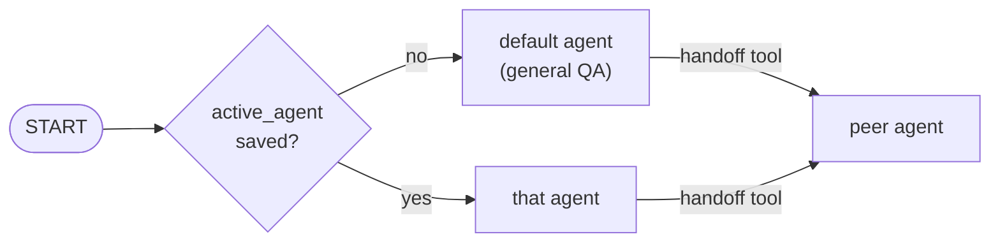

<!-- Generated by site/scripts/rag-theory-import.mjs from rag-agents-engineering. Edit the source there. -->
# Handoffs and swarms

<!-- subtitle: An agent passes the conversation on with a tool call, the graph remembers who holds it, and follow-ups skip routing altogether -->

## Handoffs

> **What you'll learn**
>
> - **Distinguish** a handoff from a router by who holds control after an agent finishes.
> - **Explain** the handoff tool: a tool call that returns a command for the parent graph.
> - **Trace** one Larkspur thread across turns with the active agent saved by a checkpointer.
> - **Compare** the calls a swarm and a supervisor spend as follow-ups pile up.

Lesson 4 of T11.1's supervisor decides every step and takes control back each time. On a thread where the customer keeps talking to billing, it still pays a routing call before and after every answer.

A Larkspur customer asks about an outage and credits, then follows up with *Which invoice will the credit be on?* That second message belongs to billing, and billing already has the context. A supervisor routes it again from scratch. A **handoff** lets the agent holding the conversation pass it on itself, and lets the next message go straight to whoever holds it now.

A router and a handoff both move a request between agents. They differ in who holds control afterwards:

| | Router or supervisor | Handoff |
|---|---|---|
| Who picks the next agent | the router, after every step | the agent holding the conversation, by calling a tool |
| Where control goes after an agent | back to the router, on a static edge | nowhere: the agent finishes the turn or hands off |
| The next user message starts at | the router | the active agent, read from `active_agent` in state |
| What stops a loop | the router's own cap | nothing built in; only `recursion_limit` |

*Table 1: Router against handoff.*

A structured-output classifier that sends each request to one specialist is still a router. A handoff needs three things: the agent itself chooses (a tool call), the parent graph moves control, and the choice is remembered.

### The handoff tool

A **handoff tool** is an ordinary tool that returns a `Command` instead of a string. It runs inside the calling agent's own graph, but the decision belongs to the parent graph that holds all the agents. The `Command` is addressed there. The handoff notebook calls one directly, with no model, for a customer charged twice. We ran that cell:

| Field | Value returned | What it does |
|---|---|---|
| `goto` | `billing` | names the parent node to run next |
| `graph` | `__parent__` (`Command.PARENT`) | applies the command in the closest parent graph, which ends the calling agent's run |
| `update.messages` | the conversation plus a `ToolMessage` | the `ToolMessage` answers call `call_demo` and carries the note "Customer was charged twice for this month's subscription." |
| `update.active_agent` | `billing` | who answers the next message on this thread |

*Table 2: The `Command` a hand-built handoff tool returns (the notebook's direct-call cell).*

`InjectedState` gives the tool the agent's messages and `InjectedToolCallId` gives it the id of the call it answers. The model fills in one argument only: `context`, a note for the next agent so the customer is not asked again. The parent's state is `MessagesState` plus `active_agent`. Its only routing of its own is at `START`: read `active_agent` and send the new message there, or to triage on a new thread.

### Following the active agent across turns

With a checkpointer, `active_agent` outlives the turn. Here is one Larkspur thread through triage and the specialists:

```animated
<figure class="anim sheet" aria-labelledby="anim-handoff-cap">
  <div class="anim__canvas" tabindex="0" aria-label="One thread with handoffs, scrolls sideways on a narrow screen">
    <svg viewBox="0 0 800 376" role="img" aria-labelledby="anim-handoff-title anim-handoff-desc">
      <title id="anim-handoff-title">One Larkspur thread with handoffs</title>
      <desc id="anim-handoff-desc">Turn 1 reaches triage, which hands off to operations, which hands off to billing. Turn 2 goes straight to billing, the active agent, and triage does not run. Turn 3 also starts at billing, which hands off sideways to operations.</desc>
      <defs>
        <marker id="ah-handoff" viewBox="0 0 8 8" refX="7" refY="4" markerWidth="8" markerHeight="8" markerUnits="userSpaceOnUse" orient="auto-start-reverse"><path class="ah" d="M0 0 L8 4 L0 8 z"/></marker>
      </defs>
      <g><rect class="box" x="25" y="20" width="130" height="44"/><text class="label" x="90" y="42">Customer</text></g>
      <g class="n-1"><rect class="box" x="225" y="20" width="130" height="44"/><text class="label" x="290" y="42">Triage</text></g>
      <g class="n-2 n-6"><rect class="box" x="425" y="20" width="130" height="44"/><text class="label" x="490" y="42">Operations</text></g>
      <g class="n-3 n-4 n-5"><rect class="box" x="625" y="20" width="130" height="44"/><text class="label" x="690" y="42">Billing</text></g>
      <path class="edge dashed" d="M90 64 V364 M290 64 V364 M490 64 V364 M690 64 V364"/>
      <g class="in-1">
        <path class="edge e-1" d="M90 104 H286" marker-end="url(#ah-handoff)"/>
        <text class="small" x="190" y="90">Turn 1: credits?</text>
      </g>
      <g class="in-2">
        <path class="edge e-2" d="M290 144 H486" marker-end="url(#ah-handoff)"/>
        <text class="fig" x="390" y="130">to operations</text>
      </g>
      <g class="in-3">
        <path class="edge e-3" d="M490 184 H686" marker-end="url(#ah-handoff)"/>
        <text class="fig" x="590" y="170">to billing</text>
      </g>
      <g class="in-4">
        <path class="edge e-4" d="M90 244 H686" marker-end="url(#ah-handoff)"/>
        <text class="small" x="190" y="230">Turn 2: which invoice?</text>
      </g>
      <g class="in-5">
        <path class="edge e-5" d="M90 300 H686" marker-end="url(#ah-handoff)"/>
        <text class="small" x="190" y="286">Turn 3: root cause?</text>
      </g>
      <g class="in-6">
        <path class="edge e-6" d="M690 340 H494" marker-end="url(#ah-handoff)"/>
        <text class="fig" x="590" y="326">to operations</text>
      </g>

      <circle class="tok" cx="0" cy="0" r="7"/>
    </svg>
  </div>
  <div class="anim__controls" hidden>
    <button class="anim__btn" type="button" data-act="prev">Previous</button>
    <button class="anim__btn" type="button" data-act="play" aria-pressed="false">Play</button>
    <button class="anim__btn" type="button" data-act="next">Next</button>
  </div>
  <ol class="anim__steps" id="anim-handoff-cap">
    <li><button type="button" data-tok="290,20">Turn 1</button><span>A new thread has no active agent, so “My server went down last night. Do I get service credits?” goes to triage. The marker shows who holds the conversation.</span></li>
    <li><button type="button" data-tok="490,20">Handoff</button><span>Triage calls <code>transfer_to_operations</code>. The tool’s <code>Command</code> runs operations next and sets <code>active_agent</code>.</span></li>
    <li><button type="button" data-tok="690,20">Handoff</button><span>Operations answers the outage part and calls <code>transfer_to_billing</code>. Billing answers the credits part and keeps the conversation.</span></li>
    <li><button type="button" data-tok="690,20">Turn 2</button><span>“Which invoice will the credit be on?” goes straight to billing, read from the saved thread. Triage does not run.</span></li>
    <li><button type="button" data-tok="690,20">Turn 3</button><span>“When is the root-cause report out?” also starts at billing, which has no incident section.</span></li>
    <li><button type="button" data-tok="490,20">Sideways</button><span>Billing hands off to operations, which answers. No coordinator was involved, and <code>active_agent</code> is now operations.</span></li>
  </ol>
</figure>
```

*Figure 1: One thread, three turns. Each handoff is one tool call that rewrites `active_agent`.*

Turn 2 is the point of the checkpointer: triage does not run, because `START` read `active_agent = billing` from the saved thread. Turn 3 moves sideways, billing to operations, with no coordinator involved. Billing has no incident section and has to recognise that and hand off.

The notebook proves the mechanism with a **scripted model**, LangChain's `GenericFakeChatModel` replaying fixed replies, tool calls included. We ran it:

| Turn | Customer | Agents that acted | `active_agent` after |
|---|---|---|---|
| 1 | "I was charged twice." | triage, then billing (via `transfer_to_billing`) | billing |
| 2 | "Will I get a confirmation?" | billing only | billing |

*Table 3: Two turns on one thread with a scripted model and no API call.*

### Planted failure: the handoff ping-pong

Nothing in this graph forces a stop. If agents keep deciding someone else should answer, they pass the request around until `recursion_limit` raises `GraphRecursionError`. Each agent run is one super-step of the parent graph. The notebook scripts that **handoff ping-pong** (triage to support to billing to triage, forever) and caps it:

| Setting | Result |
|---|---|
| `recursion_limit = 10` (the demo cap) | 10 handoffs, then `GraphRecursionError` |
| `recursion_limit = 25` (every real run in the notebook) | would end the same way, after 25 super-steps |
| No limit passed | LangGraph's default of 10,007 super-steps, each one a model call in a live run |

*Table 4: The scripted handoff loop under each limit.*

The fix for a real ping-pong is ownership: one agent's prompt and tool descriptions must claim the topic. The limit only makes the failure fast and visible.

## Swarm

A **swarm** is the same mechanism packaged by the `langgraph-swarm` library. `create_handoff_tool` builds the tool, and `create_swarm` builds the parent graph with one node per agent and the `START` router. `SwarmState` is `MessagesState` plus `active_agent`, and `default_active_agent` names the agent a new thread starts at. Compile with a checkpointer and the swarm remembers, per `thread_id`, which agent holds each conversation.



*Figure 2: The swarm's only routing of its own. Every other move is a handoff tool call.*

The swarm notebook builds three agents for a music store: a general QA agent that does RAG over company documents, an NL2SQL agent over the Chinook catalogue, and an invoice agent. Each gets its own tools plus handoff tools to the other two. Two details carry over to any swarm.

**The library tool carries no note.** It takes no arguments. Called directly, it returns the same `goto`, `graph` and update keys as the hand-built tool, and its `ToolMessage` says only "Successfully transferred to billing". Whatever the next agent needs must already be in the conversation. The hand-built tool's `context` argument exists to fix that.

**Tools that run model-written queries must be safe whatever the model writes.** The NL2SQL connection reads only, three times over:

| Planted query | Result | Guard that refuses it |
|---|---|---|
| `DELETE FROM Invoice` | not authorised | `PRAGMA query_only = ON` and the authorizer |
| `ATTACH DATABASE ...` | not authorised | the authorizer (read-only flags alone allow `ATTACH`) |
| `PRAGMA query_only = OFF` | not authorised | the authorizer |

*Table 5: Writes and escapes sent through the query tool. The notebook checks all three on Chinook, and we reproduced the same authorizer on an in-memory database.*

The file itself is opened read-only too. The invoice tools go further: they run fixed queries with the customer ID bound as a parameter, never pasted into the SQL.

### What a swarm saves

A swarm spends routing once per thread. On the outage request, triage hands off to operations, operations answers its part and hands off to billing: 3 model calls, one of them routing, against 5 for a supervisor. After that, each follow-up goes straight to the active agent for 1 call. The [routing cost lab](/labs/rag/m35_multi_agent_architectures/routing-cost-lab.html) runs the same three Larkspur requests through all four architectures, with the follow-up turns on a slider.

```lab
src: /labs/rag/m35_multi_agent_architectures/routing-cost-lab.html
title: Who routes, and what it costs
```

The lab's totals for the outage request as follow-ups pile up:

| Architecture | Request only | Plus 1 follow-up | Plus 3 follow-ups | Reaches billing |
|---|---|---|---|---|
| Router ([T9.3](/learn/agentic-and-self-correcting-rag/adaptive-rag-and-query-routing/adaptive-rag-and-query-routing-overview)) | 2 | 4 | 8 | ✗ |
| Supervisor | 5 | 8 | 14 | ✓ |
| Hierarchy | 7 | 12 | 22 | ✓ |
| Swarm | 3 | 4 | 6 | ✓ |

*Table 6: Model calls on the outage thread, from the routing cost lab. Each follow-up stays with billing.*

The swarm's saving rests on the conversation staying with one specialist. When a follow-up changes topic, the active agent has to recognise that and hand off, and routing quality now lives in every agent's prompt instead of one supervisor's. Choose the swarm when threads stay on one specialist's topic, and the supervisor when you need one decision log.

## Run the notebooks

The code for this lesson is in these notebooks. Colab runs one in your browser: install the packages its first cell imports and set the API keys it reads. To run every notebook as written, clone the repository and use its uv environment.

| Notebook | GitHub | Colab |
|---|---|---|
| Agent handoffs | [Open on GitHub](https://github.com/Sourav692/rag-agents-engineering/blob/main/p10_multi_agent_systems/m35_multi_agent_architectures/mandatory/notebook/05a_agent_handoffs.ipynb) | [Open in Colab](https://colab.research.google.com/github/Sourav692/rag-agents-engineering/blob/main/p10_multi_agent_systems/m35_multi_agent_architectures/mandatory/notebook/05a_agent_handoffs.ipynb) |
| Multi agent swarm | [Open on GitHub](https://github.com/Sourav692/rag-agents-engineering/blob/main/p10_multi_agent_systems/m35_multi_agent_architectures/mandatory/notebook/05b_multi_agent_swarm.ipynb) | [Open in Colab](https://colab.research.google.com/github/Sourav692/rag-agents-engineering/blob/main/p10_multi_agent_systems/m35_multi_agent_architectures/mandatory/notebook/05b_multi_agent_swarm.ipynb) |

## Key Takeaways

- A handoff tool returns `Command(goto=..., graph=Command.PARENT)` and sets `active_agent`. With a checkpointer, the next user message goes straight to the agent holding the conversation, with no router in between.
- Nothing in a swarm forces a stop, so agents can bounce a request until `recursion_limit` raises. Pass a note with each handoff, because the library tool carries none.
- A swarm spends routing once per thread: 6 calls for the outage request and 3 follow-ups, against 14 for a supervisor. The saving holds only while follow-ups stay on one specialist's topic.

## Check yourself

<details>
<summary>1. A structured-output classifier sends each Larkspur request to one specialist. Is that a handoff, and what would make it one?</summary>

No, it is still a router. A handoff needs the agent holding the conversation to choose the next agent by calling a tool, and the graph to remember the choice in `active_agent`. The handoff tool returns a `Command` with `graph=Command.PARENT`, so the parent graph runs the named agent next.

</details>

<details>
<summary>2. In the routing cost lab, how many model calls do the swarm, the supervisor and the hierarchy spend on the outage request plus 3 follow-ups?</summary>

6 for the swarm, 14 for the supervisor and 22 for the hierarchy. The swarm spends 3 calls on the first request and 1 per follow-up, because each follow-up goes straight to the active agent. The supervisor pays 3 per follow-up and the hierarchy 5.

</details>

<details>
<summary>3. In a langgraph-swarm build, the billing agent asks the customer again for details they already gave triage. Why?</summary>

The library's handoff tool takes no arguments and its `ToolMessage` says only "Successfully transferred", so it carries no note. Whatever the next agent needs must already be in the conversation. The hand-built tool's `context` argument exists to fix that.

</details>
