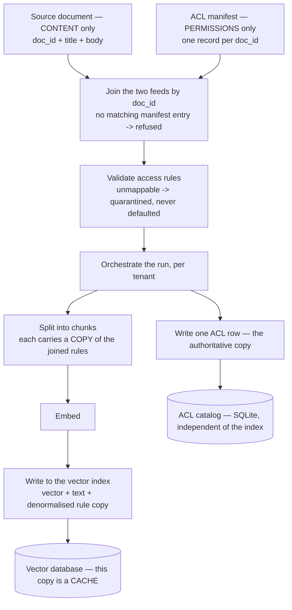

# Permission-Aware Ingestion

*Defaulting an unclassified document to "internal" keeps the pipeline moving, and it is exactly how a latent leak gets indexed.*

◷ 8 min

Ingestion is the offline half of RAG, and it is where enterprise RAG leaks are born. Refuse what cannot be classified, and keep permissions and content in separate stores, because they change for different reasons.

**Objectives:**

- trace a document from two separate feeds to a vector index and an access catalog;
- explain why the catalog, not the index, is the authority for access;
- describe incremental sync and the two real reset bugs it exposed.

---

## Feed Content and Permissions Separately

A document indexed with the wrong permissions will be found by the wrong person, however good the query-time checks are. So the pipeline treats content and permissions as **two separate feeds**.

Markdown files hold only document text and identity: a `doc_id` and a `title`. A separate ACL manifest holds every access field for each `doc_id`: `source`, `sensitivity`, `allowed_groups`, `region`, `need_to_know`, `valid_from` and `valid_until`, `contains_pii` and `owner`. The manifest stands in for whatever owns entitlements in production, such as an admin console, an HR system or a permissions export. Because the corpus files hold no access fields, a content edit can never touch a permission.

## Refuse What Cannot Be Classified

The join is the connector's real job: translating each source's permission model into the platform's own. A content file with no manifest record is **refused**, because unmatched means unclassifiable.

Validation then checks for a known sensitivity, a non-empty `allowed_groups`, a known region and consistent use of `public`. Anything that fails is **quarantined, not defaulted to `internal`**. A guessed permission is still a permission, and the query-time checks will enforce it faithfully. Every rejection is persisted as a real dead-letter queue. Every source with at least one accepted document has its last-sync timestamp bumped.

## Chunk, Embed, and Write Twice

Orchestration runs per tenant, so one tenant's ingest cannot touch another's data. Each validated document then takes two independent paths.

On the first path, chunking is structure-aware. It splits on headings, packs chunks to a target size with overlap, and prefixes each with the title and section. The title prefix measurably improves both dense and lexical retrieval. Each chunk inherits its parent's rules. Embedding is batched through an in-process `(model, text)` cache, so only genuinely new text is billed. The writer then upserts ids, vectors, text and a flattened copy of the rules into the tenant's collection. Chroma metadata must be scalar, so `allowed_groups` becomes `grp__<group>: True` columns.

On the second path, one row per document goes into a SQLite **ACL catalog**. No vectors are involved.

## Keep the Catalog Authoritative

The index's rule copy and the catalog mirror Layer 1 and Layer 2 from [Pushing Policy Into the Index](/learn/production-ai/enterprise-rag-in-production/pushing-policy-into-the-index). They change for different reasons, on different schedules, and are owned by different people. A typo fix should never touch an access rule. Revoking a group should never touch document text or force a re-embed.

With two stores, an ACL change is a manifest edit and one SQLite write. `scripts/demo_acl_catalog_update.py` shows the next `enforce()` seeing it immediately, with no Chroma write. Without a separate catalog, Layer 2 would re-read the same cached copy Layer 1 used. Running a policy twice against the same stale data is not a second opinion.

## Give the Catalog a Schema That Outlives One Demo

The Handbook's catalog is one SQLite row per document. The GenAI engineering notes show the shape the same idea takes in a production relational database. Three tables cover a document's whole life.

The **documents** table holds the tenant, source, type, a file hash to catch duplicate uploads, a status (ingesting, indexed, failed, superseded), a version, timestamps, and flexible metadata. The **document_chunks** table holds each chunk's text, token count, the embedding model and version that produced its vector, and the id of that vector in the vector store. The **document_permissions** table records which users, roles, or teams may read, write, or administer each document.

The split pays off three ways. A changed document invalidates all its chunks at once. A duplicate upload is caught by its hash. A model upgrade shows exactly which chunks need re-embedding.

The two stores then cooperate at query time. The relational side holds what a compliance review asks about: ownership, permissions, department, classification, version, and audit logs. The vector side holds embeddings, chunk ids, and minimal metadata for search. The query asks the relational database for the documents this user may read, runs vector search restricted to them, enriches the results from the relational side, and logs the retrieval.

## Prove It Is a Pipeline, Not a Script

Three additions showed the path is general.

A **second connector**, `load_ticket_export()`, parses a Zendesk-shaped JSON array with `subject` and `description` instead of a body. It joins against its own manifest and feeds the same `pipeline.ingest(loader=...)` path into its own tenant, with the same refuse-on-no-match rule. Validate, chunk, embed and index do not care about format.

**Incremental sync**, `ingest(incremental=True)`, hashes each document's text only with SHA-256. Unchanged documents skip chunking and embedding. The hash deliberately excludes access attributes, because the catalog is refreshed unconditionally anyway.

**Freshness and a dead-letter queue** live in `freshness.py`. It records per-source `last_synced_at` and every rejected document with its reason, queryable after the process exits.

> **Warning: resets and hashes must be scoped.** An unscoped reset cross-contaminated tenants. Ingesting the new `acme_helpdesk` tenant with `reset=True` wiped the unrelated `meridian` corpus, because the reset deleted the whole Chroma directory and the whole SQLite file. The fix scoped both resets by `tenant_id`. Separately, `reset=True` with `incremental=True` skipped re-embedding 21 of 22 documents into a freshly emptied index, because their old hashes still matched. The result was a near-empty index reporting success. Incremental skipping now applies only when `reset=False`.

A third, smaller bug: adding a catalog column needed a real schema migration with `PRAGMA table_info` and `ALTER TABLE`. `CREATE TABLE IF NOT EXISTS` does not add columns to a table that already exists.

## Worked Example: Two Kinds of Revocation

First, the owner of a runbook decides `support-tier3` should no longer read it. Nothing about the text changes. The entitlement owner edits that document's `allowed_groups` in the manifest, and one SQLite row changes. No chunk is re-embedded and Chroma is not written. On the next query, Layer 2 reads the catalog fresh and denies Tier-3 readers. If the stale index copy lets the chunk through Layer 1, Layer 2 denies it and logs the disagreement.

Second, an engineer leaves the `support-tier3` group in the directory. No store changes at all. The principal is resolved fresh on the next request, so the engineer's groups no longer intersect the runbook's grant.

Each revocation cost at most one row write, never a re-index. That is the payoff of keeping permissions in their own store and identity out of every store.

## Know What Is Not Built

Ingestion is batch, not streaming change-data capture, but it is no longer full-refresh only. Two connectors exist, not real Confluence, Zendesk or SharePoint integrations. Identity is a JSON file, not live OIDC or SCIM. Scaling ingestion to twenty million documents is covered under scaling and reliability.

---

## Key Takeaways

- Content and permissions arrive as two feeds joined by `doc_id`, so a content edit can never change a permission.
- A document with no manifest record is refused, and one with unmappable permissions is quarantined, never defaulted.
- Each document is chunked and embedded into the tenant's collection, and separately written as one row in the access catalog.
- The catalog is authoritative and the index copy is a cache, so a revocation is one row write and Layer 2 is a genuine second opinion.
- In production the catalog becomes documents, chunks, and permissions tables, and queries resolve allowed documents relationally before searching vectors.
- Incremental sync hashes text only, and both resets and hash skips must be scoped to avoid wiping or emptying an index silently.

## Check Yourself

1. **Why is defaulting an unmappable document to `internal` dangerous?**
   The query-time checks enforce whatever permissions were indexed. A guessed permission becomes a real one, so a sensitive document is served to everyone with internal clearance.

2. **Why does the content hash exclude access attributes?**
   An access-only change never needs re-embedding, and the catalog is refreshed unconditionally, so the hash only needs to detect text changes.

3. **What makes the catalog a genuine second opinion?**
   It is a separate store, updated independently of the index and read fresh on every request. Re-reading the index's own cached copy would just repeat the same possibly stale data.

