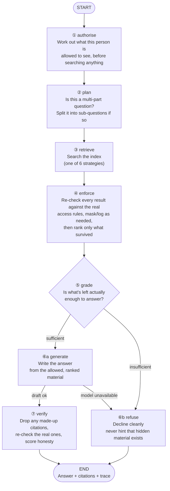

# The Security-First Query Graph

*A pipeline that relies on developers remembering the order of checks is fragile, so the order is encoded in the graph's edges at the price of a stricter structure.*

The per-request pipeline is not a chain of helper calls but a state machine whose edges enforce security. Draw its nodes from memory, then learn how each failure degrades rather than crashes.

**Objectives:**

- draw the query graph and say what each node does;
- explain why access enforcement runs before reranking and why the response-cache key includes surviving chunk ids;
- recite the degradation table, including the one failure that fails closed.

---

## Encode the Order in the Edges

Everything from the earlier lessons assembles into one per-request pipeline: a LangGraph state machine. Its defining property comes from the node module's docstring: *"`authorize` runs first, `enforce` runs before anything reaches the model — that ordering is encoded in the graph edges, not left to a convention someone can forget."* A convention can be forgotten; an edge cannot be skipped.

## Know What Each Node Guarantees

| # | Node | What it does | The detail that matters |
|---|---|---|---|
| ① | **authorise** | Compiles the principal's policy into a Chroma `where` clause (Layer 1), then ANDs on any optional caller filter such as source, type or recency | `merge_filters` is safe by construction: `$and` can only narrow a result set, so a caller's filter can never see past the access clause |
| ② | **plan** | A cheap regex for "and", "also" or ";" decides whether the question looks multi-hop; only then, and only under the `enterprise` strategy, does an LLM decompose it | Saves a model call on the common single-hop path |
| ③ | **retrieve** | Runs the selected strategy; every store call carries the compiled filter | If expansion fails with `LLMUnavailable`, it falls back to `dense` and marks the run `degraded` |
| ④ | **enforce** | Re-runs the full policy on every candidate against the fresh catalog (Layer 2), applies redaction and audit obligations, **then** reranks survivors to `rerank_k` | Denied chunks are dropped and logged and never reach the reranker; disagreements with Layer 1 become security events |
| ⑤ | **grade** | Insufficient at once if there is no context or the best rerank score is below threshold; otherwise an LLM judges `sufficient`, `partial` or `insufficient` | `partial` proceeds with a coverage note; on grader failure, it trusts the reranker score |
| ⑥a | **generate** | Checks spend against a cost ceiling, checks a response cache, otherwise writes the answer with inline citations | The cache key is described below |
| ⑥b | **refuse** | The clean no-answer path with a role-appropriate next step | **Never reveals that a withheld document exists** |
| ⑦ | **verify** | Drops cited ids that were not in context or fail a live policy re-check, strips their markers, scores groundedness | A citation is a disclosure, so it gets its own catalog lookup |

[Output Guardrails and Refusals](/learn/production-ai/enterprise-rag-in-production/output-guardrails-and-refusals) covers nodes ⑤ to ⑦ in depth.

## Enforce Before Reranking

Retrieval hands back 20 to 50 unchecked, unranked chunks. Enforcement runs first, obligations next, and the reranker scores only the survivors from 0 to 10. The top `rerank_k`, which is 6, is what the model sees.

The order matters because a reranker cannot rank fairly among chunks the user will never see. If forbidden chunks reached it, the "best" answer could be shaped by hidden content. Top-k slots would also be spent scoring material that is about to be thrown away.

The graph has four security checkpoints. The tenant collection is the physical wall. `authorize` is Layer 1, built from the cached rule copy. `enforce` is Layer 2, reading the catalog fresh. `verify` makes one last fresh catalog check on anything cited by name. No model is an enforcement point anywhere in that list.

## Key the Cache on What Was Enforced

The response-cache key combines the question, the compiled filter, the **exact chunk ids that survived enforcement** this request, and the coverage note. A hit is served only for a genuinely identical, freshly enforced situation.

That is worth volunteering in an interview. A revoked document changes which chunks survive, so it changes the key. A stale cache entry is therefore structurally unreachable, not merely avoided by convention.

## Enter Through One Method

`RAGPlatform.ask(question, principal, strategy="enterprise", as_of=None, filters=None, history=None)` is the single public method. It checks a **per-tenant rate limit** first, using a fixed-window counter. A denied request returns a refusal before an LLM client even exists, so it costs nothing; the trace shows `cost_usd == 0.0`. Otherwise it builds a fresh LLM client, usage tracker and trace, seeds the state, runs the graph and returns `{"answer", "trace", "state"}`.

The state is one `TypedDict`, `RAGState`, that flows through every node. It holds the request, infrastructure handles, authorisation output, plan, retrieval and enforcement results and the generation outcome. Any node can be tested alone, and the trace can be rebuilt from state.

## Degrade Everywhere Except Authorisation

The graph turns a provider outage into a degraded answer or a clean refusal, never an exception.

| Fails | Behaviour |
|---|---|
| Query expansion call | Retrieve falls back to `dense`; run marked degraded |
| Reranker | Fusion order used; `rerank_score=None` |
| Grader | Trusts the reranker score and proceeds |
| Synthesis | Routes to `refuse`, marked degraded |
| Run cost already over the ceiling | Routes to `refuse`: halt and escalate rather than spend more |
| Provider down repeatedly | The client's **circuit breaker** trips after 3 consecutive outage exhaustions, short-circuits every call for 30 s with zero network attempts, then allows a half-open trial |
| **Policy engine unavailable** | **Fail closed. Refuse.** Never fail open on authorisation |

The client retries a 5xx with backoff and jitter, and those count toward the breaker. A 4xx is a bug in the request, not an outage, so it raises at once and never trips the breaker. That is the transient-versus-permanent distinction applied to the model provider.

> **Warning: the last row is the one that matters.** Every other failure trades quality for availability. An unavailable policy engine must not, because answering without a decision means answering without access control. Say that row slowly in an interview.

## Version Every Prompt

`graph/prompts.py` holds every template as a named constant, and `PROMPT_VERSION` is stamped on every trace. The synthesis prompt enforces citation format, no guessing, partial-answer behaviour and a conflict rule. When two passages disagree on a fact, it prefers higher `authority`, then the more recent update, and names the conflict.

Live testing found an honest gap. The model reliably *picks* the right value. It reliably *names* the conflict only when the question hints that one exists. The project records that gap rather than hiding it.

## Worked Example: One Question Through the Graph

Marco, the EU Tier-3 engineer, runs `python scripts/ask.py --user u_marco_t3 "Why did EU ingest degrade on 14 March?"`.

The rate limit passes. `authorize` compiles his tenant, clearance, region, external flag and groups into a filter. `plan` sees no "and" and skips decomposition. `retrieve` searches only Meridian's collection with that filter. `enforce` re-reads the catalog, keeps the EU post-mortem `PM-2026-03-14`, attaches `audit_access`, and reranks the survivors. `grade` finds them sufficient. `generate` misses the cache and writes a cited answer. `verify` re-checks each cited id against the catalog and scores groundedness.

At no step could a forbidden chunk reach the model, because every step that touches text runs after `enforce`. That is what "security-first" means for a graph.

---

## Key Takeaways

- The graph encodes `authorize` first and `enforce` before the model in its edges, so the order cannot be forgotten.
- Each node has one guarantee, from a caller filter that can only narrow to a verify step that treats citations as disclosures.
- Enforcement runs before reranking, so ranking only ever considers what the user may read.
- The response-cache key includes the chunk ids that survived enforcement, so a revocation makes stale entries unreachable.
- A single entry point rate-limits per tenant before spending anything and carries one state object through the graph.
- Every failure degrades to a weaker answer or a refusal, except the policy engine, which fails closed.
- Prompts are versioned constants stamped on every trace, and known gaps are recorded rather than hidden.

## Check Yourself

1. Why is <code>merge_filters</code> safe by construction?

It joins the caller's filter to the access clause with `$and`, which can only narrow results. No caller filter can widen what the access clause allows.

2. Which failure fails closed, and why is it different from the others?

An unavailable policy engine refuses the request. Every other failure trades quality for availability, but answering without an access decision would mean answering without access control.

3. How does the client treat a 4xx differently from a 5xx?

A 5xx is transient: retry with backoff and jitter, and count it toward the circuit breaker. A 4xx is a request bug: raise immediately and never trip the breaker.

