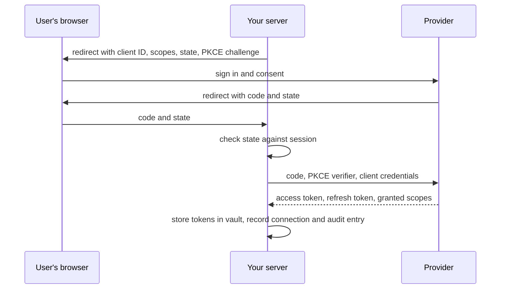

# Connecting a Customer's Account with OAuth

*A "Connect your account" button takes an afternoon to build, but the credential it creates lives for months and has to be checked, refreshed, revoked and cleaned up for all of them.*

When a customer connects a system such as a document store or a CRM to your platform, your platform receives a credential that acts inside their estate. This lesson follows that credential from the consent screen to the day it is destroyed. It covers the authorisation-code flow, checking scopes against what was granted, and the lifecycle that ends in a clean disconnect.

---

## Start With the Disconnect That Did Not Disconnect

Holbeck Legal, a fictional law firm, piloted an assistant that answers questions over its matter files. A partner clicked "Connect your document store", signed in, approved the consent screen and the platform began a nightly sync.

After six weeks, Holbeck ended the pilot. An administrator clicked "Disconnect". The platform deleted the connection row from its own database and showed a green tick. It did not revoke the refresh token at the provider, and it did not delete the token from the secrets vault. The nightly sync job looked up credentials by tenant path in the vault, not by connection row, so it kept running.

Three weeks later, Holbeck's IT team saw the platform's client still reading matter files in their access log and opened a security incident. Nothing had leaked outside the platform, but the firm could not be told that with confidence for a week.

Call this **the disconnect that did not disconnect**: a connection removed from the screen while its credential stayed alive.

> **What you'll learn**
>
> - How the authorisation-code flow works, and which checks stop a stolen or swapped code.
> - Why you check the scopes the customer granted, not the scopes you requested.
> - The five stages of a connected credential: issue, refresh, revoke, disconnect cleanup and audit.
> - What a disconnect must do before it reports success.

## Walk the Authorisation-Code Flow

OAuth 2.0 lets a user grant your application limited access to their account at another service without giving you their password. For a person connecting their own account, the standard choice is the **authorisation-code flow**. The browser carries a short-lived code. Your server exchanges that code for tokens over a direct back-channel, so the tokens never pass through the browser.

Two additions protect the code while it travels.

- **State.** A random value your server creates, ties to the user's session and sends with the request. When the browser returns, the server rejects any response whose state does not match. That stops an attacker from completing a connection in your user's session.
- **Proof Key for Code Exchange (PKCE).** Your server creates a secret verifier, sends only its hash with the request, then sends the verifier itself when exchanging the code. A code stolen in transit is useless without the verifier. Current OAuth security guidance recommends PKCE for every client, including server-side ones.

The provider also checks that the redirect address matches one you registered exactly. A loose match, such as any path on your domain, lets a code be sent somewhere you do not control.

The walkthrough shows Holbeck's connection one step at a time.

A Holbeck partner clicks "Connect your document store". Each step shows what happens and what your server checks.

<button type="button" data-step="0" aria-pressed="false" aria-controls="oauth-step-0">1. Request</button><button type="button" data-step="1" aria-pressed="false" aria-controls="oauth-step-1">2. Consent</button><button type="button" data-step="2" aria-pressed="false" aria-controls="oauth-step-2">3. Return</button><button type="button" data-step="3" aria-pressed="false" aria-controls="oauth-step-3">4. Exchange</button><button type="button" data-step="4" aria-pressed="false" aria-controls="oauth-step-4">5. Record</button>

<section id="oauth-step-0" class="step-panel" aria-labelledby="oauth-heading-0"><h4 id="oauth-heading-0">1. Build the request</h4><dl><dt>What happens</dt><dd>Your server sends the browser to the provider with the client ID, the registered redirect address, the scopes, a state value and a PKCE challenge.</dd><dt>Your check</dt><dd>Store the state and verifier against this user's session and this tenant.</dd></dl></section><section id="oauth-step-1" class="step-panel" aria-labelledby="oauth-heading-1"><h4 id="oauth-heading-1">2. The user consents</h4><dl><dt>What happens</dt><dd>The partner signs in at the provider and approves the listed permissions. An administrator may have to approve them first.</dd><dt>Your check</dt><dd>None yet. Your server sees nothing until the browser returns.</dd></dl></section><section id="oauth-step-2" class="step-panel" aria-labelledby="oauth-heading-2"><h4 id="oauth-heading-2">3. The browser returns</h4><dl><dt>What happens</dt><dd>The provider redirects to your address with a short-lived code and the state.</dd><dt>Your check</dt><dd>Reject the response unless the state matches the one stored for this session.</dd></dl></section><section id="oauth-step-3" class="step-panel" aria-labelledby="oauth-heading-3"><h4 id="oauth-heading-3">4. Exchange the code</h4><dl><dt>What happens</dt><dd>Your server sends the code, the PKCE verifier and its own client credentials to the provider's token endpoint, server to server.</dd><dt>Your check</dt><dd>Read the granted scopes in the response. They may be fewer than you asked for.</dd></dl></section><section id="oauth-step-4" class="step-panel" aria-labelledby="oauth-heading-4"><h4 id="oauth-heading-4">5. Record the connection</h4><dl><dt>What happens</dt><dd>Store the tokens in the vault and a connection row holding the vault reference, tenant, connecting user, granted scopes and time.</dd><dt>Your check</dt><dd>Write an audit entry. Every later job reads credentials through this row.</dd></dl></section>

<button type="button" data-walk="previous">Previous</button>

<button type="button" data-walk="next">Next step</button>

The walkthrough is an illustration of one provider. Providers differ in scope names and consent screens, but the checks are the same.

*Figure 1: The authorisation-code flow with state and PKCE. The tokens travel only between your server and the provider.*

## Check Scopes Against the Grant

A **scope** limits what a token may do. Request the fewest scopes the feature needs. The [authenticating as whom](/learn/enterprise-integration/connecting-enterprise-systems/authenticating-as-whom) lesson covers choosing scopes and choosing between a user's identity and a service account. This section covers the step teams skip: checking what was granted.

The user or an administrator can grant fewer scopes than you requested. Some consent screens let the user untick a permission. Some organisations block certain scopes by policy. The OAuth specification requires the token response to list the granted scopes whenever they differ from the request. If your code assumes the request was granted in full, the first sign of a narrower grant is a permission error deep inside a sync job.

- **Store the granted scopes** on the connection row, from the token response.
- **Check before you call.** Each feature declares the scopes it needs. Before calling, compare them with the stored grant. A missing scope disables that feature with a clear message, such as "Writing comments needs the comments permission. Ask your administrator to reconnect."
- **Treat a scope error from the provider as a grant change.** Re-read the grant, update the row and stop retrying that call.

The trade-off is between asking once and asking later. Requesting every scope up front means one consent screen, but a wider grant than most users need and a higher chance an administrator refuses it. Asking for extra scopes only when a user first uses a feature keeps each grant small, at the cost of a second consent screen in the middle of their work.

## Run the Credential Lifecycle

A connected credential is not set once. It moves through five stages, and each stage has an owner in your code.

| Stage | What happens | What your platform must do |
| --- | --- | --- |
| Issue | The code exchange returns tokens | Store them in the vault, never in the connection row. Record tenant, user, scopes and time. |
| Refresh | The access token expires, often within an hour | Refresh from one place per connection. A rejected refresh marks the connection broken and tells the user. |
| Revoke | The user, the customer's administrator or your platform ends the grant | Call the provider's revocation endpoint. Expect the provider to revoke from its side too. |
| Disconnect cleanup | The connection is removed | Revoke, delete the vault secret, stop jobs, apply the data rule, then report success. |
| Audit | Every stage above | Write who did what, to which connection, when and with what result. |

*Table 1: The five stages of a connected credential.*

Two links cover what this table assumes. The [secrets and per-tenant encryption keys](/learn/production-ai/security-tenancy-prompt-injection/secrets-and-per-tenant-encryption-keys) lesson explains holding a vault reference instead of the token and encrypting each tenant's secrets under its own key. The authenticating as whom lesson explains why two workers refreshing one connection can lock a user out when the provider rotates refresh tokens.

Revocation can also start at the provider. An administrator can remove your application, or the user's account can be disabled. Your platform learns of it when a refresh fails with an invalid-grant error. Treat that as a disconnect started elsewhere and run the same cleanup.

## Make Disconnect Mean Disconnected

Holbeck's disconnect failed because it removed a record and called that done. A disconnect has five jobs, in this order.

1. **Revoke at the provider.** Call the revocation endpoint with the refresh token. Revoking the refresh token usually invalidates its access tokens too, but check your provider's documentation.
2. **Delete the secret.** Remove the tokens from the vault, by the reference on the connection row.
3. **Stop the work.** Cancel scheduled syncs and drain queued jobs for this connection. Jobs must look up credentials through the connection row, so a deleted row means no credential.
4. **Apply the data rule.** Delete or keep data synced from the account, as the contract says. Tell the customer which.
5. **Audit and confirm.** Record each step's result, then show success. If revocation failed, say so and retry, rather than showing a green tick.

The trade-off is speed against certainty. A disconnect that waits for five steps is slower to confirm, and a provider outage can leave it pending. A pending disconnect that says so is better than a finished one that is not true.

## Limits of This Lesson

- **Providers differ.** Scope names, token lifetimes, refresh-token rotation and revocation behaviour vary. Read each provider's documentation.
- **Service accounts follow a different path.** The client-credentials flow has no user, no consent screen and no refresh token.
- **Fictional data.** Holbeck Legal and its systems are illustrative.

## Interview Angle

Each answer is an outline to say in about two minutes. Open the question and try it aloud before reading.

Interview question 1. Walk me through how your platform connects a customer's document store with OAuth, and what you check.

- **Answer:** Authorisation-code flow with state and PKCE. The server sends the browser to the provider with the client ID, an exactly registered redirect address, the smallest scopes, a state value tied to the session and a PKCE challenge. The user consents. On return, reject a mismatched state. Exchange the code server to server with the verifier and client credentials. Read the granted scopes, store the tokens in the vault and a connection row with the vault reference, tenant, user and scopes, and write an audit entry.
- **Trade-off:** PKCE and state add two stored values per attempt. They close code theft and session swapping for almost no cost.
- **Follow-up to expect:** "Why not the implicit flow?" It returns tokens in the browser, where they can leak. Current guidance drops it.

Interview question 2. You requested read and write scopes. Some customers' tokens fail on writes. Why, and what do you change?

- **Answer:** The grant was narrower than the request. A user unticked a permission or the customer's policy blocks write scopes. Read the granted scopes from the token response, store them on the connection and check each feature's needs before calling. Disable the write feature for those connections with a message naming the missing permission and who can grant it, instead of failing inside a job.
- **Trade-off:** Feature-by-feature checks add code. Without them, a narrow grant looks like a random bug.
- **Follow-up to expect:** "Should you ask for everything up front?" Only if most users need it. Otherwise ask when the feature is first used.

Interview question 3. A customer disconnects your app, and weeks later their logs show your client still reading data. What went wrong, and what should disconnect do?

- **Answer:** The disconnect removed a record but left the credential alive, and a job read credentials without going through the connection. Disconnect must revoke at the provider, delete the vault secret, stop scheduled and queued work, apply the contract's data rule, audit each step and report success only when they are done. Jobs must read credentials through the connection row. Also handle an invalid-grant refresh as a disconnect started at the provider.
- **Trade-off:** A careful disconnect can sit pending during a provider outage. That is honest, and a false success is a security incident.
- **Follow-up to expect:** "How do you prove it to the customer?" Show the audit entries and the provider's revocation response.

## References

1. Internet Engineering Task Force, [RFC 6749: The OAuth 2.0 Authorization Framework](https://datatracker.ietf.org/doc/html/rfc6749), accessed 18 November 2026. The authorisation-code grant, the state parameter and the rule that a token response lists the scopes when they differ from the request.
2. Internet Engineering Task Force, [RFC 7636: Proof Key for Code Exchange](https://datatracker.ietf.org/doc/html/rfc7636), accessed 18 November 2026. The code verifier and challenge.
3. Internet Engineering Task Force, [RFC 9700: Best Current Practice for OAuth 2.0 Security](https://datatracker.ietf.org/doc/html/rfc9700), accessed 18 November 2026. PKCE for all clients, exact redirect matching and the deprecation of the implicit grant.
4. Internet Engineering Task Force, [RFC 7009: OAuth 2.0 Token Revocation](https://datatracker.ietf.org/doc/html/rfc7009), accessed 18 November 2026. The revocation endpoint and the effect of revoking a refresh token.
5. The author's own field experience, the basis for the disconnect checklist.

## Key Takeaways

- Use the authorisation-code flow with state and PKCE, and register redirect addresses exactly.
- Store the scopes the customer granted, not the ones you requested, and check them before each feature calls.
- A connected credential has five stages: issue, refresh, revoke, disconnect cleanup and audit.
- Jobs read credentials only through the connection row, so removing the connection removes access.
- Disconnect revokes at the provider, deletes the secret, stops work, applies the data rule and audits, then reports success.

## Check Yourself

1. What does the state value stop, and what does PKCE stop?

State stops an attacker completing a connection inside your user's session, because the returned state must match the one stored for that session. PKCE stops a stolen code being exchanged, because the exchange needs the verifier that never left your server.

2. Why did Holbeck's sync keep running after the disconnect?

The sync job found credentials by tenant path in the vault instead of through the connection row, and the disconnect neither revoked the token at the provider nor deleted it from the vault.

3. A refresh fails with an invalid-grant error. What do you do?

Stop retrying. Treat it as a disconnect started at the provider: mark the connection broken, run the cleanup and tell the user to reconnect if they still want the feature.

