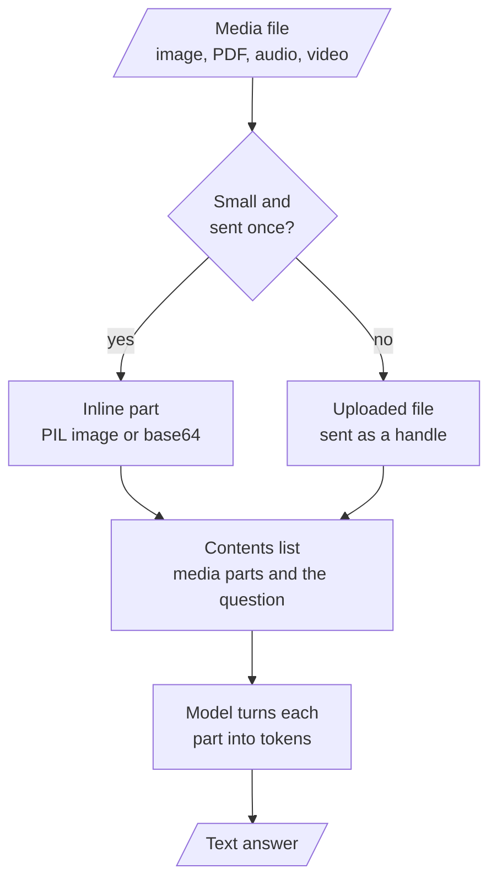

<!-- Generated by site/scripts/rag-theory-import.mjs from rag-agents-engineering. Edit the source there. -->
# Multimodal Prompting: overview

A multimodal model reads pictures, documents and sound in the same request as the question. The prompt becomes an ordered list of parts, and each part has a token price you can work out before you send it. The T3.2 notebooks build on three ideas: how an image goes into a prompt, how a PDF or an audio file goes in, and how a video becomes sampled frames plus a transcript.

The running example is the Larkspur Cloud handbook from [T5.1](/learn/llm-and-retrieval/rag-from-first-principles/rag-from-first-principles-overview) to [T6.2](/learn/ingestion-and-indexing-pipeline/chunking-and-indexing/chunking-and-indexing-overview), in the forms a support team holds it: a pricing page as a screenshot, the handbook as a PDF, a recorded support call, and a 90-second screen recording of the data export. The [T5.1](/learn/llm-and-retrieval/rag-from-first-principles/rag-from-first-principles-overview) question *Can I export my data after I cancel my plan?* now has visual evidence as well: the export walkthrough, which the lab samples frame by frame.

## In short

- A multimodal request is a list of parts. Gemini takes PIL images inline, and PDFs, audio and video by reference after `genai.upload_file`; GPT-4o takes `image_url` parts that hold a public URL or a base64 data URL.
- Every part has a price you can compute first. Gemini counts 258 tokens per PDF page and 32 per second of audio. `gpt-4o` counts 85 tokens per image at `detail="low"`, and 1,105 for a 1280 by 720 frame at `detail="high"`.
- The GPT-4o notebook sends no video file. It samples frames itself and transcribes the soundtrack with `whisper-1`, so the sampling gap sets both the cost and what the model can see.
- In the lab's 90-second walkthrough, the notebook's default gap of 2 s sends 45 frames and misses a 1.2 s toast. A 1 s gap sends 90 frames, 7,650 tokens at low detail, and catches all eight steps.
- A media prompt names what the media holds, what to extract, the output shape, and what to do with anything unreadable (`[NOT_EXTRACTED]`, "do not make up any information").

## Mental model

Whatever the provider, the request is a list of parts and the model reads every part as tokens. Decide how each file gets in by its size and by whether you will send it again, then count the tokens before you call: a 10-minute support call is 19,200 tokens before the question is read.

## Interactive lab

[**Frame sampling**](/labs/rag/m06_multimodal_prompting/frame-sampling-lab.html): open the file in a browser. Start at the notebook's default gap of 2 s and find the step no frame lands on. Drop to 1 s to catch all eight steps and read what that costs, then try 2.5 s, which catches all eight by luck. Switch to high detail to see the same frames cost 13 times as much.

## How it connects

- **Before:** [T3.1](/learn/prompt-and-context-engineering/prompt-engineering-patterns/prompt-engineering-patterns-overview) taught prompt patterns such as few-shot and chain-of-thought on text; this module sends the same kind of instructions alongside images, documents and sound.
- **Next:** [T4.1](/learn/langchain-and-langgraph-fundamentals/langchain-core-models-prompts-and-parsers/langchain-core-models-prompts-and-parsers-overview) wraps model calls in LangChain models, prompts and parsers. [T6.1](/learn/ingestion-and-indexing-pipeline/document-ingestion-and-metadata-design/document-ingestion-and-metadata-design-overview) turns PDFs into text for an index instead of sending the pages to a model, and [T8.2](/learn/complete-rag-applications/multimodal-rag/multimodal-rag-overview) retrieves images and pages before a multimodal model reads them.

## Key Takeaways

- Treat a multimodal prompt as a list of parts, and say in the text what the parts contain and what to extract from them.
- Price each part before you send it: pages, seconds of audio, frames and image tiles all have published token rates.
- When you sample video yourself, set the gap below the shortest event you need to see, and check what that costs.
- Give the model a way out for unreadable input (`[NOT_EXTRACTED]`, "not on the page") and grade answers on questions with known values.
