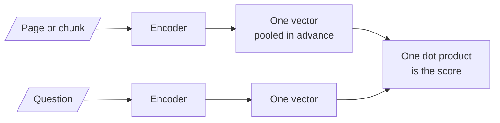

<!-- Generated by site/scripts/rag-theory-import.mjs from rag-agents-engineering. Edit the source there. -->
# Page-image retrieval with ColPali

<!-- subtitle: Retrieve the printed page itself, scored token by token against every patch -->
<!-- format: approved -->

## Late interaction

> **What you'll learn**
>
> - **Explain** late interaction: one vector per token and per patch, compared only at query time.
> - **Trace** a Larkspur question through MaxSim, token by token, to a page score.
> - **Explain** what page-level retrieval sends to the answer model, and what it skips.
> - **Weigh** the storage, generation and citation costs of retrieving pages.

Lesson 1 of T6.5 ranked figures on a different scale from text; lesson 2 of T6.5 turned figures into text and trusted a vision model's reading forever. Both start by taking the page apart. ColPali keeps the page whole.

Retrieval so far has used two kinds of model. A single-vector retriever squeezes a chunk into one vector and a question into another, and compares them once. A cross-encoder ([T6.3](/learn/retrieval-quality-engineering/post-retrieval-optimisation-and-reranking/post-retrieval-optimisation-and-reranking-overview)) reads question and chunk together, which is accurate and too slow to run over a whole index.

The single-vector design is the one every earlier retrieval lesson used:



*Figure 1: Single-vector retrieval. Everything the page says is pooled into one vector before any question exists.*

**Late interaction** sits between them. It encodes the document and the question separately, as with single vectors, so documents can be encoded ahead of time. It keeps one vector per token instead of one per text, and compares them only at the end. The comparison is called **MaxSim**:

| Step | What happens |
|---|---|
| 1 | Each query vector is compared with every document vector by dot product |
| 2 | Each query vector keeps only its best match: the maximum over the document's vectors |
| 3 | The page score is the sum of those maxima, one per query vector |

*Table 1: MaxSim, step by step.*

ColBERT introduced this for text passages (Khattab and Zaharia, SIGIR 2020). ColPali applies it to page images (Faysse et al., *ColPali: Efficient Document Retrieval with Vision Language Models*, 2024): a vision language model reads the rendered page, and every image patch gets its own vector:

```animated
<figure class="anim sheet" aria-labelledby="anim-maxsim-cap">
  <div class="anim__canvas" tabindex="0" aria-label="Late interaction scoring, scrolls sideways on a narrow screen">
    <svg viewBox="0 0 800 360" role="img" aria-labelledby="anim-maxsim-title anim-maxsim-desc">
      <title id="anim-maxsim-title">Late interaction: MaxSim over page patches</title>
      <desc id="anim-maxsim-desc">A page image becomes 1,139 patch vectors. The question becomes 24 token vectors. Each token keeps its best match among the patches; the token availability scores 0.75 on page 1. The 24 maxima sum to 15.95 for page 1, against 9.74 for page 2 and 6.82 for page 3, so page 1 ranks first.</desc>
      <defs>
        <marker id="ah-maxsim" viewBox="0 0 8 8" refX="7" refY="4" markerWidth="8" markerHeight="8" markerUnits="userSpaceOnUse" orient="auto-start-reverse"><path class="ah" d="M0 0 L8 4 L0 8 z"/></marker>
      </defs>
      <g class="n-1">
        <rect class="box" x="30" y="24" width="150" height="196"/>
        <path class="line" d="M44 42 H150 M44 54 H164 M44 70 H164 M44 82 H130"/>
        <rect class="chunk" x="60" y="150" width="20" height="50"/><rect class="chunk" x="92" y="170" width="20" height="30"/><rect class="chunk" x="124" y="155" width="20" height="45"/>
        <text class="small" x="105" y="238">page 1</text>
      </g>
      <g class="in-2">
        <path class="line" d="M55 24 V220 M80 24 V220 M105 24 V220 M130 24 V220 M155 24 V220 M30 52 H180 M30 80 H180 M30 108 H180 M30 136 H180 M30 164 H180 M30 192 H180"/>
        <text class="small" x="105" y="256">1,139 patch vectors</text>
      </g>
      <g class="n-3 in-3"><rect class="box" x="200" y="296" width="460" height="44"/><text class="label" x="430" y="318">Which month missed the 99.95% availability target?</text></g>
      <g class="n-4 in-4">
        <rect class="box" x="230" y="230" width="62" height="32"/><text class="small" x="261" y="246">month</text>
        <rect class="box" x="300" y="230" width="66" height="32"/><text class="small" x="333" y="246">missed</text>
        <rect class="box" x="374" y="230" width="34" height="32"/><text class="small" x="391" y="246">%</text>
        <rect class="box" x="416" y="230" width="98" height="32"/><text class="small" x="465" y="246">availability</text>
        <rect class="box" x="522" y="230" width="60" height="32"/><text class="small" x="552" y="246">target</text>
        <rect class="box" x="590" y="230" width="40" height="32"/><text class="small" x="610" y="246">+19</text>
      </g>
      <path class="edge e-4 in-4" d="M430 296 V265" marker-end="url(#ah-maxsim)"/>
      <path class="edge dashed e-5 in-5" d="M465 230 C465 140 260 120 158 128" marker-end="url(#ah-maxsim)"/>
      <rect class="hit mv-5" style="--from: translate(300px, 110px)" x="130" y="108" width="25" height="28"/>
      <text class="fig in-5" x="236" y="100">max 0.75</text>
      <g class="n-6 in-6">
        <rect class="box" x="664" y="220" width="124" height="52"/>
        <text class="small" x="726" y="236">sum of 24</text>
        <text class="fig" x="726" y="258">15.95</text>
      </g>
      <path class="edge e-6 in-6" d="M630 246 H661" marker-end="url(#ah-maxsim)"/>
      <g class="in-7">
        <circle class="hit" cx="668" cy="120" r="5"/><text class="fig" x="732" y="120">page 1 15.95</text>
        <text class="fig" x="732" y="146">page 2 9.74</text>
        <text class="fig" x="732" y="172">page 3 6.82</text>
      </g>
    </svg>
  </div>
  <div class="anim__controls" hidden>
    <button class="anim__btn" type="button" data-act="prev">Previous</button>
    <button class="anim__btn" type="button" data-act="play" aria-pressed="false">Play</button>
    <button class="anim__btn" type="button" data-act="next">Next</button>
  </div>
  <ol class="anim__steps" id="anim-maxsim-cap">
    <li><button type="button">Page</button><span>Indexing starts from the rendered page image, not from extracted text.</span></li>
    <li><button type="button">Patches</button><span>The model turns the page into 1,139 vectors of 128 dimensions, one per patch or token.</span></li>
    <li><button type="button">Question</button><span>A customer asks “Which month missed the 99.95% availability target?”</span></li>
    <li><button type="button">Tokens</button><span>The question becomes 24 vectors: its 14 tokens and 10 tokens the processor appends.</span></li>
    <li><button type="button">Match</button><span>Each token keeps its best patch. “availability” scores 0.75 on page 1 and 0.25 on the other two.</span></li>
    <li><button type="button">Sum</button><span>The 24 maxima add up to the page score, 15.95 for page 1.</span></li>
    <li><button type="button">Rank</button><span>Page 1 leads page 2 by 6.21. Its image, chart included, goes to the model.</span></li>
  </ol>
</figure>
```

*Figure 2: MaxSim on one page. The figures are from a real run.*

Notebook `03a`'s model needs a GPU stack, so the Larkspur lab pages were scored with `vidore/colSmol-256M`, a small model of the same family, through the ColPali engine library. Each 850 by 1100 page image became 1,139 vectors of 128 dimensions, and each question 24 vectors: its own tokens plus 10 end-of-utterance tokens the processor appends, which count in the sum like any other. The library's multi-vector scoring computes Table 1's steps; a hand-written version matched it to within 2e-6.

Here are a few of the 24 per-token maxima for *Which month missed the 99.95% availability target?*:

| Query token | Page 1 (availability) | Page 2 (refunds) | Page 3 (server plans) |
|---|---|---|---|
| `month` | 0.65 | 0.61 | 0.42 |
| `%` | 0.73 | 0.45 | 0.22 |
| `availability` | 0.75 | 0.25 | 0.25 |
| `target` | 0.65 | 0.20 | 0.28 |
| 14 question tokens, summed | 9.04 | 6.80 | 3.89 |
| 10 appended tokens, summed | 6.91 | 2.94 | 2.93 |
| **MaxSim score** | **15.95** | **9.74** | **6.82** |

*Table 2: Per-token maxima and page scores (`vidore/colSmol-256M`, the module's lab pages).*

`month` scores 0.65 and 0.61 on pages 1 and 2, so it barely separates them. `availability` and `target` do: each finds a strong match on page 1 and nothing better than 0.28 elsewhere. One vector per page would have pooled those signals before the question was known. We call that loss **early pooling**; late interaction keeps the signals apart until the question arrives.

<div class="walkthrough learning-widget" data-stepper id="maxsim-walkthrough">
<p class="widget-intro">Step through how the availability question earns page 1 its score of 15.95.</p>
<div class="step-controls" hidden role="group" aria-label="Stages of MaxSim scoring"><button type="button" data-step="0" aria-pressed="false" aria-controls="maxsim-step-0">1. Encode pages</button><button type="button" data-step="1" aria-pressed="false" aria-controls="maxsim-step-1">2. Encode question</button><button type="button" data-step="2" aria-pressed="false" aria-controls="maxsim-step-2">3. Best patch per token</button><button type="button" data-step="3" aria-pressed="false" aria-controls="maxsim-step-3">4. Sum</button></div>
<div class="step-panels"><section id="maxsim-step-0" class="step-panel" aria-labelledby="maxsim-heading-0"><h4 id="maxsim-heading-0">1. Encode pages, ahead of time</h4><dl><dt>Input</dt><dd>each 850 by 1100 page image</dd><dt>Stored</dt><dd>1,139 patch vectors of 128 dimensions per page</dd></dl></section><section id="maxsim-step-1" class="step-panel" aria-labelledby="maxsim-heading-1"><h4 id="maxsim-heading-1">2. Encode the question, at query time</h4><dl><dt>Input</dt><dd>Which month missed the 99.95% availability target?</dd><dt>Output</dt><dd>24 vectors: 14 for the question's tokens and 10 appended end-of-utterance tokens</dd></dl></section><section id="maxsim-step-2" class="step-panel" aria-labelledby="maxsim-heading-2"><h4 id="maxsim-heading-2">3. Keep each token's best patch</h4><dl><dt>Compare</dt><dd>every token vector with all 1,139 patch vectors of a page</dd><dt>Keep</dt><dd>the maximum only: availability 0.75 and target 0.65 on page 1, nothing above 0.28 on the other pages</dd></dl></section><section id="maxsim-step-3" class="step-panel" aria-labelledby="maxsim-heading-3"><h4 id="maxsim-heading-3">4. Sum the maxima</h4><dl><dt>Page 1</dt><dd>9.04 from the question tokens plus 6.91 from the appended tokens, 15.95</dd><dt>Ranking</dt><dd>page 1 first, page 2 at 9.74, page 3 at 6.82</dd></dl></section></div><div class="step-footer" hidden><button type="button" data-walk="previous">Previous</button><p class="step-status" aria-live="polite"></p><button type="button" data-walk="next">Next step</button></div></div>

## Page-level retrieval

In **page-level retrieval** the unit of retrieval is the page, and the answer model receives the page as an image. Nothing is extracted, split or captioned, so a chart, a table's grid and a scanned form arrive as they were printed.

`03a` does it in four calls with the byaldi library:

| Call | What it does |
|---|---|
| Load | Loads `vidore/colpali-v1.2` |
| Index | Renders every page of the Attention paper and embeds its patches, keeping a base64 copy of each page in the index |
| Search | Returns the top page with its document id, page number, score, metadata and the stored page image |
| Answer | Decodes the page image and sends it with the question to a vision-capable Gemini model |

*Table 3: The `03a` pipeline in four calls.*

Keeping the page images in the index is what lets search return the image with the hit, instead of a pointer to re-render.

The library's source (byaldi 0.0.7) explains why the course marks this lesson platform-specific:

- **It defaults to a CUDA GPU.** On a machine without CUDA, pass the Apple-silicon or CPU device instead. Weights load in bfloat16.
- **PDFs go through a converter that needs the poppler tools** installed on the machine.
- **The Hugging Face token is read from a token argument or the `HF_TOKEN` environment variable.** `03a` sets a variable spelled `HF_token`, which the library never reads. We call this the **misspelt token**: it fails only when the model needs authentication.

In the [interactive chart retrieval lab](/labs/rag/m20_multimodal_rag/chart-retrieval-lab.html), choose Page images. ColSmol ranks the right page first for all three questions, by clear margins:

| Question | Right page | Runner-up |
|---|---|---|
| *Which month missed the 99.95% availability target?* | 15.95 | 9.74 |
| *How many business days did a refund take in May?* | 15.93 | 10.66 |
| *How much memory does the Medium server have?* | 12.97 | 6.41 |

*Table 4: Page scores for the three golden questions (`vidore/colSmol-256M`).*

At `k = 1` the model receives the page with the chart on it, so every answer is in what it reads. Some of page 1's lead comes from its paragraph, which says "availability" and "target"; that is fine, because the page brings its chart along.

## What pages cost

Pages cost more than chunks in three places:

| Cost | Page images | Text chunks |
|---|---|---|
| **Storage** | 1,139 × 128 = 145,792 numbers per page, about 583 KB in float32 | 384 numbers per `all-MiniLM-L6-v2` chunk vector, about 1.5 KB |
| **Generation** | A whole page image to a vision model per hit, so `k` stays small | A few hundred tokens per hit |
| **Granularity** | A page with five topics is retrieved whole; a citation can point only to the page | A citation can point to a chunk or a quote |

*Table 5: Page retrieval against chunk retrieval.*

Lower precision, pooled patch vectors, or a cheap first stage with MaxSim only on its shortlist keep a large collection affordable.

> **Interview tip:** choose by where the meaning lives. Page images suit scans, slides, forms and dense tables, where layout carries meaning or there is no text layer. Text-heavy documents with a few charts are cheaper to serve with captions (lesson 2 of T6.5).

## In practice: page retrieval for Larkspur

1. **Use pages for status reports and scanned invoices**, where charts and grids carry the answer.
2. **Keep the handbook in text chunks**, with captions for its few figures.
3. **Shortlist first**: a cheap single-vector search picks 20 pages, MaxSim reranks them.
4. **Fix the token variable** and pin the device before deploying `03a`'s code.

## Limits of this evidence

- **A smaller model than the notebook's.** The Larkspur scores come from `vidore/colSmol-256M`, because `03a`'s `vidore/colpali-v1.2` needs a GPU stack. The mechanism is the same; the exact scores and margins will differ.
- **Three pages.** Each lab page holds one topic, so clear margins are expected. A report whose pages share vocabulary will separate less.
- **The appended tokens are not neutral.** They supply 6.91 of page 1's 15.95, and they reward whatever page they happen to match. On this corpus they favour the right page; that is an observation, not a guarantee.
- **Storage figures are arithmetic.** About 583 KB per page assumes float32 and no compression; the page did not measure a real index.

## References

1. Khattab and Zaharia, [ColBERT: passage search by late interaction over BERT](https://arxiv.org/abs/2004.12832), SIGIR 2020.
2. Faysse et al., [ColPali: Efficient Document Retrieval with Vision Language Models](https://arxiv.org/abs/2407.01449), 2024.
3. Illuin Technology, [ColPali engine library](https://github.com/illuin-tech/colpali).
4. Answer.AI, [byaldi](https://github.com/AnswerDotAI/byaldi).
5. Hugging Face, [vidore/colSmol-256M model card](https://huggingface.co/vidore/colSmol-256M).

## Run the notebooks

The code for this lesson is in these notebooks. Colab runs one in your browser: install the packages its first cell imports and set the API keys it reads. To run every notebook as written, clone the repository and use its uv environment.

| Notebook | GitHub | Colab |
|---|---|---|
| Multimodal RAG with colpali (optional) | [Open on GitHub](https://github.com/Sourav692/rag-agents-engineering/blob/main/p05_retrieval_quality_and_rag_apps/m20_multimodal_rag/optional/notebook/03a_multimodal_rag_with_colpali.ipynb) | [Open in Colab](https://colab.research.google.com/github/Sourav692/rag-agents-engineering/blob/main/p05_retrieval_quality_and_rag_apps/m20_multimodal_rag/optional/notebook/03a_multimodal_rag_with_colpali.ipynb) |

## Key Takeaways

- Late interaction keeps one vector per query token and per page patch, and scores a page as the sum of each token's best match (MaxSim). Pages are still encoded ahead of time, and no signal is pooled early.
- Page-level retrieval sends whole page images to a vision model, so charts, table grids and scans arrive as printed, with nothing extracted or captioned. On the Larkspur pages it ranks the right page first for all three questions.
- Pages cost more in storage (about 583 KB per page in float32), in generation and in citation granularity. Use them for scans, slides, forms and dense tables; caption text-heavy documents instead.

## Check yourself

<details>
<summary>1. For the availability question, the token month scores 0.65 on page 1 and 0.61 on page 2. Which tokens actually separate the pages, and why does that matter?</summary>

`availability` and `target`: each matches page 1 strongly (0.75 and 0.65) and nothing better than 0.28 elsewhere. Late interaction keeps each token's best match separate until the question is known; a single page vector would have pooled those signals in advance.

</details>

<details>
<summary>2. ColPali stores 1,139 vectors of 128 dimensions per page. How does that compare with a text chunk, and how do you keep a large collection affordable?</summary>

145,792 numbers per page, about 583 KB in float32, against 384 numbers for an `all-MiniLM-L6-v2` chunk vector. Use lower precision, pool patch vectors, or run a cheap first stage and apply MaxSim only to its shortlist.

</details>

<details>
<summary>3. Larkspur has a text-heavy handbook with a few charts, and a folder of scanned invoices. Where would you use page-image retrieval?</summary>

For the scanned invoices, which have no text layer and whose layout carries meaning. The handbook is cheaper and more precise as text chunks, with captions for its few figures, since page retrieval costs more storage, sends whole images to the model and can cite only a page.

</details>
