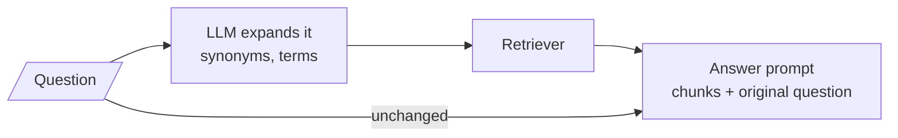
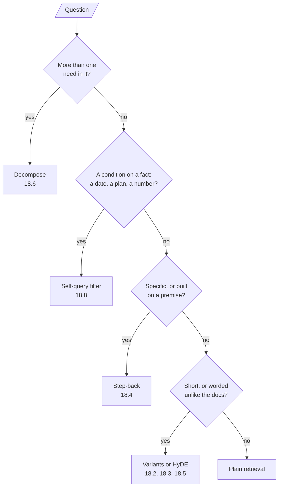

<!-- Generated by site/scripts/rag-theory-import.mjs from rag-agents-engineering. Edit the source there. -->
# Query rewriting and expansion

<!-- subtitle: A question rarely looks like its answer, so change the question before you search -->

## Query–document asymmetry

> **What you'll learn**
>
> - **Explain** the two ways a question differs from the passage that answers it: vocabulary and shape.
> - **Trace** how query expansion sends one text to the retriever and another to the answer prompt.
> - **Match** each T6.2 transformation to the gap it closes and the calls it costs.
> - **Choose** plain retrieval when no transformation can help.

[T6.1](/learn/retrieval-quality-engineering/retrieval-hybrid-rerank/retrieval-hybrid-rerank-overview) improved the retriever: two kinds of search, fused, filtered and de-duplicated. Every one of those techniques still searches with exactly what the user typed. T6.2 changes what is searched for.

A retriever compares the question with each chunk and returns the closest. That works when the two look alike, and a question rarely looks like its answer. In the [T5.1](/learn/llm-and-retrieval/rag-from-first-principles/rag-from-first-principles-overview) index, *What happens if my server goes down?* scores 0.000 against both chunks that answer it. Its top three are `reboot` (0.416), `sizing` (0.389) and `export` (0.217), all matched on the word "server". No value of `k` fixes that: the evidence is not low in the ranking, it is absent from it.

**Query–document asymmetry** is the name for this mismatch. It has two parts:

- **Vocabulary**: the user's words are not the handbook's words. The answering chunks say "outage", "availability" and "incident" and never "down".
- **Shape**: a question is short and interrogative; a chunk is long, declarative and dense with terms. Notebook `05a` pairs a nine-word question, *What is LangSmith, and why do we need it?*, with a 400-token passage that answers it. Even with a good embedding model, the question's vector sits closer to other questions than to the passage.

Here are two Larkspur questions beside the chunks that answer them:

| Query (what the user typed) | Chunk that answers it |
|---|---|
| What happens if my server goes down? | Larkspur guarantees 99.95% monthly availability. If an outage pushes availability below that, you receive service credits on the next invoice. |
| How long does a refund take? | Refunds go back to the original payment method and take 5 to 10 business days to appear on your statement. |

*Table 1: Two questions and their evidence. The words barely overlap.*

The second pair shows the vocabulary gap at its smallest. The [T5.1](/learn/llm-and-retrieval/rag-from-first-principles/rag-from-first-principles-overview) TF-IDF index does not stem, so "refund" in the question never meets "Refunds" in the chunk, and the timing chunk scores 0.000 too. Embeddings ([T5.4](/learn/llm-and-retrieval/embeddings-and-model-selection/embeddings-and-model-selection-overview)) close part of this gap, because they place paraphrases near each other, and the rest of this module closes more of it at query time.

## Rewriting and expansion

**Query expansion** closes the vocabulary gap with one LLM call. Notebook `01a` asks the model to "expand the following query to improve document retrieval by adding relevant synonyms, technical terms, and useful context", and the expanded text goes to the retriever. The original question still goes to the answer prompt:

*Figure 1: Expansion. The retriever sees the enriched text; the model answers the question the user asked.*

The split matters. The expansion exists to find chunks, and an answer prompt built on it would answer a longer, slightly different question.

`01a` names the two costs. Every retrieval now waits for an LLM call. And expansion can **dilute** the query: each added term pulls the query vector toward more of the corpus, until it is near everything and close to nothing. Three or four well-chosen terms help; a paragraph of synonyms hurts.

The optional notebook `01b` shows the neighbouring moves on one example: a rewrite that makes the query more specific, a step-back query that makes it broader, and decomposition into two to four sub-queries. Each gets its own lesson below.

## Which transformation closes which gap

Every technique in this module adds calls in front of retrieval, and each targets a different gap:

| Technique | Lesson | What it changes | Gap it closes | LLM calls, retrievals |
|---|---|---|---|---|
| Plain RAG | [T5.1](/learn/llm-and-retrieval/rag-from-first-principles/rag-from-first-principles-overview) | nothing | none | 1, 1 |
| Rewrite or expand | 17.1 | one query, more terms | vocabulary | 2, 1 |
| Multi-query | 17.2 | 3 phrasings, flat union | vocabulary | 2, 3 |
| RAG-Fusion | 17.3 | 5 phrasings, ranks fused | vocabulary, plus ranking | 2, 5 |
| Step-back | 17.4 | a broader question, searched with the original | a narrow or false premise | 2, 2 |
| HyDE | 17.5 | a hypothetical answer is the search key | shape | 2, 1 |
| Decomposition | 17.6 | 3 independent sub-questions | several needs in one question | 5, 3 |
| Self-query | 17.8 | a semantic query plus a metadata filter | facts an embedding cannot compare | 2, 1 |

*Table 2: The T6.2 transformations. Counts are per question, answer call included, from each notebook's own code.*

HyDE's retrieval embeds the hypothetical answer instead of the question, at the same cost as embedding the question.

When a question arrives, a short chain of checks picks the transformation:

*Figure 2: Pick a transformation by the question's gap. The lesson numbers in the boxes read 18.x; they mean lessons 2 to 8 of T6.2 of this module.*

Plain retrieval is a valid exit. We call the opposite habit **transform everything**: running a technique on all traffic because it helped some of it.

> **Pitfall: transform everything.** The [T5.1](/learn/llm-and-retrieval/rag-from-first-principles/rag-from-first-principles-overview) lab already retrieves both evidence chunks for *Can I export my data after I cancel my plan?* at `k = 2`. Every transformation on that question adds an LLM call and gains nothing. A router (lesson 7 of T6.2) makes the choice per question.

## In practice: Larkspur's three golden questions

The three [T5.1](/learn/llm-and-retrieval/rag-from-first-principles/rag-from-first-principles-overview) golden questions each fall in a different box of Figure 2:

1. **How long does a refund take?** Short, and worded unlike the timing chunk. Variants or expansion (17.2, 17.3).
2. **What happens if my server goes down?** Worded unlike both evidence chunks; retrieval finds neither. Variants, with fusion to order the results (17.3).
3. **Can I export my data after I cancel my plan?** Already retrieved at `k = 2`. Plain retrieval.

Lesson 2 of T6.2 starts on the first two with the simplest variant technique: ask the question three ways.

## Run the notebooks

The code for this lesson is in these notebooks. Colab runs one in your browser: install the packages its first cell imports and set the API keys it reads. To run every notebook as written, clone the repository and use its uv environment.

| Notebook | GitHub | Colab |
|---|---|---|
| Query expansion | [Open on GitHub](https://github.com/Sourav692/rag-agents-engineering/blob/main/p05_retrieval_quality_and_rag_apps/m17_query_transformation/mandatory/notebook/01a_query_expansion.ipynb) | [Open in Colab](https://colab.research.google.com/github/Sourav692/rag-agents-engineering/blob/main/p05_retrieval_quality_and_rag_apps/m17_query_transformation/mandatory/notebook/01a_query_expansion.ipynb) |
| Query transformations RAG techniques (optional) | [Open on GitHub](https://github.com/Sourav692/rag-agents-engineering/blob/main/p05_retrieval_quality_and_rag_apps/m17_query_transformation/optional/notebook/01b_query_transformations_rag_techniques.ipynb) | [Open in Colab](https://colab.research.google.com/github/Sourav692/rag-agents-engineering/blob/main/p05_retrieval_quality_and_rag_apps/m17_query_transformation/optional/notebook/01b_query_transformations_rag_techniques.ipynb) |

## Key Takeaways

- A question rarely looks like its answer: it differs in vocabulary (the user's words against the handbook's) and in shape (short and interrogative against long and declarative).
- Expansion sends an LLM-enriched query to the retriever and the original question to the answer prompt. It costs one LLM call per retrieval, and too many added terms dilute the query.
- Match the transformation to the gap, and keep plain retrieval as an exit. Running one technique on all traffic (transform everything) adds cost where nothing is missing.

## Check yourself

1. Why does "What happens if my server goes down?" score 0.000 against both Larkspur chunks that answer it?

The vocabulary differs. The answering chunks say "outage", "availability" and "incident" and never "down", so a term matcher finds no overlap; the top three, `reboot`, `sizing` and `export`, match only on "server". Embeddings close part of this gap, and query expansion adds the handbook's words to the query.

2. In the expansion chain, which text goes to the retriever and which goes to the answer prompt, and why?

The expanded text goes to the retriever; the original question goes to the answer prompt. The expansion exists only to find the chunks, and the model should answer what the user asked. The cost is one LLM call before every retrieval, and a risk of diluting the query if too many terms are added.

3. Should you apply a query transformation to "Can I export my data after I cancel my plan?" on the Larkspur index?

No. The [T5.1](/learn/llm-and-retrieval/rag-from-first-principles/rag-from-first-principles-overview) lab already retrieves both its evidence chunks at `k = 2`, so every transformation adds cost with nothing to gain. Plain retrieval is a valid exit, and a router (lesson 7 of T6.2) can make that choice per question.

