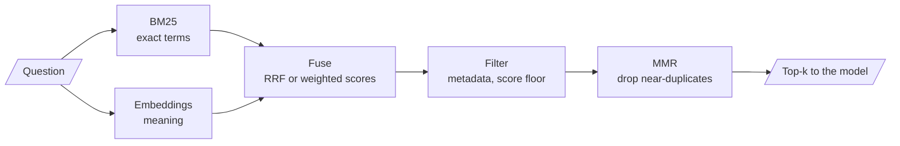

<!-- Generated by site/scripts/rag-theory-import.mjs from rag-agents-engineering. Edit the source there. -->
# Overview

An embedding retriever finds chunks that mean what the question means, and misses chunks that only share a rare exact token: an order ID, a plan name, an error code. A keyword retriever has the opposite failure. M17 runs both and merges their rankings. The M17 notebooks build on four ideas: dense and sparse retrieval, the BM25 ranking function, Reciprocal Rank Fusion, and the λ that trades relevance against diversity in Maximal Marginal Relevance.

The running example is the Larkspur Cloud handbook from [M11](/learn/llm-and-retrieval/rag-from-first-principles/rag-from-first-principles-overview) to [M13](/learn/ingestion-and-indexing-pipeline/chunking-and-indexing/chunking-and-indexing-overview), now searched with two kinds of question. Some are worded unlike the handbook, such as *What happens if my server goes down?*, whose evidence talks about "outage" and "availability"; the dense retriever is built for these. Others hang on an exact string, such as an order ID like `ORD-88213`, which the [M11](/learn/llm-and-retrieval/rag-from-first-principles/rag-from-first-principles-overview) symptom table already sends to this module; BM25 is built for these. The lab's golden set mixes both kinds: paraphrase questions, and questions that name an error code such as `E-4021`.

## In short

- **Dense** retrieval compares embedding vectors and matches paraphrase; **sparse** retrieval (BM25) scores shared tokens and matches exact terms. Each misses what the other finds, so production retrieval usually runs both.
- **BM25** is TF-IDF with two corrections: repeated terms saturate (`k1`, 1.5 by default in `rank_bm25`) and long chunks are discounted (`b`, 0.75). LangChain's `BM25Retriever` splits on whitespace only, so `application.` and `application` are different tokens.
- Fusing two rankings by **weighted min-max scores** (`03a`, `alpha = 0.5`) depends on each retriever's score scale. **Reciprocal Rank Fusion** uses ranks only: `EnsembleRetriever` adds `weight / (60 + rank)` per list. With equal weights of 1, a chunk ranked 3rd by both retrievers (2/63 = 0.0317) beats one ranked 1st by only one (1/61 = 0.0164).
- **MMR** picks the most similar chunk first, then trades relevance against redundancy with `lambda_mult` (0.5 by default) over `fetch_k` candidates (20 by default).
- Filters on metadata, score, keywords and diversity shrink the context after retrieval. Score thresholds belong to one embedding model; re-tune them when the model changes.

## Mental model

Two retrievers rank the same chunks by different evidence, and fusion turns two ranked lists into one. Fusion only reorders what the two retrievers returned: a chunk that neither puts in its top `k` is gone before the merge, so give each retriever a wider `k` than the final one.

## Interactive lab

[**Hybrid fusion lab**](/labs/rag/m17_retrievers_hybrid_search/hybrid-fusion-lab.html): open the file in a browser. It ranks 19 handbook chunks with real BM25 and with `all-MiniLM-L6-v2` cosine similarity, then fuses them. On seven golden questions, mean recall@3 is 0.57 for BM25 alone, 0.64 for dense alone and 0.93 fused at `alpha = 0.5`.

- Pick *E-4102 for the third time. Can I take my files with me another way?* and slide `alpha` from 0 to 1. BM25 alone and dense alone each miss one of the two evidence chunks; the blend in between sends both.
- On *What does E-4021 mean?*, push `alpha` toward 1. Dense retrieval ranks the code chunk 5th, behind look-alike codes, so the exact code drops out of the top 3.
- Switch to RRF with *E-5013 for the third time. Will my machines get shut off?*. With 4 chunks per retriever the suspension chunk is never handed over; with 10 it returns. Changing `c` barely moves recall here.

## How it connects

- **Before:** [M11](/learn/llm-and-retrieval/rag-from-first-principles/rag-from-first-principles-overview) gives the baseline and the symptom table that sends exact-code misses here; its TF-IDF lab is the sparse half in miniature. [M13](/learn/ingestion-and-indexing-pipeline/chunking-and-indexing/chunking-and-indexing-overview) sets chunk length, which BM25's `b` parameter normalises. [M14](/learn/ingestion-and-indexing-pipeline/embeddings-and-model-selection/embeddings-and-model-selection-overview) and [M15](/learn/ingestion-and-indexing-pipeline/vector-stores-and-index-operations/vector-stores-and-index-operations-overview) supply the embeddings and the vector store behind the dense half.
- **Next:** [M18](/learn/retrieval-quality-engineering/query-transformation-and-routing/query-transformation-and-routing-overview) rewrites the question before these retrievers see it, and RAG-Fusion applies this module's RRF to several query variants. [M19](/learn/retrieval-quality-engineering/post-retrieval-optimisation-and-reranking/post-retrieval-optimisation-and-reranking-overview) reranks the fused list with a cross-encoder.

## Key Takeaways

- Run sparse and dense retrieval together when questions mix exact strings with free wording. Check the BM25 tokeniser before you trust its misses.
- Prefer RRF when the two retrievers' scores live on different scales; it needs no calibration and rewards agreement. Use weighted scores only if you join them by id and tune the weight on the golden set.
- Fusion and MMR reorder a candidate pool and cannot add to it. Retrieve wider than you return.
- Set λ, score thresholds and fusion weights by measuring them on your golden set, and measure again when the embedding model changes.
