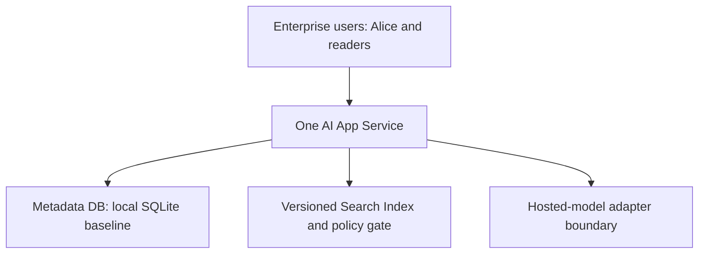

<!-- Generated by site/scripts/sd-course-import.mjs from 10_AI_System_Design. Edit the stage guide there. -->
# Scale the application: understand the problem

Alice’s supplier-policy workflow now serves a hypothetical wider enterprise rollout. The service must handle an illustrative 100 requests/second peak while preserving saved history, durable jobs, and current permission-filtered evidence. Adding app replicas is useful only if those replicas share the right state and the database or provider can carry the resulting demand.

This lesson models capacity and exercises cache/history correctness locally. It does not deploy a load balancer, managed database, cluster, or autoscaler. All service times, query budgets, hit rates, and provider capacities are authored assumptions. Estimated integrated study: six to eight hours; learner mastery remains unassessed.

## Preserve the Retrieval Contract

[T18.4](/learn/staff-ai-system-design/enterprise-knowledge/enterprise-knowledge-understand-the-problem) established versioned ingestion, current/tombstone metadata, trusted permission checks, and exact passage citations. [Its snapshot](https://github.com/Sourav692/Forward-Deployed-Engineer-Interview-Prep/blob/main/10_AI_System_Design/stages/03-enterprise-knowledge/architecture-after.md) is the actual before-state. Keep the original short draft/history path, T18.3 durable jobs and worker epochs, connector/index pipeline, model adapter, and metadata-only Telemetry contract.

Before diagram. A single application host owns the local prototype state. The Queue/Workers and source ingestion remain but do not solve interactive app capacity automatically.

## The New Failure and Its Symptoms

Assume requests consume 25 ms of app CPU on average, separate from provider waiting. One core has an idealised maximum of 40 such requests/second before other overhead. A 100 requests/second peak cannot fit one such core. Requests queue, response latency rises, and browser retries can increase load. But copying the whole application plus its local database file onto four hosts would create four separate histories and duplicate-operation domains.

A second shortcut also fails: cache final supplier answers solely by question text. Tenant B can ask the same words as Alice, while permissions or source policy versions differ. A fast wrong or unauthorised answer is not a successful scale-out.

| User-visible need | Formal idea | What it does not promise |
| --- | --- | --- |
| Any healthy app instance can handle the next request | Stateless application replica | Durable history still needs shared authoritative storage |
| Route new work away from an unhealthy instance | Load balancing and readiness | A health probe does not prove every dependency can meet its SLO |
| Reuse exact previously loaded passage bytes | Immutable-content cache | A cache hit cannot establish current access permission |
| Keep spare capacity before the request pile grows | Headroom and autoscaling | Starting replicas takes time and cannot raise a provider quota |
| Find which resource actually limits the pipeline | Bottleneck analysis | A single CPU graph cannot establish end-to-end capacity |

## Coverage and Changed Constraints

| Module | Treatment | Depth and application here |
| --- | --- | --- |
| Caching systems | Taught here | Design depth: key scope, immutable version, TTL, bounded LRU eviction, live policy and outage exercise |
| Scaling and traffic engineering | Taught here | Build depth: load path, capacity budgets, replicas, health/warmup/drain, autoscaling and failure tests |
| Requirements and architecture methodology | Revisited from T18.2 | Build depth: change the workload and preserve the saved-answer/security contract |
| Estimation and capacity planning | Revisited from T18.2 | Build depth: find the minimum app/DB/provider budget rather than repeat the basic units tutorial |
| APIs and streaming protocols | Revisited from T18.2 | Build depth: preserve key/status/commit semantics across instances and retry paths |
| End-to-end AI application design | Revisited from T18.2 | Build depth: shared state and provider boundaries across replicas |
| Search architecture | Revisited from T18.4 | Build depth: cache only what current retrieval authority can safely validate |
| Rate limiting and admission control | Context only | T18.6, Build depth: identify unserved demand now; design fair rejection next |
| Container and orchestration architecture | Deferred | T18.10, Design depth: no Kubernetes implementation needed to reason about a replica |

Outcomes: preserve history across app instances; choose cache scope safely; prove warm hits respect changes; calculate the current limiting budget; and plan warmup/draining without inventing measured throughput. Prerequisites are the prior three actual stage contracts.

## Key Takeaways

- At 25 ms of app CPU a request, one core tops out at an idealised 40 requests a second, so the illustrative 100 requests/second peak cannot fit on it.
- Copying the app and its local database file to four hosts creates four separate histories and duplicate-operation domains. Replicas help only when they share the right authoritative state.
- Caching final answers by question text alone fails because Tenant B can ask Alice's words with different permissions or policy versions. A fast wrong or unauthorised answer is not a successful scale-out.
- A health probe does not prove every dependency can meet its SLO. Autoscaling takes time to start replicas and cannot raise a provider quota.
