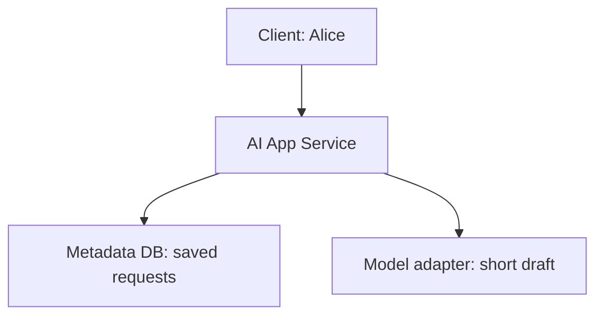

<!-- Generated by site/scripts/sd-course-import.mjs from 10_AI_System_Design. Edit the stage guide there. -->
# Distributed execution: understand the problem

Alice in Tenant A can already ask for a supplier-email draft and reopen its saved answer. She now supplies a document pack whose text preparation takes an illustrative 20 seconds. Keeping the browser request open would violate the T18.2 waiting budget. Losing the process would lose in-memory progress. Add durable execution for this longer path while retaining the short drafting API.

This is the same hypothetical procurement platform. Numbers are planning examples; the runnable exercise uses SQLite and logical clocks, not a deployed broker, document parser, identity provider, or hosted model. Study budget: six to eight integrated hours. Learner mastery is unassessed.

## What T18.2 Actually Built

[T18.2](/learn/staff-ai-system-design/mvp/mvp-understand-the-problem) established trusted tenant/user scope, a short synchronous drafting path, request-key duplicate suppression, and an answer commit before completed success. Its Python API and tests remain unchanged. [ADR-001](/learn/staff-ai-system-design/architecture-decisions/adr-001-synchronous-mvp) still applies to that endpoint. It did not implement worker recovery, background execution, or exactly-once provider calls.

Before diagram. Alice waits while the application generates and saves a short draft. Logical identity and telemetry roles remain inside the application; the drawing highlights the path changing now.

## New Pressure and Failure Walkthrough

Assume six document jobs arrive per minute and each needs 20 seconds of mostly external I/O. Alice should receive a durable job identifier within an illustrative 300 ms target and return later for the result. That acceptance latency is not a completion promise. Retain the original short API for directly supplied text.

If the application starts a thread and returns immediately, its restart can erase the task. If a worker removes a message before saving its result, a crash can erase the only execution record. If it saves the result and crashes before acknowledging delivery, another worker may receive the same job. Design for those crash positions before choosing a queue product.

| Alice’s experience                                  | Formal term            | Boundary                                                                                |
| ---------------------------------------------------- | ---------------------- | --------------------------------------------------------------------------------------- |
| Several documents are waiting or running at once     | Concurrency            | Overlapping work is not necessarily simultaneous CPU execution                          |
| Another worker takes over after one stops responding | Lease                  | Temporary authority expires; an expired worker may still be alive                       |
| A job returns after a lost acknowledgement           | At-least-once delivery | Repeat delivery is possible; side effects still need protection                         |
| The same submission returns the existing job         | Idempotent acceptance  | Scope the key by tenant/user and payload; do not claim every external call happens once |
| A task records how far it got                        | Checkpoint             | Only committed state survives; it cannot recover an unsaved provider answer             |

## What This Module Covers

| Module                                      | Treatment              | Depth and evidence                                                                         |
| ------------------------------------------- | ---------------------- | ------------------------------------------------------------------------------------------ |
| Concurrency fundamentals                | Taught here | Build depth: overlapping workers, atomic claims, stale-worker rejection, capacity exercise          |
| Messaging and event streams             | Taught here | Build depth: durable handoff, acknowledgements, redelivery, queue/log alternatives                  |
| Background execution systems            | Taught here | Build depth: job states, leases, bounded retry, deadline, dead/unknown outcomes                     |
| Agentic application system architecture | Taught here | Build depth: bounded tool loop, durable checkpoint, allowlist and side-effect boundary              |
| Database architecture                   | Revisited from T18.2 | Design depth: apply short transactions to atomic claim and completion; no repeated database tutorial |
| Backpressure and overload management    | Context only           | First taught T18.6, build depth; this stage estimates capacity but does not teach fair admission  |
| Distributed state and transactions      | Deferred               | First taught T18.8, build depth; no consensus or cross-service transaction implementation         |

Outcomes: explain durable acceptance versus completion; implement a race-safe claim; reject a stale completion; diagnose crash/redelivery; bound a tool workflow. Prerequisites are T18.2’s persistence and scoped access contracts.

## Key Takeaways

- Document preparation takes an illustrative 20 seconds, which breaks the interactive waiting budget, and in-memory progress dies with the process. Add a durable job path and keep the short drafting API for supplied text.
- Alice should receive a durable job identifier within an illustrative 300 ms. That acceptance latency is not a completion promise.
- Crash position decides recovery. A restart erases an in-process thread, removing a message before saving its result loses the only record, and a crash after saving but before acknowledging lets another worker receive the same job.
- A lease is temporary authority that expires while the old worker may still be alive. At-least-once delivery means repeats happen, so side effects still need protection.
