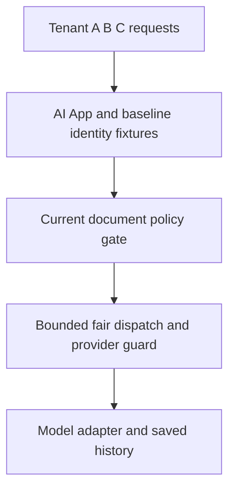

<!-- Generated by site/scripts/sd-course-import.mjs from 10_AI_System_Design. Edit the stage guide there. -->
# Enterprise security: understand the problem

Alice’s company will allow its supplier-policy workflow only if another organisation cannot read its data, revoked access stops at a defined boundary, and sensitive retrieval is auditable. A fast, fairly scheduled answer is still a failure if it crosses the wrong tenant or provider boundary. Strengthen those boundaries without replacing the platform built in Stages 1–5.

The customer, workload, policy ages and costs are hypothetical. The executable verifies local signed-claim fixtures, policy decisions and durable audit behaviour against the actual Stage 3 retrieval code. Its public demonstration keys are not secrets; the envelope is not JWT/OIDC. No production identity provider, mTLS, private endpoint, KMS, firewall or row-level security deployment is made. Estimated integrated study: seven to nine hours; learner mastery remains unassessed.

## Preserve the Actual Platform

[Stage 5](/learn/staff-ai-system-design/overload-fairness/overload-fairness-understand-the-problem) bounded tenant queues, compared fair service shares and guarded provider request/token/concurrency budgets. [Its snapshot](https://github.com/Sourav692/Forward-Deployed-Engineer-Interview-Prep/blob/main/10_AI_System_Design/stages/05-overload-fairness/architecture-after.md) and [ADR-005](/learn/staff-ai-system-design/architecture-decisions/adr-005-bounded-fair-dispatch) are the before-state. Preserve shared history and stable keys, durable worker epochs, versioned ingestion, current retrieval gates, scoped immutable caches, ready replicas and unknown-outcome handling.

Before diagram. Baseline tenant predicates and budgets exist, but they are not a complete enterprise identity, audit or network control plane. Existing fixtures cannot establish real corporate identity.

## Trace an Attempted Tenant Escape

Bob sends a valid Tenant B request with `X-Tenant: A` and a guessed citation for Alice’s supplier policy. A gateway that forwards this header as authority turns a caller claim into cross-tenant access. A model instruction such as “only answer for Tenant B” cannot repair text already retrieved from Tenant A.

A second failure is less visible. Alice was allowed yesterday; her organisation revokes her today. A long-lived token or cached “allow” may outlive that policy. A third failure concerns accountability: the system returns sensitive text but its audit write fails, leaving no durable disclosure record. Decide these consequences before adding security product names.

| Supplier-workflow consequence | Formal term | Boundary |
| --- | --- | --- |
| Establish which account actually called | Authentication | Signed identity is verified, not inferred from a body/header |
| Decide what that account may do now | Authorisation | Current membership, action and resource policy still apply |
| Let a worker act narrowly for Alice | Delegated capability | Service audience, action, tenant, expiry and actor need explicit scope |
| Keep readable document text from becoming control instructions | Data/control separation | Authorisation/tool policy never comes from model output |
| Know which protected source IDs were disclosed | Security audit | Durable metadata record, not a raw prompt dump or an ordinary debug log |

## Coverage and Learning Outcomes

| Module | Treatment | Mapped depth and evidence |
| --- | --- | --- |
| 2.3 Gateway and service communication | Taught at mapped depth | D3: ingress trust, service audience/capability, mTLS/egress boundaries and failure tests |
| 8.3 Enterprise retrieval governance | Taught at mapped depth | D3: policy authority, freshness/epoch, current resource checks, provenance and audited disclosure |
| 13.1 Identity and access control | Taught at mapped depth | D3: signature/issuer/audience/expiry, membership, least privilege and rotation tests |
| 13.2 Enterprise AI security | Taught at mapped depth | D3: prompt/tool boundaries, scoped secret references, egress, audit failure and threat exercise |
| 13.3 Multi-tenant platform design | Taught at mapped depth | D3: shared versus isolated data/compute options, administrative paths and negative access tests |
| 2.1 Networking fundamentals | Revisited from Stage 1 | D2: locate ingress, service and provider network trust boundaries rather than repeat DNS/TLS basics |
| 3.1 Distributed system fundamentals | Context only | Stage 7, D3: authority outages/freshness matter now; failover/partition design follows |
| 16.2 Cloud networking and deployment | Deferred | Stage 11, D2: no multi-region residency/network implementation here |

Outcomes: reject forged scope; verify a bounded identity/capability; block stale/revoked context; require durable audit before disclosure; and defend isolation/egress choices. [Curriculum](https://github.com/Sourav692/Forward-Deployed-Engineer-Interview-Prep/blob/main/10_AI_System_Design/progress/curriculum-map.json) assigns the full modules. Passing fixture tests is not a security certification or proof of learner mastery.
