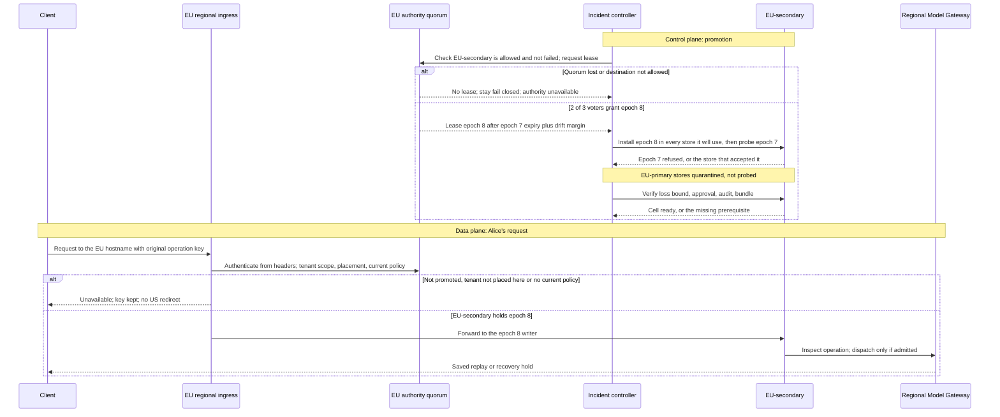

<!-- Generated by site/scripts/sd-course-import.mjs from 10_AI_System_Design. Edit the stage guide there. -->
# Global multi-region platform: observe and experiment

## Request Walkthrough

The [offline walkthrough](/labs/system-design/11_multi_region/lab.html#request-walkthrough) follows promotion on the control plane, then Alice's request on the data plane, with wrong-geography, unfenced-writer and lost-quorum branches.

```lab
src: /labs/system-design/11_multi_region/lab.html
title: Global multi-region platform: request walkthrough and lab
```



Sequence diagram. The incident controller never talks to the client: promotion is control plane, and Alice's request is data plane. Ingress authenticates, scopes the tenant, and checks placement and current policy on every request, before reading the body. A value in the lab represents fencing evidence; it does not fence a real host.

| Step | Responsible component and input | Output and possible failure |
| --- | --- | --- |
| Detect | Incident controller receives health, error and probe evidence | Incident start and recovery clock; a false positive must not start a second writer |
| Place | Trusted placement policy evaluates the proposed destination | EU-secondary for A/B; US-home or the failed EU-primary is rejected |
| Fence | EU authority quorum grants epoch 8 after epoch 7's lease and drift margin; EU-secondary installs epoch 8 in its stores, then probes epoch 7 | Epoch 7 refused and EU-primary's stores quarantined, or blocked promotion |
| Restore | Regional recovery checks the loss bound at isolation, approval generation, audit and model digests | Ready cell or explicit missing prerequisite |
| Route | EU ingress, reached through the EU hostname, authenticates Alice, scopes Tenant A and checks current policy | Forward to the epoch 8 writer, or unavailable with no US redirect |
| Admit | Scheduler checks app, provider tokens, active slots and tenant shares | Bounded service; overload rejects or expires work |
| Reconcile | Operation store and usage ledger inspect original operation and attempt IDs | Saved replay or recovery hold; no blind uncertain dispatch |

## Calculate Recovery and Capacity

Assume detection 60 seconds, fencing 30, restore/scale/artefact checks 180, route convergence 30, and validation 60. The planned sequential recovery is 360 seconds. The lease runs from the last renewal, before the incident started, so it has normally expired by the end of detection; the 30-second fencing budget conservatively covers the drift margin, epoch install and probes. The RTO stays 600 seconds; the 240-second gap is margin, not a second target. If a model takes 600 seconds to load, the plan becomes 780 seconds and misses the RTO. Overlap can reduce elapsed time only if demonstrated safely. Measure incident start through validated customer success, not DNS update time alone.

Copy loss needs a bound that still works while EU-primary is down. "Now minus last applied" grows during detection and passes 60 seconds by the end of the 60-second detection step. Bound it at isolation instead. Each lease renewal, every 5 seconds, is recorded in the authority quorum. EU-secondary's watermark is the point up to which every record has been applied ([T18.8](/learn/staff-ai-system-design/reliability-consistency/reliability-consistency-learn-and-design#lesson-checkpoint-1-a-large-sequence-can-hide-a-gap)). A partitioned EU-primary that is still running keeps acknowledging writes until its lease expires, 20 seconds after its last renewal. The loss bound is therefore last renewal + lease duration − watermark.

For example, the last renewal is at 10:00:40 and the watermark is 10:00:25: 40 + 20 − 25 = 35 seconds, inside the 60-second RPO. Adding one 5-second renewal interval instead fits only a crashed primary: a 45-second gap would pass at 50 seconds while a live writer could lose 65. The bound is frozen at isolation, so detection time does not change it. It bounds the loss; it does not measure what was lost. An operator may escalate to customer-approved degraded recovery with explicitly revised objectives, but must not claim the original objective passed.

Assume A/B combined failover peak is 60 requests/second, each using 1,000 total budgeted tokens and a two-second active serving slot. An app replica rated at an assumed 20 RPS planned at 70% supports 14 RPS: ceil(60/14)=5 replicas. Provider budget must cover 60 ×1,000×60=3.6 million tokens/minute, plus the applicable request quota. Little's law, from [T18.2](/learn/staff-ai-system-design/mvp/mvp-observe-and-experiment#lesson-9-work-the-numbers-before-buying-capacity), says average work in progress equals arrival rate times time in the system (L = λW). Here 60×2=120 active slots, excluding queued work and tail headroom. These independent budgets must all fit. App scaling cannot repair a 2-million-token/minute provider quota.

For a 100 RPS recovery burst, app demand is ceil(100/14)=8 replicas, tokens become 6 million/minute, and average active slots become 200. Keep A/B shares under the surviving budget and reject excess rather than building an unbounded recovery queue. Warm GPU readiness, available device types, context distribution, cold caches, index reconstruction, provider approval, and network routes may bind first.

## Size Recovery Capacity Under a Quota

Assume EU-secondary's reserved provider quota is 2 million tokens/minute, below the 3.6 million the peak needs. Three sizing choices remain:

| Sizing choice | Recovery behaviour | Cost | When it wins |
| --- | --- | --- | --- |
| Warm secondary at full peak | Serves 60 RPS immediately | Idle reserve for 3.6 million tokens/minute, 5 replicas and 120 slots | Strict RTO and no acceptable shedding |
| Partial warm capacity with shedding | Serves what the quota admits; rejects the rest by tenant share | Lower reserve; customers see rejections | This stage's assumptions |
| Scale on failover | Starts small and acquires capacity during the incident | Lowest idle cost; acquisition and model load may exceed the RTO | Longer RTO or spare regional supply |

**Sizing task.** With the 2-million-token quota and 1,000 tokens per request, what request rate can EU-secondary admit? How many replicas and active slots does that need? How would you split it if Tenant A's contract share is 60% and Tenant B's is 40%?

<details>
<summary>Reveal after answering</summary>

2,000,000 ÷ 1,000 ÷ 60 ≈ 33.3 requests/second. Admit 33 RPS: ceil(33/14) = 3 replicas and 33 × 2 = 66 active slots, both inside the reserve. Split about 20 RPS for A and 13 RPS for B under the illustrative shares. Reject the other 27 RPS of the 60 RPS peak at admission with a retry-after signal; do not queue it without bound. More app replicas would not help, because the token quota binds first.

</details>

## Build Unit Economics From Successful Work

Finance wants one number: what does a completed supplier workflow cost? Derive it from charged attempts, not accepted requests. All inputs are illustrative:

- 1,000,000 accepted workflows/month, of which 800,000 complete successfully.
- 1,250,000 charged attempts: one first attempt per workflow plus 250,000 retries.
- 1,000 tokens per attempt at an assumed blended $4 per million tokens, so $0.004 per attempt.
- Fixed monthly cost: primary infrastructure $6,000, EU reserve $3,000, regional networking $500 and allocated support/on-call labour $8,000, so $17,500.

| Month | Variable spend | Total | Cost per success |
| --- | --- | --- | --- |
| No failover | 1,250,000 × $0.004 = $5,000 | $22,500 | $22,500 ÷ 800,000 = $0.028125 |
| One failover with 20,000 retried attempts | 1,270,000 × $0.004 = $5,080 | $22,580 | $22,580 ÷ 800,000 = $0.028225 |

The failover month assumes 20,000 workflows whose EU-primary attempt was charged, reconciled as failed, and retried once in EU-secondary. Successes stay at 800,000: the retries recover workflows and add no new customer value. Dividing by the 1,000,000 accepted requests gives $0.0225 and hides completion failure. Unknown remote usage remains a liability until reconciled; record bounded estimates separately from actual invoices.

**Predict.** A worse month keeps 1,000,000 accepted workflows but completes only 700,000, with 300,000 retries. What is the cost per success, and how much did it rise?

<details>
<summary>Reveal after answering</summary>

1,300,000 attempts × $0.004 = $5,200, so the month costs $22,700. Divided by 700,000 successes that is about $0.0324, up about 15% from $0.028125. Retries add spend, and fewer successes share the fixed cost.

</details>

Measure input/output tokens by model and tenant, device-hours including idle reserve, stored GB-months, transferred GB, failed attempts, support time, and successful workflow IDs. Key each usage record by tenant, operation and attempt. Usage delivery is at-least-once, so the same attempt can arrive twice; it counts once. A retry in another region is a distinct attempt and is extra spend. A record that changes an existing attempt's cost, region or outcome is a conflict, not a correction, and is rejected for investigation. The local `Ledger` applies these rules and counts one success per operation. It has no epoch field: rejecting usage writes that carry an older epoch is a production control this lab does not implement. A real ledger needs append-only adjustments, price versions, currency, tax policy, and invoice reconciliation.

## Lab: When Is Recovery Eligible?

Open the [offline lab](/labs/system-design/11_multi_region/lab.html#lab). Four controls change the gap at isolation (last renewal minus watermark, 0–120 seconds; the lab adds the 20-second lease), destination (EU-secondary, US-home or the failed EU-primary), writer authority evidence, and restore and model load time (60–720 seconds). Policy, approval, audit and bundle gates are assumed true in the visual worksheet; the Python tests exercise them. Safety gates decide whether promotion is safe. The RTO column is separate: a safe but late plan still proceeds in a real incident, reports the missed objective, and goes back for rehearsal or redesign. Results are computed assumptions, not elapsed measurements.

| Preset | Inputs | Safe to promote | Blocking reasons | Planned recovery (seconds) | Meets 600-second RTO | Loss bound (seconds) |
| --- | --- | --- | --- | --- | --- | --- |
| Baseline | EU-secondary, old epoch refused, 15-second gap, 180-second restore | yes under assumptions | none | 360 | yes | 35 |
| Replica behind | Baseline with 41-second gap | no | RPO exceeded | 360 | yes | 61 |
| Wrong geography | Baseline with US-home | no | residency | 360 | yes | 35 |
| Failed region as target | Baseline with EU-primary | no | failed region is not a recovery target | 360 | yes | 35 |
| Split writer risk | Baseline with old epoch not proven rejected | no | writer not fenced | 360 | yes | 35 |
| Quorum lost | Baseline with EU authority quorum lost | no | authority unavailable | 360 | yes | 35 |
| Slow model load | Baseline with 600-second restore | yes under assumptions | none | 780 | no: rehearse or redesign | 35 |

## Run the code lab

Run this stage's Python lab in your terminal to see each idea in the stage hold. It needs Python 3.10 or later and nothing else: the standard library and SQLite only.

| File | What it is |
| --- | --- |
| [regions.py](https://github.com/Sourav692/Forward-Deployed-Engineer-Interview-Prep/blob/main/10_AI_System_Design/stages/11-multi-region/labs/regions.py) | Lab code: read this first |
| [test_regions.py](https://github.com/Sourav692/Forward-Deployed-Engineer-Interview-Prep/blob/main/10_AI_System_Design/stages/11-multi-region/labs/test_regions.py) | Tests: one test per behaviour this stage teaches |

From the root of your local clone of the repository, run:

```sh
python3 10_AI_System_Design/stages/11-multi-region/labs/test_regions.py -v
```

`-v` prints one line per test, and each test name states one behaviour. Read a test, change one value in the lab code, predict which test fails, and run it again.

Fault task: in `labs/regions.py`, set a withdrawn approval, missing audit, lost quorum, the failed region as destination, or a 41-second gap in `Recovery`, and expect one named blocking reason. A 600-second restore gives no blocking reason, only `meets_rto` false. No real routing changes occur. These are independent design slices; they do not compose earlier runtime fixtures into a deployed multi-region service.

## Checkpoint 2: Failover Lost the Operation Row

Alice's operation is absent on the promoted async replica. Is a new provider call safe under the same key?

<details>
<summary>Reveal after answering</summary>

Absence after possible replication loss does not prove no call occurred. Hold the uncertain interval and reconcile original operation/provider evidence. A local duplicate guard can only recognise records that survived. Only after reconciliation shows the first attempt failed may a new attempt run under the same operation key, and it is billed as a second attempt. Retrying under a new operation key makes the uncertainty worse.

</details>

## Key Takeaways

- Planned sequential recovery is 360 seconds (detection 60, fencing 30, restore 180, routing 30, validation 60) against the 600-second RTO. A 600-second model load makes it 780 seconds and misses the objective.
- Bound copy loss at isolation as last renewal plus lease duration minus watermark. A renewal at 10:00:40 and a watermark at 10:00:25 give 35 seconds, inside the 60-second RPO, and the bound does not measure what was actually lost.
- A 60 RPS peak of 1,000-token, two-second requests needs 5 replicas, 3.6 million tokens per minute and 120 active slots. A 2-million-token quota admits about 33 RPS, so reject the rest at admission, because extra replicas cannot beat the quota.
- Cost per success divides total spend by completed workflows. With $17,500 fixed and 1,250,000 attempts at $0.004 it is $0.028125, while dividing by the 1,000,000 accepted requests gives $0.0225 and hides completion failure.
