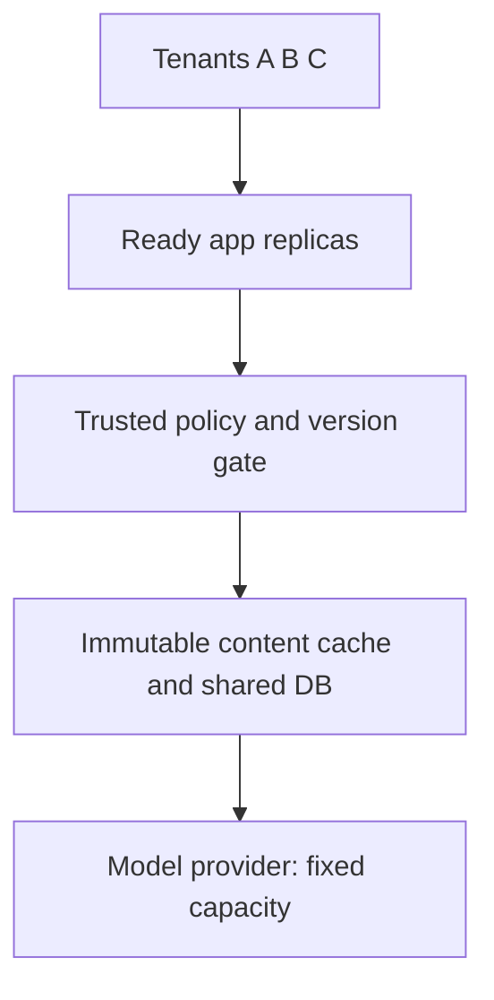

<!-- Generated by site/scripts/sd-course-import.mjs from 10_AI_System_Design. Edit the stage guide there. -->
# Handle overload and fair scheduling: understand the problem

Tenant A’s automated supplier workflow floods a model provider shared with Tenants B and C. App replicas are available, but their shared dependency is finite. Keep requests and token work bounded, give tenants explicit service shares, and stop retrying work that cannot finish within its deadline.

The same hypothetical procurement platform now has three hypothetical tenants. Earlier Tenant B fixtures become a broader rollout scenario, not evidence of a real customer launch. Workload rates, weights, quotas, and deadlines remain authored assumptions. The runnable guard uses SQLite and logical time; the scheduler uses equal one-second jobs. Neither deploys a gateway, broker, distributed quota service, or GPU scheduler. Estimated integrated study: seven to nine hours; mastery remains unassessed.

## Inherit the Actual Scale-Out Contract

[T18.5](/learn/staff-ai-system-design/application-scaling/application-scaling-understand-the-problem) introduced stateless app/shared-authority design and bounded immutable-body caching with a live policy gate. [Its snapshot](https://github.com/Sourav692/Forward-Deployed-Engineer-Interview-Prep/blob/main/10_AI_System_Design/stages/04-application-scaling/architecture-after.md) and [ADR-004](/learn/staff-ai-system-design/architecture-decisions/adr-004-stateless-scale-and-cache) are the before-state. Preserve short drafting/history, stable operation keys, durable Queue/Workers and epochs, versioned source ingestion, authorised retrieval/citations, cache safety, and the model adapter boundary.

Before diagram. Application scaling and body-cache reuse do not create new model-provider slots or token quota. Existing ingestion and durable jobs remain outside this focused shared-dependency drawing.

## The Failure Is Work Piling Up Faster Than It Leaves

Suppose a shared path can finish six equal-cost jobs/second but receives ten/second. Accepting all work indefinitely grows backlog by four jobs/second in a simplified steady fluid model. Waiting absorbs more memory and connections. Long waits cross client deadlines. Clients retry, creating still more demand. A bigger queue delays the failure without adding service capacity.

At the same time, a single global first-in-first-out queue can let A’s large burst occupy the entire useful waiting window while B and C miss their own deadlines. Overall completion rate alone can look healthy while smaller tenants receive no timely service. Define both safety limits and the intended sharing policy.

| Observable need | Formal mechanism | What it does not do |
| --- | --- | --- |
| Refuse work the service cannot afford now | Admission control | It does not finish rejected work later by magic |
| Bound incoming requests or tokens over time | Rate limit/token bucket | It does not bound how many long requests remain in flight |
| Bound simultaneous provider calls | Concurrency limit | It does not by itself cap requests/minute or tokens/minute |
| Store only a finite amount of waiting work | Bounded queue | It cannot increase downstream throughput |
| Give other tenants turns even while A is busy | Fair scheduling | It allocates existing service, not new provider capacity |
| Tell callers to slow down instead of hiding backlog | Backpressure | It requires callers/ingestion workers to respect the signal |

## Coverage and Outcomes

| Module | Treatment | Depth and evidence |
| --- | --- | --- |
| Rate limiting and admission control | Taught here | Build depth: separate request/token/concurrency budgets and atomic guard tests |
| Queuing and queueing theory | Taught here | Design depth: backlog growth, stability, bounded wait, Little’s law limitations |
| Backpressure and overload management | Taught here | Build depth: finite queues, rejection/deadline/retry policy, failure exercises |
| Fair scheduling and workload prioritisation | Taught here | Design depth: FIFO, strict priority, RR, WRR, starvation and cost-normalised trade-offs |
| AI workload management | Taught here | Build depth: token reservation, provider slots, workload classes and explicit unknown outcomes |
| Concurrency fundamentals | Revisited from T18.3 | Build depth: apply atomic authority to simultaneous budget reservations |
| Messaging and event streams | Revisited from T18.3 | Build depth: queue/prefetch/retry limits preserve durable completion and ownership |
| Caching systems | Revisited from T18.5 | Design depth: hits save body work without bypassing admission or permission |
| Scaling and traffic engineering | Revisited from T18.5 | Build depth: provider capacity stays binding while app replicas increase |
| AI gateway and provider management | Context only | T18.10, Build depth: the guard protects a provider boundary; routing/fallback is not retaught here |
| Inference performance optimisation | Deferred | T18.10, Explain depth: no kernel, batching-engine, or GPU optimisation implementation |

Outcomes: distinguish the five budgets; enforce a race-safe provider reservation; reproduce noisy-neighbour outcomes; expire waiting work; and explain why retries/extra replicas cannot create capacity. Prerequisites are the first four stage contracts.

## Key Takeaways

- If a shared path finishes six equal-cost jobs a second but receives ten, backlog grows by four a second. A bigger queue delays the failure without adding service capacity, and long waits trigger client retries that add demand.
- A single global FIFO queue lets one tenant's large burst occupy the whole useful waiting window while smaller tenants miss their deadlines. Overall completion rate can look healthy while B and C get no timely service.
- A token bucket bounds arrivals over time but not long requests still in flight. A concurrency limit bounds simultaneous provider calls but not tokens a minute. Fair scheduling shares existing capacity and creates none.
