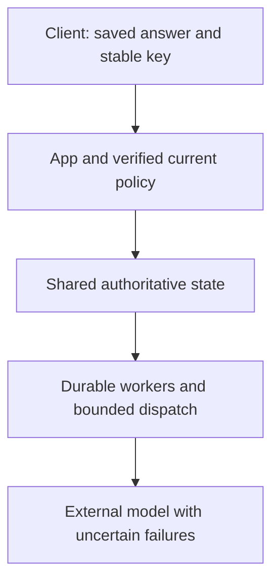

<!-- Generated by site/scripts/sd-course-import.mjs from 10_AI_System_Design. Edit the stage guide there. -->
# Reliability and consistency: understand the problem

Alice receives a saved supplier answer, refreshes the page, and sees no result because the next read reached a lagging replica. The client retries. Meanwhile a provider timeout and a policy-authority outage tempt the application to regenerate blindly or use an old cached permission. Reliability must preserve the meaning of saved success and current authority while recovering useful service.

This continues the same hypothetical platform. The executable uses two SQLite files with explicit event delivery to model a primary and a projection, logical failures, and a local circuit breaker. It is not database replication, consensus, leader election, real failover or a production telemetry deployment. Workloads and timings are illustrative. Estimated integrated study: eight to ten hours; learner mastery remains unassessed.

## Inherit Security and Execution Before Adding Recovery

[Stage 6](/learn/staff-ai-system-design/enterprise-security/enterprise-security-understand-the-problem), [its snapshot](https://github.com/Sourav692/Forward-Deployed-Engineer-Interview-Prep/blob/main/10_AI_System_Design/stages/06-enterprise-security/architecture-after.md) and [ADR-006](https://github.com/Sourav692/Forward-Deployed-Engineer-Interview-Prep/blob/main/10_AI_System_Design/architecture/decisions/ADR-006-trusted-enterprise-boundaries.md) establish verified scope, current membership/resource policy and mandatory audit-before-disclosure. Keep fair admission/provider budgets, shared history and keys, source versions, safe immutable caches, worker epochs, and explicit unknown remote outcomes.

Before diagram. Shared authority is a logical contract; actual availability, replication and recovery guarantees have not been deployed or measured in earlier stages.

## Walk Through the Incident

The primary commits Alice's answer and acknowledges success. A derived history copy has not received that commit. Reading the copy without a freshness requirement yields “not found,” although the answer is durable. Reissuing generation with a new operation key can charge again. If the original response was lost instead, the client cannot know from the timeout alone whether the commit happened.

Now imagine the failed dependency is policy authority. A stale replica may still say Alice belongs to Tenant A. Serving protected context from it would turn an availability fallback into an access regression. Recovery rules must depend on the data class, not the fact that another server can respond.

| Concrete observation | Term | Consequence |
| --- | --- | --- |
| Two copies temporarily disagree after a commit | Replication lag | A readable replica need not contain the acknowledged write |
| Alice's next read must include her saved result | Read-your-write contract | Carry a trusted minimum version or route to authority |
| The result and its notification must agree | Transactional outbox | Commit intent with local state; delivery can still repeat |
| Stop calling an unhealthy dependency repeatedly | Circuit breaker | Limits attempts; does not repair the dependency or prove remote cancellation |
| Follow one request across services and waits | Distributed trace | Correlated timings explain a path, not every unsampled failure |

## Learning Contract and Coverage

| Module | Treatment | Depth and evidence |
| --- | --- | --- |
| 3.1 Distributed system fundamentals | Taught at mapped depth | D3: lag, partition, leader authority, quorum/availability trade-offs and fault exercise |
| 3.2 Distributed state and transactions | Taught at mapped depth | D3: local atomicity, conditional writes, outbox, duplicate/order handling and external gap |
| 12.2 Resilience and fault tolerance | Taught at mapped depth | D3: deadlines, bounded retries, circuit/probe, bulkheads, failover and recovery boundaries |
| 12.3 Latency and performance | Taught at mapped depth | D3: critical-path budgets, pool/queue/dependency waits and diagnosis |
| 15.2 SRE and production operations | Taught at mapped depth | D3: service indicators, error budget, incident roles, runbook, restore/failover evidence |
| 15.3 Performance and incident diagnosis | Taught at mapped depth | D3: symptom-to-boundary reasoning, traces, hypothesis and recovery checks |
| 2.2 APIs and streaming protocols | Revisited from Stage 1 | D3: lost response and minimum-version read; same operation identity |
| 5.3 Backpressure and overload management | Revisited from Stage 5 | D3: retry/probe limits preserve finite downstream capacity |
| 6.1 Database architecture | Revisited from Stage 1 | D2: transaction/constraint boundaries under injected failure |
| 6.2 Caching systems | Revisited from Stage 4 | D2: immutable body reuse does not become stale authority |
| 8.1 Document ingestion and indexing | Revisited from Stage 3 | D3: derived publication may lag but versions/tombstones remain authoritative |
| 8.3 Enterprise retrieval governance | Revisited from Stage 6 | D3: failover cannot silently widen policy freshness |
| 13.1 Identity and access control | Revisited from Stage 6 | D3: authority outage denies protected access, even when history can be read |
| 15.1 Observability systems | Context only | Stage 8, D3: use diagnostic signals now; version-aware telemetry architecture follows |
| 3.3 Distributed architecture patterns | Deferred | Stage 12, D2: no catalogue of unrelated architectures |
| 16.2 Cloud networking and deployment | Context only | Stage 11, D2: regional recovery needs a later deployment contract |

Outcomes: choose consistency per class; reproduce rollback/lost acknowledgement; reject false projection catch-up; bound recovery attempts; diagnose the latency path and write a verifiable recovery procedure. Prerequisites are the first six stages. [Curriculum](https://github.com/Sourav692/Forward-Deployed-Engineer-Interview-Prep/blob/main/10_AI_System_Design/progress/curriculum-map.json) governs scope; neither fixture availability nor a labelled SLO proves production reliability.
