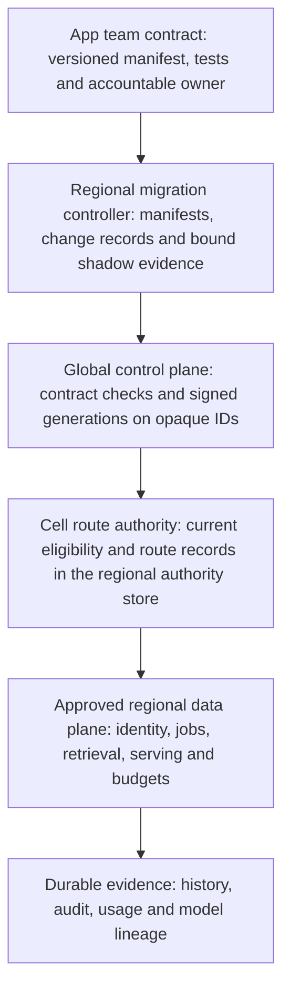

<!-- Generated by site/scripts/sd-course-import.mjs from 10_AI_System_Design. Edit the stage guide there. -->
# Staff-level platform architecture: learn and design

## Choose Abstractions That Preserve Guarantees

A shared application contract describes what a team supplies and what the platform promises. An internal developer platform provides that contract through supported templates, APIs, documentation, validation, deployment and operational support. The first useful version can be a command and a manifest; a portal does not make deployment safe.

Separate a control plane, which checks contracts and publishes desired configuration, from data planes, which serve regional customer requests. Do not send prompts through a new global platform controller merely to centralise ownership. What happens when the control plane fails is set out in [Place Route Authority in Each Cell](#lesson-place-route-authority-in-each-cell).

| Architecture option | Benefit | Cost and failure | Decision |
| --- | --- | --- | --- |
| Shared library plus templates | Fast adoption; low service overhead | Version drift, uneven rollout, policy copied into apps | Use for the software development kit (SDK) and schema, not as sole policy enforcement |
| Regional platform services plus versioned contracts | Central enforcement per cell; independent app workflows | Platform dependency, compatibility and on-call burden | Choose as logical target; reuse current services |
| One global request service | Fewer centrally managed endpoints | Global blast radius, residency coupling, control-plane dependency | Reject for A and B placement and cell isolation |
| Rewrite every role as a microservice | Independent scaling and team releases where needed | New network and transaction boundaries, more operations and migration risk | Extract only when measured ownership or scale requires it |

Each distributed pattern earns its place on one T18.13 interaction, and each has a failure it must handle.

| Pattern | T18.13 interaction | When it wins | Failure to handle |
| --- | --- | --- | --- |
| Modular monolith, extract later | Manifest validation inside the existing regional API | One owner and no new network contract | An early split adds a network failure between validating and recording; extract only for measured ownership or scale |
| Cell | Each region's runtime and route authority | A bad release or outage stays inside one cell | A cell cannot borrow another cell's capacity or authority |
| Event with an idempotent consumer, fed by an outbox | Usage events for showback | Aggregation may lag; a duplicate is dropped by its event ID | The outbox delivers a committed change at least once; it never makes a model call exactly once |
| Command against the authority | Route apply by CAS, after a current policy check | The decision needs the current value | An eventual consumer would act on stale policy or a stale generation |

Try it before revealing: classify each interaction as a command or an event, and give the reason. (1) Apply generation N+1 in a cell. (2) Add a token count to a team's showback. (3) Check that a model approval is current before cutover. (4) Tell dashboards that a cohort moved. (5) Withdraw a dataset so its descendant routes stop.

Reveal after answering

Commands: 1, 3 and 5. Each reads or changes the current authority value, and each can be refused. Events: 2 and 4. They report something that already happened, so a consumer may lag or see a duplicate without changing any decision. Item 5 may emit an event afterwards to notify app owners, but the withdrawal itself is a command.

Score options against weighted criteria, but apply hard constraints first. Score three rows of the table: shared library plus templates, regional platform services plus versioned contracts, and one global request service. Rewriting every role as a microservice is an extraction policy that can sit under any of them, so it is not scored. Use delivery speed, isolation, operability and evolvability, weighted 0.2, 0.3, 0.3 and 0.2. With assumed scores of 5, 2, 2, 2; 3, 5, 4, 4; and 1, 1, 2, 3, the weighted totals are 2.6, 4.1 and 1.7. Residency and current access are hard constraints: an option that violates one is removed before ranking, and no score rescues it. Here the vetoed global request service also ranks last, so the veto changes nothing. The [decision exercise](/learn/staff-ai-system-design/staff-platform/staff-platform-think-like-a-staff-engineer#lesson-decision-exercise-veto-the-top-score-and-write-the-adr) changes a constraint so that it removes the winner.

## Make the Developer Workflow Concrete

A production manifest holds schema version, trusted application ID, tenant mapping, owner and on-call, allowed cell, evaluated release bundle, source connector references, purpose and retention, quota and deadline envelopes, secret references and outcome instrumentation. The full manifest stays in the tenant's region; the global control plane sees only its contract part: schema and contract version, and opaque tenant, app and profile IDs. Separate desired application configuration from tenant policy, which the region enforces. A manifest may request a region or model; server policy decides eligibility. Never accept provider credentials, raw datasets or an arbitrary destination URL in that interface.

Developer steps:

1. Create an app from the minimal supplier template and declare its manifest.
2. Run contract checks and the frozen task evaluation.
3. Request sandbox deployment in the approved cell, then inspect validation and reconciliation status.
4. Shadow eligible read-only work. A shadow comparison sends a copy of authorised requests to the new route, compares its answers with the current route's, and discards them, so no customer sees or acts on them.
5. Request pilot promotion and observe outcomes.
6. Widen the cohort with a reversible change checked against the route generation. A generation is a counter that rises by one on every route change, so a writer holding an old value cannot overwrite a newer one.

Tenant-specific behaviour lives in prompts, tools, retrieval configuration and approved adapters, not in forks of the policy service.

After diagram. New platform abstractions wrap existing regional contracts. They do not replace resource authority, result persistence, model release approval or regional promotion fencing.

The regional migration controller serves `POST /v1/apps/{app}/changes` at the tenant's residency hostname, with a 16 KiB manifest limit and an operation key of up to 128 characters. Bind the verified app owner or delegated operator to a trusted tenant and app scope. Validate schema, ownership, approved region and bundle, secret references and bounded budget against current server policy. Key uniqueness is scoped to tenant, app, subject, endpoint and key. A same-key retry returns the persisted change rather than submitting another migration, even if approval was revoked after it was recorded.

| Status | Meaning |
| --- | --- |
| `202 {change_id, state, generation}` | Proposed change committed. Success means recorded intent, not deployed service |
| `400` | Invalid manifest or key |
| `403` | Forbidden region, bundle or owner |
| `404` | App not visible to this caller |
| `409` | Same key with a different canonical payload |
| `429` | Controller admission is full |
| `503` | Policy authority unavailable |

Status reads return the current generation and named blockers. The runnable SQLite slice reduces the manifest to tenant, app, owner, region, bundle and budget, scopes keys by tenant, app and key, and assumes a trusted caller. It has no HTTP, real identity, rollout, region or budget enforcement, or remote fencing.

## Place Route Authority in Each Cell

Each cell's route records live in its region's authority store, never in one global table. [T18.12](/learn/staff-ai-system-design/multi-region/multi-region-understand-the-problem) gave each tenant region a consensus-replicated authority store for policy, membership and writer ownership: an EU store for Tenants A and B, and Tenant C's equivalent in its US-home cell. T18.13 adds one record type to it: each app's current route generation and the previous one.

The global control plane holds opaque placement, contract versions and signed, versioned route generations that refer to opaque tenant, app and profile IDs. It holds no customer content, policy or membership, and it is never authority. Each cell pulls new generations, verifies the signature, and rejects any generation that is unsigned or older than its current one. It then checks current eligibility (approval, residency and policy) in its own authority store, because a signature proves origin, not present permission. Only then does it apply the generation with a compare-and-set (CAS) on its current generation number, so a request is served under generation N or N+1, never a mix. The cell keeps the last verified generation as last-known-good, with an illustrative staleness bound of 15 minutes before it alerts.

| Record | Where it lives | Authority? |
| --- | --- | --- |
| Full manifest: owners, tenant mapping, connectors, purpose, retention, secret references | Tenant region, in the migration controller | No; current policy decides eligibility |
| Change records and shadow evidence | Tenant region, in the migration controller | No; evidence for review |
| Policy, approvals, and each app's current and previous route generation | Tenant region's authority store | Yes |
| Opaque placement, contract versions and signed generations on opaque IDs | Global control plane | No |
| Generation signing keys | Global control plane | No; a stolen key can propose a route but never authorise one |

Changes to the platform itself (validators, templates, contract versions) are releases too. They roll out one cell at a time, starting with a canary cell, behind the same evaluation and rollback gates as an app change.

| Condition | Cell behaviour | Observable signal |
| --- | --- | --- |
| Control plane unreachable | Keep serving last-known-good; freeze new cutovers | Config age past the staleness bound; failed pulls |
| Unsigned or older generation arrives | Reject it; keep the current generation | Signature and ordering rejections |
| Signed generation fails current eligibility (approval revoked after signing, or a stolen key) | Reject it; keep the current generation | Eligibility rejections of signed generations |
| Cell lags the published generation | Serve its current generation; the control plane waits before the next cohort | Applied versus published generation per cell |
| Emergency rollback during an outage | CAS a new local generation, N+2, carrying N's route, with actor, reason and audit; N must be currently eligible | Rollback audit row and post-incident review |
| Control plane returns after that rollback | Report N+2; refuse N+1, which is now older; apply only a generation above N+2 | N+1 marked rolled back for that cell, not lagging; the next publication exceeds every reported generation |
| Platform release breaks the canary cell | Stop the rollout; other cells keep the old release | Canary contract tests and error budget |

## Checkpoint 1: A Portal That Bypasses Runtime Policy

A team can self-serve a deployment but its manifest supplies the final provider URL. Has onboarding become safe?

Reveal after answering

No. Resolve an allowlisted profile from current tenant policy, and reject arbitrary destinations. A convenient control plane cannot replace the regional runtime's current source, audit, release, route and budget checks. Record a denied onboarding attempt without exposing secrets or content.

## Key Takeaways

- Separate a control plane that checks contracts and publishes configuration from regional data planes that serve requests. Choose regional platform services with versioned contracts, and reject one global request service for its blast radius and residency coupling.
- Hard constraints such as residency and current access remove an option before weighted scoring, and no score rescues it. Route apply against the authority is a command, while showback usage is an event delivered at least once and deduplicated by event ID.
- Route records live in each region's authority store. A cell verifies a signed generation, rejects unsigned or older ones, checks current eligibility because a signature proves origin and not permission, then applies it by compare-and-set (CAS).
- An emergency rollback writes a new local generation N+2 carrying N's route, so a returning control plane's N+1 is refused as older. A manifest never supplies provider credentials, raw datasets or a destination URL, since server policy decides eligibility.
