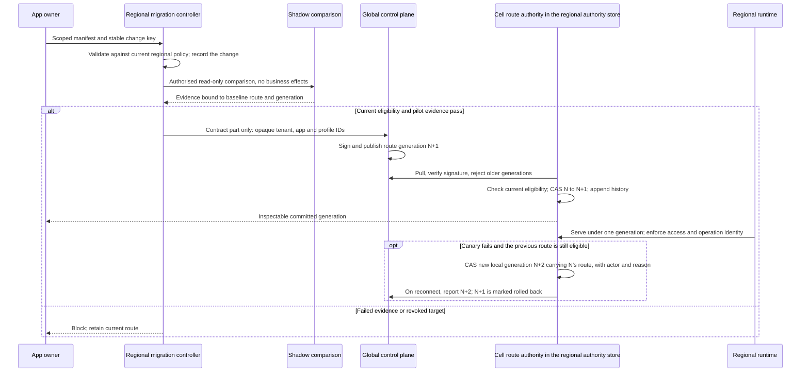

<!-- Generated by site/scripts/sd-course-import.mjs from 10_AI_System_Design. Edit the stage guide there. -->
# Staff-level platform architecture: observe and experiment

## Request Walkthrough

The [offline walkthrough](/labs/system-design/12_staff_platform/lab.html#request-walkthrough) traces migration intent through a controlled route change, including mismatch, revoked-previous-route and control-plane-outage branches.

```lab
src: /labs/system-design/12_staff_platform/lab.html
title: Staff-level platform architecture: request walkthrough and lab
```



Migration sequence. CAS changes a pointer only if its expected generation still matches. It prevents stale metadata updates; it does not stop an unfenced old region from writing.

| Step | Responsible component and input | Output and possible failure |
| --- | --- | --- |
| Propose | Regional migration controller receives manifest and key | Durable proposed record in the tenant region; invalid scope, region or bundle rejects |
| Compare | Shadow runner receives eligible read-only examples | Evidence appended with its baseline route and generation; side-effectful work is forbidden |
| Review | App and platform owners inspect evidence and current eligibility | Pilot decision; low sample, any mismatch or stale evidence blocks |
| Cut over | Cell route authority receives the signed generation, checks current eligibility in its authority store, and holds the expected generation | CAS to the new generation with a history row; an unsigned, older or ineligible generation, or a stale CAS, rejects |
| Observe | Regional runtime serves existing stable operations | Customer outcome evidence; old uncertain calls are not replayed |
| Roll back | Operator verifies the previous route is still eligible | New local generation N+2 carrying the previous route, with actor and reason, or an explicit block |

## Migrate in Phases With Reversal Evidence

| Phase and illustrative timebox | Owner | Gate | Reversal or stop |
| --- | --- | --- | --- |
| Week 1: inventory contracts and copied behaviour | Staff engineer plus app leads | Every operation, data class, owner and caller identified | Stop if current guarantees are unknown |
| Week 2: validate manifests and generate plans | Platform team | Invalid scope, region, model and quota requests reject | Keep existing runtime authoritative |
| Week 3: shadow eligible read-only supplier flows | App owner plus security | Bounded test population, no business effects, critical slices match | Stop shadow and keep the evidence |
| Week 4: one app pilot in one approved cell | Release owner and SRE | Current eligibility, capacity and rollback rehearsal | Roll back by a new generation if the old route is eligible |
| Months 2 to 6: expand cohorts while old paths stay live | App leads and platform owner | Outcome and cost agreement, no unresolved unknown effects | Pause adoption; keep original IDs and data |
| After the last cohort: retire duplicated paths | Platform owner | No traffic on old scripts for one reversal window | Retirement clears the rollback pointer; going back needs a fresh, gated change |

Use a strangler migration: route selected new work through the new contract while the old path serves unconverted work. Keep one authoritative writer and stable operation IDs. Avoid dual writes to independent result stores; an outbox plus a replayable projection is safer where eventual views suffice. Schema changes add compatible fields first, migrate readers and writers, verify backfill, then remove old fields after the reversal window. A route rollback cannot undo a destructive schema migration, erase a tombstone or revoke a remote side effect.

Production shadow evidence binds manifest, release bundle, population, evaluator, source policy, time window, and the baseline route and generation it was compared against. It must not send protected content to an unapproved route, consume unbounded quota or invoke business tools twice. Evidence is append-only: a later clean report cannot erase a recorded mismatch. If the route changes after the comparison, the evidence is stale and the change needs a fresh comparison under a new change key. The local gate needs 100 matched examples. Zero mismatches in 100 independent, representative samples bounds the true mismatch rate below about 3% at 95% confidence (the rule of three, 3/100). It is a demonstration gate, not proof of safety.

## Calculate Total Cost of Ownership

TCO adds operating cost, migration, support, the overlap while old and new paths both run, and expected change effort over an explicit horizon. It differs from Stage 11's per-success cost because it compares organisational choices. It counts labour cost and keeps opportunity cost qualitative. Count shared costs the same way in both options, and do not claim savings from costs that remain.

Assume a three-year horizon without discounting, common serving spend of $20,000 a month in both options, and a loaded planning labour rate of $100 an hour. Four teams spend 30 hours a month each on duplicated platform work: 120 × $100 = $12,000 a month. A shared platform needs 50 hours a month of operations plus 20 of adoption support, $7,000, plus $1,000 of control-plane infrastructure: $8,000 a month. Once the old paths are retired, the saving is $12,000 − $8,000 = $4,000 a month. Migration takes 600 one-time hours, $60,000.

If the old paths stopped on day one, break-even would be $60,000 ÷ $4,000 = 15 months and the three-year saving $84,000. The strangler migration says otherwise. While cohorts move, the old duplicated work and the new platform both run. Call those months the dual-run overlap. Assume six.

## Checkpoint 2: Predict the Overlap's Effect

With a six-month overlap and the inputs above, predict the break-even month and the three-year saving before you open the lab.

<details>
<summary>Reveal after answering</summary>

Each overlap month pays the platform's $8,000 without removing the $12,000 of duplicated work. Up-front cost is $60,000 + 6 × $8,000 = $108,000. After month 6, the platform saves $4,000 a month, so it repays $108,000 in 27 more months: break-even at month 33. Three-year totals: independent 36 × $32,000 = $1,152,000; shared $60,000 + 6 × $40,000 + 30 × $28,000 = $1,140,000. The saving falls from $84,000 to $12,000.

</details>

## Test the Cost Case's Sensitivity

At these inputs, break-even month = 15 + 3 × overlap months, and each overlap month cuts the three-year saving by $12,000. A seven-month overlap erases it. If migration doubles to 1,200 hours, break-even moves to month 48 and the platform costs $48,000 more over three years. If support rises from 20 to 60 hours a month, the monthly saving falls to zero and break-even never arrives. Shortening the overlap, by setting retirement dates per cohort, is the strongest lever. A team that ships customer work sooner has opportunity value, but do not invent a revenue figure; add measured adoption, incident load and delivery evidence before claiming it. These assumptions exclude tax, discounts, financing and revenue. Ask finance which costs are avoidable and which only move between teams.

[ADR-012](/learn/staff-ai-system-design/architecture-decisions/adr-012-versioned-regional-platform-contracts) records the no-overlap figures of 15 months and $84,000. Accepted ADRs are immutable, so [ADR-013](/learn/staff-ai-system-design/architecture-decisions/adr-013-regional-authority-and-route-generations) records the dual-run figures and ADR-012 carries only an amendment note.

## Lab: Is Migration Economically Reversible?

Open the [offline lab](/labs/system-design/12_staff_platform/lab.html#lab). Change migration effort (0–1,200 hours), shared operations and support (30–150 hours a month), dual-run overlap (0–12 months) and planning horizon (12–60 months). Fixed assumptions: 120 baseline hours a month, $100 an hour, $1,000 a month of control infrastructure and $20,000 a month of common serving. Outputs: monthly saving after the overlap, up-front cost, break-even month, both horizon TCOs and their difference. Zero or negative savings report no break-even rather than dividing by zero.

Inputs read: migration hours, shared hours a month, overlap months, horizon months. Output columns use the lab's labels, shortened; all values are USD except break-even.

| Preset | Inputs | Net monthly saving | Up-front cost | Break-even month | Independent TCO | Shared TCO | Horizon savings |
| --- | --- | --- | --- | --- | --- | --- | --- |
| Baseline | 600, 70, 6, 36 | 4,000 | 108,000 | 33 | 1,152,000 | 1,140,000 | 12,000 |
| No overlap | 600, 70, 0, 36 | 4,000 | 60,000 | 15 | 1,152,000 | 1,068,000 | 84,000 |
| Costly migration | 1,200, 70, 6, 36 | 4,000 | 168,000 | 48 | 1,152,000 | 1,200,000 | −48,000 |
| Support burden | 600, 110, 6, 36 | 0 | 132,000 | none | 1,152,000 | 1,284,000 | −132,000 |
| Negative savings | 600, 150, 6, 12 | −4,000 | 156,000 | none | 384,000 | 564,000 | −180,000 |

## Run the code lab

Run this stage's Python lab in your terminal to see each idea in the stage hold. It needs Python 3.10 or later and nothing else: the standard library and SQLite only.

| File | What it is |
| --- | --- |
| [migration.py](https://github.com/Sourav692/Forward-Deployed-Engineer-Interview-Prep/blob/main/10_AI_System_Design/stages/12-staff-platform/labs/migration.py) | Lab code: read this first |
| [test_platform.py](https://github.com/Sourav692/Forward-Deployed-Engineer-Interview-Prep/blob/main/10_AI_System_Design/stages/12-staff-platform/labs/test_platform.py) | Tests: one test per behaviour this stage teaches |

From the root of your local clone of the repository, run:

```sh
python3 10_AI_System_Design/stages/12-staff-platform/labs/test_platform.py -v
```

`-v` prints one line per test, and each test name states one behaviour. Read a test, change one value in the lab code, predict which test fails, and run it again.

The SQLite controller stands in for the regional migration controller's change records and one cell's route record. It has no signatures, pull loop or staleness timer. It persists proposal identity and appends shadow reports bound to the route and generation they were compared against. It rejects side-effectful comparison, applies a fixed sample and mismatch floor, and changes route plus generation atomically with a history row. `apply()` stands in for a pulled, signed generation: it needs current eligibility and refuses any generation not above the current one. Rollback needs actor and reason and writes generation N+2 carrying the previous route, so a later attempt to apply N+1 is refused. It also clears the previous pointer, so a rollback cannot itself be rolled back; going forward again needs a fresh, gated change. `inspect()` reports the change's state and the cell's route separately: after a rollback the change still reads `cutover`, while route and generation show what the cell serves. Fourteen tests cover durable restart, lost acknowledgement, stale generation, stale evidence, mismatch retention, history, inspection after revocation, policy blockers, cross-tenant lookup, rollback eligibility, refusal of a rolled-back generation and injected pre-commit failure. Eligibility booleans stand in for trusted evaluation. The controller never migrates a result row or executes a customer request.

Inject `fail_before_commit=True` at cutover. Expect `injected pre-commit failure`, with route, generation and history unchanged after reopening the database, and a later valid cutover to succeed. After a committed cutover with a lost acknowledgement, call `inspect()` or repeat the same-key proposal; both return the persisted state, even after the bundle is revoked. Do not run another cutover with the old generation. Observe stale-update and stale-evidence counts, blocked proposals, shadow mismatch by bounded slice, time in each phase, pilot outcomes, incident burden and cost reconciliation.

## Checkpoint 3: The Previous Route Is Now Forbidden

A canary fails, but the old model's data approval has been revoked. Should rollback ignore current eligibility to restore availability?

<details>
<summary>Reveal after answering</summary>

No. A historical approved pointer is not present permission. Block that rollback, keep unsafe work unavailable, and choose another currently approved route or repair the release. Neither the migration controller nor an incident commander may silently restore a revoked data purpose or wrong-region handling.

</details>
