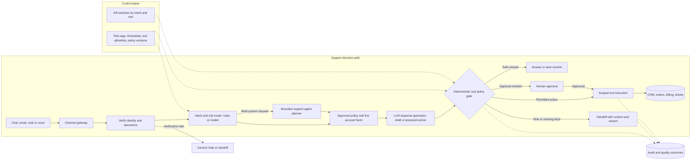

# Customer Support Automation: Main Interview Guide

**Support process** is a customer has a problem, someone answers or acts, and we close the case without making money or data worse.

**G02 covers one slice:** chat/email/voice in, then answer, get approval, or hand off. Not a free-form company agent.

End to end, as a double-charge ticket:

1. **Message lands** — “You billed me twice.”
2. **We verify it’s them** before any account tool.
3. **We look up live billing and the refund policy.**
4. **A model drafts a reply or a refund proposal.** It does not pay anyone yet.
5. **A policy gate checks** identity, amount, freshness, duplicates.
6. **Safe FAQ goes out. Money waits for a human. Unclear cases get a full handoff pack.**

That’s it: **verify → facts → draft → gate → answer, approve, or escalate.** Lawsuits and open negotiation stay human.

> **Core idea:** Build a routed decision pipeline that knows when to answer, when to ask for approval, and when to hand off. The model can draft and recommend; verified identity and a deterministic policy gateway decide whether an account action may happen.

The unchanged [source case](/design/customer-support-automation#full-pack) is the full reference. Use this guide for the spoken design, the [Deep Dive](/design/customer-support-automation#deep-dive) for follow-ups, and the [Cheat Sheet](/design/customer-support-automation#cheat-sheet) for last-minute recall.

## 1. Open with the risk

> “I want to reduce handling time and cost without increasing incorrect or harmful resolutions. I’ll identify which requests can be answered, which need approval, and which need a human. Then I’ll design the identity, policy, action, and handoff boundaries around those decisions.”

Use a double-charge request as the running example. A fluent reply is not enough: the system must verify the customer, check live billing facts, apply the refund policy, avoid a duplicate refund, and hand off cleanly if anything is uncertain.

### Questions to ask the interviewer

These questions set the first-release boundary. The [source case, §1](/design/customer-support-automation#full-pack) has the complete discovery table.

| Question to ask | What it's really asking | What you then decide |
| --- | --- | --- |
| Which channels are in scope, and what are monthly volume and peak concurrency? | Is this chat-only, or also email and voice — and how many tickets hit at once on Monday morning? | Channel gateway, capacity, and whether voice joins the same pipeline. |
| Which intents may be answered or acted on automatically, and which need approval? | Can it answer "where's my order" alone, or must a human approve a refund? | Risk tags, tool policy, and what v1 may do. |
| How is the customer verified, and which account or payment fields are sensitive? | Before we show the last four of the card, how do we know it's actually them? | Assurance level, and which tools stay locked until auth. |
| What is the approval threshold for refunds, and who owns that policy? | At what amount does a manager have to click yes, and who wrote that rule? | The money check on every refund. Do not invent a threshold. |
| How current must policy, order status, and account data be before a promise or action? | If billing is ten minutes behind, can we still promise a refund? | Live lookup vs cache, and what to do when data is stale. |
| What should a human receive at handoff, and how quickly? | When we give up, does the agent get the full story in seconds, or just a transcript later? | Handoff fields, route, and how fast it must arrive. |
| How many languages are needed, and what happens when detection is uncertain? | If we aren't sure the customer wrote Portuguese, do we guess or hand off? | Language fallback and when to escalate. |
| Which legal, financial, or safety cases must remain human-reviewed? | Is a lawsuit threat ever allowed to auto-reply? | What is out of scope, which gates stay human, and launch order. |

If the interviewer cannot provide numbers, say which assumptions you are making. Keep money-moving and account-changing actions gated until identity, authority, and policy are clear.

### The anchor for its support-automation variants

Learn the shared decision pipeline here, then change the boundary that dominates each variant.

| Related case                                                | What changes from G02                                                                                                |
| ----------------------------------------------------------- | -------------------------------------------------------------------------------------------------------------------- |
| Customer Support Assistant at 1M conversations/day          | Planner only for multi-system requests; three distinct memory layers; model routing and large-scale serving.         |
| Multi-Tenant SaaS Support Assistant                         | Add a tenant predicate to every retrieval and tool call; test for cross-tenant leakage.                              |
| ServiceNow Ticket Automation Agent                          | Classify, prioritise, assign, and request missing details; obey the existing ITIL change process.                    |
| Agentic Support Workflow / customer-support interview mocks | Probe handoff quality, wrong refunds, stale facts, confidence, rollout, and the requested automation target.         |
| Study-guide implementations                                 | Show how branches, interrupts, retrieval, durable state, and specialist tools implement the same control boundaries. |

## 2. Requirements: Functional + Non-Functional

The easiest way to frame requirements in an interview is:

> **Functional = what the system does. Non-functional = how well it does it and what constraints it must satisfy.**

### Functional requirements — what the system must do

1. **Normalise intake** — chat, email, web, or voice transcripts into one case envelope.
2. **Classify intent and risk** — before choosing an answer or action path.
3. **Verify identity** — before account data or account tools.
4. **Retrieve live facts** — approved policy and current customer/order state; draft from evidence.
5. **Gate proposed actions** — authorisation, validation, freshness, threshold, and approval.
6. **Escalate with context** — conversation, evidence, attempted actions, and why automation stopped.
7. **Audit the case** — decisions, tool calls, overrides, and outcomes.

### Non-functional requirements — how well / under what constraints

| Requirement | Example target / constraint |
|---|---|
| **Latency** | Routine p95 <3 s; ambiguous p95 <8 s; high-risk handoff bundle p95 <15 s. Final high-risk decision stays human. |
| **Availability** | Illustrative 2M tickets/month and 100 QPS peak; routing and escalation keep accepting work while optional enrichment is shed. |
| **Security** | Customer text untrusted; tools scoped per workflow; identity before account access. |
| **Reliability** | Timeouts and incomplete facts → safe handoff; reconcile possible side effects before retry. |
| **Auditability** | Actor, model/tool/policy versions, validated fields, decision, and override in an immutable trail. |
| **Cost and outcome** | Net value per resolved case, including wrong resolutions and repeat contacts — not raw deflection. |

### First release

Exclude autonomous legal complaints, open-ended negotiation, unsupervised refunds or cancellations, cross-system repair without review, and ambiguous proactive outreach.

### Interview shortcut

If asked **“What are the requirements?”**, say:

> **“Functionally, I need to verify the customer, pull live facts, draft from evidence, and gate any account action. Non-functionally, the constraints are latency by risk tier, fail-closed money moves, audit, and net value rather than deflection.”**

## 3. Architecture you can draw

This simplifies the [source architecture, §4](/design/customer-support-automation#full-pack) for a whiteboard explanation.

### Step-by-step architecture

- **Step 1.** **Receive the request.** The channel gateway normalises chat, email, web, or voice into a support case.
- **Step 2.** **Verify the customer.** Check identity and assurance; failed verification permits only generic help or handoff, not account actions.
- **Step 3.** **Route by intent and risk.** Rules or a small model classify the request; only a multi-system case invokes a bounded support-agent planner.
- **Step 4.** **Gather facts.** Retrieve approved policy and live account facts; the LLM response generator then drafts a reply or proposed tool action.
- **Step 5.** **Gate the proposal.** The deterministic policy gate checks identity, allowed tools, thresholds, freshness, and required approval.
- **Step 6.** **Choose the outcome.** Return a safe answer, send a case with context to a human, or obtain approval for an action that needs it.
- **Step 7.** **Execute and record.** Send permitted actions through the scoped tool gateway to the system of record; audit the decision and outcome.

**Model and agent role:** The LLM drafts and proposes; a bounded agent planner coordinates only requests that truly span systems. Simple lookups use direct routes. Neither the LLM nor the planner authorises an account action; the deterministic gateway and human approval path do that.

**Three boundaries to point at:**

- **Identity:** pre-auth FAQ can use a limited generic mode; account tools require verified assurance.
- **Authorisation:** the model proposes; the tool policy gateway checks identity, allowed action, thresholds, freshness, and human approval. Confidence never grants permission.
- **Sync/async:** accept and route promptly; run permitted longer actions in the background with status and reconciliation.

The automation layer owns the **case workflow and evidence of its decisions**. CRM, identity, order, and billing systems remain authoritative for customer facts and money. Policy articles are versioned; live account or billing state is fetched before an action.
