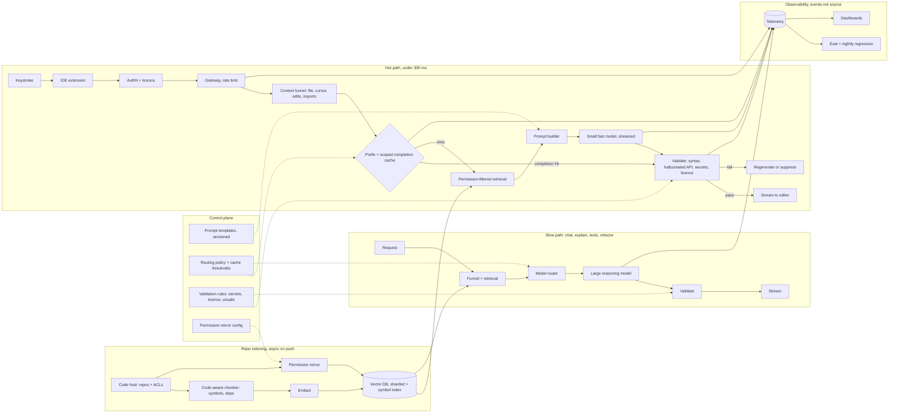

# Enterprise Coding Assistant Under 300 Milliseconds

*A completion has to arrive before the developer's next keystroke, and it has to know the private codebase without leaking it.*

A coding assistant is a context-engineering problem before it is a model problem, because "must feel instant" and "must understand the whole repository" pull in opposite directions. This group has one worked design and one question-bank prompt, so the page is shorter than its siblings and folds the group's prompts into one read for the day before.

| Case in the group | What it contributes here |
|---|---|
| #3 AI-Powered Coding Assistant, Copilot-class, with a sub-300 ms target set by the case (anchor) | Sections 1 to 14: the design, the funnel, the cache, routing, validation, the latency arithmetic, security, follow-ups |
| #51 OpenAI-style practice prompt Q7, Enterprise AI Coding Assistant | The discuss list folded into sections 3, 8 and 12; its productivity follow-up in section 14 |
| Self-drill on #3, Drill Add-ons tab | Section 15 |
| Handbook cross-cutting docs 3 and 4, and cost drivers 1 and 2 | Sections 6, 8, 10 and 15 |

Sections and tables marked *(own construction)* were built for this page from the sources' arguments and are not in the sources verbatim.

---

## 1. Set the Latency Budget Before Drawing Anything

Ask whether suggestions are real-time as the user types; the answer sets the latency budget before you design anything else. The answer is yes, with a budget under 300 ms. Everything after that is a way of spending 300 ms.

The prompt: design an AI-powered coding assistant like GitHub Copilot with real-time completion, code explanation, unit-test generation, bug fixing, refactoring and developer Q&A, integrated into the IDE. Explain how context engineering, semantic retrieval, model routing, semantic caching and output validation keep suggestions fast, accurate and safe. The enterprise version narrows it: a large company wants an internal coding assistant grounded in its private repositories.

| Question | Answer | What it decides |
|---|---|---|
| Cloud or local? | Both exist | Where inference happens; the privacy story |
| Real-time as the user types? | Yes | The latency budget is set before anything else, under 300 ms |
| Which IDEs and languages? | VS Code, IntelliJ, Visual Studio; mainstream languages | A thin, IDE-agnostic extension talking to a shared backend |
| Whole repository or current file? | The whole repo, within reason | Context engineering is the hard problem |
| Private models and on-prem for enterprise? | Yes | Security and deployment shaped from day one |

The weak answer is one call to a big model with the open file as context. It is too slow for completion, blind to the rest of the repository, and it sends source code it never needed. The strong answer is a retrieval-augmented, context-engineered system. Gather and prioritise context instead of sending repositories. Use semantic retrieval. Route across models to balance latency, cost and quality. Manage the context window for large codebases. Validate every output before it reaches the editor. Say that shape in the first two minutes.

> *"A coding assistant is a retrieval-augmented, context-engineered system, not one call to a big model. The 300 ms budget and the private repository are the two constraints, and every component earns its place by trading latency, cost and quality against the others."*

## 2. State Requirements as Testable Constraints

A requirement that cannot fail a test is a preference. "Fast" is a preference; "under 300 ms for inline completion at p95" is a constraint, and only the second one shapes the architecture. Split the functional list with MoSCoW so the launch gate is the smallest set that still keeps the promise *(the split is own construction; the items are the source's)*.

The must-haves are five. Real-time single-line and multi-line completion inside the IDE. Workspace-aware suggestions grounded in the repository, not the open file alone. Repository-level access control honoured during retrieval, so a developer is never shown code they may not read. Output validation before display: syntax, hallucinated APIs, secrets, unsafe patterns. Telemetry that captures accept, partial-accept and reject without retaining source.

The should-haves round out the first usable version: explain selected code, generate unit tests and documentation, refactor, fix compilation and runtime errors, answer coding questions, search the codebase, generate commit messages, support multiple languages. Personalisation from accepted versus rejected suggestions can come after the hot path is trusted.

| Constraint | Stated so it can be tested |
|---|---|
| Latency | Inline completion under 300 ms p95 end to end. The example split, ~10 ms cache, ~40 ms context, ~200 ms streamed inference, ~50 ms validation, already sums to 300 ms, so trim a stage to leave network headroom. Chat, explain and refactor run on a slower path with a stated p95 of their own |
| Accuracy and hallucination | Acceptance rate tracked per task and per language; hallucinated-API rate caught by validation and measured, not assumed |
| Availability | Highly available; on a backend outage the extension degrades to no suggestion, never to a stale or wrong one |
| Security | Never train foundation models on private enterprise code without explicit consent. Encrypt in transit and at rest. Repository-level access control enforced during retrieval. Secrets and credentials masked before context leaves the IDE. Private or on-prem deployment for regulated industries. Audit logs |
| Scale | Millions of developers; bursty keystroke demand absorbed by autoscaling inference and stateless servers |
| Cost | Small model for the hot path, large model only on explicit request; completion length capped; cache hit rate as a cost metric |
| Personalisation | Coding style, project APIs and accepted-suggestion history used to tune prompts and retrieval while raw source stays protected |

Every must-have then needs an owner in the architecture *(own construction)*.

| Requirement | Primary component(s) |
|---|---|
| Real-time completion under 300 ms | Semantic cache, small fast model, streaming, persistent IDE connection |
| Workspace-aware suggestions | Context collector, context builder, embedding service, vector database, semantic search |
| Repository-level access control | Authentication service, permission mirror from the code host, retrieval filter |
| Output validation | Validation service: parser, security filters, hallucinated-API detector |
| Telemetry without source retention | Telemetry and analytics, storing events and hashes rather than code |
| Explain, test, refactor, fix | Model router to the larger reasoning model; task-specific prompt templates |
| Personalisation | User preferences, conversation memory, feedback loop into retrieval |

## 3. Map the Context Signals and Who May See Them

Not every context signal is worth its token cost, and every signal is source code someone owns. Map the signals first, then the permission each one carries.

The collector gathers the current function, the current file, open tabs, imported libraries, repository structure, cursor location, programming language, recent edits, compiler errors and optionally the git branch. It selects only what is relevant. It never sends the whole repository.

| Signal | Cost | Permission it carries | *(own construction)* |
|---|---|---|---|
| Current function and file | Cheap, always in | The developer already has it open | |
| Open tabs and recent edits | Cheap, usually in | Same session, same developer | |
| Imports and repository structure | Cheap, structural | Repository read access | |
| Compiler errors | Cheap, high value for bug fixing | Local to the session | |
| Retrieved snippets from the repo index | Costs an embedding lookup | **Repository-level ACL from the code host** | |
| Retrieved snippets from other repositories | Costs a lookup and risks leakage | Only where the developer holds read access there too | |
| Internal API docs and conventions | Cheap once indexed | Organisation-level | |

The OpenAI-style practice prompt adds the indexing side: repository indexing with incremental updates, code-aware chunking, symbol and dependency retrieval. Index by symbol and file rather than by fixed token windows, so a retrieved chunk is a whole function or class and its imports. Re-index on push, not on a schedule, so the assistant never suggests a helper that was deleted this morning. Mirror the code host's repository permissions into the index metadata at indexing time and check them again at retrieval, which is the same two-layer rule as the Enterprise Knowledge Assistant case *(own construction, drawn from section 6 of the Enterprise Knowledge Assistant case)*.

## 4. Draw the Architecture End to End

The organising rule is cache first, retrieve only on a miss, route by task complexity. The scoped completion cache, exact match first, is the load-bearing latency optimisation. A valid hit, a completion the assistant has already seen in the same scope, skips embedding, retrieval and the model, and goes straight to output validation. Measure the hit rate rather than assume hits are the common case.

The source's own diagram, kept verbatim:

```
IDE Extension
│
Authentication Service
│
API Gateway / Load Balancer
┌──────────────┴──────────────┐
Context Collection      User Preferences
└──────────────┬──────────────┘         Conversation Memory
               │  ◄──────────────────────────────┘
        Context Builder
               │
        Semantic Cache
        ┌──────┴──────┐
    Cache Hit      Cache Miss
        │              │
        │        Embedding Service
        │              │
        │        Vector Database
        │              │
        │        Relevant Code Retrieval
        └──────┬────────┘
          Prompt Builder
               │
          Model Router
        ┌──────┴──────┐
Small Fast Model   Large Reasoning Model
        └──────┬──────┘
        Output Validation
               │
          IDE Suggestions
```

In the source drawing a cache hit rejoins at the prompt builder. This design ends a valid hit at output validation instead, so a hit never calls a model.

The same system drawn with its planes and lanes *(own construction)*: a control plane that changes by release, and three data-plane lanes that run per request or per push.

```
 ╔═══════════════════════════ CONTROL PLANE (changes are releases) ═══════════════════════════╗
 ║  prompt templates per task (versioned) · routing policy · cache thresholds · validation rules ║
 ║  permission mirror config · licence + secret patterns · model versions · budgets · eval gates ║
 ╚═════════════════════════════════════════╤═════════════════════════════════════════════════════╝
                                           │ configures every box below
 ╔═══════════════════════════ DATA PLANE (calls are requests) ═════════════════════════════════╗
 ║                                                                                               ║
 ║  REPO INDEXING — asynchronous, on push                                                        ║
 ║   code host (repos, ACLs) ─> code-aware chunker (symbols, deps) ─> embed ─> vector DB (sharded)║
 ║        │                             │                                     + symbol index     ║
 ║        └─ permission mirror ─────────┴─> ACL metadata on every chunk                          ║
 ║                                                                                               ║
 ║  HOT PATH — inline completion, < 300 ms                                                       ║
 ║   keystroke ─> extension ─> authN + licence ─> gateway ─> context funnel ─> PREFIX + SEMANTIC ║
 ║                (persistent connection)        (rate limit)  (nearest files,     CACHE         ║
 ║                                                              cursor, edits)   hit │ miss      ║
 ║                                                                                   v           ║
 ║                                                     permission-filtered retrieve (symbols)    ║
 ║                                                                                   v           ║
 ║                          prompt builder ─> SMALL FAST MODEL ─> VALIDATE ─> stream to editor   ║
 ║                                             (streamed)         syntax · hallucinated API      ║
 ║                                                                secrets · licence · unsafe     ║
 ║                                                                     │ fail: regenerate/suppress║
 ║  SLOW PATH — chat, explain, tests, refactor, fix                                              ║
 ║   request ─> same funnel + retrieval ─> ROUTER ─> LARGE REASONING MODEL ─> VALIDATE ─> stream ║
 ║                                                                                               ║
 ║  OBSERVABILITY — every stage writes events, never source                                      ║
 ║   telemetry (latency by stage · cache hit · accept/partial/reject · validation fails)          ║
 ║      ─> eval + regression suite ─> dashboards (acceptance, first-token latency, cost/1k compl.)║
 ╚═══════════════════════════════════════════════════════════════════════════════════════════════╝
```

The same flow for viewers that render Mermaid *(own construction)*:



Read the components in dependency order. The fourteen are the source's; the failure column is own construction.

| # | Component | Responsibility | Fails how |
|---|---|---|---|
| 01 | IDE Extension | Captures developer actions and displays suggestions | Degrades: no suggestion, editor keeps working |
| 02 | Authentication Service | Verifies user identity and licenses | Closed: no identity, no request |
| 03 | API Gateway | Routes requests and enforces rate limits | Closed on limit; sheds the slow path first |
| 04 | Context Collector | Gathers relevant workspace information | Degrades: current file only |
| 05 | Context Builder | Compresses and structures context for the model | Degrades: fewer signals, same prompt shape |
| 06 | Embedding Service | Converts code into vector embeddings | Degrades: cache and local context only |
| 07 | Vector Database | Stores embeddings for semantic retrieval | Degrades: no retrieved snippets, say so in telemetry |
| 08 | Semantic Search | Retrieves relevant code and documentation | Closed on permission check; degrades on availability |
| 09 | Prompt Builder | Constructs optimised prompts | Closed: a broken template fails the prompt unit test before release |
| 10 | Completion Cache | Reuses completions within the same scope, exact match first | Degrades to a miss; never serves across permission scopes |
| 11 | Model Router | Selects the best model based on task complexity | Degrades to the small model |
| 12 | LLM Inference Service | Generates code and explanations | Degrades: fail over region or model; suppress on timeout |
| 13 | Validation Service | Checks syntax, security, and quality | Closed: no validation, no suggestion |
| 14 | Telemetry & Analytics | Captures usage, latency, and feedback | Degrades: suggestion still served, gap logged |

Point at three boundaries while the diagram is up *(own construction)*. The hot path and the slow path share the funnel and the index but nothing else, so a refactor request never queues behind a keystroke. The trust boundary sits at retrieval: nothing enters the prompt that the developer could not open in the code host. And source code crosses the network exactly once, as the funnelled prompt, and never lands in telemetry.
