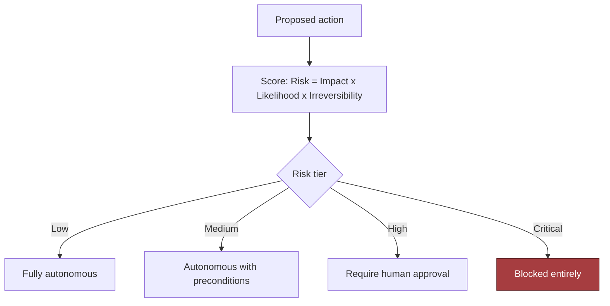

# Tool-Using AI Agent with Safety Controls

*Let the model act on email, CRM and refunds without ever letting it decide, because usefulness comes from acting and trust comes from never deciding.*

The hard part of this system is not getting a model to call a tool. It is that an agent which reads email, queries systems, updates CRM and issues refunds has to be useful without holding any authority. So the model proposes and deterministic systems decide. This page consolidates the group's prompts into one read for the day before. Everything else in the group is a delta on it.

| Case in the group | What it contributes here |
|---|---|
| #22 Tool-Using AI Agent with Safety Controls (anchor) | Sections 1 to 10: the design, requirements, evaluation and rollout |
| #1 Enterprise AI Assistant over 100+ internal applications | Section 6: REST, function calling, MCP and agent frameworks as layers; the tool registry at scale; identity propagation |
| #50 OpenAI-style practice Q6, AI Agent for Enterprise Workflow Automation | Section 11: the focus list and the refund follow-up |
| #82 Reported Salesforce prompt: agent loop, tool interfaces, memory, orchestration, safety | Section 6 and 11: the loop shape and the Tier 2 probes |
| #90 Incident: refund tool called above the approval threshold | Section 13 |
| #107 and #118 §15 scenarios: agent loops on tools, tool workflow times out | Section 12 |
| #22 self-drill: the agent gets slow and expensive | Section 12 |

---

## 1. Name the Model as the Proposer, Never the Authority

Open with the disagreement, not the feature list. The customer asks for an agent that reads email, queries internal systems, updates CRM records and issues refunds. Everyone nods at the feature list, then disagrees completely. Operations wants speed. Security wants hard approval gates. The support manager wants routine cases handled without friction. Finance fears irreversible money movement. That disagreement is the design problem. So restate the ask as a testable outcome: enable useful automation while deterministic controls govern identity, permissions, risk and irreversible effects. The consequence is that the model is not the authority. It interprets and proposes. Deterministic systems decide who may act, what may change and whether an action can be reversed.

> *"Let me restate the problem first. We need a tool-using agent that can read email, query internal systems, update CRM records, and sometimes trigger refunds, but the model itself should not have unchecked authority. So I'd frame the outcome as enabling useful automation while deterministic controls govern identity, permissions, risk, and irreversible effects."*

The three answer tiers show what that framing buys. The weak answer connects the agent to email and CRM and lets it issue refunds when it decides the customer deserves one. It makes the model the authority, hands it credentials instead of scoped capabilities, and has no defence against instructions hidden in a ticket. The average answer plans tool calls, checks permissions before each one, requires approval for large refunds, logs everything and adds retries. It still treats tool output as trusted, never bounds loops or spend, and adds retries without idempotency, which is how one refund quietly becomes two. The strong answer has the planner propose one bounded action. A typed schema validates it. A deterministic policy engine returns allow, block or needs-approval. A credential broker mints a short-lived token scoped to that single action. An idempotent gateway guarantees exactly one effect. Tool observations are untrusted data, never instructions. Loops, spend, refund amounts and destinations all have hard ceilings.

Then ask the questions that change what may be built, because a useful question is not the one that sounds thorough.

| Question to ask | What the answer decides |
|---|---|
| Which actions are reversible and which are not, and exactly where does the money boundary sit? | Whether the design is a control system with payment and escalation rules, or an assistant with tools |
| Does the agent act as the user, a service account, or a delegated actor with a narrow role? | Blast radius. Full-record access widens it; case-specific field access contains injection damage |
| What may the agent do on its own, what needs review, what must never happen automatically? | The autonomy matrix: action classes, thresholds, exception paths. Autonomy is never a single switch |
| Is email content untrusted input? | Yes, always. A message may carry instructions to override policy, exfiltrate data or trigger a tool |
| What must be logged, retained, reviewable or exportable for audit and disputes? | The ledger schema and retention; auditability is a design input, not an afterthought |
| How is the system disabled when something goes wrong? | The kill switch and the incident path. The interviewer wants to hear the system can be stopped before it is perfected |
| Which systems are the source of truth for identity, customer state and financial actions? | Where the planner reads and where it may never write |
| Is success fewer handling minutes, higher resolution rate, lower error rate or better satisfaction? | The metric the business inspects, which sets the autonomy threshold |

Map the people, because each stakeholder defines a different success condition.

| User | Workflow | Failure they notice first | What the agent gives them | Approval needed |
|---|---|---|---|---|
| Business user | Delegates inbox and case work, wants less manual handling | The agent stalls or does the wrong thing to a customer | Triage, drafts, prepared refund cases, closed loops on low-risk cases | None for reads and drafts |
| Approver | Decides when a risky action is allowed | A refund executed without them, or a queue that never drains | An approval record with reviewer, timestamp, rationale and the exact payload | They are the approval |
| Security owner | Defines identity, authorisation and audit rules | A long-lived credential in a prompt, or a tool called on an injected instruction | Scoped tokens, a policy gate outside the model, a tamper-evident ledger | Signs off on each tool class |
| Tool and data owner | Owns email, CRM, customer DB, refund service | Their system called in unsupported ways, or duplicated writes | A declared schema per tool, idempotency keys, per-tool concurrency limits | Owns the revert procedure |
| Operator | Monitors, retries, escalates | No way to stop it, no way to explain a decision | Kill switch, runbook, replayable decision record | Runs containment |

State the assumptions where the interviewer withholds answers, ranked by risk. With no approval process defined, assume a conservative human gate on every irreversible action. With retention unspecified, assume enough is stored to reconstruct any action, and leave the exact period to customer policy. With tenancy unclear, assume strict isolation and a separate authorisation check at every tool boundary. The CRM is the source of truth for customer context. Refunds above a threshold require approval. The agent may draft actions but cannot execute high-risk steps unless the policy engine allows it.

## 2. State Requirements as Testable Constraints

A requirement the customer cannot test is a preference. "It should be safe" is a preference; "no arbitrary command execution" is a constraint, and only the second one changes the architecture. Distinguish what the system must do, how safely it must do it, and what it must never do.

The six must-have functional requirements are a set, and interviewers ask for them cold. Separate planning from execution, so the model proposes a plan and a separate control layer decides whether any tool call is allowed. Validate tool name, arguments, identity and policy against an allowlist, a parameter schema, the caller's identity and the policy rules before anything runs. Use scoped, short-lived credentials, so the agent never holds a broad secret and receives only the minimum for the next approved step. Require approval for high-risk actions, meaning refunds, account changes and any irreversible external write cross a human boundary unless the customer accepts a narrower automated threshold. Make effects idempotent and auditable, so a retry cannot double-refund and every decision leaves a replayable trace. Stop safely under uncertainty: poor confidence, a malformed tool response, unclear policy or an inconsistent environment means pause, escalate or fail closed, never improvise.

Three should-haves belong in the first usable version. A declared registry with schema and data class for every tool, so undeclared tools cannot be called. A tested kill switch that halts autonomous paths without a deploy. Approval captured as a first-class record. The could-haves wait: richer policy expression, adaptive risk scoring, queued multi-step orchestration, replay tooling, operator dashboards, anomaly detection on action patterns, per-tenant policy overlays.

Declare the non-goals, because the strongest candidates draw a narrower boundary than the prompt suggests:

- free-form code execution or shell access
- open-ended tool discovery
- unbounded autonomous loops
- automatic refunds without approval thresholds
- cross-tenant data access
- self-modifying policy logic

The constraints are the lines that cannot be crossed, and each is stated so a test can fail it.

| Constraint | Stated so it can be tested |
|---|---|
| Latency | Model-planning time budgeted separately from tool time; p95 completion under about 15 seconds for low-risk tasks; approval queue time bounded by an escalation rule, for example 99.5% of approval requests leave the queue within 2 minutes |
| Availability | At 50,000 users and 20 QPS peak, 10 actions per task means roughly 200 tool actions per second. Reads parallelize; writes and approvals do not. Concurrency capped per user, per tool and globally |
| Cost | Hard ceilings on tool calls per task, per-task spend, refund amount and allowable destinations. These are guardrails, not tuning knobs |
| Security | Short-lived, narrowly scoped credentials minted per workflow; the model never holds a reusable API key or admin token. No arbitrary command execution. Tool observations are untrusted input |
| Audit and compliance | A tamper-evident ledger records intent, policy decision, approval and outcome for every action. Every decision is replayable from versioned prompts, policies, proposals and outcomes |
| Reliability | Writes fail closed when the credential broker or policy engine is unavailable; only the lowest-risk reads degrade. A write is never retried without proven idempotency |
| Operability | A rapid global disable for the agent, a tool category, or both, without a deployment cycle |

Every must-have then needs an owner in the architecture, and the traceability table is the proof.

| Requirement | Control point | Component |
|---|---|---|
| Separate planning from execution | Plan/execute boundary | Orchestrator that emits candidate actions but cannot perform them |
| Validate tool name, arguments, identity, policy | Policy gate | Authorisation service with schema validation and allowlists |
| Use scoped short-lived credentials | Secret broker | Token minting layer with time-limited, least-privilege credentials |
| Require approval for high-risk actions | Human approval flow | Review queue with explicit accept/reject and reason capture |
| Idempotent, auditable effects | Action ledger | Durable event log and idempotency keys |
| Stop safely under uncertainty | Fail-closed controller | Error handler that pauses execution and alerts operators |
| No arbitrary command execution | Execution sandbox | Restricted tool adapters only, no shell escape |
| Bounded autonomous steps and spend | Budget governor | Step counter, retry cap, spend threshold |
| Replayable decisions | Decision record | Versioned prompts, policies, tool proposals, outcomes |
| Rapid global disable | Kill switch | Central feature flag or routing gate that stops all agent actions |

## 3. Size by Workload Shape and Risk, Not by Request Count

One request is not one unit of work. Use the planning anchor of 50,000 users, 10 actions per task and 20 QPS peak. Then separate three layers of load. How often tasks arrive. How many tool calls, model calls and policy checks each task triggers. How many actions can actually change records, money or permissions.

| Estimate | Number | What it forces |
|---|---|---|
| Planning decisions | 20 per second at peak; 40 to 60 model calls per second under iterative planning bursts | The planner is a queueing problem before it is a throughput problem; size planner and tool adapters separately |
| Tool actions | roughly 200 per second at peak | Reads parallelize; writes and approvals do not; concurrency caps must assume worst-case composition |
| Audit storage | ~5 KB decision record and ~20 KB audit trail per task, so 100 KB/s to 400 KB/s | About 8.6 GB to 34.6 GB per day of raw append-only data before indexing and replication |
| Planner compute | ~1 second of planner time per task, so about 20 core-seconds per second at peak | Reasoned about as a throughput-constrained service with slack for tail latency |

The estimate that most affects the design is not CPU. It is the ratio of model time to tool time, plus the irreversibility of tool effects. Planning fast and tools slow means invest in async orchestration, caching and queueing. Tool effects high-risk means invest in policy checks, staged execution and audit logging even at the cost of latency. Human review as the bottleneck means clearer escalation rules and fewer ambiguous cases.

Derive the risk tier before deciding autonomy. The decision aid is `Risk = Impact × Likelihood × Irreversibility`, not literal arithmetic. A low-impact read of a public FAQ can be fully autonomous. A CRM update can be partially reversible and still costly if it misroutes a customer. A refund may be technically reversible and still meaningfully irreversible through customer dissatisfaction, accounting noise or abuse. The tiers are fully autonomous, autonomous with preconditions, requires human approval, and blocked entirely.

Show the sensitivity range instead of false precision. The 10× growth case is the real test: which part breaks first, the planner, the approval queue, a tool adapter, the audit log or the refund service?

| Scenario | Task peak | Internal action pressure | Likely design implication |
|---|---|---|---|
| Baseline | 20 QPS | Moderate | Single queue, bounded retries, tight approval gate |
| 10x growth | 200 QPS | High | Partition by tenant or workflow class, add backpressure, move more work async |
| 10x lower | 2 QPS | Low | Simpler deployment may work, but keep safety controls identical |

Concurrency limits are a safety feature, not only a performance one. Cap per user, so nobody floods the system with parallel tasks; per tool, so a noisy downstream is not overwhelmed; and globally. Encode value limits too, so many low-risk reads are allowed while the number and value of refunds in flight stays bounded. A well-designed limit stops a prompt injection from becoming a cascade.
