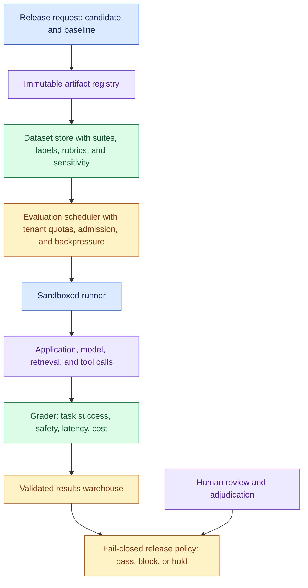
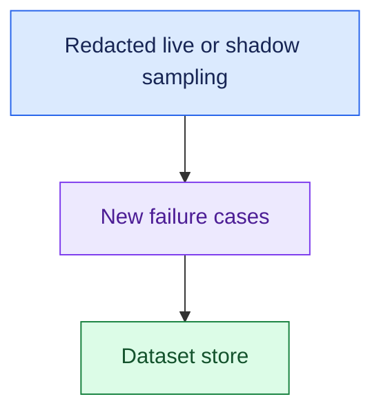
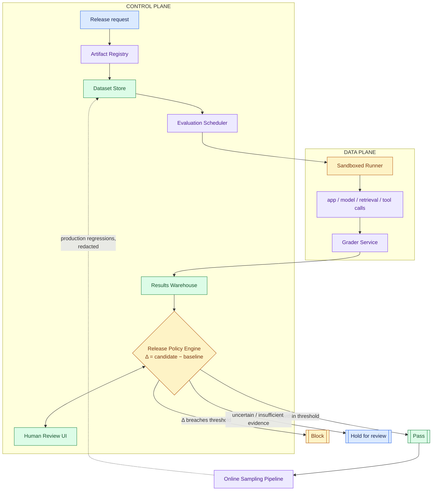

# Evaluation and Release Gating for Thirty AI Applications, part 2

## 4. Draw the Architecture End to End

The organising rule is a split. The control plane decides what to evaluate, and the data plane executes it. A slow or failing runner therefore cannot make policy nondeterministic. Candidate selection, enforcement and escalation stay deterministic however noisy the execution is.

The planes and lanes as one picture:





- Artifacts include prompts, models, retrieval, tools, seeds, and hashes.
- Bound runner timeouts, egress, secrets, and concurrency. Human overrides are policy inputs and validated runs remain auditable.

The same flow with the decision branches, from the answer key and the tutorial:



Read the components in the order a release travels through them.

| Component | Primary responsibility | State ownership | Fails how |
|---|---|---|---|
| Artifact Registry | Store immutable candidate definitions and baseline references | System of record for candidate config | Closed: an unresolvable artifact means no run |
| Dataset Store | Store suites, labels, rubrics, and scenario metadata | System of record for eval inputs | Closed: a missing suite means no run |
| Evaluation Scheduler | Select suites, fan out work, enforce queueing and concurrency | Job state / run orchestration state | Degrades: sheds noncritical work, lowers concurrency |
| Sandboxed Runner | Execute prompts, tool calls, and model calls under isolation | Ephemeral run state | Retries idempotently with the same run ID |
| Grader Service | Score task success, safety, latency, and cost | Derived scoring state | Closed for release decisions on timeout; retry for analysis runs |
| Human Review UI | Resolve ambiguous or disputed cases | Review decisions and annotations | Holds the release; nothing auto-approves |
| Results Warehouse | Persist run-level and aggregate outcomes | System of record for validated results | Closed: evidence store down means block and escalate |
| Release Policy Engine | Decide pass, block, or hold for review | Policy decision state | Closed: reads only completed, validated records |
| Online Sampling Pipeline | Sample live or shadow traffic post-release | Monitoring / sampling state | Degrades: dashboards lag, the gate keeps running |

- Point at three boundaries while the diagram is up. The registry and dataset store are strongly consistent, so a run always points at fixed inputs.
- The warehouse can be eventually consistent for analytics, but the final gate reads only completed, validated records.
- And the runner is the trust boundary: prompts, retrieved documents and uploaded cases are adversarial until proven otherwise.

- The happy path runs in ten steps. A release engineer submits an immutable candidate to the registry.
- The registry pins the exact prompt, model, retrieval, tool, seed and baseline identifiers.
- The scheduler selects the application's suite, partitions work by tenant and enforces concurrency limits.
- The runner executes cases in isolation with controlled seeds. The grader scores correctness, safety, latency and cost.
- The warehouse stores run-level and aggregate results. The policy engine compares candidate metrics and confidence intervals with the pinned baseline.
- Ambiguous cases route to human review. The decision is issued as pass, block or hold, with reasons attached to the release record.

Each step answers a different customer question. The registry answers "what exactly changed?" The suite answers "what did we test?" The runner answers "under what conditions?" The grader answers "how did it perform?" The policy engine answers "can we ship?"

The MVP is the smallest trustworthy path from registration to decision: registry, dataset store, async scheduler, sandboxed runner, grader, warehouse, and a policy engine that can pass or block. Richer human workflow, adaptive suite selection, online sampling, multi-region execution and score calibration come later.

## 5. Pin Every Input and Compare Against a Baseline

A score means nothing without the thing it is compared against. The platform does not produce one "good" number; it says whether a candidate is better, worse or indistinguishable from a pinned baseline.

- The comparison is **Δ = Metric_candidate − Metric_baseline**. The metric can be quality, safety violation rate, task success, refusal accuracy, latency or cost, depending on the gate.
- A shift is useful only when the baseline is fixed, versioned and comparable.
- A two-tenths-of-a-point gain on a noisy rubric may not justify release. Weigh variance, confidence bands and operational risk as well as the sign of the delta.

- Say the derivation on the whiteboard in one breath. For each test case, compare candidate output to a pinned baseline output or rubric score.
- Compute Δ for the metric that matters to the application. Aggregate by application, by release and across the fleet.
- If the distribution of Δ crosses the allowed regression threshold, the gate fails or routes to human review.

Four records carry the whole design. Their lifecycles let you reconstruct a decision a year later.

| Record | Purpose | Lifecycle |
|---|---|---|
| `EvalArtifact(id, type, version, hash)` | Names a model, prompt bundle, retrieval config, tool manifest, or policy snapshot | Never mutated in place; a new version gets a new ID |
| `EvalCase(id, input_ref, expected, rubric, sensitivity)` | One case: input reference, expected behaviour, scoring rubric, sensitivity class | Updated by creating a new version; retired when obsolete |
| `EvalRun(id, candidate, baseline, status)` | One comparison of a candidate against a baseline under a policy snapshot | Status moves monotonically through submitted, queued, running, completed, failed, blocked |
| `EvalResult(run_id, case_id, scores, trace_ref)` | One case-level outcome with multidimensional scores and a trace pointer | Written once; changed only by an explicit superseding correction |

- Ownership is split on purpose. The evaluation program owns `EvalCase`, the control plane owns `EvalRun`, and the execution path writes `EvalResult` for reviewers and auditors to read.
- That split keeps the gate from silently rewriting evidence after the fact.
- The decision record and the redacted score summary also outlive the raw trace.
- A shorter trace-retention policy therefore never destroys auditability.

- The API surface stays at four endpoints: `POST /v1/eval-runs`, `GET /v1/eval-runs/{id}`, `POST /v1/reviews` and `POST /v1/release-decisions`.
- Three ideas do most of the reliability work at that boundary. An idempotency key on every retryable write returns the original `run_123` on a retry instead of creating `run_124`.
- Explicit contract versions keep a run created under policy `v7` from being read under `v8` semantics.
- An ETag on reviews and decisions means two actors finalising the same run cannot both win; the second gets a `412 Precondition Failed` and must re-read.
- An override is always a new superseding record, never an invisible overwrite.

## 6. Decide on Four Dimensions and Fail Closed

One opaque score hides the trade the customer cares about. A candidate can raise quality while lowering safety, doubling latency or blowing the budget. The gate therefore checks each dimension separately and allows a release only when all of them pass.

The smallest code path that proves the design is the decision function. It validates typed input at the boundary, injects the statistical comparison as a seam, and returns every check with the verdict.

```python
def release_decision(candidate: Mapping[str, Any], baseline: Mapping[str, Any], policy: Mapping[str, Any], comparator: Comparator) -> Decision:
    candidate_metrics = _parse_candidate(candidate)
    _ = _parse_candidate(baseline)
    policy_obj = _parse_policy(policy)
    delta = comparator.compare(candidate, baseline, bootstrap_samples=2000)
    checks = {
        "quality": delta.quality_lower_bound >= -policy_obj.max_quality_drop,
        "safety": candidate_metrics.safety_rate >= policy_obj.min_safety_rate,
        "latency": candidate_metrics.p95_latency_ms <= policy_obj.max_p95_ms,
        "cost": candidate_metrics.cost_per_case <= policy_obj.max_cost,
    }
    return Decision(allow=all(checks.values()), checks=checks, delta=delta)
```

Quality is judged on the lower bound of a bootstrapped delta, not the point estimate. That single choice is what "statistically honest" means in code. A malformed metric, such as `"safety_rate": "high"`, raises `ValidationError` before any policy logic runs. The tutorial's test policy uses `max_quality_drop` 0.01, `min_safety_rate` 0.95, `max_p95_ms` 250 and `max_cost` 0.20 under `policy-7`.

One invariant gets its own test: a quality gain cannot hide a safety regression.

```python
baseline = Score(quality=0.90, safety_rate=0.999)

def test_quality_win_cannot_hide_safety_regression():
    candidate = scores(quality=0.95, safety_rate=0.97)
    assert not release_decision(candidate, baseline, policy(min_safety_rate=0.995)).allow
```

A more persuasive release cannot ship if it falls below the safety floor. The round tests that judgement.

Missing evidence and thin evidence are different outcomes. Missing evidence, such as a grader timeout or a dead evidence store, blocks. Thin evidence, a sample too small to decide, holds as "insufficient evidence" rather than approving. Neither ever turns into a pass by default.

## 7. Calibrate the Grader Before Letting It Gate

A model grader is part of the release logic, so it needs evaluation like any other component. An uncalibrated grader can make a risky release look safe while still producing a clean audit trail.

The named failure is a grader that rewards verbosity over correctness. Long, confident, wrong answers receive high marks. The runner completes normally, so nothing looks broken. The fix is a drill in four moves.

| Move | Action |
|---|---|
| Detect | Score distributions shift toward long responses with low factual alignment; compare against a baseline grader or a smaller rule-based check |
| Contain | Pause the grader version for that tenant or application and require human approval for release decisions |
| Recover | Re-run the affected cases with a pinned prior grader version and a manually sampled audit set |
| Prevent | Version the grader, store rubric hashes, and require a calibration suite that includes concise-correct and verbose-wrong examples |

- Validate a grader against human judgements on a representative sample, not the easy cases.
- Measure agreement on the cases that drive release decisions, then inspect the disagreements.
- Some reveal rubric gaps; others expose ambiguity in the task itself. Re-score a held-out set with humans periodically, because a grader drifts after rubric changes or model upgrades even when the platform is stable.

Trust is earned in levels. Early on the grader is advisory: it blocks only low-risk deploys or requires human approval on uncertain cases. As agreement stabilises, high-confidence checks move to automatic gating. The design assumes the grader is imperfect and builds a path to trust.

| Trade-off | Use this for breadth | Use this for the decision |
|---|---|---|
| Generic metrics vs task-specific rubrics | Generic metrics for platform-level trend visibility | Task-specific rubrics for release decisions |
| Model graders vs human review | Model graders on every change | Humans for calibration, dispute resolution and periodic audits |
| Large suites vs iteration speed | Fast smoke suite on every candidate | Broader regression suite pre-release; deep audits for high-risk changes |
| Fixed thresholds vs statistical tests | Statistical comparison for noisy quality metrics | Fixed thresholds for critical safety invariants |

All four pairs share one shape: one tool for breadth, another for the decision that matters. Reuse that shape live when a specific answer does not come.
