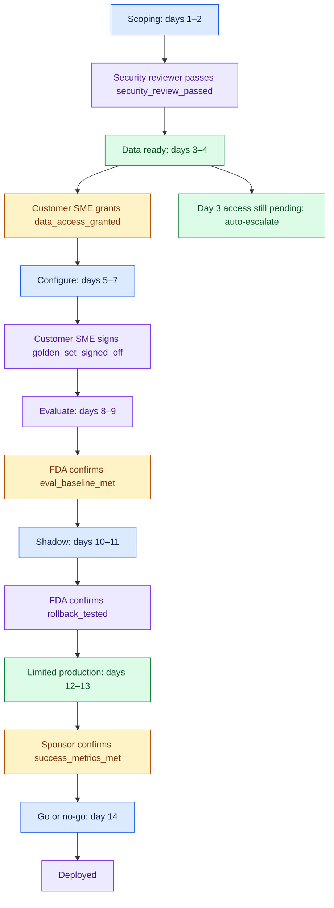
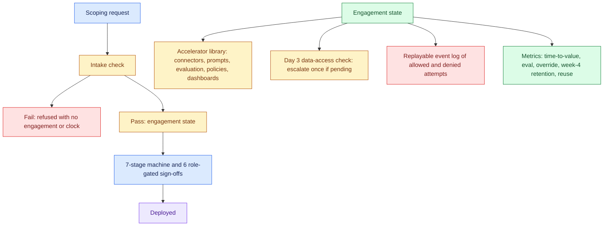
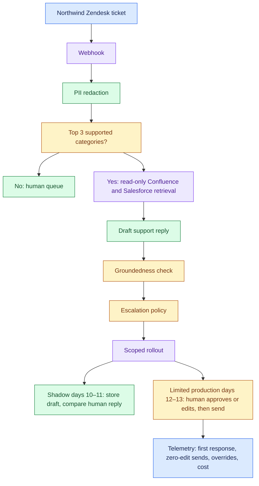
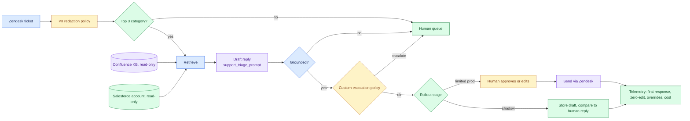

# Scoping Doc to Deployed Agent in Two Weeks

*Two weeks is fast enough to lose the customer's trust by cutting a corner, and slow enough to prove the process never needed one.*

It comes up in a system design round, but this is an operating-model question. The design is a state machine whose gates are code rather than trust. The page puts the group's prompts into one read for the day before.

| Case in the group | What it contributes here |
|---|---|
| Scoping Doc to Deployed Agent in Two Weeks, 60-minute whiteboard script (anchor) | Sections 1 to 11 and 14: framing, clarifying questions, gates, the library, risks, failure modes, scale, the close |
| Northwind Logistics tier-1 support triage, Module 10 running case and the AI_Engineer interview script and code project | The fourteen-day table, the five metrics, the evidence-bar critique and the verified numbers; the delta is in section 13 |
| Self-drill, Drill Add-ons tab | Section 15 |
| Module 10 doc 4 and the project's `docs/05` | Sections 6, 9 and 10 |

Sections and tables marked *(own construction)* were built for this page from the sources' arguments and are not in the sources verbatim. The triage agent's internals in section 4 are the largest such addition, because the sources design the delivery pipeline and name the agent without drawing it.

---

## 1. Frame the Round as an Operating-Model Question

Say the framing sentence in the first two minutes. It names the test before you draw any box.

> *"This isn't really a software architecture question — it's an operating-model question. Anyone can draw a pipeline with seven boxes. The signal is whether each box is a real, enforced gate or just a status someone reports honestly. I designed it so the gates are code, not trust."*

- The naive answer is "work faster" or "hire more people", and that is the trap.
- Two weeks is only possible if most of the work already existed before the customer showed up.
- If every engagement starts from a blank page, two weeks is not a schedule, it is a wish.
- So speed has to be a side effect of reuse and hard gates, never a target chased by cutting corners.

That splits the answer into two questions, and a strong answer spends its time on both:

| QUESTION THE ROUND IS REALLY ASKING | WHAT ANSWERS IT |
|---|---|
| How do we know each stage is safe to leave, beyond the fact that time passed? | Gates: a named, checkable condition, signed off by the right role, never by the person closest to the work |
| How do we make two weeks achievable for a different customer every time? | A library of reusable assets that most of each stage is assembled from, not written |

A weak answer draws seven boxes labelled scoping, data, build, test and launch, then stops. That is a checklist, and checklists get skipped under deadline pressure. Restate the problem in one breath when asked:

> *"We're designing a repeatable delivery pipeline — not a one-off project plan — where speed comes from a reusable accelerator library, and safety comes from hard, role-gated checkpoints between stages, so that two weeks is an achievable outcome of the process, not a deadline we hope to hit by cutting corners."*

## 2. Ask the Five Questions That Change the Design

A clarifying question earns its minute only if a different answer changes a box. These five each do.

| QUESTION | WHAT CHANGES WITH THE ANSWER |
|---|---|
| Is "2 weeks" a hard SLA or a target? | Whether a gate failure means "slip the date" or "abort and re-scope" |
| Who owns the go/no-go decision: the FDA, the account team, or the customer? | Who the `success_metrics_met` gate's allowed role should be |
| What is genuinely reusable across customers versus inherently one-off? | Whether the library covers day 1 of a new engagement type, or only the 50th customer of a proven one |
| What happens if a hard gate fails outright, not late but genuinely? | Whether the engagement pauses or terminates when a security review finds a real blocker |
| Is this framework for one team or an org-wide standard? | Whether the library is a shared asset with ownership and versioning, or tribal knowledge |

Then scope out loud. Design the pipeline as a state machine with named, role-gated checkpoints and a reusable asset library behind each stage. Name the infrastructure-provisioning layer under "configure, do not code" as a real system in its own right, say what it must do, and move on.

## 3. Write the Success Metrics Before Day 1

A two-week clock started against something nobody can measure is worse than no clock. So the requirements of this case are the scoping document's contents, and intake refuses the engagement if they are missing. The running case is Northwind Logistics: a tier-1 support triage agent over Zendesk, Confluence and Salesforce.

**Success metrics, agreed at intake, in writing** (verbatim from the intake record):

| Metric | How it is measured |
|---|---|
| Tier-1 ticket first-response time drops below 5 minutes for the top 3 ticket categories | Ticket timestamps |
| Agent-drafted replies are sent with no human edit on at least 60% of eligible tickets by week 4 | Edit history |

- Both are measurable from data the customer already has, not "the agent should be helpful".
- Say that aloud: if a metric cannot be measured this cleanly, intake refuses rather than starting a clock against it.
- The week-4 target cannot be proved on day 14, so intake also agrees a limited-release acceptance rule for the day-14 gate and names the owner who measures the week-4 target later.

**Functional requirements of the delivery framework.** Most are the source's; the MoSCoW split is *(own construction)*.

| Priority | Requirement |
|---|---|
| Must | Intake refuses a request with no measurable success metric, no named customer SME, or no named data sources; no engagement object is created |
| Must | Seven stages in fixed order, each blocked by a gate; no code path skips a stage |
| Must | Every gate is signed by an allowed role, with evidence, in order; deny overrides |
| Must | Every stage pulls assets from the accelerator library before building custom, and every custom build is logged |
| Must | Data access still pending on day 3 raises an escalation automatically |
| Must | Every sign-off attempt, stage move, escalation and pull is written to a replayable event log, allowed or denied |
| Must | Day 14 hands over a runbook, dashboards and a named owner |
| Should | Scope changes after intake go through the sponsor's authority (named, not yet built) |
| Should | Gate evidence has a required shape, a checklist rather than a sentence (section 10) |
| Could | A portfolio view across engagements per FDA |

**Functional requirements of the agent being delivered** *(own construction, from the case's metrics and library assets)*: classify incoming tier-1 tickets and handle the top 3 categories; draft a grounded reply from the Confluence knowledge base and the customer's Salesforce record; redact PII; escalate anything outside policy to a human; in shadow mode draft without sending, and in limited production send only after human approval.

**Non-functional requirements** *(own construction; figures are the source's)*:

| Attribute | Target | Why it is the bar |
|---|---|---|
| Time to deploy | Day 14, or a named gate explains why not | The promise is the process, not the date |
| Agent latency | First response under 5 minutes on the top 3 categories | The customer's own success metric |
| Quality at handover | Eval score clears the agreed baseline (the demo scripts 0.83 against 0.75; no real eval harness runs) | The number true when responsibility transfers |
| Safety of rollout | Rollback tested, not documented (the demo's sign-off text says under 2 min; scripted, not timed) | The first real action must not be the first unwatched one |
| Auditability | Every gate decision replayable with signer, role, evidence and reason | "Why did it stall at day 3?" has one answer |
| Data access | Read-only access (for Zendesk, OAuth with the `read` scope; its API tokens are all-or-nothing and being retired), scoped to the engagement, revoked at handover | The delivery process holds live customer credentials |
| Repeatability | Accelerator reuse rate tracked per engagement (83% on Northwind) | The measure of productised versus bespoke |

**Constraints.** Two calendar weeks, a customer SME who has other work, and a security review before any connection is made. Three of the six gates need a customer signature, so customer-side delay is the default risk.

**Non-goals, said out loud.** Real infrastructure provisioning under "configure, do not code"; a running eval harness, since the Evaluate stage references one; more than one engagement at a time; and a versioned rollback mechanism, since the gate attests that rollback was tested elsewhere. One limit sits above all four: some engagements should not be two weeks, and knowing which ones to reject is part of the framework.

## 4. Draw the Architecture End to End

Two systems sit on this board, and naming both is the move. The delivery pipeline is the answer. The triage agent is what the pipeline produces, and one diagram of it shows the gates are about something real.

Write the nouns before the boxes:

```
Engagement · Stage · Gate · Principal (role) · Artifact · AcceleratorAsset · Escalation · Metric
```

Narrate one engagement end to end before drawing:

> - A scoping request comes in.
> - Intake checks it's actually measurable, has an SME assigned and names its data sources, or refuses it outright.
> - Accepted, it enters day 1 at the Scoping stage.
> - Each of the next six stages is blocked behind a named gate, signed off only by the role authorised for that gate — the FDA cannot sign the security gate, no matter how senior.
> - Every stage pulls what it needs from a reusable accelerator library before building anything custom.
> - On day 14, if the agreed limited-release acceptance rule was actually met, the sponsor signs the go/no-go gate and the engagement deploys with a runbook and dashboards handed over, while a named owner measures the week-4 target later.

The source's pipeline, kept verbatim. Label every gate with who signs it.



Both layers on one board, with the agent inside the pipeline *(own construction)*:





- The delivery framework configures and gates the delivered agent. Pull a library asset when available; otherwise build and log the custom asset.
- Store stage, day, gates, artifacts, asset pulls, and escalations. Test rollback before limited production.

The delivery pipeline for viewers that render Mermaid, compressed from the source's state machine:

```mermaid
flowchart LR
    REQ([Scoping request]) --> IN{Intake: measurable metric?<br/>SME? sources named?}
    IN -- no --> REF([Refused, no clock])
    IN -- yes --> S1[1 Scoping<br/>days 1-2]
    S1 --> G1{security_review_passed<br/>security reviewer}
    G1 --> S2[2 Data readiness<br/>days 3-4]
    S2 -. day 3 still pending .-> ESC[Auto-escalate]
    S2 --> G2{data_access_granted<br/>customer SME}
    G2 --> S3[3 Configure<br/>days 5-7]
    S3 --> G3{golden_set_signed_off<br/>customer SME}
    G3 --> S4[4 Evaluate<br/>days 8-9]
    S4 --> G4{eval_baseline_met<br/>FDA}
    G4 --> S5[5 Shadow<br/>days 10-11]
    S5 --> G5{rollback_tested<br/>FDA}
    G5 --> S6[6 Limited prod<br/>days 12-13]
    S6 --> G6{success_metrics_met<br/>sponsor}
    G6 --> S7[7 Go/no-go<br/>day 14] --> DEP([Deployed + runbook])
    LIB[(Accelerator library)] -.pull or build.-> S1 & S3

    %% Casebook colours: entry, reasoning, results, controls, and stopped paths.
    classDef cbInput fill:#dbeafe,stroke:#2563eb,color:#172554
    class REQ,G1,S3,S5,S7 cbInput
    classDef cbReason fill:#ede9fe,stroke:#7c3aed,color:#4c1d95
    class IN,S2,G3,S4,G5,DEP cbReason
    classDef cbStop fill:#fee2e2,stroke:#dc2626,color:#7f1d1d
    class REF cbStop
    classDef cbPolicy fill:#fef3c7,stroke:#b45309,color:#78350f
    class S1,G2,G4,G6 cbPolicy
    classDef cbAction fill:#dcfce7,stroke:#15803d,color:#14532d
    class ESC,S6,LIB cbAction
```



The delivered agent *(own construction)*:



Read the components in dependency order. The pipeline rows are the source's; the agent rows and the failure column are own construction.

| Component | Job | What goes wrong without it |
|---|---|---|
| Intake validation | Refuses unmeasurable, SME-less or source-less requests | A clock starts against a goal nobody can prove |
| Engagement state | The one piece of mutable state, threaded through every stage | Status lives in five trackers and disagrees |
| Stage state machine (`advance_stage`) | Moves only to the immediate next stage | A stage is skipped under deadline pressure |
| Gate engine (`sign_off`) | Role, evidence and order checks, deny overrides | The FDA certifies their own security review |
| Escalation check | Raises data-access delay on day 3, once, logged | The delay is noticed on day 6 |
| Accelerator library (`pull_or_build`) | Pulls a named asset or logs a custom build | Week two turns into bespoke code |
| Event log | Every attempt, allowed or denied | "It's taking longer than expected" |
| Metrics | Computed on demand from the engagement's history | Success is argued, not read |
| Connectors (Zendesk, Confluence, Salesforce) | Read-only ingestion from the customer's systems | Data readiness slips; credentials sprawl |
| PII redaction policy | Strips personal data before the model sees it | Customer data leaks into prompts and logs |
| Triage classifier | Keeps the agent to the top 3 categories | The agent answers what it was never evaluated on |
| Draft plus groundedness check | Reply built from retrieved evidence, judged before a human sees it | A fluent, wrong reply reaches a customer |
| Custom escalation policy | Northwind's own rules for what goes to a human | The one custom asset is skipped because it is custom |
| Human approval step | The override signal in shadow and limited production | Trust is assumed rather than earned |
| Handover bundle | Runbook, dashboards, named owner | Day 15 has nobody to call |

- Point at two lines while the diagram is up.
- "This is deliberately the same decision shape as the RAG project's ABAC engine: a named rule, a role check, deny overrides, and an explicit reason." And "there is no code path that jumps a stage, the same way the RAG project has no code path that queries the vector store without the ACL filter."
