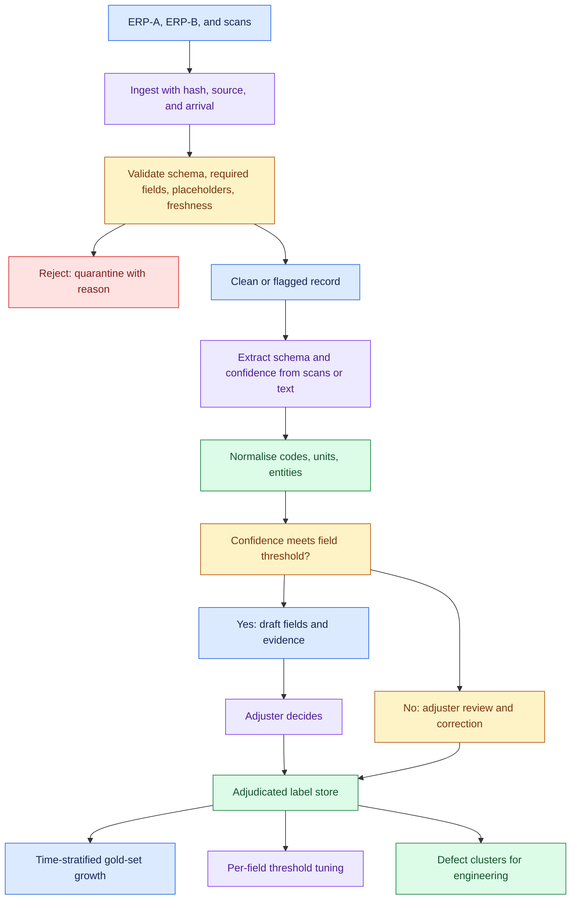
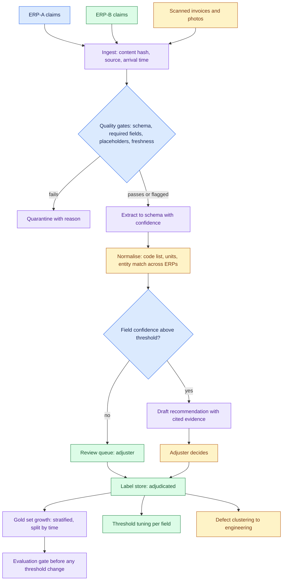

# Build an AI System When the Customer's Data Is Poor, part 2

## 6. State Requirements as Testable Constraints

A worked example makes the method concrete. The scenario is invented for this page, and every number in sections 6 to 10 is an assumption *(own construction)*.

**The customer.** A manufacturer of industrial pumps processes about 12,000 warranty claims a month. Adjusters decide approve, reject, or request more information, and route suspected design defects to engineering. Each claim takes an adjuster about 11 minutes. The customer wants AI to cut that time and catch defect patterns earlier.

**The data, as found in week 1.**

| Source | Defect found |
|---|---|
| Two ERP systems, merged after an acquisition | Different failure-code lists; no shared claim key; 14% of claims appear in both |
| Failure code field | 38% of claims coded "OTHER" |
| Serial number field | Missing on 27% of claims |
| Attachments | 55% of invoices and photos are scanned, with the key facts only there |
| Decisions | Outcome recorded; the reason for the outcome is not |
| Relabel of 100 claims by two adjusters | κ = 0.52 on failure code; κ = 0.81 on approve or reject |

That last row decides the design. Adjusters agree on outcomes, so outcomes are a usable label. They disagree on failure codes, so failure codes are not ground truth. Any design that trains on historical failure codes would learn the disagreement.

**Functional requirements.**

| ID | Requirement | Test |
|---|---|---|
| FR1 | Extract serial number, part, failure description and invoice amount from each claim and its attachments | Field-level precision and recall on the adjudicated set |
| FR2 | Normalise failure descriptions to one agreed code list, with a confidence | Agreement with adjudicated codes, reported with κ |
| FR3 | Link duplicate claims across the two ERPs | Match precision on a reviewed pair set |
| FR4 | Draft a recommendation with the evidence behind it | Adjuster agreement rate; every draft cites the fields it used |
| FR5 | Route low-confidence fields and all rejections to an adjuster | No claim auto-decided in phase 1 |
| FR6 | Capture every adjuster correction as a label | Corrections appear in the label store within one day |

**Non-functional requirements.**

| NFR | Threshold | Why |
|---|---|---|
| Latency | Draft ready within 5 minutes of claim arrival | Adjusters work a queue, not a chat |
| Throughput | 12,000 claims a month, peaks of 1,500 a day | Month-end surges |
| Data boundary | Scanned documents stay in the customer's cloud region | Invoices carry customer names and prices |
| Auditability | Every draft stores inputs, model version, confidence and reviewer action | Warranty decisions get disputed |
| Quality floor | No field shown as fact below its confidence threshold | A confident wrong serial number is worse than a blank |

**Success metrics.** Adjuster minutes per claim fall from 11 to 6. Share of "OTHER" codes on new claims falls from 38% to under 10%. Defect clusters surface in engineering's queue within two weeks of the first claim, against a current lag of about a quarter.

## 7. Draw the Architecture End to End

The architecture is a data-repair pipeline with a small decision layer on top. Draw it that way round. Most of the value in phase 1 comes from the lower half.

Read the components in dependency order *(own construction)*:

| Component | Job | What goes wrong without it |
|---|---|---|
| Ingest with content hash | Records source and arrival; skips unchanged records | Re-extraction cost on every sync; duplicates look new |
| Quality gates | Reject or flag records that fail schema, required fields or placeholder checks | "OTHER" and "N/A" flow downstream as real values |
| Quarantine with reason | Keeps rejected records queryable, with why | Bad records vanish; nobody fixes the source |
| Extraction | Pulls fields from scans and free text into a schema, with per-field confidence | Half the facts stay locked in attachments |
| Normalisation | Maps descriptions to one code list; matches claims across ERPs | Two code lists and 14% duplicates survive the merge |
| Confidence router | Sends only uncertain fields to people | Reviewers check everything, or nothing |
| Draft with evidence | Recommendation that cites the fields it used | An adjuster cannot tell why the draft says reject |
| Review queue | Adjusters fix fields in the tool, not around it | Corrections happen in email and are lost |
| Label store | Every adjudicated field and decision, with reviewer and time | The system never gets better data than it started with |
| Gold set growth | Stratified, time-split sample of the label store | The eval set drifts toward whatever was easy |
| Threshold tuning | Per-field confidence thresholds set from measured precision | One global threshold, wrong for every field |
| Defect clustering | Groups normalised failures by part and period | The early-warning value never reaches engineering |
| Evaluation gate | Blocks threshold or prompt changes that regress on the gold set | A tuning change quietly lowers precision |
| Data contract with source owners | Agreed required fields and code list at entry | The same defects arrive again next month |

## 8. Put Quality Gates at Ingestion, Not After the Model

A defect caught at ingestion costs one rejected record. The same defect caught after the model costs a wrong recommendation, a reviewer's time, and some trust. So the gates sit before extraction, not in the output guardrail.

- The enterprise RAG design's ingestion pipeline states the rule in one line: "An unmappable document is quarantined, not defaulted to `internal`." Defaulting is how a latent defect gets indexed.
- The same rule applies to a warranty claim. A claim with a placeholder serial number is flagged as missing, never assigned a guessed value.
- The pipeline also records per-source `last_synced_at` and every rejected document with its reason.
- It keeps those queryable after the process exits rather than only printing them.
- That is the quarantine box in section 7.

Content hashing belongs here too. The same pipeline hashes each document's text and skips re-embedding anything unchanged. In the claims design, that hash stops re-extraction of scanned invoices that have not changed. Extraction is the most expensive step, so the hash saves cost as well as stopping duplicates from looking new.

- Repairing at the pipeline treats the symptom. Repairing at source treats the cause.
- The FDE cross-team case resolved this conflict with data contracts. Software teams wanted speed, while data and AI teams needed stable, high-quality data.
- "Data contracts turned an ownership argument into an interface agreement." In this design, the contract makes serial number required at entry and fixes one failure-code list across both ERPs.
- The pipeline's quarantine report becomes the evidence that the contract is needed.

## 9. Grow Labels From the Review Queue

Poor labels are a starting condition, not a permanent one. The review queue turns adjuster time into trusted labels. Design it that way from day one *(own construction)*.

- Three rules make corrections usable as labels. First, the correction happens in the tool, on the field, with the original value kept.
- A reviewer who fixes a claim in the ERP directly leaves no trace the system can learn from.
- Second, each correction records who made it and when. Labels from a reviewer with low agreement can then be weighted down.
- Third, disagreements go to adjudication, not to whoever clicked last.

- Dataset hygiene applies unchanged. Deduplicate first, because "100,000 raw traces might be a few thousand distinct problems".
- Split held-out cases by time and user, never at random. Route low-agreement, high-impact cases to human adjudication.
- Watch for the trap in automatic labels. An automatic outcome label such as "user didn't complain" is not the same as "correct." For claims, "approved and not disputed" is a weak label, not a gold one.

- Weak supervision earns its place on the failure-code field, where κ was 0.52.
- Three cheap rules vote: a keyword map from description to code, the part's historical most-common failure, and the extraction model's own guess.
- Each vote is scored against the adjudicated sample. Where the rules agree with high confidence, the label is used for training.
- Where they disagree, the claim goes to the review queue. The disagreement tells the system where people are needed.

Synthetic claims fill one gap only: rare failure modes the history lacks, such as a new pump model with no claims yet. They are tagged as synthetic in the label store and excluded from any headline metric.

## 10. Build the Eval Set Before the Labels Are Clean

An evaluation set cannot wait for clean labels, because clean labels are what the project produces. Build a small, trusted set first and grow it from the label store.

- The source material gives three ways to seed it. One is mining support tickets or an existing FAQ for real questions with known answers.
- Another is to "ask 3-4 of their power users for 10 questions each".
- The third combines sampling production traffic, expert labelling, weak supervision and synthetic examples used carefully, and adds measuring grader agreement and human review of difficult cases.
- For claims, the seed is the 100 claims already relabelled in week 1, adjudicated where the two adjusters disagreed.

- Size the set honestly. The arithmetic is `n ≈ 15.7 × p(1−p) / δ²` per arm, to detect a difference δ near a success rate p.
- At p = 0.8, a 5-point gain needs ~1,000 cases per arm.
- A 200-case suite cannot reliably detect anything smaller than ~11 points. A 100-claim seed set therefore gates only large changes.
- Say so, and detect smaller changes through paired evaluation on the same cases, or through production metrics.

Stratify the set and report per stratum. The book's list is intent, tenant size, data recency and difficulty. For claims it becomes ERP source, product line, attachment type and period. Aggregate accuracy hides a collapse on scanned claims from the acquired ERP, which is where the data is worst.

Include the "insufficient data" case at a realistic rate. A system never shown a claim that should be returned for more information learns to always decide. The book makes the same point about refusal and escalation cases.

- Watch the labels in the eval set as closely as the system under test.
- The enterprise RAG golden set's first war story is a label defect, not a system defect.
- A document was reported as leaked to an account manager who was permitted to read it.
- It was irrelevant. The fix split the label into two fields, one that gates and one that is only tracked, plus a test that stops the labels drifting again.
- The lesson carries over to claims: *a false alarm from a bad label costs as much trust as a real failure.*

Ship the set with a datasheet: collection window, filters, dedup method, split strategy, label source and known biases. By one estimate, an hour of documentation saves weeks of debugging six months later.

## 11. Tell the Customer Their Data Is Poor

The hardest part of this case is a conversation, not a component. Nobody enjoys hearing that their data is poor, and the person told is often the person responsible for it *(own construction)*.

Lead with measurements, not adjectives. "Your data is messy" invites a defence. "38% of claims are coded OTHER, and two of your adjusters agree on the code about half the time beyond chance" invites a plan. The scorecard exists partly to make this conversation factual.

- Frame phase 0 as value, not as delay. The readiness week already produces things the customer can use.
- It shows where the claim backlog is duplicated across the two ERPs.
- It gives a measured estimate of how much adjuster time goes to hunting for facts in scans.
- It also produces an agreed code list the business needed anyway. A data contract that stops "OTHER" at entry improves every report the customer runs, with or without AI.

Offer a narrow first win alongside the repair. Extraction of serial numbers and invoice amounts from scans is useful on day one and needs no historical labels. It shortens every claim while the failure-code work matures. The customer then sees progress on the same dashboard where the data problems are tracked.

Name what will not be promised. In the worked example, the first release makes no automatic decisions and gives no defect prediction on product lines with under two quarters of history. Written non-goals protect the relationship when the pressure to overpromise arrives.

## 12. Phase the Work So Data Fixes Ship as Value

The phases follow the readiness scores, not a generic timeline. Each phase exits on a measured condition, in the spirit of the Scoping to Deployed Agent case’s gates *(own construction)*.

| Phase | Weeks | Ships | Exit condition |
|---|---|---|---|
| 0 Readiness | 1 | Scorecard, decision memo, quarantine report, draft data contract | Customer signs the scope and the non-goals |
| 1 Extract | 2–5 | Field extraction from scans with confidence; review queue; label store | Field precision ≥ 95% above threshold on the seed set |
| 2 Normalise | 6–9 | Unified code list, cross-ERP matching, weak-supervision labels | κ between the system and adjudicated codes ≥ 0.70 |
| 3 Draft | 10–13 | Recommendation drafts with evidence, in shadow mode | Adjuster agreement ≥ 85%; minutes per claim measurably down |
| 4 Assist | 14+ | Drafts shown live; defect clusters to engineering | The success metrics from section 6 are trending to target |

Shadow mode in phase 3 has the same meaning as in the delivery framework. The system runs against real traffic, decides what it would do, and takes no action, while humans compare. Its first real action is never also the first time nobody is watching.

The data contract runs in parallel with every phase. Its effect shows up as a falling quarantine rate and a falling "OTHER" rate on new claims. Both are tracked on the same dashboard as model quality.
