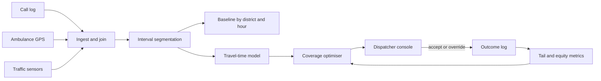

# Decomposition Classics: 911 Response Times, Bank Fraud, Medication Errors

*Commit to a plan early enough to show progress, and late enough that the mission, not the model, has chosen it.*

These three prompts have no hidden right architecture. They test whether you pin down the mission before drawing anything. This page teaches the method once, then runs it three times. The scoping mechanics come from the Scoping to Deployed Agent case and the evaluation-first habit from the Logistics Exception Handling case; this page names them and does not repeat them.

| Case | Prompt (verbatim from the source) | What it tests, per the source |
|---|---|---|
| #67 | "A major city wants to reduce 911 emergency response times. They have call data, traffic sensor data, and ambulance GPS data. You have 60 minutes. Go." | Mission clarification (response time vs. cost vs. equity of coverage), input mapping, sequencing by risk |
| #68 | "A regional bank wants to unify fraud detection across three legacy systems acquired through M&A. None of the data is labelled consistently. How do you scope the first 90 days?" | Data quality realism, phased scoping, regulatory constraints |
| #69 | "A hospital network wants to reduce medication errors in post-surgery care. They have patient records, pharmacy dispensing logs, and nurse assignment schedules. Where do you start?" | High-stakes HITL design, safety-first decomposition |

The source gives the three prompts, the six-step framework and the Tier 2 probes. It gives no worked answer for any of the three. So every case section is *(own construction)*, built from the framework's arguments, and every number in those sections is an assumption to state aloud, not a sourced fact. Domain facts are general knowledge and are marked where they appear.

---

## 1. Recognise What the Round Is Scoring

The decomposition round is 45 to 60 minutes on a vague enterprise problem. The source describes the task as breaking it "into users, data, workflows, constraints, and a prioritised V1 — out loud, collaboratively." There is no correct answer. The interviewer watches how the path gets chosen when none is given.

The source names two failure modes that eliminate many candidates. The first is jumping to architecture before clarifying scope. One OpenAI FDE candidate reported being stopped mid-design and asked, "What questions would you ask the customer before designing anything?" The second is hand-waving evaluation. "How do you know your AI system is actually working well?" is asked on purpose to separate candidates.

The scoring rewards narration. A polished answer delivered in silence scores worse than messy, well-narrated thinking. The source's pattern note: every prompt is business goal first, data second, model last. None of these three prompts asks which model to use.

A reasoning step the interviewer cannot hear cannot be scored. So think aloud continuously, and tie every choice to how it would be evaluated.

## 2. Run the Six Steps on a Sixty-Minute Clock

The source's framework has six steps. The timings below are *(own construction)*, fitted to a 60-minute round, and the first one is the source's own.

| Minutes | Step (source) | Output to leave on the board |
|---|---|---|
| 0–5 | **Clarify the mission.** "Are we optimising for response time, cost, accuracy, or equity of coverage? Who's the primary user?" | One sentence naming the objective, and the objectives it trades against |
| 5–10 | **Stakeholders and success metrics.** "Who calls this a success, and which number moves?" | A named owner per metric, and one north-star number |
| 10–20 | **Map the inputs.** "What data exists, what shape, who owns it, how fresh?" | The input-map table from section 3 |
| 20–30 | **Decompose into workstreams, sequence by risk.** Data ingestion and quality, the agent or model layer, the operator-facing surface | Three to five workstreams, ordered, with the ordering justified |
| 30–45 | **Walking-skeleton MVP, then iterate.** Ship the thinnest end-to-end version, even with mocked agent logic | A first slice, its architecture, and its evaluation |
| 45–60 | **Adapt live.** The interviewer changes a constraint mid-round | A re-derived plan, with no defence of the old one |

The source gives the canonical curveball: "you lost access to the GPS feed." Re-derive the plan; don't defend the old one. That moment scores adaptability.

When the customer will not confirm an assumption, state it and move on. The companion question bank's opener works for all three cases. "Before proposing a solution, I'd like to clarify the business outcome, primary user, current workflow, constraints, and how success will be measured."

The bank also sets a floor for each case: five clarifying questions, three to five workstreams, three measurable success metrics, two major trade-offs, three failure modes and a phased plan. Each case section below meets that floor.

## 3. Map Every Input Before Naming a Model

You cannot choose a model before you know the data that feeds it. The input map forces this, and the source names its columns: shape, owner, freshness. The source recommends data-oriented thinking as your edge.

The template below adds two columns *(own construction)*. One asks what the source can answer. The other asks what could make it lie.

| Source | Shape | Owner | Freshness | What it can answer | Quality risk |
|---|---|---|---|---|---|
| *name* | events, rows, files, free text | the team who can fix it | seconds, hours, days | the question it supports | gaps, drift, label noise, bias |

A quality problem without an owner stays a quality problem. The interviewer's first curveball usually lands in the "quality risk" column.

## 4. Sequence Workstreams by Risk, Not by Interest

The source asks for workstreams "sequenced by risk" with the ordering justified. The usual three are data ingestion and quality, the model layer, and the operator-facing surface. In my experience, the interesting one is rarely the riskiest.

Sequence by asking which unknown, if it turns out badly, kills the project *(own construction)*. That unknown goes first, because every later workstream inherits its answer. In all three cases the answer is the data, not the model.

Then build the walking skeleton. The source defines it as the thinnest end-to-end version, even with mocked agent logic, "to prove the integration story." A mocked model with real data flowing end to end teaches more than a clever model on a spreadsheet.

The Scoping to Deployed Agent pack carries the matching delivery mechanics: stage gates, named sign-off authorities, and refusing to start without measurable success criteria. Use its gate vocabulary when the interviewer asks how a phase ends.

---

## 5. Decompose the 911 Problem: Define "Faster" Before Touching the Data

*Everything in this section is (own construction). Numbers are assumptions.*

### 5.1 Clarify the mission

"Reduce response time" hides three objectives that pull apart. The source names them: response time, cost, and equity of coverage. A citywide average can fall while the slowest neighbourhoods get slower. Name that trap first.

| Ask | Assumed answer | Implication |
|---|---|---|
| Which interval counts: call answered, dispatched, or on scene? | Call received to unit on scene, split into its segments | Decompose the interval before optimising it |
| Is the target an average or a percentile? | 90th percentile for the highest-priority calls, assumed at 8 minutes | Optimise the tail, not the mean |
| Must every district meet it, or only the city? | Every district, and the city reports by district | Equity becomes a hard constraint |
| Can we add units or stations? | No new budget in year one | The levers are placement and dispatch, not headcount |
| Who acts on a recommendation? | The dispatcher, who keeps final authority | The system recommends; a human dispatches |

The last row is the safety boundary. An algorithm that dispatches without a human is out of scope for a first version.

### 5.2 Name stakeholders and metrics

The dispatcher uses the output. The EMS operations chief owns unit placement. The city council answers for equity. Residents feel the result.

The north-star metric is 90th-percentile time to scene for priority-one calls, reported by district. Three guardrail metrics sit beside it: the worst district's 90th percentile (must not rise), unit utilisation (must not burn crews out), and calls left uncovered during peaks.

### 5.3 Map the inputs

| Source | Shape | Owner | Freshness | What it can answer | Quality risk |
|---|---|---|---|---|---|
| Call data (computer-aided dispatch log) | One row per call with timestamps per stage | 911 centre | Real time | Where the minutes go: answer, triage, dispatch, travel | Timestamps entered by hand under pressure; priority recoded later |
| Traffic sensors | Speed and volume per road segment | Transport department | Seconds to minutes | Travel-time estimates by time of day | Sensor gaps in outer districts, the very places equity is judged |
| Ambulance GPS | Position pings per unit | EMS fleet | Every few seconds | Actual routes, actual travel times, unit availability | Dropped pings in tunnels; units left "available" when they are not |

The quality risks shape the plan. In this scenario, traffic sensors are thinnest where the equity constraint bites hardest. So the GPS feed, which records real travel, is the stronger ground truth for travel time.

### 5.4 Sequence by risk

Decompose the interval first, because no one yet knows where the minutes go. If most delay sits in call triage, routing optimisation is the wrong project.

| Order | Workstream | Why here |
|---|---|---|
| 1 | Join call records to GPS tracks and segment every call's interval | Every later choice depends on which segment is slow |
| 2 | Descriptive baseline by district and hour | Makes the equity gap visible before anything changes |
| 3 | Pick one lever from the baseline: triage, dispatch choice, or unit pre-positioning | The data chooses the lever, not the team's preference |
| 4 | Dispatcher-facing recommendation surface | Adoption risk is real, but only after the lever is right |

### 5.5 Build the first slice

The first slice is a report, not a model. Segment every priority-one call from the last year into answer, triage, dispatch and travel time. Show it by district and hour.

Assume the result shows that travel dominates in two outer districts at night. The second slice is then a pre-positioning recommendation: where idle units should wait, by hour, to cover those districts.

The model comes last, and it is mostly not machine learning. Travel-time estimation is a regression over GPS history. Pre-positioning is a coverage optimisation, a classic operations-research problem. A language model has one sensible role: summarising free-text call notes to speed triage, and only if segment analysis says triage is slow.

### 5.6 Draw the architecture

```
 Call log ──┐                          ┌──────────────────────────┐
 GPS pings ─┼─► Ingest + join on ─────►│ Interval segmentation    │──► Baseline dashboard
 Traffic ───┘   call id / unit / time  │ (answer·triage·dispatch· │     by district × hour
                                       │  travel)                 │
                                       └────────────┬─────────────┘
                                                    ▼
                               Travel-time model ─► Coverage optimiser
                                                    │  (per hour: where idle units wait)
                                                    ▼
                                  Dispatcher console: recommendation + reason
                                                    │  accept / override (logged)
                                                    ▼
                                  Outcome log ──► equity + tail metrics ──► review
```



| Component | Job | Why it exists |
|---|---|---|
| Ingest and join | Link each call to the unit that responded and its GPS track | Without the join, no interval can be segmented |
| Interval segmentation | Split time to scene into its four segments | Chooses the lever |
| Travel-time model | Predict drive time by origin, destination and hour | Feeds the optimiser with realistic times |
| Coverage optimiser | Recommend where idle units should wait | The lever for travel-dominated districts |
| Dispatcher console | Show the recommendation and its reason | Keeps authority with the dispatcher |
| Outcome log | Record every accept and override | The evaluation data, and the audit trail |

### 5.7 Evaluate before anyone asks

Backtest the optimiser on last year's calls first. Replay history with the recommended positions and estimate time to scene. Then pilot in one district at night, with a matched district as comparison.

Two checks gate expansion. The target district's 90th percentile must improve. No other district's 90th percentile may worsen, because moving units toward one area uncovers another. Track dispatcher override rate too. A high override rate means dispatchers think the model is wrong or don't trust it; either needs an answer.

### 5.8 Name the failure modes

| Failure | Consequence | Control |
|---|---|---|
| The average improves while outer districts worsen | Equity harm hidden by a good headline | District-level 90th percentile as a guardrail metric |
| GPS marks a busy unit as available | The optimiser counts a unit that cannot respond | Reconcile GPS status with dispatch status; stale status fails closed |
| Pre-positioning exhausts crews | Fatigue, then slower responses | Utilisation cap as an optimiser constraint |
| Recommendation outage during a major incident | Dispatchers lose a tool they came to rely on | Console degrades to the standard dispatch view; no call waits on the model |

### 5.9 Adapt when the GPS feed disappears

This is the source's own curveball. Without GPS, actual travel times and live availability are gone. Re-derive: fall back to traffic-sensor travel estimates, and take availability from the dispatch log's status codes.

Then say what degraded. Outer-district estimates get worse, because sensors are thinnest there. So the equity guardrail needs wider error bars, and the pilot should stay in a sensor-rich district until GPS returns.

---
