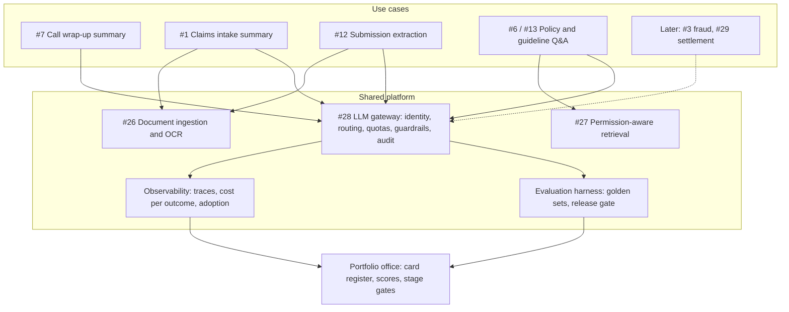

# Prioritise AI Use Cases for a Large Enterprise, part 2

## 8. Score the Worked Portfolio

The running example is a mid-size property and casualty insurer. All thirty use cases, every score and every bucket are *(own construction)* and assumptions. Scores use the section 5 weights, computed rather than estimated by eye.

| # | Use case | V | F | D | E | R | T | P | Score | Bucket |
|---|---|---|---|---|---|---|---|---|---|---|
| 7 | Contact-centre call summary and wrap-up notes | 4 | 4 | 4 | 4 | 4 | 5 | 4 | 4.10 | Now |
| 1 | Claims intake summary for adjusters | 4 | 4 | 4 | 4 | 4 | 4 | 4 | 4.00 | Now |
| 12 | Commercial submission intake extraction | 5 | 3 | 3 | 4 | 4 | 3 | 5 | 3.95 | Now |
| 28 | LLM gateway and evaluation harness | 2 | 4 | 5 | 5 | 5 | 3 | 5 | 3.90 | Enabler |
| 6 | Adjuster policy-wording Q&A with citations | 3 | 4 | 4 | 4 | 4 | 4 | 5 | 3.85 | Now |
| 13 | Underwriting-guideline Q&A | 3 | 4 | 4 | 4 | 4 | 4 | 5 | 3.85 | Now |
| 20 | HR policy assistant | 2 | 5 | 4 | 4 | 4 | 5 | 5 | 3.85 | Next |
| 9 | Inbound email triage and routing | 3 | 4 | 4 | 5 | 4 | 4 | 3 | 3.75 | Next |
| 15 | Broker email summarisation | 3 | 4 | 4 | 4 | 4 | 4 | 4 | 3.75 | Next |
| 2 | Claims document extraction (estimates, invoices) | 4 | 3 | 3 | 4 | 4 | 3 | 5 | 3.70 | Next |
| 21 | Coding assistant for internal developers | 3 | 5 | 5 | 3 | 3 | 5 | 1 | 3.60 | Buy |
| 26 | Document ingestion and OCR service | 2 | 4 | 3 | 5 | 5 | 3 | 5 | 3.60 | Enabler |
| 11 | Complaint classification for regulatory reporting | 3 | 4 | 3 | 4 | 4 | 4 | 3 | 3.50 | Next |
| 16 | Loss-run parsing | 4 | 3 | 2 | 4 | 4 | 3 | 4 | 3.45 | Next |
| 18 | Regulatory-change digest | 2 | 4 | 4 | 3 | 4 | 4 | 3 | 3.30 | Next |
| 19 | IT helpdesk agent with reset actions | 3 | 3 | 4 | 4 | 3 | 3 | 3 | 3.25 | Later |
| 22 | Marketing copy drafts | 2 | 5 | 5 | 2 | 3 | 5 | 1 | 3.25 | Buy |
| 8 | Customer-facing policy chatbot | 4 | 3 | 3 | 3 | 2 | 3 | 4 | 3.20 | Later |
| 25 | Actuarial model documentation drafts | 2 | 4 | 4 | 3 | 4 | 4 | 2 | 3.20 | Later |
| 27 | Permission-aware enterprise retrieval | 2 | 3 | 3 | 4 | 4 | 3 | 5 | 3.20 | Enabler |
| 10 | Live agent-assist during calls | 4 | 2 | 3 | 3 | 3 | 2 | 4 | 3.10 | Later |
| 5 | Subrogation opportunity detection | 4 | 3 | 2 | 3 | 3 | 2 | 3 | 3.00 | Later |
| 17 | Reinsurance treaty clause comparison | 3 | 3 | 3 | 3 | 3 | 3 | 3 | 3.00 | Later |
| 23 | Month-end variance commentary | 3 | 3 | 3 | 3 | 3 | 3 | 2 | 2.90 | Later |
| 3 | Fraud-referral triage assist for investigators | 5 | 2 | 2 | 2 | 2 | 2 | 3 | 2.85 | Later |
| 29 | Autonomous settlement of small auto claims | 5 | 2 | 3 | 2 | 1 | 1 | 3 | 2.75 | Later |
| 30 | Voice bot replacing the tier-1 phone line | 4 | 2 | 3 | 2 | 2 | 2 | 3 | 2.75 | Later |
| 4 | Auto-sent claim denial letters | 4 | 3 | 3 | 2 | 1 | 3 | 2 | 2.75 | No |
| 14 | LLM-set premiums | 5 | 1 | 2 | 1 | 1 | 1 | 1 | 2.15 | No |
| 24 | Auto-generated board pack | 2 | 3 | 2 | 2 | 2 | 2 | 1 | 2.05 | No |

The bucket rules, in order: a gate failure is "No"; a commodity capability is "Buy"; a shared component is "Enabler"; a score of 3.8 or more with no dimension below 3 is "Now"; a score of 3.3 or more is "Next"; the rest are "Later" unless they score under 2.6. The totals are five Now, seven Next, ten Later, three Enablers, two Buy and three No.

Read the table for what the sum hides, not only for its order.

**The floor did real work.** The HR policy assistant (#20) ties the Now items at 3.85 on a value of 2. Easy, fast and reusable, it is still not worth one of five wave-1 slots. The floor moved it to Next, where it is a cheap second tenant of the retrieval enabler.

**The gates did the rest.** Auto-sent denial letters (#4) fail the permissible-decision gate: an unreviewed adverse decision on a customer. The reshaped version is "draft the letter for the adjuster to approve", which folds into #1. LLM-set premiums (#14) fail the right-tool gate, because pricing belongs to the actuarial models, and in most US states property and casualty rates must be filed with the insurance regulator.

**The highest-value items are all Later.** Fraud triage (#3), autonomous settlement (#29) and the voice bot (#30) score 4 or 5 on value. Each fails on data, risk or evaluability. That is Question 16's follow-up in table form, and section 12 answers it.

**The ranking survives reweighting where it matters.** When I rerun it under a value-heavy, a risk-heavy and a speed-heavy weighting, #7, #1 and #6 stay in the top five every time. #12 drops out only when speed dominates, because extraction from submission packs takes a quarter to prove. #13 swaps with #2 under the value-heavy weighting. So say it as "#7, #1 and #6 are decided; #12 and #13 depend on whether the sponsor values speed or value more."

## 9. Fund the Platform the Top Items Share

The architecture in this case is the shared platform, not any one use case. It earns a diagram because it explains the sequencing: the enablers make every later card cheaper. The delivery framework's governing question applies to a portfolio too. For each new use case, how much is pulled from a library, and how much is built from scratch?

```
   WAVE 1 USE CASES           WAVE 2                      LATER
 ┌──────────────┐ ┌──────────────┐ ┌──────────────┐   ┌──────────────┐
 │ #7 call      │ │ #1 claims    │ │ #6/#13 policy│   │ #3 fraud     │
 │ wrap-up      │ │ intake       │ │ & guideline  │   │ triage       │
 │ summary      │ │ summary      │ │ Q&A          │   │ #29 settle   │
 └──────┬───────┘ └──────┬───────┘ └──────┬───────┘   └──────┬───────┘
        │                │                │                  │
 ═══════╪════════════════╪════════════════╪══════════════════╪═══════
        ▼                ▼                ▼                  ▼
 ┌──────────────────────────────────────────────────────────────────┐
 │  LLM GATEWAY (#28): identity · routing · quotas · cost per       │
 │  use case · guardrails · audit log                                │
 ├──────────────────────┬─────────────────────┬─────────────────────┤
 │ DOCUMENT INGESTION   │ PERMISSION-AWARE    │ EVALUATION HARNESS  │
 │ & OCR (#26)          │ RETRIEVAL (#27)     │ golden sets per use │
 │ claims, submissions, │ policy wording,     │ case, release gate, │
 │ loss runs            │ guidelines, HR docs │ online sampling     │
 ├──────────────────────┴─────────────────────┴─────────────────────┤
 │  OBSERVABILITY: traces · cost per successful outcome · adoption   │
 └──────────────────────────────────────────────────────────────────┘
        ▲                                   ▲
   claims system, policy admin,        portfolio office:
   contact-centre platform             card register, scores, gates
```



| COMPONENT | WHY IT IS FUNDED IN WAVE 1 | FIRST USE CASE THAT NEEDS IT | LATER CARDS IT MAKES CHEAPER |
|---|---|---|---|
| LLM gateway (#28) | Every use case calls a model; cost and audit per use case need one choke point | #7 | All of them |
| Evaluation harness | No item leaves pilot without a golden set and a release gate | #7 | All of them |
| Document ingestion and OCR (#26) | Claims and submissions arrive as scans and PDFs | #1, #12 | #2, #16, #5, #3 |
| Permission-aware retrieval (#27) | Policy wording and guidelines have different audiences | #6, #13 | #20, #8, #18, #17 |
| Observability | Cost per successful outcome and adoption are the portfolio's scoreboard | #7 | All of them |
| Portfolio office | Holds the card register, re-scores quarterly, records kill decisions | Wave 0 | The next thirty ideas |

The platform view is *(own construction)*. Its gateway pieces come from this site's gateway material. [#100 Production LLM Gateway](/design/production-llm-gateway) designs that component in full. [G13 Evaluation and Release Gating](/design/evaluation-and-release-gating#full-pack) covers the harness.

## 10. Sequence the Portfolio in Waves

A ranked list is not a plan until it has dates and dependencies. Sequence by what each wave proves, and let each wave pay for the platform the next one needs *(own construction; durations are assumptions)*.

| WAVE | WHEN | WHAT SHIPS | WHAT IT PROVES |
|---|---|---|---|
| 0 | Weeks 1–4 | Thirty cards, gates applied, scores and buckets agreed with the sponsor; data-access requests filed for wave 1 | The organisation can say no, and write down why |
| 1 | Months 2–4 | #7 call wrap-up in shadow then limited production; gateway, eval harness and observability underneath it | One measurable win, and the platform's first tenant |
| 2 | Months 4–8 | #1 claims intake summary and #6 policy Q&A on ingestion and retrieval; #13 as a second retrieval tenant | Reuse: the second and third use cases cost a fraction of the first |
| 3 | Months 8–14 | #12 submission extraction; Next-bucket items that ride existing components (#9, #15, #2, #20) | The platform carries the portfolio, not individual heroics |
| 4 | Months 14–24 | One strategic Later item, most likely #29 as decision support built on #1 and #2 evidence | The organisation can take on a high-risk item with gates it already trusts |

Wave 1 is deliberately a low-risk, high-volume use case, not the biggest one. It has to earn credibility and build the gateway, and it must not create a headline if it fails. Handbook Module 10 describes the same move: narrow the first build to prove the approach, then expand.

## 11. Set Kill Criteria Before the Pilot Starts

A portfolio without kill criteria only ever grows. Stopping a pilot is then a political event instead of a scheduled outcome. Write the stop condition on the card before any code exists, so the decision was made when nobody was invested in it.

The stage gates reuse the delivery framework's shape: a named, checkable condition, signed by the right role, with no seniority override.

| STAGE | EXIT CONDITION | WHO SIGNS | KILL IF |
|---|---|---|---|
| Card | All fields filled; gates passed | Business owner | No measurable baseline after two attempts |
| Discovery (2 weeks) | Data access granted; golden set drafted with the SME | Customer SME | Data access still pending after escalation |
| Pilot in shadow | Eval baseline met on the golden set | Delivery lead | Below baseline after two iterations |
| Limited production | Adoption and outcome metric moving; rollback tested | Delivery lead | Adoption under the card's floor at week 4 |
| Scale | Outcome metric met; cost per successful outcome within plan | Executive sponsor | Value under run cost at the next quarterly re-score |

The gate names and roles adapt Handbook Module 10's six gates, including `data_access_granted`, `eval_baseline_met`, `rollback_tested` and `success_metrics_met`, from a single engagement to a portfolio *(own construction)*. The delivery framework's week-4 retention metric is the adoption kill signal. It is recorded as "none" until measured, never as a fake zero. Its accelerator reuse rate becomes the portfolio's platform health metric.

Re-score the whole register every quarter. Pilot data replaces estimates, so the portfolio corrects itself. A Later item whose data problem was solved by an enabler moves up without anyone lobbying for it. [G12 Scoping to Deployed Agent](/design/scoping-to-deployed-agent#full-pack) covers the gate mechanics in depth.

## 12. Say No to the Executive's Pet Project Without Losing the Executive

The executive who handed over the list usually has a favourite. Here it is autonomous settlement of small auto claims (#29). It is also the answer to Question 16's follow-up, quoted verbatim:

> "The highest-value use case is also the riskiest. What do you recommend?"

The source's answer, verbatim:

- Narrow the initial scope
- Introduce human approval
- Start with decision support rather than automation
- Limit the user population
- Use shadow mode
- Define explicit go/no-go gates
- Expand only after measured evidence

Turn that list into a path, not a refusal. "No" loses the sponsor; "not yet, and here is the route" keeps them. The route for #29 runs through items already in waves 1 and 2 *(own construction)*.

| STEP | WHAT RUNS | EVIDENCE THAT UNLOCKS THE NEXT STEP |
|---|---|---|
| 1 | #1 and #2 summarise and extract small auto claims for adjusters | Extraction accuracy on the golden set; adjuster adoption |
| 2 | A settlement recommendation shown beside the adjuster's own, in shadow | Agreement rate with adjusters, broken down by claim segment |
| 3 | Recommendation with one-click approval, claims under a low cap, one region | Override rate falling; no rise in complaints or leakage |
| 4 | Straight-through settlement for the narrowest segment, with sampled audit | The segment's error rate below the human baseline, signed off by claims leadership and compliance |

Say it to the executive in outcome language. The cost cram sheet's rule applies: acknowledge the business concern, show trade-offs as options, and commit to a measured follow-up.

> *"Autonomous settlement is where this ends up, and it's the most valuable thing on the list. The fastest safe route there starts with the two items that build its data and its evidence. In four months you'll see settlement recommendations running beside your adjusters. At that point the case for automation will be made by your own numbers."*

The move is to make the pet project the destination of the roadmap rather than its first stop. The executive keeps the goal; the programme keeps its credibility.

## 13. Anticipate the Failure Modes

Each row is a way prioritisation programmes fail in practice, with the signal that catches it *(own construction)*.

| FAILURE | WHAT IT LOOKS LIKE | EARLY SIGNAL | MITIGATION |
|---|---|---|---|
| Demo-driven pick | The first build is the most impressive one and stalls in security review | Wave-1 item has a risk score under 3 | Floor rule; wave 1 must be low risk |
| Thirty pilots at once | Every sponsor gets a pilot; none reaches production | Pilots outnumber engineers; no item past shadow at month 4 | Cap work in progress; fund waves, not requests |
| Enablers starved | Each use case builds its own ingestion and prompts | Reuse rate falling; cost per new use case flat | Enabler bucket funded with wave 1 |
| Score theatre | Scores tuned until the favourite wins | Weights changed after scoring | Weights agreed before cards are scored; sensitivity rerun |
| Zombie pilots | Pilots never killed, never scaled | Kill criteria missing from cards | Kill criteria mandatory at card stage; quarterly re-score |
| Value never measured | Launch declared a success with no baseline | Card baseline field empty | Measurable-outcome gate |
| Data surprise | Top item's data turns out to be unusable | Discovery overruns | Data readiness scored before ranking; [#62](/design/build-when-customer-data-is-poor) for the playbook |
| Portfolio monoculture | All wave-1 items are summarisation | No item exercises retrieval or extraction | One slot reserved per pattern |
