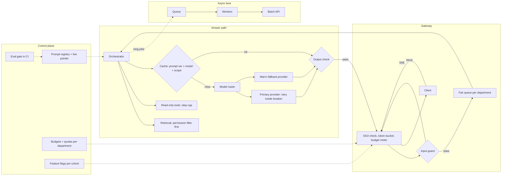

# Scale a Prototype to Production, part 2

## 6. Draw the Architecture End to End

The organising rule is admit, assemble, answer, learn. The gateway decides who may use a model and how much. Retrieval decides what the answer may see. The model path decides what it costs and how it fails. The control plane decides what changes reach users, and on what evidence.

The whole system, drawn with its planes *(own construction)*:

```
 ╔═════════════════════ CONTROL PLANE (changes are releases) ═══════════════════════╗
 ║ prompt registry + live pointer · routing policy · quotas per department          ║
 ║ eval gate in CI (Evaluation and Release Gating) · budgets + anomaly alerts · feature flags per cohort      ║
 ╚══════════════════════════════════════╤═══════════════════════════════════════════╝
                                        │ configures every box below
 ╔═════════════════════ DATA PLANE (calls are requests) ════════════════════════════╗
 ║                                                                                   ║
 ║ web / chat client ──SSE──> GATEWAY: SSO token check · per-user token bucket       ║
 ║                            budget meter · input guard · fair queue per department ║
 ║                                        │ admitted                                 ║
 ║                                        v                                          ║
 ║                   ORCHESTRATOR ──> RETRIEVAL (permission filter BEFORE search)    ║
 ║                        │           read-only TOOLS (step cap, timeouts)           ║
 ║                        v                                                          ║
 ║                   CACHE (key = prompt ver + model + permission scope)             ║
 ║                        │ miss                                                     ║
 ║                        v                                                          ║
 ║                   MODEL ROUTER ──> primary provider (small · mid)                 ║
 ║                        │           retry + backoff inside a circuit breaker       ║
 ║                        └─────────> warm fallback provider ──> degraded answer     ║
 ║                                        │ tokens                                   ║
 ║                                        v                                          ║
 ║                   OUTPUT CHECK (PII, citations present) ──> stream to client      ║
 ║                                                                                   ║
 ║ ASYNC LANE: queue ──> workers (reports, summaries, re-indexing) ──> batch API     ║
 ║ INGESTION: sources ──> parse ──> chunk + embed ──> index with ACL metadata        ║
 ║ OBSERVABILITY: trace per request · tokens · cost · stage timings · outcome        ║
 ╚═══════════════════════════════════════════════════════════════════════════════════╝
```

The same flow for viewers that render Mermaid *(own construction)*:



Read the components in request order. The failure column is *own construction*.

| # | Component | Responsibility | Fails how |
|---|---|---|---|
| 01 | Client | Streams the answer, shows citations | Degrades: shows a labelled partial or degraded answer |
| 02 | Gateway | SSO token validation, per-user token bucket, budget meter | Closed on auth; sheds the async lane first under load |
| 03 | Input guard | Rule-based screen first, model-based screen second | Closed for known attacks; logs and allows on timeout for low-risk intents |
| 04 | Fair queue | Orders admitted work by department weight | Never drops an admitted request silently |
| 05 | Orchestrator | Assembles context in a prefix-stable order, calls tools under a step cap | Degrades: answer without the tool, say so |
| 06 | Retrieval | Filters by the user's permissions before vector search | Closed: no filter, no results |
| 07 | Cache | Serves repeated safe answers; key carries prompt version, model and permission scope | Degrades to a miss; never serves across scopes |
| 08 | Model router | Sends easy intents to the small model | Degrades to the mid-tier model |
| 09 | Primary provider | Answers under retry-with-backoff inside a breaker | Breaker opens; traffic moves to the fallback |
| 10 | Fallback provider | Warm second provider or region with its own validated prompt | Degrades to a labelled "try again shortly" answer |
| 11 | Output check | PII scan, citation presence | Closed: withholds the answer and says why |
| 12 | Async lane | Non-interactive work through a queue and the batch API | Delays; users see job status |
| 13 | Ingestion | Incremental indexing with ACL metadata | Stale but safe; freshness alert |
| 14 | Observability | One trace per request with tokens, cost, stages and outcome | Degrades: request still served, gap logged |
| 15 | Control plane | Versioned prompts, routing, quotas, flags, eval gate | Changes blocked until the gate passes |

Point at three boundaries while the diagram is up *(own construction)*. The admission boundary is the gateway: nothing reaches a model without identity, a quota and a budget check. The isolation boundary is retrieval and the cache key: both carry the user's permission scope. The change boundary is the control plane: a prompt edit is a release with a gate, never a hot edit.

## 7. Admit, Queue and Route at One Gateway

Put every model call behind one gateway, because the prototype's direct calls leave no single place to enforce identity, limits, fairness or cost. Standalone #100 designs that gateway in depth, in its sections 5 to 10. This section names only what the scale-up adds.

**Identity first.** Handbook Module 06 doc 1 draws the line: authorisation logic assumes identity is already established. Validate the customer's own SSO token, map their groups to internal roles, and derive the user's permission scope once per request. The prototype's shared key cannot tell 100,000 people apart, so it cannot enforce a single rule about them.

**Limits and fairness are two mechanisms.** The same Handbook doc says it in one line: a rate limit answers *may this request proceed at all*; a fair queue answers *in what order do requests get served under load*. Give each user a token bucket sized in tokens, not only requests. Feed admitted work into a weighted fair queue per department, so the finance quarter-end burst waits for its share rather than starving everyone. Section 7 of the Secure Multi-Tenant AI Platform case has the full argument.

**Meter before the call.** The production guide's rule: *"The cap has to fire before the API call, not after — checking cost post-hoc only tells you what you already spent."* Use a real tokeniser for the estimate, since the guide shows a word-count heuristic letting expensive requests through.

**Route by intent.** The production guide calls routing *"The single biggest cost lever in a production LLM system."* Pick the routing threshold from a labelled sample of real traffic, not intuition. The cost additions add a warning: prompt caches are scoped to a model, so a three-model cascade means three cold prefixes. Measure one strong model at lower effort before building a cascade.

**Cache what is safe.** The cram sheet's rule: caching is acceptable only when the key includes tenant and permission boundaries and invalidation respects document and access changes. For #61, the cheapest win is the provider's prefix cache on the frozen system prompt and tool list. The answer cache comes second and carries the user's permission scope in its key.

**Stream, and move slow work off the critical path.** Streaming buys perceived latency, not real latency. Report generation and document summaries do not need a waiting user. Send them through a queue to the batch API, which the cost additions put at *50% of standard cost*. Workers scale by queue depth, as the cram sheet's infrastructure section says, not by CPU.

## 8. Fail Over Before the Provider Fails the Users

At 100 users, a provider outage is an anecdote. At 100,000, it is an incident with a headcount. The production guide gives the chain in order: retry with backoff, a circuit breaker around the retried call, a fallback provider, and graceful degradation as the floor. Its one-liner: *"Retries handle one bad call; a circuit breaker handles a bad dependency — you want both, with the breaker wrapping the retried call."*

Set the reliability target honestly. The guide's FDE track answers the "99.9% uptime" request directly: *"Separate your infra's uptime from the upstream provider's — you can't promise more than your dependency provides, and fallback/circuit-breaker design is how you buy margin, not a guarantee."* Say that sentence to the customer before the contract says something else.

Keep the fallback warm and validated *(own construction)*. A fallback provider that has never served real traffic fails at the worst moment. The guide's agent track names the trap: tool schemas and structured-output contracts are not portable across models, so the fallback path needs its own prompt and its own eval run. Route a small, steady share of traffic to it so its latency and quality stay measured. Tag every response with the model that answered, because cost and quality shift silently when traffic moves.

Degrade in front of people and fail loudly in front of machines. That is the guide's own trade-off line. The assistant shows a labelled degraded answer. The async lane stops and alerts rather than writing a half-finished report.

## 9. Rebuild the Eval Set From Production, Not the Demo

The prototype's eval set, if it exists, is the demo questions. It measures what already worked on the questions the builder thought to ask. That is survivorship, not evaluation. The Evaluation and Release Gating case designs the full release gate; this section names what the scale-up changes *(own construction, from the Evaluation and Release Gating case’s argument)*.

Build the new set from the first cohorts' real traffic. Sample by intent and by department, because 100,000 users ask questions the 100 never did. Label with the customer's subject-matter experts, not the builder. Add adversarial cases for permissions and prompt injection, and hold the security slice at zero failures. Handbook Module 08 doc 1 is explicit: the safety gate is *"A hard block, not a review comment."*

Gate on slices, not on the aggregate. Section 8 of the Evaluation and Release Gating case makes the point: an average can rise while one department's intent collapses. Report each slice against a named baseline, which is the version currently serving.

Keep evaluating after launch. Run a sampled online evaluation on live traffic, plus thumbs, regenerates and escalations. The cost additions warn about the new bill: LLM-as-judge is inference too. Stratify the sample, use a cheaper judge with a periodic strong-judge audit, and cache judge calls on unchanged pairs. Section 14 of the Evaluation and Release Gating case has the full cost card.

## 10. Roll Out by Cohort With a Pointer-Flip Rollback

Never launch to 100,000 people on one day. Roll out by cohort, so each tenfold step in section 5 happens on purpose, to a group that can be supported. Handbook Module 08 doc 1 gives shadow, canary and promote, and the risk each puts on a real user. I add cohort waves between canary and promote.

| Stage | What happens (Module 08 doc 1; the cohort-wave row is mine) | Gate to move on *(own construction)* |
|---|---|---|
| Shadow | *"The new version runs alongside the live one on real traffic; both outputs are logged; compared offline"* | Eval gate passed; zero isolation failures in shadow |
| Canary | A small slice of real users sees it; *"the same metrics are watched live"* | p95, error rate and cost per request within limits for 48 hours |
| Cohort waves | In this design, 1% → 10% → 50% → 100%, one department wave at a time | Each wave: support tickets per 1,000 users, week-1 retention, no open severity-1 incidents |
| Promote | Repoint the live pointer | Executive sponsor signs on the success metrics |

Split cohorts per user, never per request. The Handbook's reason: one person's experience must not flicker between versions mid-conversation. Hold the safety gate identical across arms.

Make rollback a pointer flip. The Handbook's line: *"If rollback requires a build, it is not a rollback; it is a hot-fix under pressure."* The version that was live five minutes ago stays deployed, ready to take traffic. Test the rollback before the first wave, because Handbook Module 10 doc 4 makes `rollback_tested` a gate that blocks limited production.

## 11. Assign Owners Before the First Page

At 100 users, the builder is the owner, the on-call and the support desk. At 100,000, that arrangement is the single point of failure *(own construction)*. Name the owners before the first cohort, not after the first incident.

| Area | Owner *(own construction)* | What it owns |
|---|---|---|
| Platform and gateway | AI platform team | SLOs, capacity, provider relationships, on-call |
| Product behaviour | Product owner | Prompts, intents, routing policy, release decisions |
| Knowledge content | Department content owners | Source freshness, document permissions |
| Security review | Security team | The review gate, red-team results, incident response for leaks |
| Budget | Finance partner plus product owner | Department budgets, anomaly thresholds |
| Support | IT helpdesk (L1), app team (L2), platform (L3) | Tickets, known issues, escalation |

Write runbooks for the incidents that will happen *(own construction)*. The cost cram sheet lists fifteen, and four matter from week one. Cost 5× after rollout: *"The increase is likely from request shape, not just user count."* Latency 2 s to 20 s after a deploy: roll back the prompt or reranker, activate the fallback provider. One tenant over-using: *"distinguish healthy adoption from runaway automation."* Cache hit rate dropping: look for a silent prefix invalidator. Add a fifth for a permissions leak, owned by security.

Run a security review against evidence, not a checkbox. Handbook Module 10 doc 4 names the failure: a gate can be structurally real and still accept free text as evidence. Require adversarial testing and permission-boundary probes as listed artefacts before the review passes.

## 12. Measure Adoption, Not Only Uptime

A system can be technically ready and still fail, because nobody uses it. Adoption is the last item on the bank's list, and it is where the follow-up goes.

Measure adoption with numbers that cannot be faked by a launch email. Handbook Module 10 doc 4 gives two. The human-approval override rate: *"Falling over time = trust being earned; flat = the agent is not ready for less supervision."* The second is week-4 retention: *"Whether the thing deployed is still the thing being used a month later."* Add active users as a share of licensed users, task success by intent, and cost per successful task *(own construction)*. The cost additions insist on the last one: a cheaper model that needs a retry or a human correction is not cheaper.

The bank's follow-up, verbatim: *"The system is technically ready but users are not adopting it. What do you investigate?"* Its answer list, verbatim: whether the problem is important enough, workflow fit, user trust, response quality, latency, training and onboarding, incentives, integration friction, and whether the product solves the user's actual pain point.

Order that list into an investigation *(own construction)*. Start with data, not opinions. Segment usage by department and intent, and find where users try once and stop. Then read those sessions. A drop after the first answer points to quality or trust. A drop before any answer points to latency or onboarding. Low first use points to workflow fit and integration friction: the assistant lives in a separate tab while the work lives in another tool. Only then talk to users, and ask about their pain rather than the product. The cost cram sheet's executive table says adoption depends on *"Perceived latency, workflow fit, reliability, explainability."*

> *"Adoption is a deliverable. I would measure it per cohort, and treat a flat week-4 retention as a bug with a root cause, not a marketing problem."*
