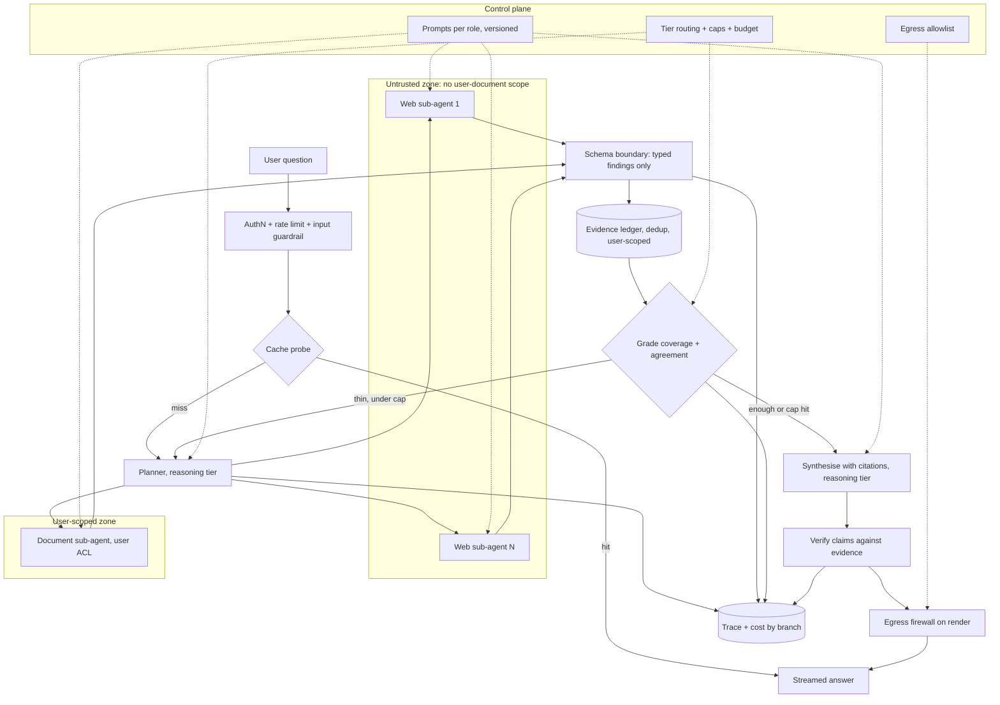

# Deep Research Agent at Consumer Scale

*Every extra search round makes the answer better grounded and the run slower and dearer, and the web pages that ground it are also the attack surface.*

A research agent fails when an unbounded fan-out quietly spends the budget, or when a fetched page reaches data it should never have seen. This page covers the group's prompts in one read for the day before. It pairs one worked whiteboard design with one deployed system and one mock prompt.

| Case in the group | What it contributes here |
|---|---|
| #10 Deep Research Agent at consumer scale (anchor) | Sections 1 to 10 and 13: requirements, state, architecture, the arithmetic, the trifecta, measurement, the 45-minute script, the follow-up bank |
| #12 The Research Platform (multi-agent, deployed on AWS) | Section 11: the same product as nine running layers, with gateway, guardrails, pgvector and PyRIT |
| Research system with a supervisor and workers (mock design) | Sections 3, 8 and 12: the reducer, the three termination defences, the supervisor–worker build |
| Self-drill on #10, Drill Add-ons tab | Section 14 |

Sections and tables marked *(own construction)* were built for this page from the sources' arguments and are not in the sources verbatim.

---

## 1. Restate the Problem and Name the Oracle First

The first eight minutes buy every later answer. Twenty minutes on requirements leaves the design unfinished. Two minutes leaves it generic. Rehearse against a clock until the pacing is automatic.

Make three opening moves, every time. Restate the problem in one sentence. Ask for the eight numbers: throughput, latency, horizon, accuracy, cost, autonomy, data class and recovery. Then name the oracle and cut scope: "how will we know a run succeeded", and "I'll treat X as out of scope unless you want it in".

The prompt: design a read-only, citation-grounded research agent for ~100K daily users. It searches the public web and the user's own documents, then writes an answer in which every claim is cited.

Close requirements by restating the whole system as one sentence and asking "is that the system?". It costs 20 seconds. I'd expect an interviewer to mark it as a strong signal, because it is what a technical lead does at the start of a real project.

> *"A read-only research agent for about a hundred thousand daily users, forty thousand runs a day, under ninety seconds at p95 and twenty cents a run, where success means every claim is cited to a source a reviewer would accept. Is that the system?"*

## 2. State Requirements as Testable Constraints

A requirement that cannot fail a test is a preference. "Well-researched" is a preference. "Every claim cited to a source a reviewer would accept" is an oracle, and only an oracle shapes the architecture.

The must-haves are five *(the MoSCoW split is own construction; the items are the source's)*. Decompose a question into a dependency-aware plan. Search the public web and the user's documents in parallel. Collect findings into one deduplicated evidence ledger. Synthesise an answer with citations. Verify each claim against the evidence before streaming it with a coverage note.

The should-haves come after the core path is trusted. Probe a cache before planning. Replan when coverage is thin. Grade agreement between sources. Answer "not enough evidence" rather than guess.

Read-only is a deliberate requirement. There are no writes, so you need no approval subsystem. Say so out loud: the interviewer is listening for whether you asked the autonomy question.

| Constraint | Stated so it can be tested |
|---|---|
| Throughput | ~40K research runs/day, peak 3x mean |
| Latency | p95 under 90s; first signal under 3s |
| Horizon | 3-12 steps per run |
| Accuracy (the oracle) | Every claim cited to a source a reviewer would accept |
| Cost | $0.20/run ceiling |
| Autonomy | Read-only: no writes, so no approval subsystem |
| Data class | Public web plus user documents; per-user isolation required |
| Recovery | A failed branch returns partial results with an explicit gap note, never a silent drop *(from #103)* |

Every must-have then needs an owner in the architecture *(own construction)*.

| Requirement | Primary component(s) |
|---|---|
| Decompose the question | Planner on the reasoning tier |
| Search web and documents | Web sub-agents (no user-document scope); document sub-agent (user-scoped) |
| One deduplicated evidence base | Schema boundary, then the user-scoped evidence ledger |
| First signal under 3s | Cache probe, streamed plan and progress |
| Every claim cited | Synthesiser with citations, then the claim verifier |
| $0.20/run | Sub-agent isolation, prefix caching, tier routing, budget dict |
| Per-user isolation | User-scoped ledger and document sub-agent; web agents hold zero document scope |

## 3. Carry State That Cannot Lose a Branch

State is the contract between the planner, the sub-agents and the synthesiser. Parallel branches that write one key under a last-write-wins rule lose all results but one. LangGraph refuses this with an `InvalidUpdateError` when the key has no reducer, but a hand-rolled merge loses the data silently. That is the fan-out data-loss defect.

The anchor's state carries seven things: run and user identity, the goal, a dependency-aware plan, an evidence list with a *concatenating* merge rule, tool errors, the draft and its verification score, and step and replan counters with a budget dict summed across branches.

| Field | Why it is there |
|---|---|
| Run and user identity | Scopes the document sub-agent and the ledger; keys the trace |
| Goal | Non-evictable; the planner and verifier both read it |
| Dependency-aware plan | Lets independent sub-questions run in parallel and dependent ones wait |
| Evidence list, concatenating merge | Parallel writes accumulate instead of overwriting |
| Tool errors | A failed branch becomes a recorded gap, not a vanished one |
| Draft and verification score | The verifier's output decides stream, replan or refuse |
| Step, replan and hop counters | The termination defences read them |
| Budget dict, summed across branches | The $0.20 ceiling is enforced per run, not per branch |

The supervisor-and-workers mock names the fix in one line: any key more than one node writes needs a reducer that accumulates. The same mock warns against the scalar version of the bug. Several agents writing one `summary` key through a hand-rolled last-write-wins merge means the final answer reflects only the last one to run. Accumulate findings into a list, then synthesise once at the end.

## 4. Draw the Architecture End to End

The organising rule is privilege separation first, then cost. Web sub-agents read untrusted content and hold no user-document scope. Only typed findings cross back to the parent, and everything after the schema boundary is user-scoped.

The source's flow, redrawn as text:

```
Question + cache probe
        │
Plan (reasoning tier): decompose?
   ┌────┴─────────────────────┐
Web sub-agents             Document sub-agent
(untrusted, NO user        (user-scoped)
 doc access)                   │
   └────┬─────────────────────┘
Schema boundary — typed findings only
        │
Evidence ledger (user-scoped, dedups sources)
        │
Grade coverage + agreement
        │
Synthesize with citations
        │
Verify claims against evidence
        │
Streamed answer + citations + coverage note
```

The same system with its planes and trust zones *(own construction)*: a control plane that changes by release, and a data plane split by who may see what.

```
 ╔══════════════════════ CONTROL PLANE (changes are releases) ══════════════════════╗
 ║ prompts per role (versioned) · tier routing · hop/step caps · budget ceiling      ║
 ║ egress allowlist for rendering · cache thresholds · grader rubric · eval gates    ║
 ╚══════════════════════════════════════╤════════════════════════════════════════════╝
                                        │ configures every box below
 ╔══════════════════════ DATA PLANE (calls are requests) ═══════════════════════════╗
 ║                                                                                   ║
 ║  ENTRY   user ─> authN + rate limit ─> input guardrail ─> CACHE PROBE ─ hit ─> out║
 ║                                                              │ miss               ║
 ║  PLAN                                     PLANNER (reasoning tier, plan + budget) ║
 ║                                             │ dependency-aware sub-questions      ║
 ║  ┌──────────── UNTRUSTED ZONE ────────────┐ │ ┌──────── USER-SCOPED ZONE ───────┐ ║
 ║  │ web sub-agents × N (small model)       │<┴>│ document sub-agent (user ACL)   │ ║
 ║  │ fetch · read · extract  NO doc scope   │   │ retrieve · extract              │ ║
 ║  └───────────────┬────────────────────────┘   └───────────────┬─────────────────┘ ║
 ║                  └──────── SCHEMA BOUNDARY: typed findings ────┘                   ║
 ║                                        │                                          ║
 ║  SYNTH   evidence ledger (dedup, user-scoped) ─> grade ─ thin ─> replan (capped)  ║
 ║                                        │ enough                                   ║
 ║          synthesise w/ citations (reasoning tier) ─> VERIFY claims vs evidence    ║
 ║                                        │                                          ║
 ║  OUT     EGRESS FIREWALL on render (strip images, non-allowlisted links) ─> stream║
 ║                                                                                   ║
 ║  OBSERVE trace per run, sub-agent traces linked · tokens + $ by branch · grades   ║
 ╚═══════════════════════════════════════════════════════════════════════════════════╝
```

The same flow for viewers that render Mermaid *(own construction)*:



Read the components in dependency order *(own construction; the components are the source's)*.

| # | Component | Responsibility | Fails how |
|---|---|---|---|
| 01 | Entry and rate limit | Identity, per-principal rate and cost governor | Closed: no identity, no run |
| 02 | Cache probe | Returns a finished answer for a near-identical question | Degrades to a miss; never serves across users for private-document answers |
| 03 | Planner (reasoning tier) | Decides whether to decompose; writes a dependency-aware plan and budget | Degrades to a single-query plan |
| 04 | Web sub-agents | Fetch and read untrusted pages in their own windows; return findings | Degrades: a failed branch becomes a gap note |
| 05 | Document sub-agent | Retrieves from the user's own documents under the user's ACL | Closed on permission; degrades on availability |
| 06 | Schema boundary | Admits typed findings only, never raw page text | Closed: malformed findings are dropped and logged |
| 07 | Evidence ledger | Accumulates and deduplicates sources, user-scoped | Closed on scope mismatch |
| 08 | Grader | Scores coverage and cross-source agreement | Degrades: thin coverage triggers a capped replan |
| 09 | Synthesiser (reasoning tier) | Writes the answer with a citation per claim | Degrades to a shorter answer over the evidence it has |
| 10 | Claim verifier | Checks every claim against the ledger | Closed: an unsupported claim is cut or flagged |
| 11 | Egress firewall on render | Strips Markdown images, non-allowlisted links and fetch-inducing markup | Closed: nothing renders unfiltered |
| 12 | Trace and cost meter | One trace per run, sub-agent traces linked; tokens and dollars by branch | Degrades: the answer still ships, the gap is logged |

## 5. Isolate Sub-Agents So the Parent Stays Small

Sub-agent isolation is the single largest cost lever in this design. A parent that accumulates raw pages resends every token on every later step. A parent that receives one short conclusion per sub-agent grows by hundreds of tokens, not thousands.

Context rot compounds the cost problem. Model accuracy degrades as the window fills, and unevenly, so information stuck in the middle is retrieved less reliably. A run with three well-chosen observations often beats the same run stuffed with twelve.

Isolate when a subtask's intermediate steps are not needed downstream. That is the common case for research, verification and extraction. Share context only when steps must reason across each other's intermediates, which is rarer than it feels. On a ten-step run, isolation can shrink the parent's input tokens a lot, but sub-agents bill their own tokens, so measure the total.

Isolation costs you auditability across the boundary. Store each sub-agent's full trace and link it from the parent's span. Otherwise a wrong conclusion becomes unexplainable.

Isolation is also the security boundary. A web sub-agent that never holds user-document scope cannot leak a private document, whatever a fetched page tells it to do. Section 7 builds on this.

## 6. Say the Arithmetic Aloud

Saying the numbers out loud is the senior signal. Derive them in front of the interviewer instead of quoting them, because the derivation is what gets scored.

| Step | Arithmetic | Result |
|---|---|---|
| Mean rate | 40K runs ÷ 1,440 minutes | ~28 runs/min *(own derivation)* |
| Peak rate | ~28 × 3 ≈ 84, rounded up for headroom | ≈ 100 runs/min at peak |
| In flight (Little's Law) | 100 runs/min × ~70 s mean time in system ÷ 60 | ~120 in-flight |
| Concurrency to provision | 120 ÷ 0.70 utilisation target | around 170 |
| Naive cost | 7 steps, ≈ 30K input tokens plus output, all on the premium model | Blows the $0.20 budget |

Little's Law says work in flight equals arrival rate times mean time in system. It turns a throughput number into a capacity number. Name it.

Three levers bring the naive run under $0.20. Sub-agent isolation means the parent sees hundreds of tokens, not raw pages, so the planner's calls stay cheap, though each sub-agent still pays for the pages it reads. Prefix caching covers the stable instructions and tool definitions. Tier routing sends extraction and summarisation to a small model and keeps the reasoning tier for the plan and verification only.

At 10x, I'd expect provider quota to bind before compute. Name the quota first, then the arithmetic, then which lever to pull and what it costs.

## 7. Volunteer the Trifecta Analysis Before Anyone Asks

The lethal trifecta is three capabilities that are dangerous together. They are reading private data, processing untrusted content, and communicating externally. An agent holding all three can be told by a web page to send a user's documents somewhere.

This agent reads private data and processes untrusted web content. It has no external communication tool, so the third leg looks absent, but the rendered answer is itself a channel. A Markdown image whose URL encodes private text is exfiltration the moment the client fetches it.

The rendering path therefore needs an egress firewall. It strips Markdown images, non-allowlisted links and fetch-inducing markup. Web sub-agents hold zero user-document scope. An injection in a fetched page cannot reach the private corpus, even in principle. Call it privilege separation, in those words.

Prompt defences are rate-reducers, not boundaries. Keep them, and never present them as the control. The boundary is the gateway, the scope separation, and egress control on both the tool path and the rendering path.

## 8. Bound the Loop in Both Directions

A research run can fail by stopping too early or by never stopping. Stopping early abandons solvable work. Never stopping burns budget on unsolvable work.

The supervisor-and-workers mock combines three defences, all read by one routing function: an explicit done flag from the supervisor, a hard hop cap, and a no-progress check that compares this delegation with the last one.

```python
MAX_HOPS = 8

def route(state) -> Literal["agent", "give_up", "end"]:
    if state["task_complete"]:
        return "end"
    if state["hops"] >= MAX_HOPS:
        return "give_up"                       # partial results, with a reason
    # Same agent, same request as last hop -> the loop is not converging
    signature = f"{state['next_agent']}::{state['messages'][-1].content[:200]}"
    if signature == state.get("last_delegation"):
        return "give_up"
    return "agent"
```

Do not skip the no-progress signature. A hop cap alone still lets a supervisor and worker burn the whole budget rejecting and retrying the identical request. It only bounds how much they burn. The signature catches the loop on hop two instead of hop eight.

This is the canonical multi-agent failure. The supervisor rejects, the worker retries the same way, and the supervisor rejects again. The third defence is feedback specific enough for the worker to change its approach.

Every ceiling returns partial results with a reason rather than raising. Add the per-run budget as a fourth ceiling: the anchor's budget dict, summed across branches, stops the run at $0.20. The deployed platform uses the same shape. Its Critic loops back to Search while under `agent_max_iterations`, and a YES or an exhausted budget ends the graph.
