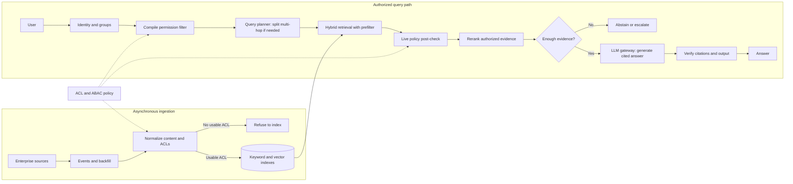

# Enterprise Knowledge Assistant: Interview Guide

**Knowledge work** is people looking up how the company actually runs: policies, runbooks, product docs. The same question is not the same answer if you are an intern vs a VP.

**G01 covers one slice:** ask an internal question and get a cited answer you are allowed to see. Not a general Google, not a ticket bot.

End to end, as Priya (Tier-1 support):

1. **She asks** “What’s the SLA for enterprise plus?”
2. **We check who she is** — tenant, role, groups.
3. **We retrieve only docs she may open.** The VP handbook never enters the model.
4. **The model writes from that pack** and cites the passages.
5. **If sources disagree or evidence is thin**, we say so, or abstain, or escalate.
6. **If she is later moved off that group**, yesterday’s cached hit is dead.

That’s it: **who you are → what you may read → cited answer or stop.** Building a new policy is out of scope.

> **Core idea:** This is not primarily a vector-search problem. It is a permission-aware RAG problem. Different employees can ask the same question and legitimately need different answers.

## The anchor case study

Use this guide as the **master case study** for enterprise RAG and knowledge-assistant interviews. Learn the shared architecture here, then adapt it to each variant's dominant constraint.

| Related case | What changes from G01 |
|---|---|
| **Enterprise Support Assistant** | Support knowledge, tickets and runbooks become central; add workflow integrations, escalation paths and customer-specific visibility. |
| **Legal RAG** | Increase citation precision, source authority, version tracking, auditability and review; control cost while handling high-risk answers. |
| **Sub-100ms Search** | Latency dominates; use permission-aware precomputation and caches, bounded retrieval and often remove live generation from the hot path. |
| **Enterprise / LLM Search** | Emphasise broad source coverage, relevance, freshness, scale and search UX; preserve the same authorisation boundary. |
| **Meridian Assist** | Keep the enterprise-assistant foundation, then adapt source systems, users, workflows and domain-specific policies to the scenario. |
| **Security / incident cases** | Focus on threat model, blast radius, detection, containment, revocation, recovery and evidence that no unauthorised data escaped. |

~~~text
                         G01
          Enterprise Knowledge Assistant
                           |
       +-------------------+--------------------+
       |                   |                    |
 Enterprise Support     Legal RAG      Enterprise / LLM Search
       |                   |                    |
       +----------+--------+--------------------+
                  |                             
       Sub-100ms Search, Meridian Assist, Security / Incident cases
                  |
     Same core: identity → authorization → retrieval → grounded answer
       Adapt the data, workflow and dominant quality constraint
~~~

## 0. The mental model

~~~text
User
  ↓
Identity
  ↓
Authorization
  ↓
Query understanding
  ↓
Permission-aware retrieval
  ↓
Rerank
  ↓
Evidence selection
  ↓
LLM
  ↓
Citation / policy verification
  ↓
Answer / Abstain / Escalate
~~~

**The LLM is never the authorisation system.** If the user cannot see a document, that document must not enter the model context.

---

## 1. How I would open

> “Anyone can build multi-source RAG. The difficult part is that a Tier-1 agent, a Tier-3 engineer and an account manager may ask the same question but should see different information. So I’ll treat permission fidelity as the primary constraint and optimise retrieval quality inside that boundary.”

### Questions to ask the interviewer

Ask the questions that change a design decision. The [Full Design, section 1](/design/enterprise-knowledge-assistant#full-pack) expands these into the full discovery table.

| Question to ask | What it's really asking | What you then decide |
| --- | --- | --- |
| Which source is authoritative for each content type, and what if sources disagree? | If Confluence says one SLA and the handbook PDF says another, which one do we quote? | Source ranking, how conflicts are shown, and whether to flag uncertainty. |
| Must inherited permissions and group changes be checked live, or is bounded sync lag acceptable? | If someone just left a group, can they still get last week's docs in the answer? | Live auth vs a named stale window. |
| How fast must updates, deletions, and access revocations take effect? | If a doc is deleted or access is revoked, how long can it still appear in an answer? | Freshness SLO, tombstones, and how often you reconcile. |
| Should answers synthesize across sources, and do citations need a passage or whole document? | Can we blend three docs into one answer, and must the citation be the exact paragraph? | Evidence mix, context budget, and citation grain. |
| What should happen when evidence is weak, retrieval fails, or sources conflict? | If we only have a maybe, do we still answer, or say we don't know? | Answer, mark stale, abstain, or escalate. |
| Who asks questions, who investigates wrong answers, and who owns an over-sharing incident? | When an intern sees a salary doc they shouldn't, who gets paged — and who may open the traces? | Personas, incident owner, and who can inspect traces. |
| What are p95 latency, scale, residency, retention, and cost limits? | How fast, how many users, which country the data must stay in, and what we can spend? | Latency budget, partitioning, region, and how long logs are kept. |
| Who may inspect traces, and what must an audit reconstruct? | After a leak scare, can we prove which docs went into the model and who was allowed to see them? | Logged IDs, versions, policy, evidence, and citation set. |

If answers are unavailable, state the assumptions before drawing: read-only, query-time permission checks, passage citations, and fail-closed behaviour on uncertain access.

**Default MVP:** read-only Q&A; Drive, SharePoint, Slack, wiki and tickets; multi-tenant; ABAC/ACL-aware; query-time authorisation; passage citations; sub-3-second chat target; no write-back, personal files, unapproved web, cross-tenant search or persistent memory.

---

## 2. Requirements: Functional + Non-Functional

The easiest way to frame requirements in an interview is:

> **Functional = what the system does. Non-functional = how well it does it and what constraints it must satisfy.**

### Functional requirements — what the system must do

1. **Ingest enterprise sources** — Drive, SharePoint, Slack, Confluence/wiki, Jira/tickets, etc.
2. **Normalise permissions** — convert source-specific ACLs/groups into a common authorisation model.
3. **Retrieve authorised content** — unauthorised chunks must never enter model context.
4. **Answer questions** — use retrieved evidence rather than unsupported model knowledge.
5. **Provide citations** — citations should point to the actual supporting, authorised evidence.
6. **Abstain when necessary** — if evidence is weak or unavailable, do not guess.
7. **Handle changes** — propagate document updates, deletions, ACL changes and revocations.
8. **Support different personas/tenants** — the same query can legitimately produce different results.
9. **Audit decisions** — preserve enough information to explain why an answer was produced.

### Non-functional requirements — how well / under what constraints

| Requirement | Example target / constraint |
|---|---|
| **Security** | Zero unauthorised disclosure; fail closed on authorisation failure |
| **Latency** | Chat target around p95 <3s; tighter targets need caching/precomputation |
| **Freshness** | ACL changes/deletions reflected within a defined SLO |
| **Scalability** | Example: 100k employees, 50M chunks, 100 QPS peak |
| **Availability** | Degrade safely when retrieval/reranking/LLM components fail |
| **Cost** | Define a cost/request budget and control model + retrieval spend |
| **Auditability** | Replay why an answer and authorisation decision occurred |
| **Reliability** | Idempotent ingestion, retries, backfill and reconciliation |
| **Maintainability** | Centralised, deterministic authorisation rather than scattered permission logic |

### Interview shortcut

If asked **“What are the requirements?”**, say:

> **“Functionally, I need to ingest enterprise data, understand permissions, retrieve only authorised evidence, and generate a cited answer or abstain. Non-functionally, the big constraints are zero data leakage, permission freshness, latency, scalability, cost, and auditability.”**

---

## 3. Architecture

Think in two planes.

### Control plane

Identity mapping, ACL/ABAC policy, source configuration, retrieval configuration, model routing, evaluation, audit policy and admin controls.

### Data plane

Ingestion, normalisation, indexing, query authorisation, retrieval, reranking, evidence selection, generation, citation verification and response/escalation.

### Architecture diagram

This is the interview-size version of the [Full Design architecture, section 5](/design/enterprise-knowledge-assistant#full-pack).

### Step-by-step architecture

- **Step 1.** **Ingest sources.** Source events and backfills bring enterprise documents into an asynchronous pipeline.
- **Step 2.** **Normalise permissions.** Convert content and source ACLs into a consistent form; refuse to index an item if it has no usable ACL.
- **Step 3.** **Build the search indexes.** Put eligible content into keyword and vector indexes for hybrid retrieval.
- **Step 4.** **Establish the user's scope.** Authenticate the user, resolve groups and attributes, compile the ACL/ABAC permission filter, and plan a multi-hop question only when needed.
- **Step 5.** **Retrieve and check.** Run hybrid search with that filter, then apply a live policy post-check before any candidate reaches reranking or the model.
- **Step 6.** **Select evidence.** Rerank only authorised candidates and decide whether the evidence is sufficient; abstain or escalate if it is not.
- **Step 7.** **Answer and verify.** The LLM gateway generates a cited answer from authorised evidence; citation and output checks run before returning it.

**Model and agent role:** This is an LLM-powered RAG assistant. A query planner may decompose a multi-hop question, but it does not grant access; deterministic ACL/ABAC checks decide what the LLM may see. The LLM gateway handles generation and model routing after those checks. It is not a free-running write agent.

### Trust boundary

~~~text
Retrieve only what the user may see
              ↓
        final policy check
              ↓
             LLM
~~~

Forbidden content must stay outside the model context.

---

## 4. Ingestion: normalise permissions first

A connector does more than download documents. It translates each source's permission model into one internal representation.

Keep:

- stable source/document ID
- tenant
- owner
- version
- updated-at
- principals/groups
- classification
- deletion/tombstone state
- ingestion checkpoint
- ACL/index version

Typical source concerns:

| Source | Main risk |
|---|---|
| Drive | Inherited sharing (limited-access folders can block it), personal files, external sharing |
| SharePoint | Broken inheritance, stale site/library permissions |
| Slack | Private channels/DMs, secrets, prompt injection |
| Wiki | Page restrictions, stale policy, malicious content |
| Tickets | Customer visibility, PII, exact ticket/error identifiers |

**Rule:** no usable ACL means do not silently assume “internal”. Embeddings are derived search state, not the permission authority.

---

## 5. Freshness and deletion

Use:

~~~text
Source event
 → Queue
 → Fetch authoritative record
 → Normalize content + ACL
 → Index / tombstone
 → Reconciliation
~~~

Use change events where possible, idempotent processing, backfill, tombstones and periodic reconciliation.

Important distinction:

> **Authorisation correctness and freshness correctness are different checks.**

A connector can miss a delete while the ACL still looks valid. If freshness is outside the agreed SLO, fail closed or clearly withhold/label the answer.

---

## 6. Authorisation: two layers

### Layer 1 — Pre-filter

Compile the user's identity/attributes into the search filter.

Examples: tenant, groups, clearance, region, project, customer/account, classification.

This improves retrieval quality and latency because forbidden documents never compete for top-k.

### Layer 2 — Authoritative post-check

Before generation, verify the final evidence set again.

This catches:

- live revocation
- stale ACLs
- time-based embargoes
- need-to-know rules
- redaction obligations
- changes between retrieval and generation

### Why not only post-filter?

If top-10 contains six forbidden documents, filtering afterward leaves only four useful candidates. The user may miss relevant authorised evidence.

> **Pre-filter for efficiency and recall. Post-check for correctness.**

---
