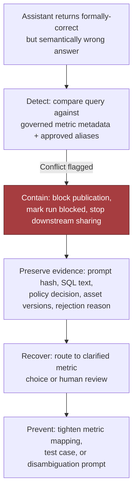
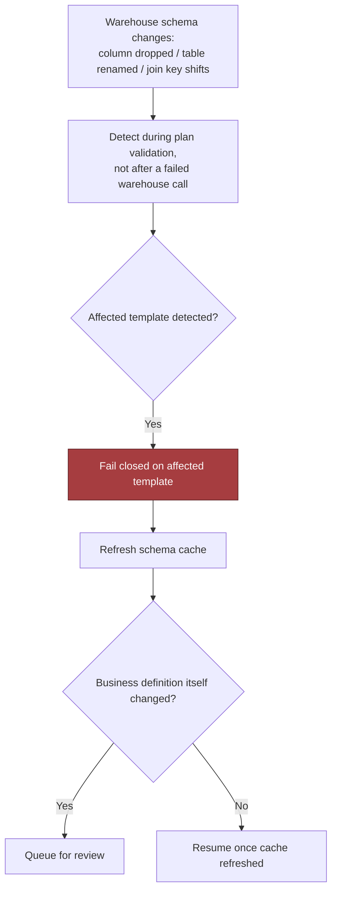
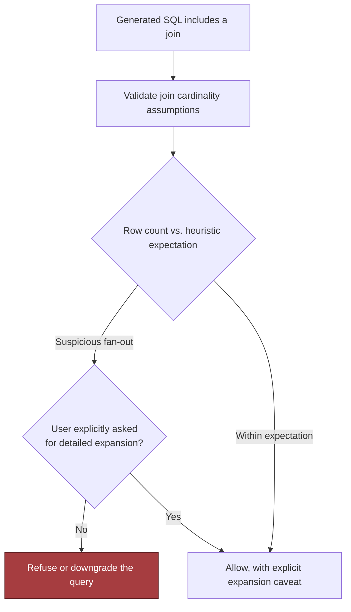
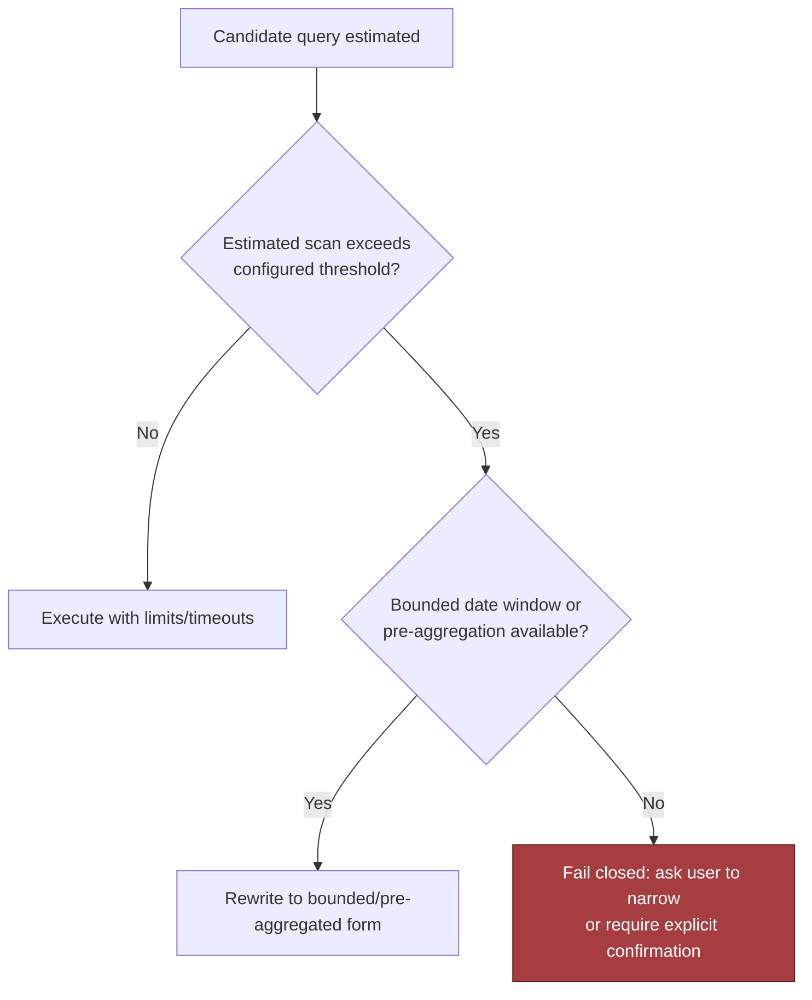
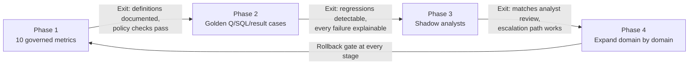

# Natural Language over Governed Data, part 3

## 9. Fail Closed on Policy, Degrade on Everything Else

A strong answer says exactly what fails open, what fails closed, what degrades, what queues and what escalates to a human. Incidents deserve different reactions: a policy engine outage differs from a visualisation glitch, and a query scan that explodes cost differs from a benign cache miss. Memorise the pattern by category: authorisation closed, connectivity degrade or queue, ambiguity human, suspicious scan closed and alert.

| Situation | Preferred policy | Why |
|---|---|---|
| Authorisation or policy evaluation fails | Fail closed | Better to deny than to expose data accidentally |
| Warehouse connection is briefly unavailable | Degrade or queue, depending on freshness needs | Preserve request intent if the use case tolerates delay |
| Query planner exceeds a safe timeout | Fail closed with a retry suggestion | Prevent runaway cost and long-tail blocking |
| Low-risk formatting or explanation service fails | Degrade | User may still get a safe, reduced answer path |
| Ambiguous metric mapping or business-definition conflict | Human intervention | A wrong answer is worse than a slower answer |
| Execution produces a suspicious row count or scan volume | Fail closed and alert | Treat unexpected scale as a probable correctness or cost issue |

Five drills cover the failures that survive unit tests. The headline drill is the wrong business question. The user asks for "active customers". The assistant quietly uses login activity when the definition requires paid activity. The SQL returns rows and the chart renders. Detect by comparing the generated query against governed metric metadata and approved aliases. Contain by blocking publication and marking the run. Preserve the prompt hash, SQL text, policy decision, asset versions and rejection reason. Recover by routing to a clarified metric choice or human review. Prevent by tightening the mapping, the test case or the disambiguation prompt. The blast radius is scoped by tenant, workflow and metric family, never "all analytics is broken".



Schema drift is the second drill. A column disappears, a table is renamed overnight, a join key shifts, and a previously good template still produces something that looks reasonable. Detect it during plan validation, not after a failed warehouse call. Fail closed on the affected template, refresh the schema cache, and queue a review if the business definition itself changed.



Join fan-out is the third. A join multiplies rows and inflates totals while remaining syntactically valid and passing every SQL check. Validate join cardinality assumptions, compare expected row counts against heuristics, and block suspicious fan-out unless the user explicitly asked for a detailed expansion. If the join cannot be proven safe, refuse or downgrade; never hope the aggregate still looks plausible.



Excessive scans are the fourth, and cost is a reliability issue because one query can exhaust concurrency and slow other tenants. Estimate before executing. Where the estimate exceeds the threshold, rewrite to a bounded window or a pre-aggregation if one exists; otherwise fail closed and ask the user to narrow or confirm.



The summary contradicting the table is the fifth, already drawn in section 8. Around all five sit the operational safeguards:

- a bounded timeout on every warehouse query
- limited, idempotent retries, only when the failure is likely transient
- no indefinite retry of a policy failure, because a bad prompt is not a network glitch
- a dead-letter path with enough redacted context for support when a queued request keeps failing
- a human escalation route for any ambiguous mapping or repeated semantic mismatch

Treat human escalation as a designed path.

Backpressure belongs to the background lane. Crawler and registry refresh jobs sit behind a queue with rate-limited bursts, so they never stampede the warehouse during peak query traffic. The query API degrades gracefully when metadata confidence drops. The compact failure policy reads as one flow:

```
request received
  -> authenticate user
  -> authorize against tenant + role + metric policy
  -> parse SQL AST
  -> validate tables, columns, joins, limits, and query shape
  -> if policy or semantic check fails: reject + log redacted evidence
  -> execute read-only as the user (on-behalf-of) under warehouse-native RLS/CLS
  -> if scan/time budget exceeded: cancel + surface safe fallback
  -> if results pass checks: mask sensitive fields
  -> generate summary from structured result
  -> if summary mismatch detected: return table only, alert review queue
```

## 10. Gate the Release on Semantic Correctness, Not Execution Success

A query that runs can still be wrong, so the evaluation separates two things. Execution accuracy is proved by the golden-set replay. Semantic correctness is proved only by analyst review against the governed definition, and that is the release gate. Golden cases pair the user's natural-language question, the approved SQL and the expected result shape. They include easy examples, ambiguous paraphrases, edge cases with filters and time windows, and known traps where a valid query answers the wrong question.

| Metric | Good threshold | Bad threshold | Dataset / method | Owner |
|---|---:|---:|---|---|
| Semantic correctness | Matches analyst review on scope | Any silent mismatch | Golden question/SQL/result cases | Analytics lead |
| Execution accuracy | No unexplained regression on the golden set | Any unexplained regression | Golden-set replay on every change | Application owner |
| Policy violations | 0 escaped | > 0 escaped; investigate repeated blocks (more than five identical blocked attempts in a day) | Policy decisions in the query-run audit | Security |
| Warehouse compute per answer (bytes scanned or credit time) | Within the 7-day baseline | > 20% above baseline | Warehouse telemetry | Data platform |
| User trust score | ≥ launch target (4.2/5 or 80% positive) | Two consecutive review periods of decline, even if usage rises | In-product feedback and periodic survey | Product |
| p95 latency and escalation volume | Within target; escalations trending down | Breach or rising escalations | Request traces plus analyst ticket counts | Platform / SRE |
| Groundedness and citation accuracy (copilot personas) | ≥ 90% supported claims; ≥ 95% correct citations | Below | Golden Q&A with SME review; source-span audit | ML / eval |
| Escalation quality (copilot personas) | ≥ 95% correct escalation on high-risk cases | Missed high-risk case | Risk-labelled scenarios | Product / support |

Measure in four buckets, so model quality is never confused with operational health or business value:

- technical health: bytes scanned, p95, availability
- model quality: execution accuracy, semantic correctness, clarification rate, policy violations
- adoption: trust score
- business outcome: answer turnaround before and after, analyst escalation volume, executive self-service rate

A successful assistant changes behaviour. If executives keep asking analysts to re-check, the product has not solved the problem. The dashboard is layered the same way: business outcome on top, model quality in the middle, system health at the bottom. Each business metric is wired to the component that can move it. A trust drop then points at slow answers, too many clarifications, broken mapping, or policy blocks that feel arbitrary.

Red-team the definitions as well as the SQL. Semantic substitution, where login activity stands in for paid activity. Schema drift that keeps a template plausible. Join explosions that pass every SQL check. Excessive scans that slow other tenants. Summary drift, where the table is right and the prose misstates the trend. For the copilot personas, add fabricated business reasons, leakage across regions or business units, stale dashboard refreshes presented as current, and an overconfident board-level narrative.

## 11. Roll Out Ten Metrics at a Time

The rollout must prove three things in order. The assistant answers a narrow set of governed questions correctly. It does so safely under policy. Real users adopt it because it improves their workflow rather than impressing them in a demo. Each phase left to right widens the blast radius. The assistant advances only when the prior phase's exit criteria are met.



| Week | Gate |
|---|---|
| 0-1 | Ten governed metrics with stable definitions, known owners and visible impact (revenue, active customers, pipeline, churn, support backlog); non-goals documented |
| 1-2 | Metric definitions documented, query templates reviewed; the assistant can explain which metric it used and why |
| 2-3 | Golden cases built, including ambiguous paraphrases and known traps |
| 3-4 | Golden set replayed on every change; execution accuracy and semantic correctness compared; every failure explained |
| 5 | Shadow analysts on real questions; users still see the analyst's answer as truth; analysts mark correct, merely plausible, or wrong for subtle reasons (wrong grain, wrong definition, wrong segment filter) |
| 6-8 | Executive release once the assistant consistently matches analyst-reviewed answers and escalation works |
| After | Expand domain by domain, each with a named metric owner who approves definitions, reviews golden cases and owns semantic-layer changes |

Name the owners. The metric owner approves definitions and golden cases. The application owner owns the runtime, prompt assembly, generation and API contracts. The data owner owns warehouse tables, the semantic layer and policy mappings. The security owner reviews access control, audit logging and blocked-query handling. The support owner receives escalations and coordinates rollback. Rollback triggers are a spike in policy violations, a drop in semantic correctness, a jump in bytes scanned, or users routing around the assistant because they stopped trusting it. Rollback keeps a partial success from becoming an incident.

Decide what is configuration, adapter, shared service and core product, because an FDE system pays off only when the next customer inherits the stable core and swaps the edges. Metric definitions, allowed domains and rollout thresholds are configuration. Warehouse and identity integrations are adapters. Query validation, policy enforcement, tracing and audit logging are shared services. Question understanding, explanation behaviour and safe query orchestration are the core. Five delivery items make it stick:

- a canary on a small user group or metric set
- staged migration of governed questions from analyst workflows
- user training on what the assistant can and cannot answer and how it signals uncertainty
- documented escalation paths
- a maintained metric catalog with known limitations

| Risk | Owner | Mitigation | Trigger |
|---|---|---|---|
| Correct SQL answers the wrong business question | Analytics lead | Golden cases, semantic review, approved metric catalog | A valid query passes execution but fails analyst review |
| Policy block frustrates users | Security + product | Better clarifying prompts and explanation text | Repeated blocked attempts on the same workflow |
| Warehouse cost spikes | Platform owner | Query limits, result caching, scan monitoring | Warehouse compute per answer drifts upward |
