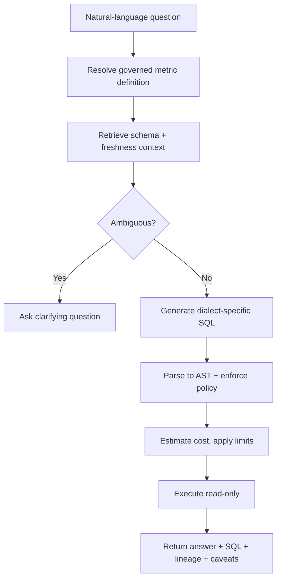

# Natural Language over Governed Data

*Give executives an answer in seconds without ever letting the model decide what "revenue" means: the semantic layer, not the model, is the product.*

The hard part of this system is not generating SQL. It is that a syntactically perfect query against the wrong definition of a metric is a governance failure dressed up as a working feature. So the design anchors every question on a governed definition before it touches a table. This page consolidates the group's prompts into one read for the day before. Everything else in the group is a delta on it.

| Case in the group | What it contributes here |
|---|---|
| #17 Natural-Language-to-SQL Analytics Assistant (anchor) | Sections 1 to 12: the design, requirements, validation, failure drills, evaluation, rollout and delivery |
| #36 Executive Dashboard Copilot | The executive persona and variance explanation in sections 1 and 8; its escalate-to-analyst rule |
| #34 Retail Demand Forecast Explanation Assistant | The planner persona, driver attribution and the correlation-versus-causation risk in section 8 |
| #13 From Supervisor to Deep Agent (governed data assistant at a large Asian life insurer) | The governed metric views, the Genie-versus-Multi-Tool split, the clarify-below-60% gate, and section 13's story |
| Self-drill for #17 | Section 14, the cost pivot |

---

## 1. Name the Wrong-Answer Risk Before Drawing Anything

Open with the failure, not the pipeline. Executives ask analysts the same handful of questions every week, and each time someone hand-translates English into SQL, runs it and sanity-checks the result. The naive pitch, "let an LLM write the SQL", loses the interview immediately, because generation is not the hard part. "Revenue" might mean booked, recognized or cash collected. The system must never produce valid SQL that confidently answers the wrong business question. That failure is more dangerous than an outright error, because the SQL ran, the chart rendered, and the number looks plausible.

Reframe the ask from "build a text-to-SQL model" to "build a governed decision-support system that only speaks in terms the business has already agreed to". That framing implies three things from day one. A semantic layer of governed metric definitions. A safety boundary around the warehouse that is read-only and cost-bounded. And an explicit way to say "I don't know which definition you mean" instead of guessing.

The three answer tiers show what the reframe buys. The weak answer lets an LLM write SQL against the schema and run it. It ignores who owns metric definitions, allows an unapproved reading of revenue, and has no AST validation, cost bound or way to notice a confident wrong answer. The average answer adds a semantic layer, validates before running, executes read-only with row limits and logs every query. It still never says what happens when the question is ambiguous, when the schema drifts, or when the prose summary disagrees with the table. The strong answer consults the metric registry before any physical table and turns ambiguity into a clarifying question. It parses SQL into a tree and checks it against policy and a scan budget before a read-only gateway sees it. It re-checks entitlements at execution. And it proves the whole thing on ten governed metrics with golden cases before any executive sees output.

Then ask the questions that change the architecture, before sketching a box. Each one decides a component.

| Question to ask | What the answer decides |
|---|---|
| Who owns each metric definition, how often do definitions change, and who approves a change? | Whether a metric registry exists as a product, and who is the named owner per domain |
| Is there already a semantic layer or metrics catalog, or must this system build one? | The largest single scope decision in the project |
| Which SQL dialects and warehouses are in scope? | Generation and validation breadth; one dialect or many |
| What is the tolerance for latency versus cost? Synchronous, or async and cached? | Where the sync/async boundary sits |
| Is row-level and column-level security already enforced by the warehouse, or would the assistant reimplement it? | Whether authorisation is reused or rebuilt, which is the classic bug |
| What happens when the assistant is unsure: ask, refuse, or escalate to an analyst? | The ambiguity gate's three modes |
| Which ten metrics matter most, and what does "revenue" actually mean: booked, recognized, or collected? | The MVP scope and the first golden cases |
| What audit evidence must exist so someone can reconstruct why a number was produced? | The query-run record's schema |

Map the people, because the three groups want different things and the architecture has to satisfy all three at once. That tension is exactly why the semantic layer and the policy and cost validator are first-class components rather than afterthoughts bolted onto a chat UI.

| User | Wants | Failure they notice first | What the assistant gives them |
|---|---|---|---|
| Executive | Fast, correct answers with minimal back-and-forth, never "let me check with analytics" | A plausible number that turns out to be the wrong definition | Governed answers with the definition shown, variance explained, uncertain cases escalated |
| Analyst | Repetitive definitional lookups taken off their plate, without the assistant inventing new interpretations | The assistant redefines a metric they maintain | Golden cases they review; escalation queue; the analyst stays the source of truth during shadowing |
| Data / platform engineer | Bounded blast radius: no whole-warehouse scans, no restricted-column leaks, no company-wide budget blowups | One ambiguous question exhausting concurrency | Read-only gateway, scan budgets, warehouse-native policies reused |
| Metric owner | One versioned definition every consumer shares | Two answers to one question | The registry as the single artefact, with approval on change |

The same design arrives with two more personas from the purchased worksheets. The Executive Dashboard Copilot user asks natural-language KPI questions. The copilot translates them to governed metrics, retrieves dashboard and data context, explains variance, cites metric definitions, and escalates uncertain answers to analysts. The Retail Demand Forecast Explanation Assistant user is a planner reviewing forecast variance who asks why demand changed. The assistant explains drivers using sales history, promotions, weather, inventory and events, and recommends human-reviewed planning actions. Neither changes the architecture. Both add a variance-explanation step after the query, which section 8 covers.

Declare the non-goals as a scope fence. This is not a system that lets users author write queries or modify data. It is not a general-purpose exploration tool for every table in the warehouse; it answers a governed set of business questions. And it is not responsible for defining what "revenue" means. That is a business decision the semantic layer records, not one the assistant makes on the fly.

## 2. State Requirements as Testable Constraints

Correctness dominates every other axis. A fast, confidently wrong answer is the single worst outcome, because the executive has no way to know it is wrong. So the system trades latency for safety every time. Asking, narrowing scope or refusing are all preferable to guessing. Depth on ten metrics beats shallow coverage of the whole warehouse.

The functional core is one pipeline, and the must-haves are its stages. Take a natural-language question. Resolve it against governed metric definitions before touching physical tables. Retrieve only the tables, joins and freshness context needed, never the whole schema. Detect ambiguity and ask rather than silently choosing one of several plausible metrics. Generate dialect-specific SQL from the narrowed context only. Parse it into an AST and enforce policy against the tree, not the text. Estimate cost and execute read-only with limits. Return the result with the exact SQL, metric lineage and caveats such as snapshot staleness.

The should-haves come from the copilot personas:

- show confidence, missing evidence and the escalation reason when uncertain
- collect user feedback and reviewer corrections for evaluation, never for ungoverned training
- give admins controls over source inclusion, freshness thresholds, policy rules, blocked actions and audit export

Richer query planning, human approval for ambiguous cases, learned query ranking, federated sources and semantic search over data dictionaries can wait.

"Good" for the MVP has one definition: the system reliably answers ten governed metrics with full lineage and explainability. If it cannot do that, it is not ready to become a general interface to the warehouse.

| Constraint | Stated so it can be tested |
|---|---|
| Correctness | A fast, confidently wrong answer is the worst outcome, so latency is traded for safety every time |
| Latency | The user-facing path stays synchronous. Anything that only improves future answers moves to background queues. Interactive answers 3 to 8 s for the copilot personas; longer workflows async with progress state |
| Security | A read-only identity that reaches only approved datasets, with warehouse-native row and column policies reused rather than reimplemented. SSO, encryption in transit and at rest, secrets management, no training on customer data unless the contract allows |
| Compliance | Append-only query runs recording actor, SQL hash, policy decision, bytes scanned, and the schema and metric versions used |
| Reliability | Fail closed on policy evaluation, planner timeouts and suspicious scan volume. Degrade on formatting or explanation failures |
| Cost | Scan budgets, row limits, timeouts and bounded date windows, because an unbounded query is a reliability problem, not just a bill. Token budgets and small models for routing |

Every must-have then needs an owner in the architecture.

| Requirement | Primary component(s) |
|---|---|
| Anchor on a governed definition | Semantic metric registry, consulted first |
| Retrieve only what is needed | Schema retriever with catalog cache, TTLs and version stamps |
| Ask rather than guess | Ambiguity check with a confidence threshold |
| Dialect-specific generation from narrowed context | SQL generator, stateless |
| Policy against the tree | AST parser, policy and cost validator |
| Bounded, read-only execution | Read-only execution gateway with the narrowest credentials |
| Answer with SQL, lineage, caveats | Result summarizer with cross-check against the table |
| Reconstruct any number | Append-only query-run store, versioned metrics, schema snapshots and policy bundles |

## 3. Map Every Source and Who Owns Its Definition

Three kinds of state exist here, and each has one owner. The warehouse catalog owns physical schema truth. The semantic metric registry owns business definitions. The identity provider owns authentication and the policy store owns access decisions. Caches hold schema snippets, metric lookups and recent plans only as a performance layer, with TTLs and version stamps so the system can explain what it used. Question interpretation, candidate SQL, the AST, the validation result and the execution trace are short-lived workflow state and must not become hidden durable state.

| Data source | Owner | Freshness | Permission model | Risk |
|---|---|---|---|---|
| Warehouse (fact and dimension tables, gold layer) | Data owner | Minutes to daily by table | Warehouse-native row and column security | Join fan-out, unbounded scans, renamed tables |
| Semantic layer / metrics store | Metric owners per domain | Changes on approval | Definition-level ownership, versioned | Two definitions of one word; silent overwrite by another team |
| Warehouse catalog and lineage | Data platform | Crawled on a schedule | Filtered to what the caller may see | Stale join paths after an overnight rename |
| BI dashboards | Dashboard owners | Refresh time per dashboard | Dashboard sharing | Stale refresh presented as current |
| Financial planning, CRM, ERP | Finance and sales systems owners | Daily to weekly | Source-system roles | Numbers that disagree with the warehouse |
| Forecasting platform, POS sales, inventory, promotions calendar, pricing, weather and event feeds (retail persona) | Planning and merchandising | Daily; feeds hourly | Region and store scope | Stale promotions data; correlation read as causation |

The core records follow. Metric(id, name, definition, dimensions, owner, version). SchemaAsset(id, engine, object, columns, sensitivity). QueryRun(id, actor, sql_hash, policy_decision, bytes_scanned, result_ref). The copilot personas add KPIValue(metric_id, period, dimension, value, source_table), Dashboard(id, owner, metric_ids, refresh_time), Insight(id, metric_id, explanation, supporting_queries, confidence) and UserAccess(user_id, metric_id, dimension_scope). The retail persona adds SKU, Store, Forecast(id, sku_id, store_id, horizon, prediction, confidence), ActualSales, DriverSignal(id, type, value, source, timestamp) and Explanation(forecast_id, top_drivers, confidence, caveats).

State the versioning rules aloud. Metric versions are retained long enough to reconstruct why last quarter's dashboard produced a different number than today's. QueryRun is write-once and append-only, because query history is where incident review and adoption analysis start. Every artifact that influences behaviour is versioned, whether metric definitions, schema snapshots, policy bundles or generated plans, or the system works in the happy path and fails at rollout. Idempotency keys go on question submission and feedback, and optimistic concurrency on metric edits, so one team cannot silently overwrite another team's definition.
