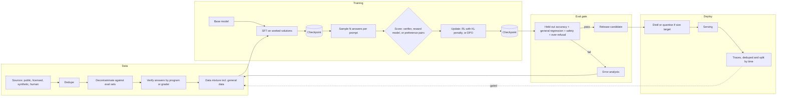

# Model Development and Post-Training

*Every model-building prompt spends one fixed budget of compute and data, and the constraint decides which stage of the pipeline gets the money.*

These four prompts ask about one pipeline in four ways. Each question fixes a different constraint, and that constraint changes exactly one stage: data, SFT, post-training, evaluation or deployment. This page puts the group's prompts into one read for the day before.

| Case in the group | What it contributes here |
|---|---|
| Cohere: design a model that solves math problems, walking through data collection, SFT, post-training and eval (anchor) | Sections 1 to 8 and 13: the full pipeline on one running example |
| OpenAI: design a scalable, efficient system for training an LLM given compute and data constraints | Section 9: the training stage under a compute budget |
| Anthropic: design a language model that minimises harmful outputs while staying useful | Section 10: the post-training and eval stages under a harm constraint |
| Google: design a small LLM that runs on a phone while staying polite | Section 11: the deploy stage under a device constraint |
| Compute-cost self-drill | Section 14 |

**Most of this page is own construction.** No worked design exists for any of these four prompts. The grounding comes from hands-on fine-tuning labs, material on learning surfaces, and the quantisation arithmetic in the air-gapped chapter. Sections and tables marked *(own construction)* were built for this page. Every number marked *(assumption)* is an illustration for the whiteboard, not a sourced figure.

---

## 1. Clarify What "Solves Math" Means Before Collecting Anything

A model cannot be trained toward a target nobody wrote down. "Solves math problems" hides at least four different products, and each one needs different data and a different evaluation *(own construction)*.

| Question | Why it changes the design |
|---|---|
| Which level: grade school, competition, university proofs? | Sets the data sources and whether answers can be checked automatically |
| Final answer only, or a shown working? | A final number can be verified by a program; a proof needs a checker or a human grader |
| Tools allowed, such as a Python interpreter or a calculator? | Tool use moves arithmetic out of the weights and changes what SFT teaches |
| Who uses it, and what does failure cost? | A tutor that is wrong teaches students wrong; a research assistant that is wrong wastes an hour |
| Build from a base model, or adapt an existing chat model? | Sets whether pretraining is in scope or only post-training |

The decomposition round rewards this move. The question bank's own framework starts with "Clarify the mission" and warns that the most common failure is jumping to architecture before scope. Say the assumptions aloud if the interviewer does not answer. A safe default is grade-school to competition word problems, final numeric answers, an optional code tool, and adaptation of an open base model.

> *"Before I pick a method I want the target pinned: which level of math, whether a final answer is enough or the working must be right too, and whether the model may call a tool. Those three answers decide the data, the reward and the eval."*

## 2. State Requirements as Testable Constraints

A requirement that cannot fail a test is a preference. "Good at math" is a preference. "Pass@1 of at least the target on a held-out set that shares no problems with training" is a constraint. Only the second one shapes the pipeline *(own construction throughout this section)*.

The must-haves are six. Correct final answers on the target distribution, measured on problems the model never saw. Shown working that is consistent with the final answer. No regression on general ability beyond an agreed tolerance. Refusal to fabricate when a problem is ill-posed. A reproducible training run, so any checkpoint can be rebuilt. An evaluation harness that runs on every candidate checkpoint before anyone reads a single sample by hand.

The should-haves come after the first model is trusted. Tool use through a code interpreter. Step-level feedback on the working. A tutoring mode that explains rather than answers.

| Constraint | Stated so it can be tested |
|---|---|
| Accuracy | Pass@1 on a held-out, decontaminated test set; target set with the customer *(assumption: the number is theirs, not ours)* |
| Reasoning quality | Sampled human or model grading of working on a stratified slice; answer-consistent working rate reported alongside accuracy |
| Contamination | N-gram or embedding overlap between train and test below an agreed threshold; any benchmark found in training is removed from reporting |
| General-ability regression | A fixed general benchmark suite, run on every checkpoint, with a maximum allowed drop |
| Reproducibility | Data snapshot hash, code version, config and seed recorded per run; any checkpoint rebuildable |
| Compute | A stated GPU-hour budget per stage, with a kill rule when eval stops improving per GPU-hour |
| Safety | Refusal on genuinely harmful requests; over-refusal rate on benign prompts measured, not assumed |

Every must-have then needs an owner in the pipeline.

| Requirement | Primary stage or component |
|---|---|
| Correct answers on unseen problems | Data collection with verified answers; post-training with a correctness reward; held-out eval |
| Consistent working | SFT on worked solutions; optional step-level reward in post-training |
| No general regression | Data mixture that keeps general data in; regression suite in the eval gate |
| No fabrication on ill-posed problems | SFT examples of "this problem is ambiguous"; eval slice of ill-posed problems |
| Reproducibility | Experiment tracker, data versioning, checkpoint store |
| Eval before anyone reads samples | Automated eval harness wired to the checkpoint store |

## 3. Size the Run Before Naming a Method

Arithmetic decides which methods are on the table. The standard approximation for training compute is about 6 × parameters × training tokens in FLOPs. Generation costs about 2 × parameters per generated token. Both are rules of thumb, good enough for a whiteboard and not for a purchase order.

Run the numbers on the math model *(all figures are assumptions, arithmetic is exact)*.

| Stage | Assumed workload | Compute |
|---|---|---|
| SFT | 7B model, 100K worked problems at 500 tokens each = 50M tokens | 6 × 7e9 × 5e7 = 2.1e18 FLOPs |
| SFT wall-clock | At an assumed 3e14 effective FLOP/s per GPU | 7,000 GPU-seconds, about 2 GPU-hours |
| Post-training rollouts | 50K prompts × 8 samples × 1,000 tokens = 4e8 generated tokens | 2 × 7e9 × 4e8 = 5.6e18 FLOPs to generate |
| Post-training updates | Training on those 4e8 tokens | 6 × 7e9 × 4e8 = 1.68e19 FLOPs |

SFT is cheap. With these assumed workloads, post-training with sampled rollouts costs roughly ten times more, and generation runs well below peak throughput because it is memory-bound. So the compute budget belongs to post-training and to evaluation, not to the supervised stage.

Memory decides the hardware shape. A full fine-tune with the Adam optimiser in mixed precision needs roughly 16 bytes per parameter for weights, gradients and optimiser state. That is about 112 GB for a 7B model *(assumption: the rule of thumb, before activations)*. It does not fit on one 80 GB card. Either shard the optimiser state across GPUs or train a small adapter instead of the full weights. Section 9 returns to both.

## 4. Draw the Architecture End to End

The pipeline is a loop. Data flows forward through training stages, and evaluation results flow backward into the next data mix. No checkpoint moves forward without passing the eval gate *(own construction for every diagram in this section)*.

```
 ╔═══════════════════════ CONTROL PLANE (changes are experiments) ═══════════════════════╗
 ║  data mixture config · training configs · reward definitions · eval suites + gates     ║
 ║  experiment tracker (run id, data hash, code version, seed) · compute budget per stage  ║
 ╚══════════════════════════════════════╤══════════════════════════════════════════════════╝
                                        │ configures every stage below
 ╔══════════════════════════ DATA + TRAINING PLANE ═══════════════════════════════════════╗
 ║                                                                                         ║
 ║  DATA            sources ─> dedupe ─> decontaminate vs eval ─> verify answers ─> mix    ║
 ║                  (public sets, licensed, synthetic from a strong model, human-written)  ║
 ║                                   │                                                     ║
 ║                                   v                                                     ║
 ║  BASE MODEL ──> SFT (worked solutions, format) ──> checkpoint ──┐                       ║
 ║                                                                 v                       ║
 ║  POST-TRAIN     sample N answers ─> score (verifier / reward model / preference) ─>     ║
 ║                 update policy (RL with KL to reference, or DPO on pairs) ─> checkpoint  ║
 ║                                                                 │                       ║
 ║                                                                 v                       ║
 ║  EVAL GATE      held-out accuracy · general regression · safety + over-refusal ·        ║
 ║                 contamination report ─── pass ──> release candidate                     ║
 ║                                     └── fail ──> error analysis ──> next data mix ─┐    ║
 ║                                                                                     │   ║
 ║  DEPLOY         distil / quantise if a size target exists ─> serving ─> traces ─────┘   ║
 ║                                                                  (flywheel, gated)     ║
 ║                                                                                         ║
 ║  CHECKPOINT STORE + TRACKER — every stage reads from and writes to it                   ║
 ╚═════════════════════════════════════════════════════════════════════════════════════════╝
```

The same pipeline for viewers that render Mermaid:



| Component | Job | Fails how |
|---|---|---|
| Source collection | Gather problems with trustworthy answers | Scraped answers are wrong, so the model learns the errors |
| Deduplication | Collapse near-identical problems | Popular problems dominate training and their twins sit in the test set |
| Decontamination | Remove any eval problem from training data | Reported accuracy measures memory, not skill |
| Answer verification | Check each answer by program, symbolic solver or grader | Unverified synthetic data teaches confident wrong reasoning |
| Data mixture | Blend math with general data | Math improves while general ability collapses |
| SFT | Teach format and the shape of a worked solution | Trained too long, it memorises; trained on bad solutions, it imitates them |
| Sampler | Generate several candidate answers per prompt | Too few samples give no signal on hard problems |
| Scorer | Turn answers into reward or preference pairs | A lenient answer check rewards wrong answers that look right |
| Policy update | Move the model toward higher-scoring answers | Without a penalty for drifting from the reference, it games the reward |
| Eval gate | Decide whether a checkpoint moves forward | Evaluating on training-adjacent data passes a model that fails in production |
| Distil and quantise | Meet a size or latency target | Quality loss goes unmeasured because the eval ran on the big model only |
| Checkpoint store and tracker | Make every run rebuildable and resumable | A failure mid-run loses days; a good result cannot be reproduced |

## 5. Collect Data That Can Be Checked, Not Just Read

In math, a program can verify most final answers, which few domains allow. Build the data pipeline around that. A problem whose answer cannot be checked is worth less than one that can, because nothing downstream can tell whether training on it helped.

Draw from four sources *(own construction)*. Public problem sets with known answers. Licensed or customer-owned material. Human-written problems from domain experts for the hard tail. Synthetic problems and solutions generated by a stronger model, kept only when the final answer passes verification. That last filter is rejection sampling: generate many solutions, keep the ones whose answer checks out, discard the rest.

The Foundations labs show the mechanical half of this stage. They contrast a pretraining corpus with a company fine-tuning dataset. They format examples as question-answer pairs with a prompt template, store them as JSONL, tokenise with padding and truncation, and split into train and test. That is the plumbing. The judgement lies in the three gates of the data flywheel.

Deduplicate first. In the book's worked example, 140,000 traces turned out to be only about 9,000 distinct requests after dedup. Split by time and by source, never at random, because a random split puts near-twins on both sides. Route low-agreement, high-impact examples to human adjudication, because an automatic label is not the same as a correct one. Ship a datasheet with every dataset: collection window, filters, dedup method, split strategy, label source and known biases.

## 6. Teach the Format With SFT, Then Stop

SFT teaches the model what a good answer looks like, not how to find one it has never seen. Supervised fine-tuning trains on example inputs paired with the exact outputs wanted. For math, the outputs are worked solutions ending in a clearly marked final answer.

The Foundations labs make the contrast concrete. They compare a base model with an instruction-tuned one on the same prompt. The base model continues the text; the tuned one answers the question. They then train a small model, `pythia-70m`, for a handful of steps and compare it with the same model trained longer and with a larger model. In those labs, more training on the same data changed the style of the answer long before it changed whether the answer was right.

Three rules follow *(own construction)*. Keep SFT short: a model that over-fits the worked solutions reproduces their exact wording and loses flexibility. Mix in general instruction data so the model does not forget how to follow ordinary requests. Include examples that decline an ill-posed problem, or the model will never learn that "this has no unique answer" is a legal output.

Parameter-efficient fine-tuning is the default for iteration. An adapter method such as LoRA trains a small set of added weights and leaves the base model frozen. QLoRA does the same on a base model loaded at 4-bit precision. A typical Llama 2 AutoTrain run uses `--use_peft` and `--use_int4` (current AutoTrain calls them `--peft` and `--quantization int4`) to fit a 7B model on modest hardware. Use adapters for fast experiments. Move to a full fine-tune only when an adapter demonstrably plateaus below the target.
