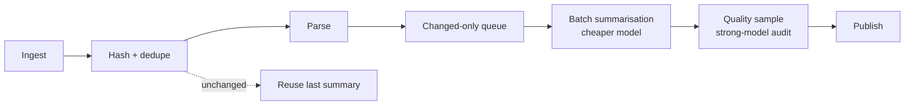

# High-Volume Batch Inference and Document Pipelines, part 5

## 15. Answer the Cost Pivots in Ten Minutes

The interviewer's pivot after a good design is "the nightly bill is too high." Two members of the group are that pivot, and both have the same root: reprocessing what did not change.

**#42, nightly PDF summarisation is too expensive.** Thousands of PDFs are processed nightly and cost is too high. Ask first. Are documents new or changed? Is full summarisation required every time? What is the SLA? Can work be batched off-peak? What quality checks are needed?

| | |
|---|---|
| Dominant driver | Reprocessing unchanged documents on a premium model |
| Cheapest lever first | Content hash and change detection; dedupe; cheaper model in batch mode; sampled strong-model audit |
| Metric that proves it | Changed ratio; cost per document; queue depth; eval score on the sample |
| Do not | Run every PDF through the premium model every night |
| 60-second line | Never reprocess an unchanged document without a reason. Batch buys throughput not latency, so quality is proven by sampling. |

The source's strong answer adds incremental processing, queue budgets and sampled evaluation. Its architecture is ingest, hash and dedupe, parse, changed-only queue, batch summarisation, quality sample, publish. The trade-off: batch optimises throughput, not interactive latency, and quality is checked by sampling plus strong-model audits.

**#116, scenario 13, the batch embedding job became too expensive.** The nightly embedding bill spikes after a document refresh. Ask whether all documents are re-embedded or only changed content. The causes are full re-indexing, duplicate documents, no content hash, or a larger embedding model.

| | |
|---|---|
| Dominant driver | Re-embedding unchanged and duplicate documents on every refresh |
| Cheapest lever first | Pause the full job; switch to incremental indexing; deduplicate. Later, a content-hash embedding cache with change detection, and off-peak scheduling |
| Metric that proves it | Embeddings generated vs documents changed; duplicate rate; model version; job retries |
| Do not | Re-index the whole corpus because the refresh touched it |
| 60-second line | Embedding should be incremental. Re-embedding unchanged documents is usually a pipeline design issue. |

The debugging step is a single comparison: changed document count against embedded document count. If the two differ, the pipeline is the bill. Prevention is an indexing budget with anomaly alerts. A silent embedding-model upgrade is also a re-index, so the model version belongs in the cache key *(own construction)*.

Both cards connect back to the anchor. The content hash is the same idea as the immutable snapshot: know exactly what this run is about, and skip what it is not. The sampled audit is the same idea as the tail-sized evaluation: prove quality on a sample instead of paying the premium model on everything.

Every strong cost answer is generated by four verbs in order. Measure, by comparing changed against processed and tracing cost per document. Route, sending the bulk to a cheaper model and the audit sample to the strong one. Bound, with queue budgets, an indexing budget and anomaly alerts. Cache safely, keyed on content hash and model version.

---

## Level calibration

On this design the levels separate on who owns the 4 a.m. decision and how far replay safety reaches, not on raw throughput.

| Level | Sounds like | Missing |
|---|---|---|
| Senior | Derives 4,630 records a second, plans for 5,320 with 15% headroom and sizes from the tail, not the mean. Freezes the snapshot, leases partitions, upserts on job, record and model version, and advances the checkpoint only after the sink write, so a worker crash is harmless. | The 4 a.m. policy and its owner: which contingency mode applies, whether partial output is publishable, and how a quota cut is kept from turning into a retry storm. |
| Staff | Asks the partial-result question first and gets the contingency modes agreed with a named owner before launch. Holds backpressure in the rate-limit coordinator with global and per-tenant quotas, and gates rollout on 1% and 10% load tests plus a rehearsed crash after the sink write. | What happens as workloads and models change: which parts become shared, how a rerun under a new model stays meaningful, and what stops the nightly bill growing through reprocessing. |
| Principal | Makes retry, checkpoint and rate-limit wrappers a common service, and keeps partition orchestration, replay semantics and the push, degrade or stop policy engine as core product. Treats a model upgrade or format drift as a versioned cohort replay, not an overwrite, and makes change detection the first cost lever. | Provider versus self-hosting, the cost ceiling and whether downstream can take mixed vintages depend on the customer's quotas, budget and consumers, so they wait for discovery. |

## Key Takeaways

- The prompt is a throughput problem on the surface and a 4 a.m. recovery decision underneath, so restate it as a replayable, cost-controlled batch by deadline.
- The partial-result question is asked first, because it sets retry, checkpointing and the spend on the last ten percent.
- Requirements are split into features and constraints, prioritised must, should, could, and each traced to a component.
- Sizing starts at 4,630 records per second, plans for 5,320 with headroom, and is driven by the tail and the 270 tokens a record.
- One diagram separates the control plane that coordinates the run from the data plane that moves records, with three trust boundaries.
- Duplicate work is made harmless by keying results on job, record and model version and advancing the checkpoint only after the sink write.
- Workers read immutable snapshots, queues carry opaque identifiers, and every run records its model, code and schema versions.
- The failure policy is decided before launch: fail closed, degrade, queue or human intervention, with five rehearsed drills.
- The 4 a.m. answer finds the bottleneck, pulls the smallest lever, and uses a contingency mode that already had an owner.
- Four trade-offs are defended with a verdict first, and skew is treated as the riskiest assumption.
- The scorecard tracks completion forecast, duplicates, straggler age, retry rate and cost per million records, not "the job finished".
- Rollout climbs from a representative benchmark through 1% and 10% gates to deliberate failure drills.
- The bank document platform is the same spine, with a schema at the typed boundary, a review lane and format drift treated as a data-quality incident.
- The hour opens with the outcome, spends its middle on failure and trade-offs, and closes on the first rollout gate.
- Both cost pivots are answered with change detection: never reprocess or re-embed what did not change.

## Check Yourself

1. **What is the one-sentence restatement of the prompt?** Complete a replayable, cost-controlled batch by deadline with clear recovery decisions when behind schedule.
2. **Which clarifying question is protected first when time is short, and why?** Whether partial results have value; it decides retry strategy, checkpoint cadence and how much to spend on the last 10%.
3. **Derive the planning rate.** 100,000,000 / 21,600 s ≈ 4,630 rps; ×1.15 headroom ≈ 5,320 rps.
4. **Why is headroom kept separate from growth factor?** Headroom covers noise inside one batch; growth covers next quarter's larger batch. Mixing them hides both.
5. **Where does backpressure live, and what does it do when quota tightens?** In the rate-limit coordinator; it slows leases or per-worker concurrency instead of letting retries stampede the provider.
6. **Why is `InferenceResult` keyed on `job_id + record_id + model_version`, not `record_id`?** So replay is idempotent within a run and a rerun under a new model cannot silently overwrite the old answer.
7. **When does the checkpoint advance?** Only after the sink write succeeds, which prevents false progress.
8. **Name one trigger for each failure policy.** Fail closed: broken snapshot hash. Degrade: transient sink throttling. Queue: quota reduction. Human intervention: 45% at 4 a.m. with no path to the deadline.
9. **What three questions should the console answer at 4 a.m.?** Can we still finish? Which lever first? What is the blast radius if we keep going?
10. **What changes when the payload is a bank's financial documents (#49)?** A schema at the typed boundary, confidence and business-rule checks, a human-review lane, and lineage down to document hash and page.
11. **What is the sixty-second line for the nightly PDF bill (#42)?** Never reprocess an unchanged document without a reason. Batch buys throughput not latency, so quality is proven by sampling.
12. **What single comparison diagnoses the embedding bill spike (#116)?** Changed document count against embedded document count.

## References

### Fact-check sources (checked 27 Sep 2026)

- [OpenAI API docs: Batch API](https://developers.openai.com/api/docs/guides/batch) — batch jobs have their own semantics, so a naive retry loop can duplicate work
- [Dean & Ghemawat, MapReduce (OSDI 2004)](https://www.cs.princeton.edu/courses/archive/fall13/cos518/papers/mapreduce.pdf) — stragglers set batch finish time; backup tasks fix it
- [OpenAI Help Center: Troubleshooting 429 errors](https://help.openai.com/en/articles/5955604-troubleshooting-api-rate-limits-and-429-errors) — rate-limited calls are rejected up front
- [Claude docs: Rate limits](https://platform.claude.com/docs/en/api/rate-limits) — tokens-per-minute quotas can be the real ceiling; 429 behaviour
- [IETF draft-ietf-httpapi-idempotency-key-header-07 (expired), s2.7](https://www.ietf.org/archive/id/draft-ietf-httpapi-idempotency-key-header-07.html) — same key with a different payload is an error
- [Stripe API reference: Idempotent requests](https://docs.stripe.com/api/idempotent_requests) — same key with different parameters is rejected
- [RFC 9110 HTTP Semantics, 403 and 404](https://www.rfc-editor.org/rfc/rfc9110.html#name-403-forbidden) — a server may return 404 to hide a forbidden resource
- [OWASP Authorization Regression Testing Cheat Sheet](https://cheatsheetseries.owasp.org/cheatsheets/Authorization_Regression_Testing_Cheat_Sheet.html) — distinct 403/404 answers leak existence
- [AICPA & CIMA: SOC 2](https://www.aicpa-cima.com/topic/audit-assurance/audit-and-assurance-greater-than-soc-2) — SOC 2 is a voluntary attestation, not an industry rule
- [45 CFR 164.312(b) Audit controls](https://www.law.cornell.edu/cfr/text/45/164.312) — HIPAA's audit-control requirement
- [FINRA: Books and Records (SEA 17a-4, FINRA 4511)](https://www.finra.org/rules-guidance/key-topics/books-records) — finance record-keeping rules
- [Amazon Textract pricing](https://aws.amazon.com/textract/pricing/) — document extraction is priced per page

