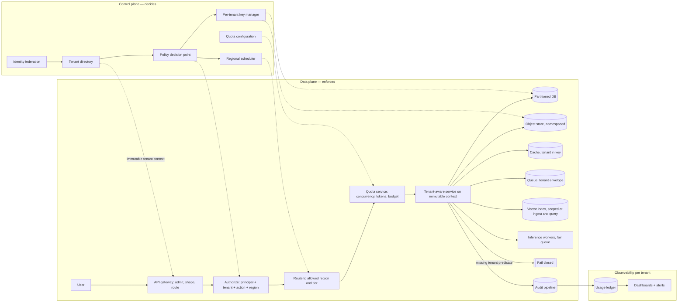
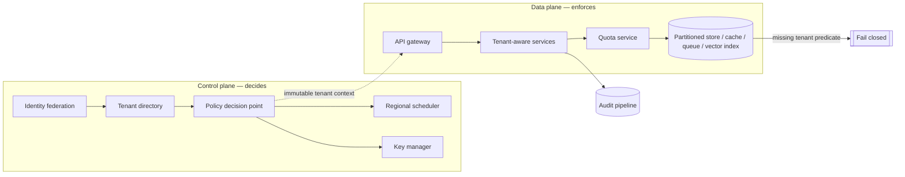
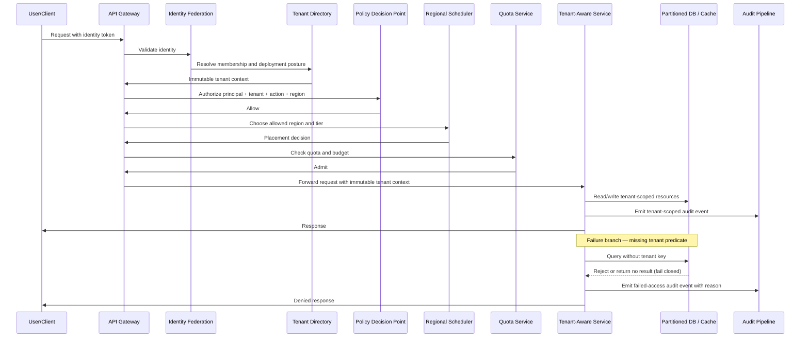

# Secure Multi-Tenant AI Platform, part 2

## 4. Draw the Architecture End to End

One diagram carries the design. The organising split is control plane against data plane. The control plane decides who may do what, where and under which limits. Its changes are slower, more privileged and more auditable. The data plane does the work. A tenant moving to the dedicated tier is a controlled configuration change in the control plane, not an ad hoc code path.

```
 ╔═══════════════════ CONTROL PLANE — decides who may do what, where, under which limits ═══════════════════╗
 ║  identity federation (customer IdP) ─> tenant directory ─> policy decision point ─┬─> regional scheduler   ║
 ║  quota configuration · per-tenant key manager · tenant registry + provisioning    └─> key selection       ║
 ║  central policy definition · regional enforcement · SCIM group sync · retention policy per tenant         ║
 ╚═══════════════════════════════════════╤═══════════════════════════════════════════════════════════════════╝
                                         │ immutable tenant context (never re-derived below this line)
 ╔═══════════════════ DATA PLANE — enforces, per region, shared by default ═══════════════════════════════════╗
 ║                                                                                                            ║
 ║  REQUEST PATH — synchronous, strict dependency order                                                       ║
 ║   user ─> API GATEWAY ─> AUTHORIZE ─> ROUTE ─> ADMIT ─> TENANT-AWARE SERVICE ─> STORES ─> AUDIT ─> answer  ║
 ║           admit,       PDP: role,   region +  quota:    executes only on      row · object ·   tenant-   ║
 ║           shape,       tenant,      tier      concur-   immutable context     cache · queue ·  scoped    ║
 ║           reject early action,                rency,                          vector · key     event     ║
 ║                        region                 tokens,        │ missing tenant predicate                   ║
 ║                                               budget         v                                            ║
 ║                                                           FAIL CLOSED (reject / 404 / no result)          ║
 ║                                                                                                            ║
 ║  STORES — tenant key in the physical layout AND in every predicate                                         ║
 ║   partitioned DB (tenant_id) · object store (namespace per tenant) · cache (tenant in key)                 ║
 ║   queues (tenant envelope, per-tenant dead-letter) · vector index (scoped at ingest AND query)             ║
 ║   per-tenant data-encryption keys (envelope) · inference workers (fair queue, reserved lanes)              ║
 ║                                                                                                            ║
 ║  REGIONS — shared control plane, regional data planes; residency decided by the scheduler, not the app     ║
 ║                                                                                                            ║
 ║  OBSERVABILITY — per tenant                                                                                ║
 ║   audit pipeline (append-only) ─> usage ledger (cost attribution) ─> dashboards: p95 by tenant, quota     ║
 ║   rejections, cost/tenant, cross_tenant_retrieval_count, isolation-test pass rate, failover time           ║
 ╚════════════════════════════════════════════════════════════════════════════════════════════════════════════╝
```

The same flow as a rendered diagram:



The answer key's diagram is the compressed form. Draw it first if time is short:



Read the components in dependency order, because that is the order they must exist and the order they fail.

| Component | Responsibility | Trust boundary | Plane | Fails how |
|---|---|---|---|---|
| Identity federation | Authenticate the caller through the customer's identity provider and deliver verified claims | External customer boundary to platform boundary | Control | Closed: no verified token, no request |
| Tenant directory | Map identity to tenant membership, posture and allowed regions | Platform authority boundary | Control | Closed: unresolved membership is denied |
| Policy decision point | Decide whether the action is permitted for this tenant, principal and region | Privileged policy boundary | Control | Closed: no decision, no admission |
| API gateway | Admit, shape and route requests; reject malformed or disallowed traffic early | Edge boundary | Data | Closed on auth, degrades on capacity |
| Tenant-aware services | Execute business logic using immutable tenant context only | Service boundary inside the shared platform | Data | Closed on a missing predicate |
| Partitioned databases and indexes | Persist tenant-scoped records with tenant-aware keys and predicates | Storage boundary | Data | Closed: the store refuses an unscoped read |
| Quota service | Enforce concurrency, token and budget limits per tenant or tier | Shared-resource governance boundary | Control with data-plane hooks | Degrades that tenant only; closed if the quota system is compromised |
| Per-tenant key manager | Select or issue tenant-specific encryption context | Key-management boundary | Control | Closed: no key, no read |
| Regional scheduler | Place workload into an allowed region and tier | Placement and residency boundary | Control | Closed for sensitive writes; queue or reroute otherwise |
| Audit pipeline | Capture immutable tenant-scoped events for investigation and billing | Observability and compliance boundary | Data | Degrades: the action completes, the gap is alerted |

Point at three boundaries while the diagram is up. The sync/async boundary sits after audit: authentication, authorisation, quota admission and region selection are synchronous, and reporting, logging and offline enrichment may be asynchronous. Anything that could cross a trust boundary or consume scarce capacity is never deferred blindly to a background task. The systems of record are the tenant directory for membership, the partitioned database for tenant data, the quota service for usage and the audit pipeline for traceability. A boundary mistake among them is a security incident. Caches improve latency and are never the source of truth for membership or authorisation. Queues carry tenant identifiers and policy context explicitly, because backpressure is only safe when the worker knows which tenant it is slowing down.

The MVP is one policy service, one gateway, one tenant-aware application tier, one partitioned data store, one quota service, one regional control plane and one audit stream. That is enough to prove isolation, performance shaping and regional routing. Dedicated customer clusters, per-service SLOs, richer workload classification and a more granular policy language are extensions, not prerequisites.

## 5. Derive Tenant Context Once and Make It Immutable

Tenant context comes from verified identity, never from the request body. A signed token, verified claim or server-side session can be authenticated and logged. A header or JSON field the client sets can be spoofed, replayed or forwarded across tenants by accident, unless a trusted gateway sets it. That one choice governs everything downstream, because row filters, object ownership, cache keys, queue partitions, log redaction and vector-index lookup must all consume the same verified context.

The dependency order is strict, and each step has a reason. Identity must come first. Context must become immutable early. Policy must run before expensive work. Region is a control-plane decision, not a late optimisation. Audit happens after the action but close to it.

1. **Identity federation** authenticates the human or workload through the customer's IdP.
2. **Tenant directory** maps the principal to tenant membership and allowed deployment posture.
3. **Policy decision point** evaluates principal, action, resource and region together.
4. **API gateway** admits, shapes and routes into the correct service tier.
5. **Tenant-aware services** execute only after receiving immutable context.
6. **Partitioned databases and indexes** carry the tenant key in physical layout and in every predicate.
7. **Quota service** tracks concurrency, token and budget limits.
8. **Per-tenant key manager** selects the encryption context for tenant and tier.
9. **Regional scheduler** decides which region and cluster class may serve the request.
10. **Audit pipeline** records tenant-scoped activity.

Narrate the happy path and tie each step to a customer reason. Authenticate through federation, because the customer keeps their own identity source. Derive immutable tenant context, because one company may have several subsidiaries. Authorise against policy, because authorisation must be explainable and centrally governed. Route to the allowed region and tier, because location control is part of the product promise. Apply quota before inference, because shared cannot mean noisy neighbour. Read and write only tenant-scoped resources. Emit a tenant-scoped audit event, because enterprise buyers need traceability.



If the diagram does not make the missing-predicate case obvious, the design is still too hand-wavy. The strongest signal in the round is your narration of how identity, data, state and failure move through the diagram, more than the drawing itself.

Production identity has three problems to solve before the policy engine runs, and none of them is authorisation. Token validation checks the signature against the IdP's published keys, the issuer, the expiry, and that the token was issued for this application, before any permission logic runs. Group mapping is owned by the customer. Their Okta or Microsoft Entra ID (formerly Azure AD) groups are the source of truth, mapped into the platform's role vocabulary. That mapping is configuration that drifts silently when a group is renamed. Just-in-time provisioning creates the first local record from the token's claims, scoped to the customer and never with more access than intended by default.

## 6. Enforce Isolation at Seven Layers That Do Not Trust Each Other

One row label is one defence layer. It is easy to omit in application code, ad hoc queries, background jobs and admin tools. It covers nothing in backups, object storage, search indexes, caches, analytics pipelines or service-to-service auth. Seven layers therefore enforce independently, and one missed check does not become a full breach.

| Layer | What must be true |
|---|---|
| Row | Every query includes the tenant predicate, and the database enforces it where possible |
| Object | Files, blobs and embeddings are namespaced or separately authorised by tenant |
| Cache | Every cache key includes the tenant id; a shared cache never returns data with ambiguous authorisation context |
| Queue | Messages never expose payload metadata across tenants, especially in shared dead-letter and retry channels |
| Log | Logs never expose secrets, raw prompts or cross-tenant identifiers that let someone reconstruct another customer's state |
| Vector index | Tenant scoping applied at ingestion and at query time, because semantic search otherwise surfaces neighbouring content |
| Key | Tenant-scoped encryption keys with envelope encryption, so one compromise does not span the fleet |

The tenant predicate is the mechanism this group owns. The store itself refuses to return a row unless the request is already scoped to one tenant. Row-level security bound to the session does that, as long as the app connects as a role that is not the table owner, a superuser or BYPASSRLS, or the table uses FORCE ROW LEVEL SECURITY. Partitioning helps only if each tenant's partition sits behind its own credentials. Isolation then never depends on every engineer remembering `WHERE tenant_id = …`. A future API that forgets the clause returns nothing rather than another company's data. The same predicate is compiled into the vector-search filter and into the cache key, keyed on tenant, permission signature and version. The two-layer pattern that makes a pre-filter cheap and a post-check authoritative is the Enterprise Knowledge Assistant case’s section 6, and it applies here unchanged. The tenant predicate is layer 1 in the search. The post-retrieval invariant `request.tenant_id == chunk.doc_tenant_id` is the layer 2 check, and section 14's incident shows it being skipped.

Pick a tenancy level and justify it, because the interviewer will ask how strongly tenants are isolated.

| Level | What it means | When |
|---|---|---|
| Shared infra + tenant id on every row | One database, one set of tables. Every row tagged; every read and write includes the tag | The default: cheapest, fastest to ship |
| Separate schema / namespace per tenant | Same cluster; one tenant's tables are not another's | Stronger isolation without an extra deployment |
| Dedicated deployment per tenant | Separate cluster, region and encryption keys | Customers whose contracts or risk policy rule out sharing, often in banking and healthcare |

Start at level 1 and make the default honest with two follow-ups. First, the database enforces the tenant, not the application. Second, regulated customers get a named escalation path from a tagged row to their own keys, region or deployment. Per-tenant keys answer the question *"what happens if someone gets raw read access to the storage layer?"* With per-tenant data keys wrapped by a master key, storage access alone gives them only ciphertext. A leaked tenant key opens one tenant, not the fleet, and destroying that key crypto-shreds the tenant's data. With one platform-wide key, a single leaked key exposes every customer at once. The master key still guards everyone, so it lives in the KMS and never leaves it.

Two more principles belong on the board. Least privilege: each service sees only the tenant scope it needs, only for the operation it performs. Blast radius as the design unit: by tenant, by region, by workflow, by dependency. Negative isolation tests matter more than positive ones, because the platform should prove the wrong tenant cannot read, infer, cache, dequeue or search another tenant's data.

> *"I'd start with shared infrastructure and a tenant id on every record, that's the right default. The filter has to live in the data layer, not in application code: the store should refuse to return a row unless the request is tenant-scoped. For regulated customers I'd escalate to a separate schema or a dedicated region and keys, not just a different tag in the same table."*

## 7. Meter Before the Call and Share Fairly

Apply quota and budget before inference, storage growth or batch fan-out, never after. A budget checked after the call is a bill, not a control, and budgets here are contractual. The quota service enforces concurrency, token and burst limits per tenant or tier. The usage ledger attributes every request to a tenant. Quota alerts fire before the limit rather than at it.

Rate limiting and fairness are different problems, and a real platform needs both. A rate limit answers whether this request may proceed at all, a ceiling on one tenant's own allotment. A fair queue answers in what order requests are served under load. A large tenant's burst then cannot make a small, well-behaved tenant wait longer for its turn, even though the small tenant never exceeded any limit. The mechanism is weighted fair queuing across per-tenant queues feeding a shared worker pool, so throughput is shared proportionally under contention rather than first-come-first-served. A token bucket per tenant caps each tenant's rate on top.

Contain a noisy neighbour in two steps. First the per-tenant quotas, rate limits, concurrency caps and workload classification. Then isolate the expensive parts: admission control before inference, queue partitioning, reserved capacity for premium tenants, circuit breakers past the envelope. Noise caused by a bug gets fast detection and a kill switch. Legitimate burst demand gets fairness, not punishment.

Move a customer to dedicated infrastructure when shared tenancy no longer satisfies risk, performance or operational requirements at acceptable cost. The triggers are regulatory residency constraints, unusually strict latency SLOs, high-value workloads with low tolerance for contention, and a customer policy demanding a harder boundary. Avoid "big customers get dedicated"; define measurable thresholds and an exception review path.
