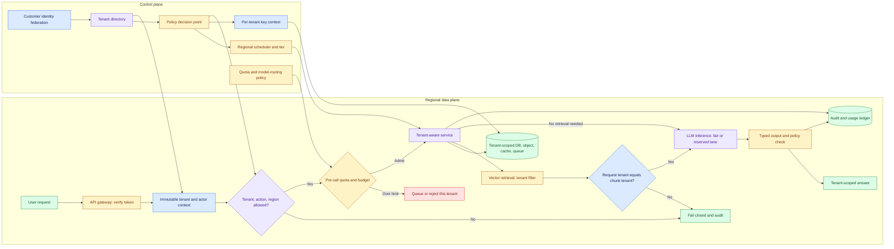

# Secure Multi-Tenant AI Platform: Main Interview Guide

Multi-tenant AI means one platform serving many customers, which costs less than a stack per customer. The failure to design against is Acme seeing Globex’s docs in a cache, a log, or a prompt.

**This case covers one slice:** identity → tenant stamp that never changes → every store and model call respects it. Not “put tenant_id on a row and hope.”

End to end, as Acme user Maya asking her assistant:

1. **SSO proves Maya is Acme.** That tenant id is frozen on the request.
2. **Quotas and region apply.** Acme may be Frankfurt-only, logs included.
3. **Retrieval, cache, and the model see only Acme bytes.**
4. **If Globex is noisy**, fair queues protect Maya, and no hot cache key is shared across tenants.
5. **Spend is metered before the model call**, so Acme cannot burn Globex’s budget.
6. **If Acme leaves**, we prove keys and copies are gone.

**Verify tenant once → enforce everywhere → meter and isolate.** Arbitrary tenant plugins stay out.

The goal is one affordable AI platform for many customers with no cross-tenant read, write, cache hit, or model context leak. A tenant ID on a row does not achieve that. Derive tenant context once from verified identity, keep it immutable, and enforce it independently at every storage and inference boundary.

This case anchors the [source study](/design/secure-multi-tenant-ai-platform#full-pack)’s cases on the shared platform, per-tenant budgets, noisy neighbours, and cross-tenant retrieval.

| Variant | Shared foundation | What changes |
|---|---|---|
| Secure platform for 500 tenants | Identity-derived scope, layered isolation, quotas, regional routing | Full platform design and shared-versus-dedicated choice |
| Per-customer GenAI budgets | Same tenant context and request path | Meter before the model call; attribute spend and key caches by tenant and permission |
| One unusually active tenant | Same admission and usage ledger | Distinguish healthy adoption from a loop or abuse before throttling |
| Cross-tenant retrieval incident | Same retrieval and ACL boundary | Detect mismatched request/document tenant, roll back filter, purge cache, notify affected customer |

## 1. Questions to ask the interviewer

| Question to ask | What it's really asking | What you then decide |
| --- | --- | --- |
| Which tenant data classes and AI tasks are in scope? | Are we hosting chat over tickets, or also embeddings of contracts and logs of prompts? | Storage, inference, logging, and the first-release trust surface. |
| Are residency rules hard, customer-specific, or preferences? Do logs and backups count? | If a German tenant’s data cannot leave Frankfurt, do chat logs and backups count? | Regional placement and what must stay local. |
| Which tenants may share, and what qualifies for dedicated capacity, keys, or clusters? | Can tenant A sit next to tenant B on the same GPU, or do banks get their own cluster? | Tiers and how much isolation you pay for. |
| What does “predictable performance” mean per tenant? What is peak skew? | If one tenant sends 20× traffic, do the other 499 get slow? | Quotas, fair queues, and reserved lanes. |
| Do customers federate identity or bring keys? What does verified deletion require? | When a customer leaves, can we prove every copy, keys included, is gone? | Membership mapping, keys, inventory, and offboarding. |
| Which budgets are contractual, and can tenants choose model tiers? | Can a tenant burn $10k overnight on a frontier model, or do we stop them before the call? | Pre-call admission, routing, metering, and billing. |
| What proof must an auditor or incident commander see? | After a suspected leak, can we show tenant B’s docs never entered tenant A’s context? | Isolation tests, tenant-scoped audit, and retention. |

## 2. Requirements: Functional + Non-Functional

Frame requirements in an interview like this:

> **Functional = what the system does. Non-functional = how well it does it and what constraints it must satisfy.**

### Functional requirements: what the system must do

1. **Onboard tenants and configure policy.**
2. **Stamp immutable tenant context** on every request from verified identity.
3. **Apply per-tenant quotas, keys, regions, and retention.**
4. **Scope data, cache, queues, retrieval, and inference** to that tenant.
5. **Make administration auditable.**
6. **Offer a dedicated tier** for justified exceptions.
7. **Coordinate export and deletion** when a tenant leaves.

### Non-functional requirements: how well / under what constraints

| Requirement | Example target / constraint |
|---|---|
| **Security** | Zero confirmed cross-tenant exposure; security failures fail closed. |
| **Fairness** | One tenant cannot cause unbounded latency for its neighbours. |
| **Observability** | Measure p95 and cost by tenant, not only fleet average. |
| **Audit** | Control-plane changes are auditable. |
| **Scale (illustrative)** | 500 tenants, 50,000 active users, 200 QPS peak, 20× workload skew. Mean 0.4 QPS/tenant hides heavy tenants. |
| **Latency shape** | A 2 s SLO implies fewer hops; a 15 s workflow can use a durable queue. |

Unit economics: `C_tenant = C_fixed/N + C_usage + C_isolation`. Share when safe; pay isolation for residency, risk, or performance.

### First release

No arbitrary tenant plugins in the core, no universal custom runtime, no cross-region active-active writes for everyone, no unlimited model choice at launch. Tenants pick from platform-approved models; they cannot supply their own code to run.

### Interview shortcut

If asked **“What are the requirements?”**, say:

> **“Functionally, derive tenant once and enforce it at every store and model call. Non-functionally, zero cross-tenant leaks, per-tenant p95 and cost, fail closed, and isolation you can prove to an auditor.”**

## 3. Architecture

This condenses the [Full Design architecture, section 4](/design/secure-multi-tenant-ai-platform#full-pack). The platform hosts LLM inference, but the model receives only tenant-scoped inputs and never decides tenant membership or authorisation.

### Step-by-step architecture

- **Step 1.** Validate the identity token and map the principal through the tenant directory; ignore tenant IDs supplied in a request body.
- **Step 2.** Create immutable actor, tenant, role, and region context, then evaluate policy for the specific action and resource.
- **Step 3.** Route only to an allowed region and shared or dedicated tier; select tenant-specific keys and retention policy.
- **Step 4.** Meter tokens, concurrency, and budget before inference. A tenant over quota is queued or rejected without stalling its neighbours.
- **Step 5.** Tenant-aware services read and write scoped DB rows, object namespaces, cache keys, queue envelopes, and vector indexes. A missing scope fails closed.
- **Step 6.** Apply tenant filtering at vector ingestion and query, then independently check `request.tenant_id == chunk.doc_tenant_id` before building the LLM prompt.
- **Step 7.** Route the permitted request to fair shared or reserved LLM inference. Validate typed model output before any persistence or downstream action.
- **Step 8.** Emit tenant-scoped audit and usage events; return the answer only within the verified context.

**Agent role:** a multi-tenant AI platform that hosts RAG assistants and bounded agents, rather than one universal autonomous agent. Every model prompt, retrieval, tool call, cache hit, output, and trace inherits the same immutable tenant context. Agent plans are proposals that platform policy checks.

## 4. The seven isolation layers

| Layer | Enforced rule |
|---|---|
| Row | Database or session policy refuses an unscoped query, provided the app role is not the table owner, a superuser or BYPASSRLS (or FORCE ROW LEVEL SECURITY is on); application convention alone is not enough. |
| Object | Blob and embedding namespaces are tenant-scoped. |
| Cache | Key includes tenant, permission signature, and version; cross-tenant hit is an incident. |
| Queue | Envelope and dead-letter path preserve tenant scope. |
| Log | No raw prompt, secret, or other tenant’s identifiers in shared telemetry. |
| Vector index | Tenant scoped at ingestion and search, with a post-retrieval tenant invariant. |
| Key | Raw storage yields only ciphertext; a leaked tenant key opens one tenant, not all, and destroying it crypto-shreds that tenant. |

Default to shared infrastructure with enforced tenant rows. A separate namespace gives a stronger boundary without a whole deployment. Reserve a dedicated cluster, region, or key set for requirements the shared tier cannot meet safely or economically. Give every service identity least privilege. Measure blast radius by tenant, region, workflow, and dependency.

## 5. Fairness, regions, and failures

- Rate limiting caps a tenant’s own usage; fair queuing decides order under contention.
- Use token, concurrency, and burst quotas to cap each tenant, and weighted fair queuing across per-tenant queues to share the worker pool; reserve capacity for contractual tiers.
- Diagnose unusually high usage by API key, user, feature, time, model route, tokens, batch jobs, and agent steps.
- Support legitimate adoption; stop loops or abuse. Do not rely on autoscaling alone.

Define policy centrally and enforce it regionally when residency requires. Data, traces, logs, backups, and derived indexes follow placement and retention. During a control-plane outage, continue only operations whose local verified policy and keys remain sufficient; block sensitive changes, queue where safe, and reconcile on recovery.

| Failure | Response |
|---|---|
| Missing tenant predicate, mismatched chunk, or region route | Reject, audit, and stop the affected path. |
| Cache key missing tenant | Disable path, invalidate entries, inspect what was served. |
| Queue leaks metadata | Quarantine, investigate, rotate credentials if necessary. |
| One tenant exhausts quota | Throttle or degrade only that tenant; keep service fair for the rest. |
| Key or policy authority unavailable | Fail closed for protected data or actions. |

Export and deletion need a tenant inventory across rows, blobs, embeddings, caches, queues, logs, and backups, plus verified completion and retention exceptions. A database delete alone is not offboarding.

## 6. Evaluation, rollout, and interview close

**Release gate:** an adversarial isolation suite for cross-tenant object reads, stale cache, replayed tokens, malformed filters, namespace collisions, missing predicates, and vector retrieval. Any unexplained boundary failure stops promotion. The target for confirmed cross-tenant incidents is zero. Track per-tenant p95, quota rejection, cost, and regional failover against agreed SLOs.

Roll out internal tenants → negative isolation suite → small shared tenants with conservative quotas → dedicated tier by policy and economics. Canary, rollback, operator runbooks, support training, and audited admin actions are part of delivery.

> - I would default to a shared platform for 500 tenants, but derive tenant context from verified identity once and make it immutable.
> - The control plane sets membership, policy, region, keys, and quotas; the data plane enforces scope independently in rows, objects, caches, queues, logs, indexes, and keys.
> - I would meter before LLM inference and use fair queues so a large tenant cannot starve the rest.
> - A missing tenant predicate or cross-tenant retrieved chunk fails closed.
> - I would prove that with an adversarial suite before external rollout, then offer dedicated capacity only when the customer’s risk, residency, or SLO requires it.

Use the [Deep Dive](/design/secure-multi-tenant-ai-platform#deep-dive) for the leak drill and isolation mechanics and the [Cheat Sheet](/design/secure-multi-tenant-ai-platform#cheat-sheet) for last-minute recall.
