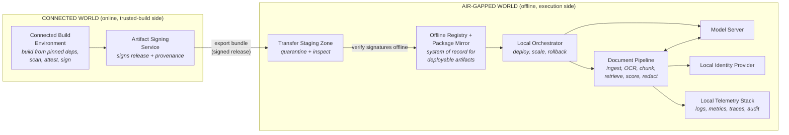
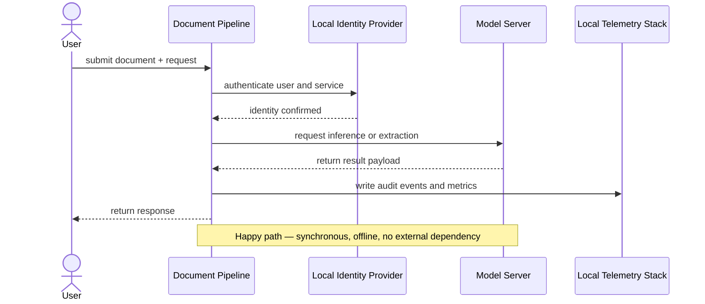
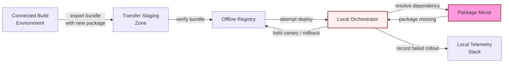

# Design an AI System for an Air-Gapped Environment, part 3

## 4. Architecture and End-to-End Flow

### Two Worlds Separated by a Controlled Update Path
- The clearest way to defend this design is to walk one request through it twice. On the first pass everything works. On the second, something critical has gone missing.
- Picture the scenario. Inside the restricted or classified network, a user submits a packet of documents. They want it classified, want fields pulled out of it, or want it redacted. The answer has to be useful and auditable, and producing it must not rely on the internet at all.
- One hidden constraint shapes everything else. Software, models and metadata reach the offline side through a single controlled update path and no other way. So we deliberately split the design into two worlds: an online side where things get built, and an offline side where they run.

### Nine Components in Dependency Order
- Present the components in the order they depend on one another, not the order they would sit on a slide:
  1. **Connected build environment** — gathers source code, pinned dependencies and model artifacts ahead of export.
  2. **Artifact signing service** — signs whatever bundle crosses the boundary and issues attestations that anyone can check.
  3. **Transfer staging zone** — holds each bundle in quarantine for inspection until the offline side admits it.
  4. **Offline registry and package mirror** — the one trusted local store for every approved model package, container image and library.
  5. **Local orchestrator** — runs canary rollouts, applies deployment policy and decides where services run.
  6. **Model server** — hosts the local model, or the inference runtime, that the document pipeline calls.
  7. **Document pipeline** — takes documents in, runs OCR/parsing, chunks them, retrieves context, scores, redacts and builds the final result.
  8. **Local identity provider** — confirms who each user and service is, without leaving the boundary.
  9. **Local telemetry stack** — collects audit events, logs, metrics and traces, and exports none of it.
- The main trust boundary separates the build environment, the only connected part, from everything else.
- Boundaries inside the enclave count too: orchestrator versus workloads, identity versus services, document pipeline versus telemetry store. Cutting the network link does not make untrusted code vanish. It moves the threat model away from internet exposure and towards admission control, least privilege and a strong audit trail.

### Top-Down Architecture Diagram
- Each box earns its place by meeting a requirement. None is there just to fill out the picture:
  - Connected build environment → inputs that can be rebuilt identically.
  - Signing service → evidence of exactly what crossed the boundary.
  - Transfer zone → unvetted material never lands straight on the offline side.
  - Registry and mirror → deployments stay deterministic.
  - Orchestrator → keeps the runtime under management.
  - Model server and document pipeline → do the actual work.
  - Identity and telemetry stacks → every access is authenticated and every operation can be audited.

### System of Record vs. Cache vs. Queue
- Getting this distinction right is what sets a strong answer apart from an architecture that merely looks good:
  - **System of record:** approved packages and images live in the offline registry. User and service identities live in the identity provider. The audit log records each deployment and its time.
  - **Cache:** model weights kept locally in memory, retrieval indexes or frequently used document fragments, and any response cache that saves repeating costly computation.
  - **Queue:** jobs that ingest documents, tasks that scan, attest and export, and background jobs for enrichment or post-processing.
  - **External dependency:** end-user traffic has none. The single thing from "outside" is the controlled build pipeline that produces the offline bundle.
- A frequent error is to let a cache act as if it were the source of truth. Air gaps make this worse. Nothing online refreshes it, so stale entries can linger unnoticed for a long while.
  - When the registry marks an image as approved, the runtime must not quietly fall back to an older copy it has cached.
  - A service credential revoked in the identity provider must be revoked everywhere, consistently, by the local control plane.

> **Interview pointer:** Interviewers love to probe the split between system of record, cache and queue. For every component you draw, be ready to say which bucket it belongs to and what breaks once its data goes stale.

### End-to-End Happy Path
- Tell the happy path as a sequence of explicit state changes:
  1. **Build from pinned dependencies.** On the connected side, pin code, system packages and model package versions to known revisions.
  2. **Scan, attest, sign, and export bundle.** The bundle is checked for policy violations, given a provenance attestation, signed, then packaged ready for export.
  3. **Inspect in the transfer zone.** Before anything moves inward, the zone confirms integrity, policy conformance and chain-of-custody.
  4. **Verify signatures offline.** This proves that an authorised signer produced the bundle and that nothing altered it on the way.
  5. **Import to local registry.** The offline runtime can then pull approved model files, images and libraries from the local mirror.
  6. **Deploy canary.** The orchestrator runs a small share of model-serving and document-pipeline capacity against harmless test data.
  7. **Run acceptance tests.** They check authentication, ingestion of documents, latency, the quality of outputs, logging, and whether rollback is ready.
  8. **Promote or rollback.** A passing canary gets more traffic. A failing one is reverted, and its bundle goes into quarantine for review.
- Building, scanning, attesting, exporting and inspecting are all admin work, and they run asynchronously. In the live system, deployment, request handling and the inference users see are all synchronous.
- State it plainly to the interviewer. Document requests need a synchronous answer from the offline runtime. Updates and the supply chain run in the background, so a user never waits on them.

### Sequence Diagram of the Happy Path

### Dependency-Failure Drill: Fail Closed
- The fail-closed drill you must be able to run: one transitive package is absent.

- When the package mirror lacks a dependency, the offline system must fail closed. It must never improvise by reaching across the boundary for the missing piece.
- The rule: any unresolved dependency blocks promotion. The bundle stays quarantined in staging or the mirror until someone repairs the dependency and it is approved again.

### Backpressure and Flow Control
- Without backpressure, a burst of document uploads can melt an offline service. With it, the service stays stable.
  - **At ingestion:** cap the number of concurrent uploads, check file size and type as early as possible, and queue oversized jobs rather than letting them grab parser resources straight away.
  - **At the pipeline:** shard each document's work on a fixed key: case ID, tenant or document ID. Related state then lands in one place and retries behave deterministically.
  - **At the model server:** limit concurrency, put a ceiling on batch size, and reject or defer work once GPU/CPU saturation passes a safe threshold.
  - **At the orchestrator:** use rollout limits so the canary sees only a small share of traffic until acceptance tests pass.
- The choice of partitioning key matters. It keeps related work local and stops state from one document corrupting another. With document ID as the key, a retry or a partial failure is much simpler to reason through than when requests land on random workers. That matters most when a document's context, its redaction choices and its audit trail must agree.

### Component Responsibility Table

| Component | Primary responsibility | State ownership | Notes |
|---|---|---|---|
| Connected build environment | Pin, package and compile artifacts ready for offline use | Source tree and build metadata | Sits outside the runtime trust boundary |
| Artifact signing service | Attest and sign artifacts | Signing keys and provenance records | Keep tight control over who can use the keys |
| Transfer staging zone | Examine each bundle before it is admitted | Quarantine manifests | Never serves runtime traffic |
| Offline registry / package mirror | Hand out approved packages and images | Catalogue of approved artifacts | The authoritative record of what may be deployed |
| Local orchestrator | Deploy services, scale them and roll them back | Desired state and rollout state | Applies policy on site |
| Model server | Run inference | Model runtime state, cached weights | Keep its API small and stable |
| Document pipeline | Ingest, analyse and redact documents, then assemble outputs | Document processing state | Usually the main request path |
| Local identity provider | Confirm who users and services are | Identities, groups, tokens | The authoritative record for access |
| Local telemetry stack | Store audit events, logs, metrics and traces | Observability data | Retain for as long as policy requires |

### MVP vs. Later Evolution
- Keep the MVP small and opinionated. It needs one each of offline registry, orchestrator, identity provider, telemetry stack, model server and document pipeline, plus a clear canary process.
- Signing, verification and the transfer zone are not optional extras. They ship in the first release, because without them offline updates cannot be defended.
- What comes later: smarter scheduling, routing across several models, better retrieval, reindexing in the background and richer policy engines. These are follow-on features, not prerequisites.
- The signal for the interviewer: first make the offline path dependable and auditable. Only then tune throughput and make life easier for operators.
- **Failure overlay to describe out loud:** a bundle arrives, but the offline mirror lacks one transitive package. Promotion stalls in the orchestrator, which leaves the canary isolated. The telemetry stack logs the failed rollout. The registry holds the bundle in quarantine. An operator repairs the package on the connected build side and retries.

### Control Plane vs. Data Plane
- A diagram only helps if you can talk through how data, identity, state and failure move across it.
- **Control plane:** signing, verification, deployment, identity and policy.
- **Data plane:** inference and live document requests.
- Be clear about which workflows are synchronous and which are asynchronous, and about which system owns every durable state transition.
- Why it matters in the job market: this split lets you explain one architecture to customer stakeholders and engineering stakeholders alike.
  - What the customer hears: *"The system stays inside our boundary, and we can still take controlled updates."*
  - What engineering hears: *"State has a known home, failures have a known edge, and promotion holds no surprises."*
- **90-second interview summary:** "I'd keep the connected build side apart from the offline runtime, with signing and staging as the only bridge. Inside the enclave sit a local registry, an orchestrator, a model server, a document pipeline, an identity provider and a telemetry stack. Requests are synchronous. Updates are asynchronous and tightly controlled. Deployable artifacts have one system of record: the offline registry. Local telemetry and the identity provider hold the audit trail. My biggest trade-off is security versus how hard updates become. The first production gate is simple: no bundle enters the enclave until it has proved, offline, that it is intact, complete and compatible. After that, a canary proves signature provenance, complete dependencies, working authentication and a rollback path before wider promotion."
