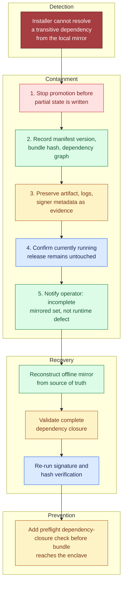

# Design an AI System for an Air-Gapped Environment, part 5

## 6. Security, Reliability, and Failure Handling

### Lead With the Failure, Not the Model
- Open the way a security and operations reviewer would: with the incident that hurts most. The update package lands, yet one transitive package never made it into the offline mirror.
- "Just retry" is the wrong reflex. With no network, a retry cannot conjure an artifact nobody copied in.
- A good answer halts the promotion, keeps the manifest and the evidence intact, and shrinks the damage to the smallest slice of the system it can.

### Threat-Model the Offline Control Plane
- Inference is only one thing you defend. The local AI capability depends on a chain of signing keys, model artifacts, index files, package repositories, privileged admin actions and update workflows. Any link can be attacked.
- **Control 1: pin and attest every dependency.** Nothing crosses into the air-gapped network without it. The release manifest lists each exact version and hash. The installer checks signatures against offline trust roots. Anything outside the known-good set is turned away at deployment.
- **Control 2: avoid telemetry egress assumptions.** In a connected product, teams switch on cloud diagnostics, remote metrics and crash reporting without a second thought. Inside the enclave that habit is wrong. Each observability path has to be local-first and approved on purpose. Metrics flow to an internal collector. Support bundles leave only through a controlled operator workflow. A library that silently calls home is a leak.
- **Control 3: treat privileged administration as a high-risk interface.** Admin commands live apart from the everyday user flow. Demand local role-based approval for them. Key rotation, index rebuilds, trust-root updates and rollback promotion should each run as a deliberate, explicit operation that leaves an audit record.

> **Interview pointer:** Telemetry egress is where candidates slip. Interviewers wait to hear "we'll send logs to our SaaS dashboard", said out of habit. Say plainly that every observability path stays local-first and approved.

### Failure Policy: Fail Open, Fail Closed, Degrade, Queue
- A strong FDE answer sorts each failure into a bucket: fail open, fail closed, degrade, queue, or hand to a human. For example:
  - Authentication and signature checks fail closed.
  - When the downstream classifier is down, document ingestion can queue, but only inside a bounded local buffer.
  - Search on a stale index can degrade, as long as users see a freshness warning.
  - If memory runs short, model serving can drop to a smaller approved model, provided that fallback was verified in advance.
  - Promoting a bundle or updating a trust root needs a human to approve it.
- This split separates a system that is down from one that is dangerous.

### Five-Condition Decision Table

| Condition | Policy | User-visible behaviour | Recovery path |
|---|---|---|---|
| Missing transitive package | Fail closed | Promotion is blocked; the current release keeps running | Put the mirrored artifact back, then repeat verification |
| Artifact corrupted during transfer | Fail closed | Bundle is refused before installation | Copy it again from the release origin; check hash and signature |
| Model exceeds GPU memory | Degrade or queue | A smaller approved model answers, or the request waits for capacity | Rework routing, or retrain the packaging policy |
| Local certificate expires | Admin actions fail closed; read-only flows degrade where policy permits | Admin operations stop; some reads may carry on | Rotate the cert from the offline trust anchor |
| Update breaks stored-index compatibility | Queue or rollback | Promotion pauses; the old index stays live | Rebuild the index offline, or roll back model and index together |

### Blast Radius
- Spell out the blast radius per workflow, per tenant, per dependency and per region (enclave/site).
- On an air-gapped government network, a "region" is often a physical enclave or site, not a cloud geography.
- Where tenants or workspaces can be isolated, one bad index rebuild must not knock out document search across the whole enclave.
- A rollout of a model that fails must leave the audit service valid.
- If policy lets reads continue, a certificate fault in the admin plane must not stop read-only document lookup.
- Give every dependency a containment boundary of its own.

### Critical Incident Drill: Missing Transitive Package
- This drill is mandatory because it tests whether a candidate grasps what offline means. The bundle carries a valid signature, yet operations finds that the installer cannot pull one transitive dependency from the local mirror.
- However tempting, do not let the install go ahead "just this once".
- **Containment (immediate):**
  1. Halt the promotion before it writes any partial state.
  2. Capture the failing dependency graph, plus its exact bundle hash and manifest version.
  3. Save signer metadata, logs and the artifact itself as evidence.
  4. Check that the release now in service has not been touched.
  5. Tell the operator the mirrored set is incomplete; this is not a runtime defect.
- **Recovery:** use the source of truth to rebuild the offline mirror, prove the dependency closure is whole, and verify hashes and signatures again.
- **Prevention:** run a dependency-closure preflight before the bundle ever reaches the enclave. A release process that cannot prove completeness must never hand the bundle to the installer.



### Other Failure Paths
- **Artifact corruption during transfer:** check cryptographic hashes and signatures at every hop, not only where the bundle was built. A bundle that verifies at its origin but fails at the enclave boundary is hostile or damaged until shown otherwise. Set the bad artifact aside for investigation; do not overwrite it.
- **Model exceeds GPU memory:** this is a capacity and packaging problem, and it should never surprise you at runtime. Send the request to a smaller approved model, hold it until a compatible worker frees up, or reject it with a clear operational error. Never let the node crash in the hope that the scheduler sorts it out. Where you can, spot memory pressure before admission. Keep an explicit compatibility map that ties model size, quantisation format and hardware profile together.
- **Local certificate expiring:** at first this is about availability and administration. It turns into a security problem the moment the system skips checks to stay up. Issue a short-lived operational certificate, watch its expiry, renew it locally from an offline trust anchor, and keep an escalation path for overdue rotation. Privileged actions should halt, while read-only workflows may keep going in degraded form if policy says so.
- **Update breaks stored-index compatibility:** give the index format a version that moves with the model and the reader code. The three ship as one unit. They ship only when the new reader can read the old index, or can rebuild it deterministically. If the new release cannot read the current index, pause promotion and let the old path keep serving. A human should step in if nobody is sure what the compatibility matrix says, or if rebuilding would take longer than the recovery objective allows.

### Code: Proving One Security Invariant
- Interview code should prove a security invariant rather than walk a toy happy path. Here the invariant is that a tampered bundle is refused before it is deployed.

```python
from __future__ import annotations

from dataclasses import dataclass
from pathlib import Path
import hashlib
import hmac
import json
import tempfile
from typing import Mapping


class IntegrityError(RuntimeError):
    pass


@dataclass(frozen=True)
class TrustedKey:
    name: str
    secret_key: bytes


@dataclass(frozen=True)
class Bundle:
    root: Path

    def replace(self, relative_path: str, content: bytes) -> None:
        target = self.root / relative_path
        if not target.is_file():
            raise FileNotFoundError(relative_path)
        target.write_bytes(content)


@dataclass(frozen=True)
class AuditEvent:
    action: str
    detail: str


def _sha256_file(path: Path) -> str:
    digest = hashlib.sha256()
    with path.open("rb") as f:
        for chunk in iter(lambda: f.read(1024 * 1024), b""):
            digest.update(chunk)
    return digest.hexdigest()


def _load_manifest(bundle: Bundle) -> Mapping[str, object]:
    manifest_path = bundle.root / "manifest.json"
    if not manifest_path.is_file():
        raise IntegrityError("missing manifest")
    try:
        manifest = json.loads(manifest_path.read_text(encoding="utf-8"))
    except json.JSONDecodeError as exc:
        raise IntegrityError("invalid manifest") from exc
    if not isinstance(manifest, dict):
        raise IntegrityError("invalid manifest")
    return manifest


def _audit(log: list[AuditEvent], action: str, detail: str) -> None:
    log.append(AuditEvent(action=action, detail=detail))


def verify_bundle(bundle: Bundle, trusted_key: TrustedKey, audit_log: list[AuditEvent] | None = None) -> None:
    audit_log = audit_log if audit_log is not None else []
    manifest = _load_manifest(bundle)

    if manifest.get("signer") != trusted_key.name:
        _audit(audit_log, "verify_bundle", "untrusted signer")
        raise IntegrityError("untrusted signer")

    signature = manifest.get("signature")
    if not isinstance(signature, str) or not signature:
        _audit(audit_log, "verify_bundle", "missing signature")
        raise IntegrityError("missing signature")

    expected = manifest.get("artifacts")
    if not isinstance(expected, dict):
        _audit(audit_log, "verify_bundle", "invalid artifact list")
        raise IntegrityError("invalid artifact list")

    # Validate the closure of the bundle before any promotion occurs.
    for relative_path, expected_hash in expected.items():
        if not isinstance(relative_path, str) or not isinstance(expected_hash, str):
            _audit(audit_log, "verify_bundle", "invalid artifact entry")
            raise IntegrityError("invalid artifact entry")
        artifact_path = bundle.root / relative_path
        if not artifact_path.is_file():
            _audit(audit_log, "verify_bundle", f"missing artifact: {relative_path}")
            raise IntegrityError(f"missing artifact: {relative_path}")
        actual_hash = _sha256_file(artifact_path)
        if not hmac.compare_digest(actual_hash, expected_hash):
            _audit(audit_log, "verify_bundle", f"hash mismatch: {relative_path}")
            raise IntegrityError(f"hash mismatch: {relative_path}")

    # Offline trust-root check: the manifest is authenticated with a pinned local key.
    material = json.dumps(
        {"signer": manifest["signer"], "artifacts": manifest["artifacts"]},
        sort_keys=True,
        separators=(",", ":"),
    ).encode("utf-8")
    expected_sig = hmac.new(trusted_key.secret_key, material, hashlib.sha256).hexdigest()
    if not hmac.compare_digest(signature, expected_sig):
        _audit(audit_log, "verify_bundle", "signature verification failed")
        raise IntegrityError("signature verification failed")

    _audit(audit_log, "verify_bundle", "bundle accepted")


def _write_bundle(root: Path, signer: str, secret_key: bytes, model_bytes: bytes) -> Bundle:
    root.mkdir(parents=True, exist_ok=True)
    (root / "model.bin").write_bytes(model_bytes)
    artifact_hash = hashlib.sha256(model_bytes).hexdigest()
    manifest_body = {"signer": signer, "artifacts": {"model.bin": artifact_hash}}
    material = json.dumps(manifest_body, sort_keys=True, separators=(",", ":")).encode("utf-8")
    signature = hmac.new(secret_key, material, hashlib.sha256).hexdigest()
    manifest = {**manifest_body, "signature": signature}
    (root / "manifest.json").write_text(json.dumps(manifest), encoding="utf-8")
    return Bundle(root=root)


def test_tampered_model_is_rejected():
    with tempfile.TemporaryDirectory() as tmpdir:
        bundle_root = Path(tmpdir) / "bundle"
        trusted_key = TrustedKey(name="offline-root-1", secret_key=b"local-trust-root-secret")
        bundle = _write_bundle(
            bundle_root,
            signer=trusted_key.name,
            secret_key=trusted_key.secret_key,
            model_bytes=b"approved-model-bytes",
        )

        bundle.replace("model.bin", b"tampered")
        audit_log: list[AuditEvent] = []

        try:
            verify_bundle(bundle, trusted_key, audit_log=audit_log)
        except IntegrityError:
            assert any(event.action == "verify_bundle" for event in audit_log)
            assert (bundle_root / "model.bin").read_bytes() == b"tampered"
            return
        raise AssertionError("tampered bundle should be rejected")
```

- The sketch is sized for an interview on purpose. For production, keep this control flow but swap the teaching scaffold for a hardened release verifier. Check the manifest schema explicitly, write structured audit events to local storage, and add tests for the negative cases: signer mismatch, a malformed manifest, a missing file and a broken dependency closure.
- The test shows that the system will not install a bundle whose integrity it cannot establish.

### Evidence, Runbooks, and Operational Readiness
- Runbooks must exist before go-live for node replacement, index rebuild, rollback, certificate renewal, trust-root rotation and verification failure.
- Every runbook names who may run it, which evidence it keeps, which systems it pauses and how success is judged.
- The audit trail captures the operator's identity and approval record, the signed manifest with its hash list, the trust-root fingerprint, installation logs and any rollback decision.
- Later, a customer may ask why a release was blocked. The evidence by itself should be enough to rebuild the answer.
- Skip this discipline and each incident turns into forensic guesswork. Keep it, and operations can show that a release was rejected for a real integrity reason rather than a flaky installer.

### Why This Matters for the Job
- A strong FDE goes past the happy-path diagram. They show the design survives stale state, partial failure, dependency outages, hostile input, retries that change nothing, and political pressure to "just make it work."
- They know which failures should queue, which should degrade, which must fail closed and which need a person. They can explain the blast radius, hold on to evidence and back a safety invariant with a test.
- **90-second interview summary:** "The offline release pipeline is a high-trust control plane, and I guard it that way. Every dependency is pinned and attested. Signatures are checked against offline trust roots. Telemetry never assumes it can leave the network. Privileged admin is kept apart from normal use. The riskiest failure is a bundle that is incomplete or corrupted. So the system fails closed, keeps the evidence and leaves the running release alone. Runtime problems each get a clear policy: some queue, some degrade to an approved fallback, some need a human. My first production gate: no bundle enters the enclave until it has proved, offline, that it is intact, complete and compatible."

> **Interview pointer:** When someone asks for your first production gate, give the same sentence every time, in every section, and learn it by heart: no bundle enters the enclave until it has proved, offline, that it is intact, complete and compatible.
