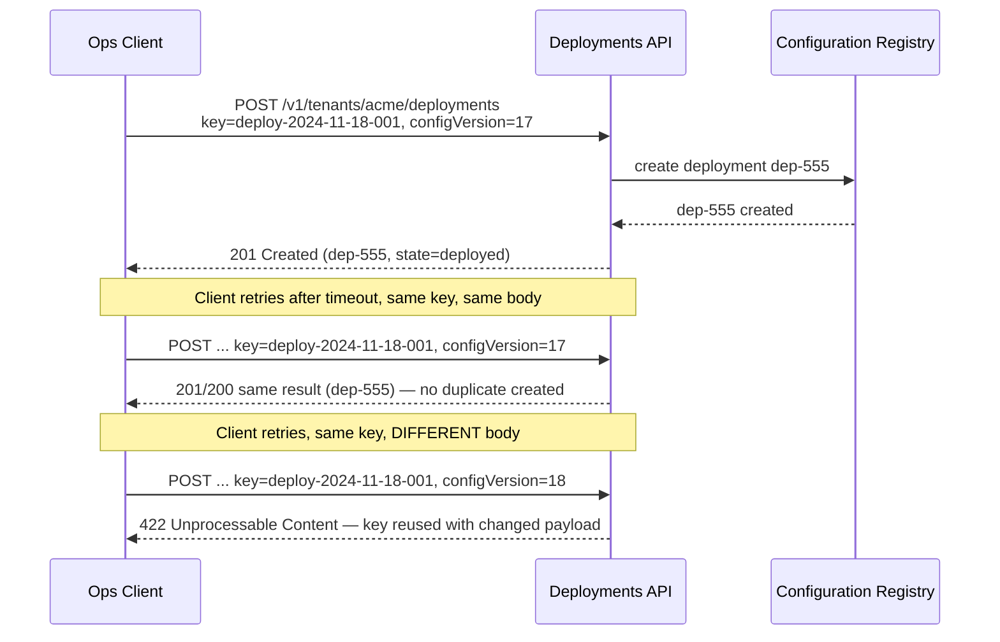
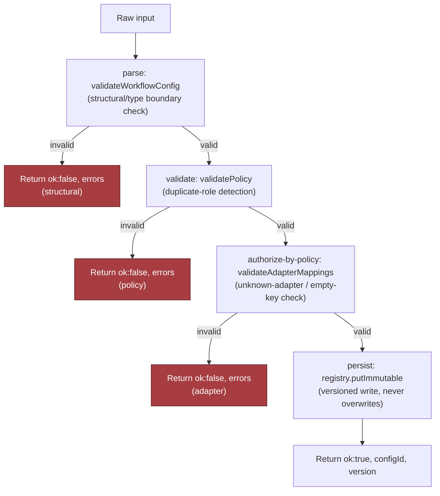

# Design a Configurable Platform for Customer-Specific Workflows, part 3

## 5. Data Model, APIs, and Working Code

### Four Core Records and Ownership

- Abstractions do not convince an interviewer. Concrete state does. Tie the riskiest parts of the design to records, contracts and a little code. Say what is durable and what can change. Say what carries a version, what gets deployed, and what the system does when an identical request arrives a second time.
- **`WorkflowTemplate(id, engine_version, schema)`** — the shared blueprint. Product and platform own it.
  - `id` is the primary key. `engine_version` names the evaluator and renderer that can read this template. `schema` sets the permitted shape of fields, approvals and integrations.
  - Lifecycle: `draft` → `published`. Once published, the artifact never changes; new behaviour needs a new template version.
  - Retention: hold published templates for as long as the product or contract window lasts. Older tenant configs must still resolve against the precise template they were validated with. Drafts can be garbage-collected once they have sat idle for a safe period.
- **`TenantConfig(tenant_id, template_id, version, values)`** — the overlay one customer applies on top of a template.
  - In practice the key is `(tenant_id, version)`. `values` carries only the tenant parameters that the template schema permits.
  - Lifecycle: `draft` → `validated` → `deployed` or `rolled_back`. When validation fails, the record goes back to `draft`/`needs_fix` and keeps its version number.
  - Retention: every published and rolled-back version stays, so audit and rollback both work. Drafts follow platform policy and are dropped once abandoned or superseded.
  - What the values mean for the business is the tenant's call. Validating and storing them is the platform's job.
- **`AdapterDefinition(name, contract_version, permissions)`** — the contract for talking to one downstream system, such as CRM, ticketing, storage or messaging.
  - `name` plus `contract_version` form the key. `permissions` lists the scopes and capabilities the adapter needs, so the platform can turn down a config that requests an adapter it has no safe way to call.
  - Lifecycle: the platform or integrations team runs it. Contracts ship as versions and retire only when no active tenant config still relies on them.
  - Retention: retired definitions stay around for past deployments and debugging. They are flagged inactive, so a new config cannot pick them.
- **`ConfigDeployment(tenant_id, version, state)`** — the deployment ledger. It alone decides which of `draft` / `validated` / `deployed` / `rolled_back` / `failed` applies.
  - Ops and support read this record to see which version is live at this moment.
  - Lifecycle: each state change is appended; nothing is rewritten in place. A rollback adds a fresh deployment event that points at an earlier good version.
  - Retention: hold the whole history for the full support and audit window. Incident reviews, customer support and change tracking all depend on it.
- Separate owners stop the records from tangling. Product owns the template. The customer owns the tenant config. Integrations owns the adapter contract. Ops owns the deployment record. Once those lines blur, you get forks that call themselves flexibility.

> **Interview pointer:** If asked what tells you which version is live, answer `ConfigDeployment`, not `TenantConfig`. Its state transitions are append-only. That ledger, not the config record, lets support see what is running now, and it turns a rollback into a new event rather than an edit in place.

### Four API Contracts

- At interview scale, show one bounded declarative contract plus a write path that stops unsafe input before the registry ever sees it. The point is to prove three things: the platform takes limited configuration, checks it, and publishes it as an immutable version.
- `POST /v1/configurations/validate` — takes a draft tenant config and hands back validation errors plus a normalised preview. It never publishes anything.
  - Auth: a bearer token or session scoped to the caller's tenant. Authorisation permits validation only for tenants the caller is allowed to administer.
  - Body: `template_id`, `version`, `values`, and an optional `idempotency_key` so validation traces can be replayed. The call has no write effects, so retrying it is safe anyway.
  - Responses: `200 OK` for a good preview; `400 Bad Request` when the structure is wrong; `403 Forbidden` for a tenant mismatch or missing rights; `422 Unprocessable Content` when schema or policy rules fail.
- `POST /v1/tenants/{id}/deployments` — starts a deployment for a tenant, usually from a config version that already passed validation. It returns the deployment ID and its state.
  - Auth: the caller must belong to tenant `{id}` or hold a delegated ops role. The server refuses any attempt to deploy into another tenant.
  - Because this call creates something, it needs an idempotency key. The same key with an identical body gives back the same result. The same key with a different body gets `422 Unprocessable Content`, as the IETF Idempotency-Key draft recommends. If a retry arrives while the first request is still in progress, it gets `409 Conflict`.
  - Errors: `401 Unauthorized` when credentials are absent or expired; `403 Forbidden` when tenant permission is missing; `404 Not Found` when the named config version does not exist; `409 Conflict` for a stale optimistic-concurrency token or a key that is still in flight; `422 Unprocessable Content` when syntax passes but policy fails, or when a key is reused with a different payload.
- `POST /v1/adapters/{name}/test` — runs an adapter mapping against a harmless test payload or a sandbox endpoint.
  - Auth: limited to integration maintainers or tenant admins.
  - Body: the adapter name, a test payload, the mapping and an optional sandbox selector. An idempotency key is accepted too, so a retry does not produce a second test run or a second audit entry.
  - Errors: `404 Not Found` for an unknown adapter; `403 Forbidden` when permission is lacking; `422 Unprocessable Content` when the mapping cannot be applied; `502 Bad Gateway`, or something like it, when the sandbox dependency fails.
- `POST /v1/deployments/{id}/rollback` — records a new rollback state for that tenant. The old deployment is left untouched.
  - Auth: the caller needs tenant scope and either raised ops rights or an explicit sign-off route.
  - Body: identifies the target deployment or the earlier good version. It carries an idempotency key, because rollback writes state and may be retried after a failure.
  - On success the caller gets the new deployment record. The previous record is never overwritten.
  - Errors: `404 Not Found` when no deployment has that ID; `409 Conflict` when the live state has changed so much that rolling back is unsafe; `422 Unprocessable Content` when the target version no longer fits the current template or adapter contract.
- Rules shared by all four: authentication and authorisation are tenant-aware, and writes across tenants are refused. Create-style calls demand an idempotency key. A repeat with the same key and body returns the same answer. A reused key with a new body is rejected; it never becomes a quiet update.

### Idempotent Deployment Creation Walkthrough

- Worked case: an ops client calls `POST /v1/tenants/acme/deployments`. Its body is `{configVersion: 17, templateId: "tpl-9"}`; its key is `deploy-2024-11-18-001`.
  - The server makes deployment `dep-555` and replies `201 Created` with `deployment_id=dep-555` and `state=deployed`. The write log stores the idempotency key alongside.
  - The client times out and retries with that key. No `dep-556` may appear. The reply is identical and still refers to `dep-555`.
  - The client then retries with that key but sends `configVersion: 18`. The payload no longer matches what the key was first used for, so the server answers `422`.



### The Smallest Safe Code Path: Config Publication

- Config publication carries the most risk. Bad structure, broken mappings or faulty versioning at this step can take production down. The sketch below is small, yet it contains every control point that counts in a live system.

```typescript
type JsonValue = string | number | boolean | null | JsonValue[] | { [key: string]: JsonValue };
type JsonLogic = { op: string; args?: JsonValue[] };

type WorkflowConfig = {
  version: 1;
  fields: Array<{ key: string; type: "text" | "number" | "date"; required: boolean }>;
  approvals: Array<{ when: JsonLogic; role: string; slaHours: number }>;
  integrations: Array<{ adapter: string; mapping: Record<string, string> }>;
};

type ValidationError = { path: string; code: string; message: string };

type PublishResult =
  | { ok: true; configId: string; version: number }
  | { ok: false; errors: ValidationError[] };

class ConfigValidationError extends Error {
  constructor(public errors: ValidationError[]) {
    super("Configuration validation failed");
  }
}

function isPlainObject(value: unknown): value is Record<string, unknown> {
  return typeof value === "object" && value !== null && !Array.isArray(value);
}

function validateWorkflowConfig(input: unknown): WorkflowConfig {
  const errors: ValidationError[] = [];

  if (!isPlainObject(input)) {
    throw new ConfigValidationError([{ path: "$", code: "invalid_type", message: "Expected an object" }]);
  }

  if (input.version !== 1) {
    errors.push({ path: "version", code: "unsupported_version", message: "Only version 1 is supported" });
  }

  if (!Array.isArray(input.fields) || input.fields.length === 0) {
    errors.push({ path: "fields", code: "required", message: "At least one field is required" });
  }

  if (!Array.isArray(input.approvals)) {
    errors.push({ path: "approvals", code: "invalid_type", message: "Approvals must be an array" });
  }

  if (!Array.isArray(input.integrations)) {
    errors.push({ path: "integrations", code: "invalid_type", message: "Integrations must be an array" });
  }

  if (errors.length > 0) {
    throw new ConfigValidationError(errors);
  }

  return input as WorkflowConfig;
}

function validatePolicy(config: WorkflowConfig): void {
  const seenRoles = new Set<string>();
  for (const approval of config.approvals) {
    if (!approval.role || approval.slaHours <= 0) {
      throw new ConfigValidationError([
        { path: "approvals", code: "invalid_approval", message: "Each approval must have a role and positive SLA" },
      ]);
    }
    if (seenRoles.has(approval.role)) {
      throw new ConfigValidationError([
        { path: "approvals", code: "duplicate_role", message: `Duplicate approval role: ${approval.role}` },
      ]);
    }
    seenRoles.add(approval.role);
  }
}

function validateAdapterMappings(config: WorkflowConfig, allowedAdapters: Set<string>): void {
  for (const integration of config.integrations) {
    if (!allowedAdapters.has(integration.adapter)) {
      throw new ConfigValidationError([
        { path: "integrations", code: "unknown_adapter", message: `Unknown adapter: ${integration.adapter}` },
      ]);
    }
    for (const [from, to] of Object.entries(integration.mapping)) {
      if (!from || !to) {
        throw new ConfigValidationError([
          { path: `integrations.${integration.adapter}.mapping`, code: "invalid_mapping", message: "Mappings must not contain empty keys" },
        ]);
      }
    }
  }
}

class Registry {
  private store = new Map<string, { version: number; config: WorkflowConfig; hash: string }>();

  putImmutable(configId: string, config: WorkflowConfig): { version: number } {
    const existing = this.store.get(configId);
    const nextVersion = existing ? existing.version + 1 : 1;
    const hash = JSON.stringify(config);
    this.store.set(configId, { version: nextVersion, config, hash });
    return { version: nextVersion };
  }
}

function publish(configId: string, raw: unknown, allowedAdapters: Set<string>, registry: Registry): PublishResult {
  try {
    const config = validateWorkflowConfig(raw);
    validatePolicy(config);
    validateAdapterMappings(config, allowedAdapters);
    const result = registry.putImmutable(configId, config);
    return { ok: true, configId, version: result.version };
  } catch (error) {
    if (error instanceof ConfigValidationError) {
      return { ok: false, errors: error.errors };
    }
    return {
      ok: false,
      errors: [{ path: "$", code: "internal_error", message: "Unexpected failure during publish" }],
    };
  }
}
```

- What each part teaches:
  - `WorkflowConfig` limits the shape to a declarative contract with a version.
  - `JsonValue`/`JsonLogic` state approval conditions openly and leave no route for arbitrary code.
  - `ValidationError` hands the API a fixed set of error terms.
  - `validateWorkflowConfig` validates types at the boundary. Malformed payloads stop there, before any business logic runs.
  - `validatePolicy` keeps authorisation and workflow rules apart from structural checks.
  - `validateAdapterMappings` compares the integration surface with an allowlist instead of trusting whoever wrote the config.
  - `Registry.putImmutable` stores each write as a new version; nothing is overwritten.
  - `publish` runs the checks in the one order that holds up: parse → validate → authorise-by-policy → persist.



> **Interview pointer:** Commit the sequence to memory and reuse it elsewhere: parse → validate → authorise-by-policy → persist. Expect the follow-up "why that order?" Cheap structural checks come first and fail fast, so the costly policy and adapter checks only run on sound input. Nothing is written until every earlier step passes, so the path fails closed.

### What the Whiteboard Version Omits on Purpose

- A production service would also need:
  - **Optimistic concurrency** — each write should state the template or config version it expects. Then two operators cannot race and silently overwrite each other. If the version travels in the body, a mismatch returns `409 Conflict`. If it travels in an `If-Match` header, HTTP calls for `412 Precondition Failed`.
  - **Idempotency** — retrying after a timeout must never yield a second deployment or a second version.
  - **Bounded, safe retries** — retry only failure types that are safe to repeat. A rejected validation or authorisation is not transient, so never replay it as if it were.
  - **Observability** — each validation, deployment, adapter test and rollback should carry the request ID, the tenant ID, the idempotency key and the config version. Support can then rebuild exactly what happened without combing through application logs.

### Contract and Failure-Injection Tests

- A strong answer brings two tests. One pins the contract; the other injects a failure.

```typescript
import { describe, it, expect } from "vitest";

describe("publish", () => {
  it("rejects duplicate approval roles and returns a structured validation error", () => {
    const registry = new Registry();
    const result = publish(
      "cfg-1",
      {
        version: 1,
        fields: [{ key: "requester", type: "text", required: true }],
        approvals: [
          { when: { op: "always" }, role: "manager", slaHours: 24 },
          { when: { op: "always" }, role: "manager", slaHours: 24 },
        ],
        integrations: [],
      },
      new Set(["crm"]),
      registry,
    );

    expect(result.ok).toBe(false);
    if (!result.ok) {
      expect(result.errors[0].code).toBe("duplicate_role");
    }
  });

  it("survives an adapter allowlist miss without publishing state", () => {
    const registry = new Registry();
    const result = publish(
      "cfg-2",
      {
        version: 1,
        fields: [{ key: "requester", type: "text", required: true }],
        approvals: [{ when: { op: "always" }, role: "manager", slaHours: 24 }],
        integrations: [{ adapter: "unknown", mapping: { a: "b" } }],
      },
      new Set(["crm"]),
      registry,
    );

    expect(result.ok).toBe(false);
  });
});
```

- The first, the contract test, shows the API turning away a config whose structure is fine but which breaks policy.
- The second, for failure injection, feeds in an unsafe adapter definition and confirms that publishing fails closed.
- A real service would add more: tests for duplicate idempotency keys, tests for deployment rollback, and a concurrency test proving that stale versions are refused.
- Why this matters for hiring: teams need FDEs who can go from a customer's workflow pain to a state model, then to API semantics, then to validation code fit for production. That is the gap between sketching a system and shipping a platform others can support.
