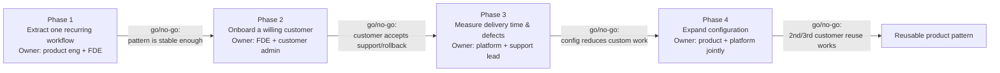
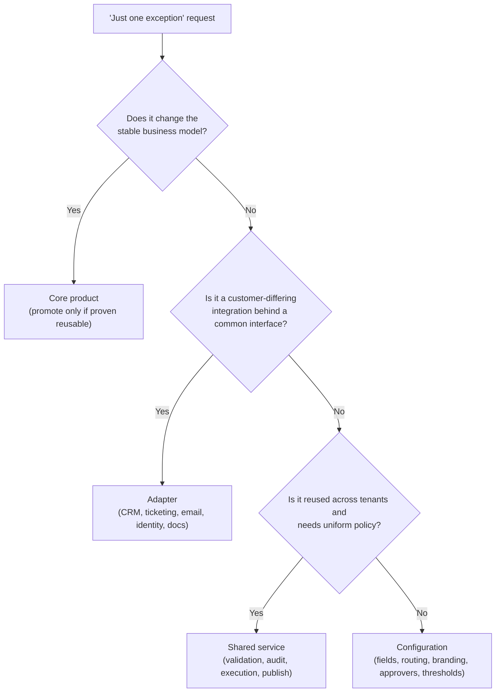

# Design a Configurable Platform for Customer-Specific Workflows, part 5

## 7. Delivery Plan, Observability, and Business Impact

### Rollout as a Series of Proofs

- When the prototype works, the customer stops asking whether the platform can do the job. They start asking whether they can trust it in production, with their own data, their own approval chains and their own support staff. Now the FDE stops building demos and turns the architecture into staged delivery, with a measurable gate at every stage.
- Do not plan one big go-live. Plan a sequence of proofs:
  - Start with a workflow that several customers already share. Pick its least contested form: a single approval path, a single integration, a single field set and a single brand surface. Go deep: show that a real customer need fits the platform with no fork.
  - Next, bring on one willing customer who copes with loose ends and gives feedback quickly. Name an owner on your side, keep a single production gate, and know the rollback path before the first publish. Release as a canary first, to a thin slice of traffic or to one low-risk group of tenants. Keep the first launch small enough that support can trace each event, each rejected config and each request sent to a downstream system.
  - Widen the configuration surface only when evidence keeps showing three things: the current surface meets real demand, it cuts duplicated work, and it adds no incident risk. Without that rule, the platform turns into a growing pile of tenant-specific debt.

### The Four-Phase Rollout Plan

1. **Extract one recurring workflow.**
   - Owner: a product engineer, with the FDE in support.
   - Exit criteria: shared primitives can express the workflow, so no one-off fork is needed.
   - Go/no-go gate: the team judges the pattern settled enough to build into the platform.
2. **Onboard a willing customer.**
   - Owner: the FDE together with the customer admin.
   - Exit criteria: the customer configures the workflow, finishes a pilot run and raises issues through the support channel.
   - Go/no-go gate: the customer signs up to the support model and the rollback procedure.
3. **Measure delivery time and defects.**
   - Owner: the platform lead for telemetry, and the support lead for classifying incidents.
   - Exit criteria: starting figures exist for how fast tenants launch, how many defects appear and how often validation fails, all captured before any scope is added.
   - Go/no-go gate: the data shows configuration is cutting custom work, not hiding rework somewhere else.
4. **Expand configuration only after repeated evidence.**
   - Owner: product and platform, deciding together.
   - Exit criteria: a second and a third customer reuse the same mechanism, and the effort is predictable.
   - Go/no-go gate: a new config type is approved only if it reduces forks or support load without adding upgrade risk.

> **Interview pointer:** Interviewers tend to push on the gates between phases, so know all four by heart. The pattern is stable. The customer accepts the support and rollback model. The evidence shows config cuts custom work. Customers two and three reuse it with no fresh build. These gates stop a rollout from becoming "we shipped because the demo went well."

### The Six-Metric Scorecard

- **Time to launch customer:** the time from an approved request to a tenant's first successful production workflow. Data from: release tracking and ticket timestamps. Owner: delivery lead. Alert when: lead time creeps up across several customers, a sign of brittle config, slow approvals or manual steps.
- **Percentage handled by configuration:** of all customer-specific changes, the share delivered as config rather than code. Data from: tags on releases and change requests. Owner: product or platform lead. Alert when: the share stops rising, which usually means the team is quietly going back to forks.
- **Config validation failure rate:** failed publishes divided by all publish attempts. Data from: config service logs. Owner: platform engineering. Alert when: the rate climbs, which points to a confusing UX, a weak schema or unsafe requests.
- **Fork count:** how many customer-specific code branches, conditionals or exceptions exist that cannot be removed. Data from: architecture reviews and repository analysis. Owner: engineering manager. Alert when: the count grows, since every fork erodes the stable core.
- **Upgrade time:** the effort to move one customer or tenant onto a new platform version. Data from: release records and migration tickets. Owner: release manager. Alert when: an upgrade needs one-off scripts or a long freeze window.
- **Tenant incident rate:** a rolling count of each tenant's incidents, kept separate from outages that hit the whole platform. Data from: the incident management system. Owner: support and SRE together. Alert when: incidents bunch around one config type or one adapter.

### Four Layers of Metrics

- **Technical health:** how often publishes succeed, validation failures, how often rollbacks happen, latency and incident rate.
- **Model/config quality:** do the workflow primitives fit how customers really work? The usual clue is how often customers ask for exceptions.
- **Adoption:** customer count on the configured workflow, how frequently each one returns, and the share of each customer's process it now handles.
- **Business outcome:** faster launches, less custom engineering, fewer support escalations and quicker growth into new tenants.
- Keep the layers apart in an interview. A platform can pass every technical check and still fail commercially because nobody adopts it. It can also be widely adopted and still fail in operation because support cannot keep it stable.

### Dashboard in the Language of the User

- Lead with the customer's story, then drill down into the machinery. A headline might read, with illustrative numbers: "Onboarding for this customer took under two days. It needed zero manual config edits and one validation retry, and there was no incident after launch."
- Under that headline sit the internal signals, broken out by tenant: rollout status, publish latency, adapter errors, blocked approval loops and failed schema validations.
- Use this to answer "what do we watch after launch?". CPU, logs and queue depth are not enough. The dashboard should link what the customer sees as success to the failure modes inside the system.

### Ownership Before Launch

- **Product owner:** picks the first repeated workflow to turn into a platformised path.
- **Platform owner:** looks after the shared core, the config schema and the publish service.
- **FDE:** turns the customer's workflow into supported configuration, checks the assumptions and runs the rollout.
- **Support lead:** handles customer communication, triage and escalation during the pilot.
- **SRE / operations lead:** owns monitoring, rollback execution and release health.
- **Customer admin / champion:** tests the workflow in their own environment and signs off that it is ready.

### Go/No-Go and Rollback Triggers

- Go/no-go gate: a config may publish only when four things hold. Validation passes. The adapters it depends on are healthy. The team has rehearsed the rollback plan. The customer champion agrees that their business process and the configured workflow still line up.
- Rollback trigger: roll back on any one of these. Validation keeps failing. Integrations throw errors nobody predicted. Incidents climb among the earliest group of tenants. A new config pattern starts to make approvals unstable.
- For a stateful workflow, write the migration plan and the rollback plan separately. Moving state is a different job from reverting code.
- Ship a launch package of four documents: a short guide for admins, a runbook for support, a rollback checklist and a change log. The change log lists which parts customers may configure, which stay fixed, and which go to engineering for review.

### Config vs. Adapter vs. Shared Service vs. Core

- **Configuration:** fields, routing choices, branding, approver lists and threshold values that differ per customer.
- **Adapter:** integrations that vary by customer behind one common interface, such as CRM, ticketing, email, identity and document systems.
- **Shared service:** capabilities every tenant reuses under one uniform policy, such as validation, audit logging, workflow execution and publish orchestration.
- **Core product:** the building blocks the business model rests on. They stay put, and no new tenant gets to reopen them.
- When someone asks for "just one exception", test it against these four homes. Does it change the core product? Does it belong in an adapter? Can it be modelled as config? Asking this keeps the platform from sliding into per-customer branches that nobody can maintain.

### The Risk Register

| Risk | Owner | Mitigation | Trigger |
|---|---|---|---|
| Infinite approval loop | Platform engineer | Detect cycles and validate at publish time | The same approval state is entered again and again |
| Adapter mismatch | Integration engineer | Contract tests plus explicit adapter versions | Calls fail after a publish, or the schema drifts |
| Customer confusion during rollout | FDE | Training, playbooks and guided setup | Support volume is high, or validation errors keep repeating |
| Unsupported fork pressure | Product manager | Clear grounds for refusing bespoke code, plus a review board for exceptions | A request cannot be expressed in configuration |

- Treat this register as part of running the platform, not an appendix.
- Forward-deployed teams want people who carry work past the prototype until customers adopt it, then distil what customers said into a pattern the product can reuse. Call the platform finished once three things are true: customers rely on it, the workflow keeps improving, and operations can run it with no heroics.
