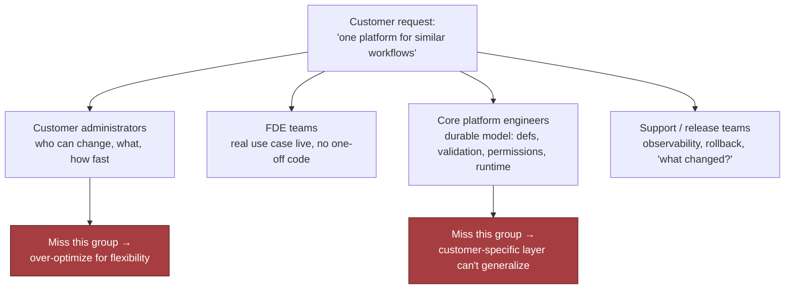
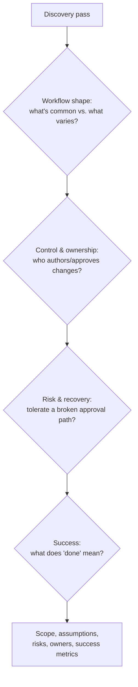
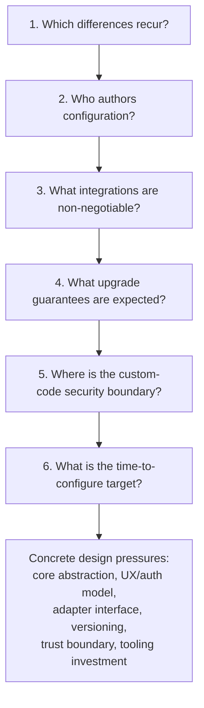

# Design a Configurable Platform for Customer-Specific Workflows

## Table of Contents

- [1. The Customer Problem and Discovery](#1-the-customer-problem-and-discovery)
  - [Reframing the Request](#reframing-the-request)
  - [Stakeholder Map](#stakeholder-map)
  - [Discovery Question Tree](#discovery-question-tree)
  - [Assumption Ledger](#assumption-ledger)
  - [Weak vs. Strong Answers](#weak-vs-strong-answers)
- [2. Clarifying Questions, Requirements, and Constraints](#2-clarifying-questions-requirements-and-constraints)
  - [Requirement vs. Preference](#requirement-vs-preference)
  - [The Six-Question Interview Tree](#the-six-question-interview-tree)
  - [Must-Have Functional Requirements](#must-have-functional-requirements)
  - [Measurable Non-Functional Requirements](#measurable-non-functional-requirements)
  - [MVP Non-Goals / Scope Fence](#mvp-non-goals--scope-fence)
  - [Requirement-to-Component Traceability](#requirement-to-component-traceability)
  - [Handling Partial Answers](#handling-partial-answers)
  - [The Strong Candidate Move](#the-strong-candidate-move)
- [3. Scale Estimates, SLOs, and Capacity](#3-scale-estimates-slos-and-capacity)
  - [Load Shape, Not Marketing Shape](#load-shape-not-marketing-shape)
  - [The Four-Step Capacity Envelope](#the-four-step-capacity-envelope)
  - [SLOs Tied to Customer Pain](#slos-tied-to-customer-pain)
  - [Leverage and What Belongs in Core](#leverage-and-what-belongs-in-core)
  - [A Whiteboard Estimate That Changes Component Choice](#a-whiteboard-estimate-that-changes-component-choice)
  - [Sensitivity Table Across Growth Scenarios](#sensitivity-table-across-growth-scenarios)
  - [Average vs. Peak: Headroom as a Product Feature](#average-vs-peak-headroom-as-a-product-feature)
  - [Decision Rule to Carry Forward](#decision-rule-to-carry-forward)
- [4. Architecture and End-to-End Flow](#4-architecture-and-end-to-end-flow)
  - [Control Plane vs. Data Plane](#control-plane-vs-data-plane)
  - [Architecture Diagram and Trust Boundaries](#architecture-diagram-and-trust-boundaries)
  - [Core Components in Dependency Order](#core-components-in-dependency-order)
  - [Failure-Path Overlay: Infinite Approval Loop](#failure-path-overlay-infinite-approval-loop)
  - [Happy-Path Sequence: Author to Promotion](#happy-path-sequence-author-to-promotion)
  - [Systems of Record, Caches, Queues, and Backpressure](#systems-of-record-caches-queues-and-backpressure)
  - [MVP vs. Later Evolution](#mvp-vs-later-evolution)
  - [90-Second Interview Summary](#90-second-interview-summary)
- [5. Data Model, APIs, and Working Code](#5-data-model-apis-and-working-code)
  - [Four Core Records and Ownership](#four-core-records-and-ownership)
  - [Four API Contracts](#four-api-contracts)
  - [Idempotent Deployment Creation Walkthrough](#idempotent-deployment-creation-walkthrough)
  - [The Smallest Safe Code Path: Config Publication](#the-smallest-safe-code-path-config-publication)
  - [What the Whiteboard Version Omits on Purpose](#what-the-whiteboard-version-omits-on-purpose)
  - [Contract and Failure-Injection Tests](#contract-and-failure-injection-tests)
- [6. Security, Reliability, and Failure Handling](#6-security-reliability-and-failure-handling)
  - [The Red-Team Question](#the-red-team-question)
  - [Four Security Controls](#four-security-controls)
  - [Failure-Policy Decision Table](#failure-policy-decision-table)
  - [Blast-Radius Containment Levels](#blast-radius-containment-levels)
  - [Failure Drill: Infinite Approval Loop](#failure-drill-infinite-approval-loop)
  - [Other Named Failure Cases](#other-named-failure-cases)
  - [Six Operational Primitives](#six-operational-primitives)
  - [Evidence, Runbooks, and Launch Gates](#evidence-runbooks-and-launch-gates)
  - [Interview-Sized Production Sketch](#interview-sized-production-sketch)
- [7. Delivery Plan, Observability, and Business Impact](#7-delivery-plan-observability-and-business-impact)
  - [Rollout as a Series of Proofs](#rollout-as-a-series-of-proofs)
  - [The Four-Phase Rollout Plan](#the-four-phase-rollout-plan)
  - [The Six-Metric Scorecard](#the-six-metric-scorecard)
  - [Four Layers of Metrics](#four-layers-of-metrics)
  - [Dashboard in the Language of the User](#dashboard-in-the-language-of-the-user)
  - [Ownership Before Launch](#ownership-before-launch)
  - [Go/No-Go and Rollback Triggers](#gono-go-and-rollback-triggers)
  - [Config vs. Adapter vs. Shared Service vs. Core](#config-vs-adapter-vs-shared-service-vs-core)
  - [The Risk Register](#the-risk-register)
- [8. Interview Walkthrough, Trade-Offs, and Practice](#8-interview-walkthrough-trade-offs-and-practice)
  - [Minute-Zero Opening](#minute-zero-opening)
  - [The 50-Minute Pacing Plan](#the-50-minute-pacing-plan)
  - [Four Trade-Off Pairs](#four-trade-off-pairs)
  - [Expected Follow-Up Questions](#expected-follow-up-questions)
  - [Weak Answers and Their Repairs](#weak-answers-and-their-repairs)
  - [Scoring Rubric](#scoring-rubric)
  - [Interview Rehearsal Checklist](#interview-rehearsal-checklist)
  - [90-Second Architecture Summary](#90-second-architecture-summary)
  - [Practice Plan](#practice-plan)
- [Coverage Notes](#coverage-notes)
  - [My Perspective on the Gaps](#my-perspective-on-the-gaps)

## 1. The Customer Problem and Discovery

### Reframing the Request

- The room agrees on the headline, "one platform for similar workflows", and on little else. Fields, approval paths, audit depth and release process all differ by stakeholder.
- Don't start by drawing services. First turn the vague ask into a measurable outcome: one configurable workflow platform on which ten customers can each change their fields, approvals, branding and integrations, while the shared core stays stable, versioned and supportable.
- Separate the feature someone asked for ("configuration") from the result the business needs: each customer gets its own workflow, and the product does not splinter into ten forks that cannot talk to each other. Say that split aloud; an implementer skips it, an FDE leads with it.
- Make each word in the outcome testable:
  - Safe: no change can skip authorisation or switch on runtime behaviour that nobody reviewed.
  - Versioned: every customer can see which workflow definition is live and what changed in it.
  - Supportable: support and release staff can trace a fault, undo a bad configuration and explain behaviour tenant by tenant.
- Avoid vanity measures such as the number of configurable fields. Track how often a new customer variation ships with no fork, no hotfix and no support escalation.
- Frame it as a job to be done: the customer hires the platform to make custom forks unnecessary while each tenant keeps its own process. That pushes the design towards a stable core with a few controlled extension points instead of a codebase that changes shape per account.

> **Interview pointer:** Learn the outcome statement by heart: "keep one stable product core, and allow customisation that is safe, versioned and supportable." Interviewers listen for those three words, because each one drives a later architecture decision.

### Stakeholder Map

- One request means something different to each group:
  - Customer administrators ask who may change a workflow, how much they may customise, and how fast a change reaches users.
  - FDE teams want a real customer use case in production without leaving one-off code behind.
  - Core platform engineers want a lasting model for workflow definitions, validation, permissions and how the runtime executes them.
  - Support and release teams want observability, rollback, a clear incident process and a quick answer to "what changed?"
- Drop a group and the design tilts: without support you ship flexibility nobody can operate; without platform engineers the customer layer never generalises.
- The concrete map, one line per role:
  - End user: a customer employee who starts a workflow, approves it, or is on the receiving end of its result.
  - Operator: on the support or release team; watches health, reverts a bad config, handles incidents.
  - Security owner: answers for permissions, audit and least privilege between tenants.
  - Executive sponsor: the business leader paying for one platform rollout instead of a run of forks and long customisation projects.

### Discovery Question Tree

- Time is short, so skip the twenty generic questions. Ask the few that remove the most doubt.
- Workflow shape:
  - Which parts are the same for every customer, and which really differ?
  - Is the variation only in fields, routing, branding and integrations, or does it also touch business logic and lifecycle states?
- Ownership and control:
  - Who may write configuration changes, and who signs them off?
  - Do customer admins change configuration themselves, or does an FDE or platform team handle every change?
- Risk and recovery:
  - What happens when someone misconfigures a workflow?
  - Can the customer live with a broken approval path, or must a fallback always exist?
- Success:
  - What counts as "done" for the first customer: one live workflow, several teams onboarded, or every variation migrated?
  - How will the customer judge it: less manual handling, faster turnaround, fewer errors or simpler audits?
- The answers become the design's inputs: scope, assumptions, risks, owners and success measures.
- If the interviewer holds back, state your assumption aloud: "I'll assume only customer admins can configure, and the vendor approves each change before production." That sets a clear boundary.

### Assumption Ledger

- A useful discovery pass leaves four things on the table:
  1. Scope: what is configurable and what stays fixed.
  2. Assumptions: what you accept for now because the prompt left it open.
  3. Risks: where a bad configuration, a permission slip or a failed integration could hurt a customer.
  4. Success criteria: the measurable change that shows the platform works.

### Weak vs. Strong Answers

- A weak restatement leads with features: "Let's build a flexible workflow system: forms, approvals, themes and some API hooks."
- A strong restatement leads with the outcome: "We need a single shared workflow platform. Each customer can tailor its fields, approvals, branding and integrations without a separate codebase, and the core stays stable enough to version, support and roll out safely." The second version names the tension between flexibility and fragmentation.
- A short spoken opening: "Let me frame it first. One workflow product, ten customers, each wanting its own fields, approval chains, branding and integrations. I want a stable shared core with safe, versioned, supportable customisation, so we never run ten forks. First I'd find out who owns configuration, which variations are really needed, which failures we can't accept, and how we'll measure the first rollout. Then the design rests on validation, rollback and a few controlled extension points, not per-customer code."
- It works because it names the problem and the people, and holds the architecture back until someone owns the workflow, someone owns the risk and a success metric exists.

## 2. Clarifying Questions, Requirements, and Constraints

### Requirement vs. Preference

- Don't take "we need flexibility" at face value, or you lose control of the design. Ask who needs it, under what governance, and with what promise about upgrades.
- Sort requirements from preferences and hard constraints from conveniences. Every customer wants a slightly different mix of fields, approvals, branding, integrations and sometimes rules. The first design fork is spotting which differences repeat.
- Skip that, along with who authors configuration and where custom code ends, and you get one of two failures: a platform that is too thin, or a bespoke rules engine nobody can support safely.

### The Six-Question Interview Tree

- Six questions keep the conversation away from a feature wish list:
  1. **Which differences keep coming back between customers?** This separates a shared product pattern from one-offs. Approval chains that differ again and again are a platform capability; one seasonal override goes down an exception path. It also tells you what the core abstraction is: steps, policy rules, form schemas or integration orchestration.
  2. **Who will write the configuration?** This is an architecture question. Internal engineers can handle expressive power; customer admins and support staff need guardrails such as validation, previews, narrow building blocks and safe defaults. The answer reshapes the UX, the validation model and the authorisation model.
  3. **Which integrations and extensions can't be dropped?** Typical items are webhook callbacks, outbound notifications, CRM sync, document generation, ticket creation and auth hooks. The list fixes the adapter interface, settles sync versus async, and decides whether a failed call blocks a transition or degrades gracefully.
  4. **What upgrade promise do customers expect?** If configs must outlive core releases, you need versioning, migration tooling, backward-compatible schema changes and rollback paths. Without them the "product core" becomes an endless services project.
  5. **Where does the security boundary for custom code sit?** Options are the trusted core itself, a sandbox, or approved integration points only. The choice sets tenant isolation and supply-chain scrutiny. Default to a declarative core, with arbitrary code kept beyond the main trust boundary.
  6. **How fast must a configuration change go live?** Changes needed within hours call for self-service tooling with validation built in. A week allows more manual review. The target decides where you invest: admin UX, reusable templates, automated testing or partner onboarding.

> **Interview pointer:** Expect follow-ups on question 5, the custom-code boundary. Have the default ready (a declarative core, with any arbitrary code kept outside the trust boundary) and link it to the sandbox component in the architecture section and the controls in the security section.

### Must-Have Functional Requirements

- A stable workflow engine that runs one core lifecycle for all customers.
- Declarative configuration (schemas, rules, UI metadata) for labels, fields, visibility and validation, so no customer needs a code fork.
- An adapter interface, so external systems plug in and the engine stays untouched.
- Versioned configuration with validation, so every change can be reviewed, tested and reverted.
- A small set of controlled extension points for the rare cases declarative configuration cannot cover.
- Migration and rollback tooling, so a version change never strands a customer on an incompatible config.
- How they fit: the engine is the centre, so there is one release train, one way to operate and one thing to support. Most variation lives in declarative configuration, not code. Integrations go through the adapter interface instead of each becoming a special case. Versioning and validation make customisation supportable. Extension points stay narrow and explicit, never a blank cheque.

### Measurable Non-Functional Requirements

- One core release train: a single product ships, never ten customer branches.
- Configuration isolation: no customer's settings, data or test changes can leak into how another customer's workflows run.
- Backward-compatible upgrades: an existing configuration keeps working until a planned migration runs.
- Observable customer-specific behaviour: when a workflow goes wrong, operators can see the config version involved and which rule or adapter fired.
- Each one shapes the system. No observability means no support. No backward compatibility turns configuration into a liability. Weak isolation turns customisation into a steady stream of multi-tenant incidents.

### MVP Non-Goals / Scope Fence

- The MVP leaves out:
  - Code written by customers and run inside the workflow engine.
  - Endless per-customer UI branches to meet branding requests.
  - A general-purpose rules language that tries to model any business process.
  - Bespoke integration behaviour that goes around the adapter contract.
  - Automatic, unreviewed migration of every legacy configuration shape.
- These cuts protect the core. The MVP proves that one platform can serve ten customers with safe variation, not that it can model every workflow on day one.

### Requirement-to-Component Traceability

- Give every requirement a likely home:

| Requirement | Likely component |
|---|---|
| Stable workflow engine | Workflow runtime / orchestrator |
| Declarative schemas, rules, UI metadata | Config model, schema registry, admin UI |
| Adapter interface for integrations | Integration gateway / connector layer |
| Versioned configuration and validation | Config service, validator, release pipeline |
| Controlled extension points | Sandbox or plugin boundary |
| Migration and rollback tooling | Deployment and ops tooling |
| One core release train | Shared platform build and release process |
| Configuration isolation | Tenant-aware data and authorisation layer |
| Backward-compatible upgrades | Schema evolution and compatibility checks |
| Observable customer-specific behaviour | Audit logs, metrics, tracing, config-version tags |

### Handling Partial Answers

- If only some questions get answers, don't stall. Assume sensibly and guard the riskiest constraint.
- Say the customers look alike but nobody says who authors configuration. Assume a mix: the customer's admins own the safe declarative fields, and our ops team signs off any extension or schema change. That guards the most fragile line, between safe customisation and unsafe code.
- This tests discovery under ambiguity, prioritisation with gaps, and the habit of protecting delivery by narrowing scope.

### The Strong Candidate Move

- The strong move runs in order: find the recurring differences, settle who owns configuration, state the integration and upgrade promise, draw a firm line for custom code, then commit to a stable engine backed by declarative configuration, versioning and strict validation.
- That order turns discovery into a buildable plan. Ask only questions that change the design, then proceed on stated assumptions.
