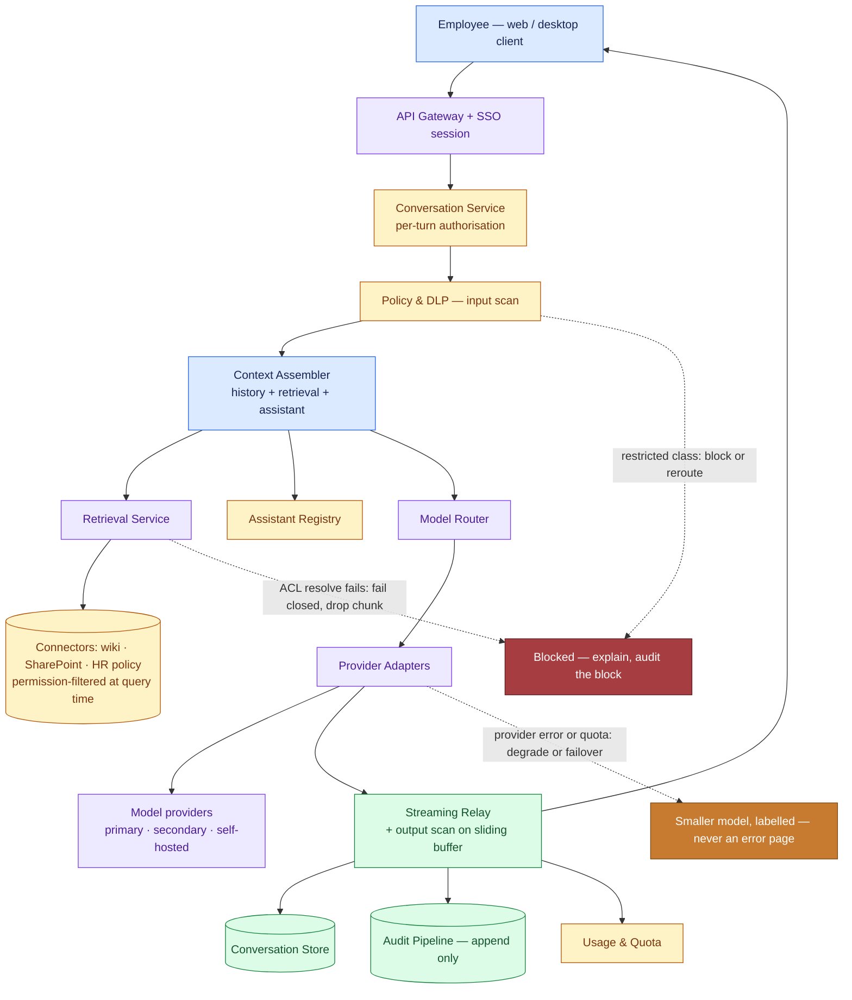
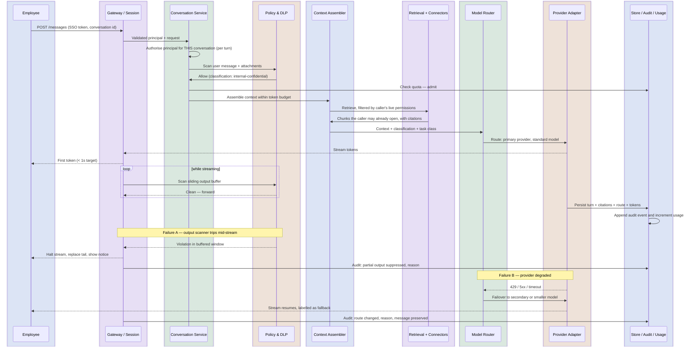

# Enterprise Chatbot Platform: "Our Own ChatGPT", part 2

## 3. Scale, SLOs, and Capacity

### Load shape

- Expect enterprise chat traffic to be lumpy: a sharp spike from 8:30 to 10:00, a lunch dip, a smaller afternoon peak, and near silence overnight.
- My working numbers: 40,000 employees, of whom 12,000 are DAU; each has 8 conversations a day, with 6 turns in each.
- That makes **576,000 turns a day**, or 16 a second across a 10-hour day. With an assumed morning peak 2.5× higher, we reach **about 40 turns a second**.
- Plan for four things: average, peak, growth and skew. Build in growth headroom, because adoption is the goal. Skew comes from power users and scripts.

### The number that actually sizes the system

- A REST call at 40 requests a second, 50 ms each, keeps about 2 requests open. **A chat stream at 40 turns a second, lasting an assumed 20 seconds, keeps 800 connections open.**
- Use Little's Law here rather than request rate: $\text{concurrent streams} = \text{arrival rate} \times \text{hold time} = 40 \times 20 = 800$.
- This figure sizes the relay tier, the load balancer's connection limits, the provider concurrency quota and the deployment strategy.
- Long-lived streams defeat autoscaling on request count and naive round-robin. Idle proxies also close a stream that falls silent for 60 seconds during a slow tool call; nginx and AWS ALB both do so by default. Heartbeats fix that.
- A rolling restart that severs these connections is a product failure that users see.

> **Interview pointer:** Open the sizing with 800 concurrent streams, not raw QPS. That figure drives the relay tier and the provider quota. Interviewers notice when you use Little's Law instead of plain request-rate maths.

### The cost trap: quadratic history

- Resending the full history every turn makes input over $n$ turns grow as $\text{input tokens} \approx t \cdot \frac{n(n+1)}{2}$.
- At turn 40, one turn carries about 40× the tokens of turn one, and the conversation has sent roughly 820 turns' worth of input in total. By then the early turns add almost nothing.
- **Sliding window with a pinned head:** the system prompt and assistant definition always stay, plus the last $k$ turns word for word.
- **Rolling summarisation:** compact older turns, so history costs about the same at every turn.
- **Prompt caching:** put retrieved documents, assistant instructions and the system prompt into a stable prefix the provider can cache.
- **Context order is a day-one cost decision.** It is almost free to design in and costly to fix later.

### Quotas as control surfaces

- **Token quota per user:** limits spend and boxes in scripted or compromised accounts.
- **Concurrency cap per user:** a person needs one or two streams. Fifty means a script.
- **Budget per department:** cost lands on a cost centre, and an overspending team shows up before the invoice.
- **Burst allowance:** a real heavy session should not be throttled into a poor experience.
- **Priority classes:** when capacity is short, interactive turns beat background jobs.
- **The tension:** too tight, and people hit artificial walls, go back to the consumer tool, and the project fails. Too loose, and one script spends the quarter's budget.

### SLOs

- **Adoption hangs on TTFT**, not total latency. My rule of thumb: words on screen within 700 ms feel quick, even if the full answer needs 25 s. A 4-second spinner feels broken.
- **My targets for this case:** p95 TTFT under 1.0 s, p99 under 2.0 s.
- **Turn completion rate:** a turn whose stream stops at 80% has failed. Many teams log it as an HTTP 200 success, which hides the failure.
- **Quality:** regeneration rate (people rarely regenerate a good answer), thumbs-down rate, citation clicks and sampled groundedness.
- **Permission-filter correctness:** a hard gate with zero tolerance, not a quality score.
- **Cost:** spend per turn and per active user per month, plus how often the cached prefix hits.
- **Give each task class its own target.** Drafting needs a fast TTFT. A policy lookup needs a fast total time, since nobody can act on half an answer.

### Capacity, worked backward

- Peak load: 40 turns a second × an assumed 2,400 tokens a turn gives 96,000 tokens a second, or about **5.8M tokens a minute**.
- **At this scale I expect our provider TPM/RPM quota to bind first. That limit lives in a contract, not in a cluster.**
- When our quota falls short, buy a higher tier, spread load over several deployments or regions, or move low-value traffic onto a smaller model during the peak.
- Leave spare capacity for growth, retry storms (they arrive just when capacity is short), one provider taking all load in failover, deploy draining, and the surge after an all-hands demo.

### Unit economics

$$ C_{\text{user}} = \frac{C_{\text{fixed}}}{N} + C_{\text{tokens}} + C_{\text{retrieval}} + C_{\text{storage}} $$

- $C_{fixed}/N$: negligible across 40,000 seats, painful across 500. So the case for building depends on scale.
- $C_{tokens}$: the largest term. Compaction and prompt caching cut it directly.
- $C_{retrieval}$: largely a per-corpus cost, not a per-user one.
- $C_{storage}$: set by the retention class. Keeping data 7 years is a legal choice that comes with an engineering bill.
- **Say this aloud:** "We estimate $22 per user per month, against about $30 for a vendor seat (the list price of Microsoft 365 Copilot, checked Sep 2026). So cost does not justify building. What forced the build was capability."

### Sensitivity

These figures scale up my working assumptions. None is measured.

| Assumption | Now | Full adoption |
|---|---|---|
| Daily active | 12,000 | 32,000 |
| Turns per user/day | 48 | ~144 (assumed: about 3× heavier use) |
| Turns/day | 576,000 | ~4,600,000 |
| Peak turns/sec | 40 | ~320 |
| Concurrent streams | ~800 | ~6,400 |
| Peak tokens/min | ~5.8M | ~46M |
| Binding constraint | provider TPM | provider TPM **and** relay connection limits |
| Cost strategy | compaction + caching | add model tiering by task; perhaps self-host the bulk classes |

- **What breaks at full adoption:** one gateway to a single provider stops scaling, so we need routing across deployments. Build it early. Adding it mid-incident costs a quarter.

### Recovery bar (decide before the happy path)

- **The likeliest outage sits upstream, outside our control.**
- **Fail over** to a second provider. This counts only if we tested its answer quality in advance, not live.
- **Degrade** to a smaller model with a clear label. A labelled weaker answer beats an error.
- **Shed** background work so interactive users keep capacity.
- **Preserve** the message the user typed, always. It is the cheapest reliability win, and teams often forget it.
- **Separate targets per store:** RPO ≈ 0 for the conversation store, because it holds people's work. RPO in hours for the retrieval index, since a stale index lowers quality but loses nothing.

---

## 4. Architecture and End-to-End Flow

### The coherence rule (write this before drawing anything)

- **The session establishes identity and every turn re-checks it. Nothing enters the context window until it has passed policy and landed in audit.**
- The prompt has no side door. History, retrieved chunks, attachments and assistant instructions all take one path.

### Dependency order

1. **Identity and session:** sign-in through corporate SSO, a short-lived token, device binding.
2. **Conversation authorisation:** on every turn, since people share and revoke access between turns.
3. **Input policy:** scan and classify the message and attachments before anything leaves.
4. **Context assembly:** assemble the compacted history, the assistant definition, the system prompt and permission-filtered retrieval within budget, ordered for the cache.
5. **Model routing:** pick the model from live health, cost policy, the data's classification and the task class.
6. **Provider adapter:** translates to the vendor's API and normalises the returning stream.
7. **Streaming relay + output policy:** passes tokens on while scanning a sliding buffer, and can stop mid-flight.
8. **Persistence:** writes the turn idempotently, with citations, token counts and route decision.
9. **Audit and usage:** appends a record and updates the quota ledger.

- **Why this order:** assembly reads data, so authorisation comes first. Dispatch is egress, so policy comes first. Routing waits for classification, which may rule out a destination. Audit trails the action, but closely enough to be trusted.

### Component responsibilities

| Component | Responsibility | Trust boundary | Plane |
|---|---|---|---|
| Client | Shows the stream and keeps a draft; holds no authority | Untrusted user | Edge |
| Gateway + session | Checks the SSO token; admits and shapes traffic | Corporate network → platform | Data |
| Conversation service | Owns conversation and message state; authorises each turn | Application authority | Data |
| Policy & DLP | Classifies input, scans streamed output, blocks or redacts | Egress control | Data + control policy |
| **Context assembler** | Builds the prompt within budget; the riskiest boundary in the system | Prompt construction | Data |
| Retrieval + connectors | Fetches only candidates the caller's live permissions allow | Source-system access | Data |
| Assistant registry | Stores, versions and governs assistant definitions and their scopes | Publishing / delegation | Control |
| Model router | Picks provider, deployment and model by class, cost and health | Vendor selection | Control + data hooks |
| Provider adapters | Hide vendor API differences; handle retries and timeouts | External vendor | Data |
| Streaming relay | Keeps long-lived connections open; handles aborts mid-stream | Connection management | Data |
| Conversation store | Keeps conversations under their retention class | Storage and retention | Data |
| Attachment store + scanner | Holds uploads, scans them for malware, extracts text | Untrusted content | Data |
| Usage & quota | Counts tokens and enforces limits | Shared-resource governance | Control |
| Audit pipeline | Keeps an append-only record, admin reads included | Compliance evidence | Data |
| Admin console | Runs legal hold, retention, discovery and assistant review | Privileged administrative | Control |

### Happy path as a trace

1. **Authenticate** through SSO; the gateway adds a verified principal.
2. **Authorise this conversation** now, not from a cache filled at session start.
3. **Scan the input.** A restricted classification can block the turn or reroute it.
4. **Admit against quota** before spending anything.
5. **Assemble:** pin the head, compact history, filter retrieval by permission, put the cacheable prefix first.
6. **Route** to a model and deployment by class, cost and health.
7. **Dispatch and stream.** Tokens flow while the output scanner reads a sliding buffer.
8. **Finalise:** save the turn with citations, tokens and route; update usage; emit audit.
9. **Recover:** if the stream fails midway, mark the turn failed, keep the user's message, and offer a retry or a fallback model.

### Architecture with failure overlay

- **Overlay 1:** a restricted class is blocked or rerouted, and the block is audited. "We stopped it" counts as evidence only once it is recorded.
- **Overlay 2:** drop the chunk whenever the ACL resolver fails. An ACL service outage must never widen access.
- **Overlay 3:** if the provider fails, fall back to a labelled smaller model, never an error page.

### Sequence with both failure branches

### State ownership and consistency

- **The client holds no authority.** Let a client pick its model or its assistant scope and you open a route to privilege escalation.
- **Message state belongs to the conversation service.** The relay passes it each finished turn. The admin console goes *through* it, never around it.
- **The assistant registry owns delegation.** An assistant's scope caps access; it never grants it. Effective scope = assistant scope ∩ viewer permissions.
- **We write audit records on the action path, append-only,** and never rebuild them from logs later.
- **Consistency differs by data.** The retrieval index may be eventually consistent, because staleness costs only quality. Permissions may not, because a stale revocation is an incident. Say this outright; interviewers read it as a senior signal.

### MVP vs. evolution

- **MVP:** a gateway, a conversation service, a single provider adapter and a single retrieval connector, plus the policy layer, store and audit. Assistants, attachments and a second provider all wait.
- **Then, by value:** second provider for reliability, scanned attachments as the top user request, assistant registry so departments build their own, federated connectors for breadth, model tiering for cost.
- **Tie each step to a trigger, not a date:** "we add the second provider after the first one's first incident, and that incident will come."

### The five differentiators

- Authorising again on every turn, not once per session.
- The rule that intersects assistant scope with viewer permissions.
- Retrieval that fails closed when an ACL lookup fails.
- Failure handling built for streaming.
- Treating the provider as something we expect to lose.

---
