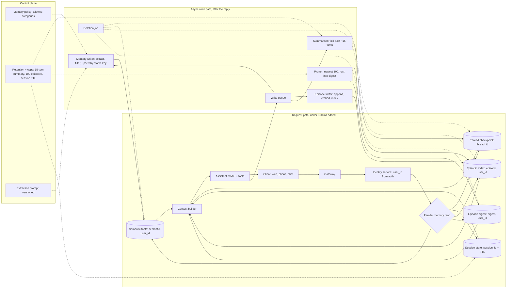

# Personal Assistant With Memory

*The assistant has to remember enough to feel personal and forget enough to stay fast, correct and private.*

A memory system is not one database with a bigger context window. It is four scopes of state, each with its own key, its own write rule and its own way to go wrong. This page turns this case into one read for the day before.

| Case | What it contributes here |
|---|---|
| #98 Study-guide mock design: "Real-time personal assistant that remembers you across weeks" | The prompt, the 8-point scoring rubric and the 7-point strong answer (sections 5 to 11 and 14) |
| Memory study guide, sections 1 to 5 | Scopes, the memory taxonomy, gotchas and trade-offs (sections 5 to 13) |
| Handbook Module 03 doc 2 and Module 07 doc 5 | Three scopes of state, per-user isolation, a real 30-day retention decision (sections 2, 5 and 11) |
| Cost and latency study guides | The cost pivot (section 16) |

**The source is short.** Section 6 of the memory study guide gives a prompt, a rubric and seven bullets, about 25 lines in all. It has no diagram, no sizing and no cost. Everything beyond those 25 lines is built from this site's other memory material, and anything those sources do not say is marked *(own construction)*. Sizing figures are stated assumptions, not measurements.

The prompt, verbatim from the source:

> "Design the memory layer for a personal assistant used daily by the same users over months. It needs to hold a live conversation, recall stable preferences from weeks ago, remember what tasks it did recently, and never mix up two users' data. Keep p95 added latency from memory under 300ms."

---

## 1. Clarify What "Remembers You" Means Before Choosing a Store

Ask what the user expects the assistant to remember before drawing a box. "Remembers you" hides four different promises. Hold the conversation. Keep preferences for good. Recall what it did last week. Keep one user's life out of another's view. Each promise needs a different store with a different lifetime.

The clarifying questions *(own construction)*:

| Question | Why it changes the design |
|---|---|
| What must it recall weeks later: preferences, past tasks, or both? | Decides whether episodic memory exists at all |
| Which channels does one user reach it through? | Web, phone and chat must resolve to one `user_id` before memory can be shared |
| Can the user see, correct and erase what it remembers? | Decides whether memory is a user-facing product surface or a hidden cache |
| What must never be stored? | Health, payment or third-party data may be barred from long-term memory |
| Where must the data live? | Residency rules decide where each store physically runs |
| Is "300ms" added latency on read, write, or both? | Decides which work may run after the reply |

Answer the last one for the interviewer if they will not: the budget is for reads on the critical path. Writes run after the reply is sent *(own construction)*.

## 2. State Requirements as Testable Constraints

A requirement that cannot fail a test is a preference. "Remembers preferences" is a preference. "Recalls a preference stated 30 days ago in a new conversation" is a constraint.

The functional requirements *(own construction, from the prompt)*:

| # | Requirement |
|---|---|
| F1 | Hold a live multi-turn conversation, resolving "it" and "that one" to earlier turns |
| F2 | Recall stable preferences (time zone, preferred name, dietary rule) in any new conversation |
| F3 | Recall recently completed tasks ("the flight I booked last Tuesday") |
| F4 | Update a preference when the user restates it, without duplicating it |
| F5 | Show the user what is remembered, and forget on request |
| F6 | Survive a server restart mid-conversation |

The non-functional requirements, stated so each can fail a test:

| Constraint | Stated so it can be tested |
|---|---|
| Latency | Memory adds under 300ms at p95 to each turn *(source)* |
| Isolation | Zero cross-user reads; `user_id` comes from auth, never from the model *(source)* |
| Recall | A fact planted early is recalled 20 turns later, measured on an eval set *(study guide take-home)* |
| Bounded growth | Prompt tokens per turn flat after the summary threshold; episodes capped per user *(source)* |
| Durability | A completed turn and a saved fact survive a process restart |
| Freshness | A fact written in one conversation is readable from a new conversation within seconds *(own construction)* |
| Deletion | "Forget X" and account deletion propagate to every store, index and cache *(own construction)* |

Every requirement then needs an owner *(own construction)*.

| Requirement | Primary component(s) |
|---|---|
| F1, F6 | Thread checkpointer, context builder |
| F2, F4 | Semantic store with stable keys, memory writer |
| F3 | Episodic store, vector index, episode digest |
| F5 | Memory API behind the user's settings page, deletion job |
| Latency | Parallel read fan-out, vector index, async write queue |
| Isolation | Identity service, namespaces keyed by `user_id` |

## 3. Size the Memory Before the Model

Say the arithmetic aloud, because it shows why an index and a pruning policy are not optional. Every number is an assumption for the whiteboard *(own construction)*. The method is what gets scored.

| Step | Assumption | Result |
|---|---|---|
| Daily active users | 1M | — |
| Turns per user per day | 30 | 30M turns a day |
| Average turn rate | 30M ÷ 86,400 s | ≈ 350 turns/s |
| Peak | 3× average | ≈ 1,050 turns/s |
| Memory reads per turn | 1 semantic fetch + 1 episodic search | ≈ 2,100 reads/s at peak |
| Completed tasks per user per day | 5 | 5M episode writes a day |
| Episodes kept per user | 100 *(source cap)* | ≤ 100M live episodes |
| Stable facts per user | 50 | ≈ 50M semantic rows |
| Vector size | 1,024 dims × 4 bytes | ≈ 4 KB per episode vector, ≈ 400 GB at the cap |
| Summary calls | One per ~15 turns *(source threshold)* | 2 per user a day, ≈ 2M extra model calls, about 7% on top of 30M |

Three conclusions follow. The episode cap is what bounds the index, because without it 5M writes a day grow without limit. The read rate is modest, so latency depends on the index, not on throughput. The summary calls are a real line on the bill, so the threshold is a cost lever and not just a quality setting.

## 4. Draw the Architecture End to End

The organising rule is resolve, read, assemble, reply, then write. Identity comes first, because every key depends on it. Reads fan out in parallel inside the budget. Writes happen after the reply, off the critical path.

The whole system *(own construction)*:

```
 ╔═════════════════════ CONTROL PLANE (changes are releases) ═════════════════════╗
 ║ memory policy: what may be stored, per category · retention and caps per scope ║
 ║ summary threshold (~15 turns) · episode cap (100/user) · session TTL           ║
 ║ extraction prompt (versioned) · residency map · eval gates                     ║
 ╚══════════════════════════════════════╤═════════════════════════════════════════╝
                                        │ configures every box below
 ╔═════════════════════ DATA PLANE (calls are requests) ══════════════════════════╗
 ║                                                                                ║
 ║ client (web, phone, chat) ──> GATEWAY ──> IDENTITY SERVICE                     ║
 ║                                          user_id from the auth session         ║
 ║                                                  │                             ║
 ║                                                  v                             ║
 ║                      ┌──────── MEMORY READ FAN-OUT (parallel) ────────┐        ║
 ║                      │ thread checkpoint   key: thread_id             │        ║
 ║                      │ session state       key: session_id, TTL       │        ║
 ║                      │ semantic facts      ns: (semantic, user_id)    │        ║
 ║                      │ episodic search     ns: (episodic, user_id)    │        ║
 ║                      │                     vector index, user filter  │        ║
 ║                      │ episode digest      ns: (digest, user_id)      │        ║
 ║                      └───────────────────────┬────────────────────────┘        ║
 ║                                              v                                 ║
 ║                        CONTEXT BUILDER: system prompt + facts + digest         ║
 ║                        + top-k episodes + summary + recent turns + message     ║
 ║                                              │                                 ║
 ║                                              v                                 ║
 ║                        ASSISTANT MODEL + TOOLS (calendar, mail, booking)       ║
 ║                                              │ reply streams to client         ║
 ║                                              v                                 ║
 ║                        CHECKPOINT the turn (thread_id)                         ║
 ║                                              │ enqueue                         ║
 ╠══════════════════════════════════════════════╪═════════════════════════════════╣
 ║ ASYNC WRITE PATH (after the reply)           v                                 ║
 ║   MEMORY WRITER: extract candidate facts → policy filter → stable-key upsert   ║
 ║                  (previous value kept one version back)                        ║
 ║   EPISODE WRITER: one append per completed task → embed → index               ║
 ║   SUMMARISER: fold buffer into running summary past ~15 turns                  ║
 ║   PRUNER: keep newest 100 episodes, fold older into the rolling digest         ║
 ║   DELETION JOB: "forget X" and account deletion across every store and index   ║
 ║                                                                                ║
 ║ OBSERVABILITY: read latency per store, hit counts, writes by category — no text║
 ╚════════════════════════════════════════════════════════════════════════════════╝
```

The same flow for viewers that render Mermaid *(own construction)*:



Read the components in request order. The failure column is *own construction*.

| # | Component | Responsibility | Fails how |
|---|---|---|---|
| 01 | Gateway | Auth, rate limit, streams the reply | Closed on auth failure |
| 02 | Identity service | Resolves one `user_id` across every channel | Closed: no identity, no memory read |
| 03 | Thread checkpoint | Conversation state per `thread_id`, saved after each step | Replicated; a restart resumes from the last step |
| 04 | Session state | Short-lived context per login session, with a TTL | Degrades: session context lost, conversation continues |
| 05 | Semantic store | Stable facts under stable keys, one prior version kept | Degrades: answer without preferences, never invent one |
| 06 | Episodic store + index | One record per completed task, vector-searchable, filtered by user | Degrades: skip recall past a timeout, say so if asked |
| 07 | Episode digest | Rolling summary of episodes older than the newest 100 | Degrades: answer from recent episodes only |
| 08 | Context builder | Assembles the prompt in a fixed order within a token budget | Degrades: fewer episodes, same order |
| 09 | Assistant model + tools | Answers and acts | Fails over to a fallback model |
| 10 | Memory writer | Extracts candidate facts, applies policy, upserts by key | Retries from the queue; a lost write is re-extracted next turn |
| 11 | Episode writer | Appends, embeds and indexes a finished task | Retries from the queue |
| 12 | Summariser | Folds old turns into the running summary | Degrades: window trimming until it recovers |
| 13 | Pruner | Enforces the 100-episode cap, feeds the digest | Degrades: index grows for a while, alert fires |
| 14 | Deletion job | Propagates "forget" and account deletion everywhere | Closed: retried until every store confirms |

Point at three boundaries while the diagram is up *(own construction)*. The isolation boundary is the identity service, because every namespace below it carries a `user_id` it supplied. The latency boundary is the parallel fan-out, because the slowest store sets the turn's added latency. The write boundary is the queue, because nothing after it can slow a reply.

## 5. Separate Four Scopes and Give Each Its Own Key

Give each kind of memory its own scope, because each answers a different question. A `thread_id` answers "which conversation". A `user_id` namespace answers "which person". A system that has only the first forgets everyone between conversations. A system that confuses them leaks memory across users.

The study guide's taxonomy maps directly onto the prompt's four promises.

| Scope | Holds | Key | Write rule | Read rule | Lifetime |
|---|---|---|---|---|---|
| Thread (short-term) | The live conversation | `thread_id` | Checkpoint after each step | Summary plus recent turns | Retention policy, for example 30 days |
| Session | Login-session context, such as "planning the Lisbon trip" | `session_id` | Overwrite | Get by key | TTL, sliding or fixed |
| Semantic (long-term) | Stable facts: time zone, preferred name | `(semantic, user_id)` + stable key | Overwrite in place | Get all keys for the user | Until changed or erased |
| Episodic (long-term) | Completed tasks: "booked flight to Lisbon" | `(episodic, user_id)` + fresh key | Append one per task | Vector search, top-k | Newest 100, older folded into a digest |

Procedural memory, meaning instructions that change the assistant's behaviour, is the fifth kind in the taxonomy. Keep it out of scope for a personal assistant unless asked. If it appears, gate every change behind human approval. The study guide's gotcha is that an approval passed as a tool argument lets the model approve itself.

"Short-term" describes scope, not lifetime. A durable checkpointer keeps thread history on disk across restarts, which is the point here. Handbook Module 07 doc 5 records a real deployment with thread checkpoints in a table, 30-day retention, chosen so conversations survived an endpoint restart and stayed auditable.

Keep enterprise knowledge out of memory entirely. Handbook Module 03 doc 2 makes the distinction: a stale preference fails as mildly wrong personalisation, while an outdated policy fails as a wrong answer. They refresh on different cadences, so they live in different stores.

## 6. Bound What the Model Sees on Every Turn

Store every turn, and send the model only what this turn needs. Replaying the full history makes tokens and latency grow linearly with turns. The source answer summarises once the buffer crosses ~15 turns, so cost stays flat on long chats.

The study guide compares three options.

| Option | Costs | Buys | Choose when |
|---|---|---|---|
| Full history replay | Tokens and latency grow with every turn | No information loss | Short conversations only |
| Sliding window | Anything outside the window is gone | Flat, bounded cost | Only the last few turns matter |
| Summarisation | One extra model call per fold, and it is lossy | Bounded cost and a record of older turns | Long conversations where old facts still matter |

Pick summarisation with a window of raw recent turns. Volunteer its failure mode before the interviewer does: the summariser can drop something it judged unimportant that matters later. The semantic store is the safety net, because a preference extracted into a stable key no longer depends on the summary keeping it.

Two gotchas separate a practitioner from a reader. Trimming the prompt does not trim the stored checkpoint; only an explicit removal or a retention policy shrinks storage. A running-summary field with no merge rule can be reset by a stray input on the next call, so the summary appears never to accumulate.

The context builder assembles in a fixed order *(own construction)*: system prompt, semantic facts, episode digest, top-k episodes, running summary, recent turns, then the new message. Stable parts go first, so a provider's prefix cache can reuse them across turns.
