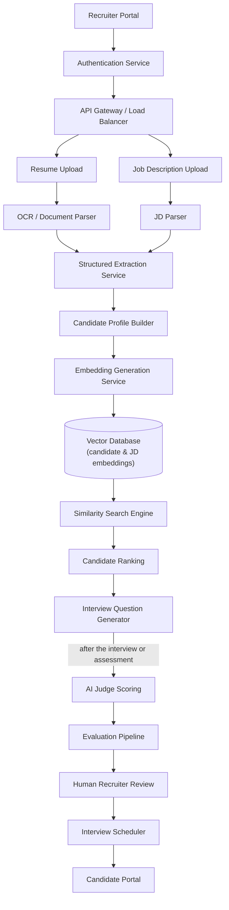

# AI-Powered Recruiting Platform: Casebook

## The prompt

You are asked to build a recruiting platform with AI at every step. It reads resumes, matches people to open roles, drafts interview questions, scores candidates, books interviews and supports the hiring manager. The scope runs the whole way, from the first upload to the hiring decision.

## Step 1. Define the problem space

A recruiter posts a job description and a large batch of resumes arrives. The platform has to rank those candidates by fit, draft questions and scorecards, book interviews and suggest a decision. The recruiter still makes the final call, and that requirement shapes the rest of the design: we are building a tool that helps people hire, not one that hires on its own.

This case works from the answers in the table. Check each one with the interviewer before you rely on it.

| Question | Answer | What it decides |
| --- | --- | --- |
| Who is the customer: an enterprise hiring team or a staffing agency? | It varies | How many tenants and how much volume to plan for |
| Does matching run in batches or live? | Batches for bulk intake; close to live when a recruiter searches | The system needs two processing modes |
| May a recruiter overrule the AI? | Always | Human review is a core feature, not an add-on |
| Does the system decide, or help a person decide? | It helps a person decide | Explainability drives every later choice |
| Do GDPR and EEOC rules apply? | Yes | Fairness checks and an audit trail are mandatory |

**Functional:** take in a JD and resumes; turn them into structured data; rank candidates by fit; search profiles by meaning; draft interview questions and scorecards; suggest a decision; book interviews; summarise interviewer feedback; give recruiters a chatbot; improve from past hiring decisions. **Non-functional:** handle thousands of resumes an hour; match accurately; keep hallucination low; protect PII; scale out; make every ranking explainable; stay compliant; control cost.

## Step 2. High-level architecture: two intake paths, one ranked pipeline



**The extraction service is where documents turn into data.** Upstream of it, the system handles PDFs and loose text. Downstream, it handles profiles that share one shape, so they can be compared and ranked. This is the chunking-by-format lesson from Module 06 again. Resumes come in every layout, and the parser must still emit one consistent structure.

## Step 3. The flow

1. **JD upload.** The parser pulls out must-have and nice-to-have skills, years of experience, education, certifications, location and salary band.
2. **Resume upload.** Input can be a PDF, a DOCX file, a LinkedIn profile or a record from the ATS.
3. **Structured extraction.** Each resume becomes a set of fields rather than a block of text. Search and ranking need those fields to be reliable.
4. **Embeddings.** The system embeds the JD and the profile, plus skills, projects, experience and certifications. Embeddings capture meaning, so matching is not tied to exact words.
5. **Similarity search.** A query for *"LLM Engineer"* can surface people who list Generative AI, RAG, prompt engineering or agentic AI.
6. **Ranking.** Several weighted signals feed one ordered list. Each place in the list comes with a reason, which beats a bare pass or fail.
7. **Interview questions.** Questions fit the role. They draw on the JD, the candidate's background, the skills they lack and the projects they have done.
8. **AI judge.** Once an interview or assessment is over, the judge rates technical accuracy, communication, problem-solving and fit with the role. It returns structured feedback and a provisional score.
9. **Human review.** A recruiter or hiring manager looks at the ranking, scores, summaries and suggestion, then takes the final decision. That gives clear accountability and a human check on bias, but only if the reviewer can genuinely overrule the system.
10. **Scheduling.** The platform reads calendars, finds free slots, sends invites, notifies the candidate and updates the ATS.

## Step 4. The deep dive: explainable ranking

The ranking does not rest on a single similarity number. It blends semantic similarity, the match on required skills, level of experience, domain knowledge, location, certifications, availability and, where it applies, past hiring success. Explicit weights let a recruiter follow the ranking and an auditor inspect it; one opaque score allows neither. The weights do not by themselves make the ranking fair or job-relevant.

Here is a weighting I would open with. It is my own starting point, not an industry norm: semantic similarity ~30% · skills match ~25% · experience ~20% · domain expertise ~15% · everything else ~10%. With weights like these on show, a recruiter can see the reasons behind a candidate's place as well as the place.

The AI judge works the same way. It scores against a fixed rubric and explains each score, and the decision is never its to make. The evaluation pipeline pulls together similarity, profile completeness, judge scores, interview feedback and input from the recruiter and hiring manager. When confidence falls below a set threshold, a person must review the case. Module 04 warned against letting an LLM judge alone gate a high-stakes outcome. Here the outcome is someone's career.

## Step 5. Scaling to thousands of resumes an hour

Keep the application servers stateless so they scale out. Process documents asynchronously: parsing and embedding run as background jobs, and an upload never waits on them. Spread the vector database across nodes. Use GPU-backed inference to soak up bursts, such as a new posting that sets off thousands of comparisons at once. Drive ingestion with events, so upload is decoupled from parsing, extraction, embedding and ranking. Deploy in several regions to cut latency and keep candidate PII where it has to stay. Cache embeddings and generated text, and lean on queues during peak hiring periods.

## Security and fairness: candidate data is sensitive; hiring decisions carry legal weight

Encrypt data both when stored and when moving. Guard PII. Give recruiters and hiring managers role-based access through RBAC. Write an audit record for every AI suggestion and every hiring action. Agree with the privacy and legal owners which GDPR, CCPA and EEOC duties apply, and honour candidates who ask for their data to be deleted. These controls support compliance; they do not certify it. Watch the models for bias across protected groups continuously, not once at launch.

```
AI Ranking & Scores → Human Recruiter Review → Approve or Override → Final Hiring Decision
                        (continuous bias and fairness monitoring over the whole path)
```

No AI ranking reaches a decision without a person in between.

## Trade-offs

| Decision | Pros | Cons |
| --- | --- | --- |
| Keyword matching | Quick and easy to build | Misses people who describe the same skill in other words |
| Embedding-based search | Finds more good candidates | Costs more compute |
| Fully automated hiring | Decisions come sooner | Carries legal and ethical exposure |
| Human-in-the-loop | Keeps oversight and fairness | Takes longer |
| Large reasoning model | Stronger summaries and questions | Slower and dearer |
| Smaller model | Quicker and cheaper | Weaker reasoning |

## Follow-ups to have ready

**How do you reduce bias?** Hide or mask demographic details where that makes sense. Train and test on varied data. Track fairness metrics continuously. Keep a human sign-off on every hire. Explain each ranking openly. Audit on a regular schedule.

**How do you improve matching accuracy?** Never match on keywords alone. Evaluate lexical and semantic matching on a labelled set first, and expect a hybrid of the two to win. Blend several ranking signals. Feed recruiter feedback back into the ranker. Measure precision and recall against past hiring outcomes. Tune prompts and retrieval using that same feedback.

**How do you personalise for recruiters?** Learn from each recruiter's earlier decisions. Lift candidates who resemble past successful hires, *and watch that step closely for bias*. Set question difficulty by the seniority of the role. Reflect the skills a given team needs. Let recruiters adjust the weights themselves.

## Summary

The design is one AI workflow from end to end: structured extraction, matching by meaning, ranking you can explain, and evaluation by an AI judge. A person keeps the final decision. Fairness, PII protection and compliance are built into the design from the start, not ticked off at the end. AI helps at every stage and decides at none.

## Checkpoint

- What makes structured extraction the most important boundary in this architecture?
- Why is an explicit weighted ranking easier to defend than one model score?
- What is the AI judge allowed to do, what is it barred from doing, and what triggers manual review?
- Give three fairness mechanisms and say which one runs all the time.
- In the personalisation answer, why is "similar to successful hires" a bias risk, and how do you contain it?

## Key Takeaways

- The recruiter makes the final call, so the platform is a tool that helps people hire, not one that hires on its own.
- Because the system helps a person decide rather than deciding, explainability drives every later choice.
- Structured extraction is the line between documents and data: every resume layout must come out as one profile shape that can be compared and ranked.
- Run matching in two modes: batches for bulk intake, and close to live when a recruiter searches.
- Embeddings match on meaning, so a search for "LLM Engineer" can surface people who list RAG, prompt engineering or agentic AI.
- Rank on explicit weighted signals, opening at semantic similarity ~30%, skills ~25%, experience ~20% and domain ~15%, with ~10% for the rest.
- Explicit weights let a recruiter follow the ranking and an auditor inspect it, and one opaque score allows neither. They do not by themselves make the ranking fair.
- The AI judge scores against a fixed rubric and explains each score, but the decision is never its to make.
- When confidence falls below a set threshold, a person must review the case.
- Human review only adds accountability and a bias check if the reviewer has real power to overrule the ranking.
- Parse and embed as asynchronous, event-driven background jobs, so thousands of resumes an hour never block an upload.
- Absorb bursts from a popular posting with GPU-backed inference, cached embeddings and queues.
- Deploy in several regions to cut latency and keep candidate PII where it has to stay.
- Audit-log every AI suggestion and hiring action, and monitor bias across protected groups all the time, not once at launch.
- Lifting candidates who resemble past successful hires can learn past bias, so that step needs close fairness monitoring.

## Level calibration

On the recruiting platform, the levels split on how far an answer takes "AI-assisted, never AI-decided" beyond a slogan.

| Level | Sounds like | Missing |
|---|---|---|
| Senior | "Parse JDs and resumes into structured profiles, embed them, and rank on explicit weighted signals, semantic similarity ~30% and skills ~25% and so on. Parsing and embedding run as async jobs, so thousands of resumes an hour never block an upload, and every shortlist goes to a recruiter." | Who owns the weights, the confidence threshold that forces manual review, and how bias gets caught once the system is live. |
| Staff | "The recruiter review needs real power to override. Below a [confidence threshold], review is mandatory, and every recommendation and override is audit-logged. Fairness monitoring across protected groups runs continuously and is owned with legal and hiring leadership, and deletion requests and candidate PII stay in their region." | How recruiter feedback flows back into ranking, and the risk that "similar to successful hires" learns past bias. |
| Principal | "Personalised weights and learning from past decisions only ship behind continuous fairness audits and demographic masking. No stage ever becomes autonomous, because AI that filters candidates is classed as high-risk. I'd also set the organisation-wide rule for who may change weights, prompts and judge rubrics." | Whether historical hiring outcomes are clean enough to learn from. That needs the customer's own data and an audit of past decisions. |

**Next →** Case 5 — Logistics Exception Handling
