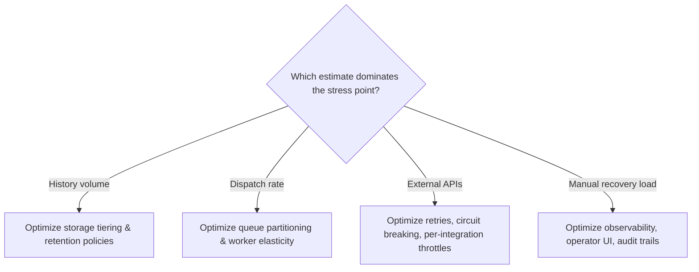

# Design a Reliable Workflow Orchestration System, part 3

## 3. Scale Estimates, SLOs, and Capacity

### Start with the Load That Breaks the First Draft

- Most candidates open with a sensible sketch: a workflow service, a queue, a pool of workers, a state database and a blob store for attachments. At average load, it holds up.
- Its weak spot is timing as much as volume. Long waits, retries and deadline pressure stack up, and that mix is the limit the sketch hides.
- Picture a workflow that idles for days. Then approvals arrive, a payment gateway answers, or a downstream system recovers, and the work spikes at once. A system sized for the mean will miss business deadlines once it is live.
- So estimate the envelope next. Count the workflows running at the same time and the events they emit. Work out how much state needs durable retention, how fast tasks must go out, and how much slack peaks and partial outages call for.

### Working Assumptions and Activity Rate

- Treat the scenario figures as planning inputs, not fixed truth:
  - 10 million active workflows
  - 100 million activities per day
  - Week-long waits between some steps
- Those figures describe a durable state machine. Most of its population sits idle, while a smaller slice keeps moving.
- Turn the daily figure into a rate: 100,000,000 activities/day ÷ 86,400 seconds/day ≈ **1,157 activities/second on average**.
- The mean is a useful anchor, but you do not provision for it. Real peaks can land several times higher. Work bunches up in office hours. Reminders go out in a morning batch. A dependency outage holds retries back, then releases them together.
- Say the framing out loud. These multipliers are my own planning choices for this case, and I'd defend them; they are not industry standards:
  - Average dispatch rate: roughly 1.2k activities/sec
  - Peak dispatch rate: 3x–10x average, set by how the customer uses the system
  - Headroom: for a new system, at least double the observed peak; go higher still if regional failover or retries matter
  - Growth factor: run the numbers at both 2x and 10x future scale before you fix partition counts or storage layout

### Separate Workflow State from Payloads

- A frequent scaling error is to push everything into the workflow history.
- Keep durable state small. It needs only the facts that let you replay, resume, audit and compensate: version markers, step status, timestamps, business references and correlation IDs.
- Big items go elsewhere. Documents, PDFs, images and payloads from internal systems live in object storage or a document store, and the workflow keeps a pointer.
- The split pays off in three ways:
  1. **Replay cost**: if every retry or rehydration drags megabytes of payload into the orchestration engine, latency climbs and worker memory comes under strain.
  2. **Retention cost**: audit and support often need workflow histories kept for a long time. Park large payloads on the hot path and the operational ledger becomes a costly archive.
  3. **Blast radius**: when every event record carries its own copy of the payload, a leak or an accidental change does far more harm.
- As a rule, workflow state holds only enough to keep the system deterministic and inspectable. Payload storage takes the data that is large, mutable or sourced from outside. The workflow points at the payload; it never turns into it.

### Estimating Event-History Storage

- Estimate it with a quick product: active workflows × events retained per workflow × bytes per event.
- Inputs (10 million is the scenario's figure; the per-workflow numbers are my own):
  - 10 million active workflows
  - An average of 40 retained events per workflow
  - 1 KB per event record (an illustrative size)
- The result is about **400 GB** of raw event data. That leaves out replication, indexing, compaction overhead and backups.
  - If each event takes 2 KB rather than 1 KB, the total grows to about **800 GB**.
  - If the true active set is 20 million, not 10 million, the figure doubles once more.
- The estimate shows which dimension drives the storage design. It is not a final figure.
- When history is kept for a long time, give the colder audit path its own home, apart from the hot execution path that holds task leases and execution metadata. Compaction, tiering and retention policies then become simpler to think through.

### Estimating Task-Queue Throughput

- The task queue is where operations choke. Every status update, payment request, internal API call and approval notification ends up as a queued task.
- At 100M activities/day, the system has to accept, lease and complete a sustained flow above ~1,157 activities/second.
- That figure still hides load. Each activity usually triggers at least two queue actions, an enqueue and a dequeue. Leasing, visibility timeouts and requeues can add more.
- So the throughput envelope covers both creating tasks and running them:
  - Task enqueues: grow roughly in line with activity count
  - Task leases and acknowledgements: one or more per activity, often extra once retries kick in
  - Retry traffic: added load after transient failures or worker restarts
- The queue subsystem must survive a retry storm and still serve new tasks. A practical design splits queues by priority class, workflow type or workflow tenant. Then no single customer, and no runaway workflow family, can monopolise dispatch capacity.

### Sensitivity at 10x Growth

- A sensitivity table makes the scaling decision concrete. It shows what gives way first when the assumptions shift:

| Scenario | Active workflows | Activities/day | Avg activities/sec | Likely architectural pressure |
|---|---|---|---|---|
| Base case | 10M | 100M | ~1.2k | Durable history, a moderate degree of partitioning, a worker pool kept warm |
| 10x growth | 100M | 1B | ~11.6k | More aggressive sharding, tighter isolation between queues, heavier compaction and tiering |

- At 10x, I would not expect application-server CPU to give out first. I'd expect replay latency, hot spots in the queue, storage fan-out or operating cost to hit the wall sooner.
- If the design would need a full rewrite to take that growth, say so. Then pick a layout that partitions more easily from day one.

### Latency Budgets and Workflow SLOs

- Workflow orchestration needs a different set of SLIs/SLOs from a typical API server:
  - **Availability SLI**: the share of time that workflow submission, progress updates and operator controls can be reached
  - **Latency SLI**: how long it takes to accept a new step, send out an activity, and show a state change in the UI
  - **Freshness SLI**: the lag between a real-world event and its appearance in workflow state
  - **Quality SLI**: the rate of stuck workflows, failed compensations, missed transitions or duplicate side effects
  - **Security SLI**: the fraction of requests that pass authorisation correctly and get audited; the rate of sensitive-data exposure is pushed toward zero by design, never claimed to be impossible
  - **Cost SLI**: cost per workflow or per thousand activities, plus the support effort that operator intervention demands
- Turn these into objectives the customer can feel. Few customers care whether a task lease takes 80ms or 120ms. They do care when a payment step shows up in the UI so late that an operator thinks it was lost and retries it by hand. They also care when a workflow that ought to be compensating stays hidden for hours.
- Size the queue subsystem to ride out a retry storm with new tasks still flowing. Partitioning by tenant, workflow type or priority class stops one runaway workflow family from monopolising dispatch capacity.

### Retry Math Is Not Compensation

- This formula puts a bound on repeat attempts and avoids a thundering herd:

**backoff_n = min(cap, base × 2^n) + jitter**

- Here *n* is the retry attempt number, *base* is the first delay, *cap* is the longest allowed delay, and *jitter* is randomised variation so retries do not fire in sync.
- Exponential backoff spaces out attempts after a failure. That shields dependencies and gives a transient incident room to clear.
- Backoff is not business compensation:
  - The payment goes through but the email fails. Retrying the email is the right move.
  - The payment goes through, and later the workflow finds a validation error. Backoff cannot reverse the charge. You need an explicit compensation step, such as a refund or marking the case for review.
  - Retry says "try once more, later". Compensation asks "which business action reverses or limits a side effect that already happened?" Keep the two apart.
- Treat cap and jitter as operational trade-offs tied to the business process, never as habits:
  - A low cap recovers user-facing work faster, but it can swamp a flaky dependency.
  - A high cap protects the dependency, but customers wait longer to see progress.

> **Interview pointer:** Interviewers like to set the "retry vs. compensation" trap. Say plainly that backoff never stands in for a business-level reversal, such as a refund, when a side effect that already completed has to be undone.

### Which Estimate Should Drive the Architecture

- Total workflow count alone rarely decides it. The mix of long waits, visible state and safe side effects does:
  - Week-long waits demand durable storage and the ability to replay.
  - 100 million daily activities demand a scalable queue and a partition strategy.
  - Side effects you cannot undo demand compensation tooling, unique business keys and idempotency.
- Let the stress point choose the components, not whatever is easiest to sketch:
  - When history volume is the main load → tune storage tiering and retention policies.
  - When the dispatch rate leads → invest in queue partitioning and worker elasticity.
  - When external APIs are the pressure → work on retries, circuit breaking and throttles per integration.
  - When manual recovery takes the most effort → improve observability, the operator UI and audit trails.

### Communicating Uncertainty Like an Operator

- Interviewers look for proof that you steer with estimates, rather than pretend to be certain.
- A sample answer: "I'd take 10 million active workflows as the starting working set. But I'd plan partitions and queue namespaces for a 10x sensitivity case, since growth and retry bursts rarely spread load evenly. If the customer later says only 20% of workflows run long, storage gets simpler. If they say 80% have week-long waits, retention and the replay path jump to the top of my list."
- That answer shows you picking the smallest design that stays safe under realistic growth and failure. You are not over-building for every future you can dream up.
- This topic sorts candidates. Plenty of engineers can talk about distributed systems in the abstract. Fewer can name the number that matters, explain why, and say which decision it moves.
- Treat estimates as tools for decisions. Each number should back an architectural choice or an operational limit. If a metric leaves partitioning, storage, retry policy, latency budget and support model all unchanged, it probably does not belong at the front of your answer.
