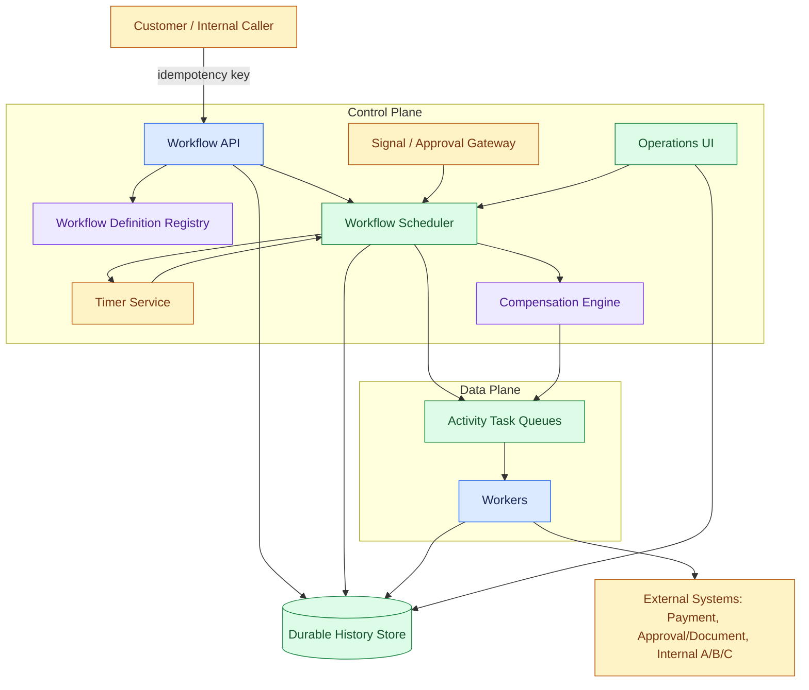
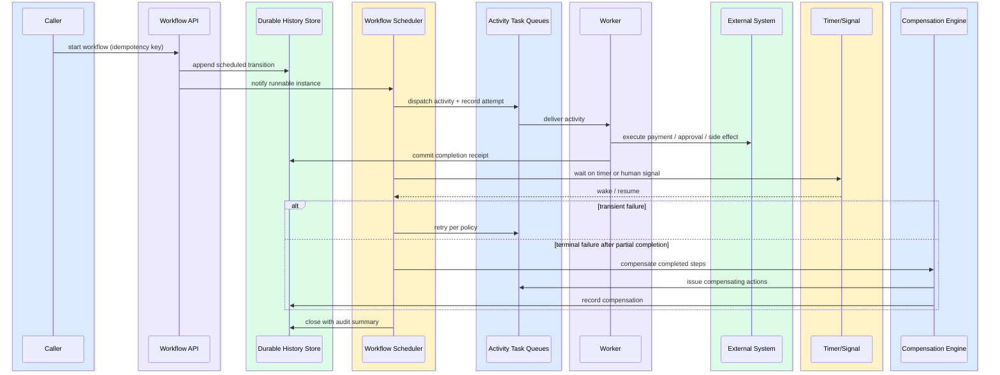
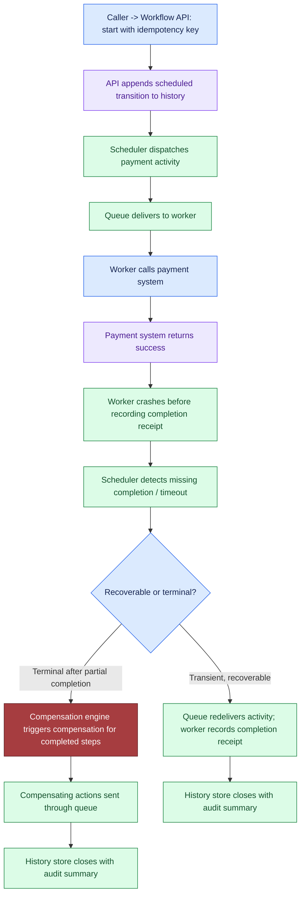

# Design a Reliable Workflow Orchestration System, part 4

## 4. Architecture and End-to-End Flow

### System Boundary and Customer Outcome

- Start with what the customer needs and design back from it. The outcome: **apply each business effect of a long-running process exactly once, keep its state visible, and compensate when a step fails**.
- Retries still happen. "Exactly once" means nobody is charged twice or sent the same message twice, no step goes missing unnoticed, and you can show all of that.

### Component Map: Control Plane vs Data Plane

- Draw a line between the control plane and the data plane before anything else. Without it, the parts never fall into place.
- Components:
  - **Workflow definition registry**: holds the approved workflow templates. It is the source of truth for their step order, their retry and timeout rules, and which compensation undoes which step.
  - **Durable history store**: the system of record. It logs every attempt, signal, state transition, receipt and final outcome.
  - **Workflow scheduler**: derives the next runnable transition from durable history and hands it off to run.
  - **Activity task queues**: buffer the handoff from scheduler decisions to the workers.
  - **Workers**: make external calls, apply internal side effects and run local validation.
  - **Timer service**: brings a workflow back after a delay, at a deadline, or when a human wait ends.
  - **Signal/approval gateway**: takes explicit signals from people or systems and releases the workflow waiting on them.
  - **Compensation engine**: after a terminal failure, runs business actions that undo, as far as they can, the steps already finished.
  - **Operations UI**: shows live state, who is blocking whom, and the retry history, with pause, resume and override controls.
- **Control plane** = the scheduler, the registry, the timer service, the signal gateway, the operations UI and the compensation engine. They decide what happens next.
- **Data plane** = the queues and the workers. They do the work.
- This split lets decision-making scale apart from side-effect execution.

### Top-Down Architecture and Trust Boundaries

- Top-down flow:
  - A customer or internal caller sends an HTTP/API request carrying an idempotency key.
  - The Workflow API receives it.
  - The API looks up the permitted workflow template and policy in the Workflow Definition Registry.
  - It writes the opening event into the Durable History Store.
  - It may also tell the Workflow Scheduler that a fresh instance can run.
  - The Workflow Scheduler reads durable history and pushes runnable work onto the Activity Task Queues.
  - Workers pull from the queue and call Internal Systems A/B/C, the External Payment System and the Approval/Document Service.
  - Workers write their results and receipts into the Durable History Store.
  - The Timer Service tracks deadlines and wakes workflows that must carry on later.
  - The Signal/Approval Gateway passes human approvals, rejections and outside-system signals on to the scheduler.
  - When finished work must be unwound, the Compensation Engine sends business compensations out through the queues.
  - The Operations UI reads the store and scheduler state, so operators can watch, pause, override or resume a workflow without risk.

- Three trust boundaries exist. Each needs its own authentication, authorisation and logging policy; do not merge them into one generic "service layer":
  - **Public/customer-facing API**: takes the start request and its idempotency key, but cannot count on the caller retrying with care.
  - **Worker edge**: the outside systems here may fail, time out or only partly finish.
  - **Human approval path**: slow, error-prone, and every decision on it must be auditable.

### State Ownership and Consistency

- Only the **durable history store** owns the canonical progress of a workflow.
- Queues handle delivery. The truth does not live in them.
- Workers suggest effects. They hold no truth either.
- The scheduler does not rely on what it keeps in memory. It rebuilds its view from durable history each time.
- That gives the central consistency rule: once an event is accepted, recovery runs off the history store's record of it.

### Sequence Diagram: Happy Path

- The happy path in order. Time runs from top to bottom; the actors sit left to right:
  1. Caller → Workflow API: start a workflow, passing an idempotency key.
  2. Workflow API → Durable History Store: record the scheduled transition.
  3. Workflow API → Workflow Scheduler: flag the fresh instance as runnable.
  4. Workflow Scheduler → Activity Task Queues: send out the activity and log the attempt.
  5. Activity Task Queues → Worker: hand over the activity.
  6. Worker → External System(s): carry out the side effect, such as a payment, an approval lookup, an email or an internal change.
  7. Worker → Durable History Store: write the completion receipt.
  8. Workflow Scheduler → Signal Gateway or Timer Service: pause until a timer fires or a human signals.
  9. Signal Gateway or Timer Service → Workflow Scheduler: wake the workflow or let it go on.
  10. Workflow Scheduler → Activity Task Queues: if policy permits, try a transient failure again.
  11. Workflow Scheduler → Compensation Engine: on terminal failure, compensate the steps already done.
  12. Workflow Scheduler → Durable History Store: close the workflow and write an audit summary.

- Walk through every step in order and skip no handoff. The interviewer should hear control leave the model, reach deterministic services, and return.

### Failure-Path Overlay: Worker Crash After Payment

- Rehearse this failure above all others: the payment goes through, and then the worker crashes.
- Event sequence:
  - The caller starts the workflow and supplies an idempotency key.
  - The API records the scheduled transition in history.
  - The scheduler sends out the payment activity and logs an attempt.
  - The activity queue hands that attempt to a worker.
  - The worker sends the charge to the payment system.
  - The payment system reports success.
  - **The worker dies before the completion receipt is written.**
  - The scheduler notices that no completion arrived, or that a timeout expired.
  - It then picks a path: redeliver the activity, or reconcile from the state already on record.
  - Transient or recoverable → the queue redelivers the activity and the worker writes the completion receipt.
  - Terminal once some steps are done → the compensation engine starts compensation for the finished steps and routes the compensating actions through the queue.
  - Last, the history store closes the workflow and writes an audit summary.

- The charge may have gone through before the worker died. So "worker lost" must never be read as "business action lost".
- Only the record prevents a double charge on retry: the durable history and the completion receipt decide whether to redeliver or compensate; worker memory never does. The scheduler reads the history to see what already happened. Depending on that, it safely reissues the step or hands the case to compensation.

> **Interview pointer:** This is the follow-up to expect most: the payment succeeds, then the worker dies before the receipt is written. Know the answer cold: the durable history and the completion receipt decide whether to redeliver or compensate; worker memory never does.

### End-to-End Flow, Step by Step

- Give the happy path as numbered steps, not as a loose story:
  1. An **idempotency key** comes with the start request, so a retry cannot spawn a second business process.
  2. The API checks the request, then adds a **scheduled transition** to durable history.
  3. The scheduler picks up that transition, puts an **activity** on the queue and logs the attempt.
  4. A worker takes the activity, carries out the side effect and writes a **completion receipt** to durable history.
  5. The workflow then enters a **wait state** until a timer fires or a human sends a signal.
  6. A transient failure gets a **retry** under policy, not an instant escalation.
  7. If the workflow fails terminally after some steps are done, the compensation engine runs **compensating actions** for those steps.
  8. The workflow ends with an **audit summary**: the route it took, its waits and retries, any manual interventions, and the final effect.
- Read the flow as a series of consistency points. The request is durable before anything downstream changes. The side effect lands before the workflow reports success. The audit summary comes last, because it is built from history rather than from worker memory.

### Synchronous and Asynchronous Boundaries

- **Synchronous**: validating the start request, authentication, permission checks, writing the first history event, handing back the workflow ID, and most reads from the operations UI.
- **Asynchronous**: activity dispatch, approval waits, timer wakeups, retries, compensation, and most calls to downstream integrations.
- The boundary keeps the API quick to answer while the business process behind it waits for days.
- Make everything synchronous → a fragile chain of requests that snaps as soon as a human is slow.
- Make everything asynchronous without a solid history model → nobody can explain what happened, and operators lose control.

### Queues, Backpressure, Caches, and Policy Placement

- Queues sit at the seam between scheduling and execution, not in the state store. There they soak up bursts of demand and stop slow workers from holding up the rest.
- Apply backpressure in the scheduler and on the queue admission path. If one tenant, partition or dependency backs up, throttle new dispatches so retries cannot swamp the fleet.
- Use caches only for data that is read often and carries little risk, such as workflow definitions and UI summaries. A cache must never be the sole home of execution state.
- Enforce each policy near the point where its decision is made: retry limits in the scheduler, approval rules in the signal gateway, and permission checks ahead of any compensation or manual override.
- How history and queue load spread out depends on the partitioning key: tenant ID, workflow ID, or a customer/process key. Aim for fewer hot spots and causal order wherever the business needs it, not raw scale alone. When two steps for one process instance must never race, choose a key that puts them in the same partition.

### Why This Decomposition Matters

- A product owner thinks in invoices and approvals. An engineering team thinks in retries, locks and queue depth. Both must be able to follow this one architecture, and speaking to both is a strong hiring signal.
- Use the diagram to tell four stories: data, identity, state and failure.
  - Data moves from the caller to history, on to the scheduler and the worker, and back.
  - Identity is carried by auth, by idempotency keys and by approval context.
  - State is kept in durable history.
  - Failure is met with retries, timers and compensation, not with optimism.
