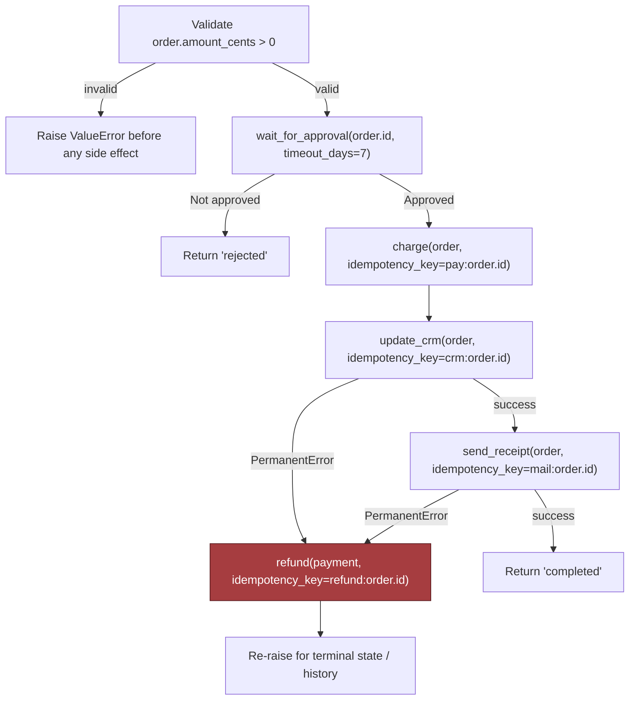

# Design a Reliable Workflow Orchestration System, part 5

## 5. Data Model, APIs, and Working Code

### The Smallest Safe Slice of the System

- Boxes on a whiteboard don't convince an interviewer. Durable records, strict contracts and one code path that runs the riskiest part safely do.
- Here the riskiest part is the state machine. It picks the next move once a step has succeeded, failed or been replayed. The approval screen and email sender matter far less.
- Get the state machine wrong and the customer suffers, however healthy the rest is: cards charged twice, lost approvals, workflows that look frozen for good.

### Core Durable Records

- Four records carry the design. Give each a purpose, a key, a lifecycle and a retention rule:
  - `WorkflowInstance(id, definition_version, state, next_event)` — the single row that owns one business process.
    - Purpose: the one durable record of where the workflow stands and where it will resume.
    - Primary key: `id`.
    - Lifecycle: created at start, changed on each transition, and finally archived or kept as the customer's policy requires.
    - Retention: hold the live row while the workflow runs. Once it finishes, keep a slimmer historical copy if audit or replay needs one.
  - `HistoryEvent(instance_id, sequence, type, payload_ref)` — an audit trail you only ever add to.
    - Purpose: rebuild the exact order of events without leaning on memory or short-lived logs.
    - Primary key: `(instance_id, sequence)`.
    - Lifecycle: new events get appended; past events are never edited.
    - Retention: keep events while debugging, customer audits and replay still need them. After that, policy moves them to cold storage or deletes them.
  - `ActivityReceipt(idempotency_key, external_ref, status)` — a note of each side effect that has been tried or has finished.
    - Purpose: stop a retry from taking payment again, sending a second email or repeating an update.
    - Primary key: `idempotency_key`.
    - Lifecycle: written just before or just after the external effect, depending on how the dependency behaves.
    - Retention: keep it for as long as duplicates must be blocked.
  - `Timer(instance_id, fire_at)` — a record of each scheduled wake-up.
    - Purpose: wake a workflow after a long wait, expire an approval, or check whether an outside job has finished.
    - Primary key: `(instance_id, fire_at)`, or whatever key the scheduler uses instead.
    - Lifecycle: insert it when a wait starts and delete it once the wait ends. Insert it again if the workflow is retried.
- Ownership is split. The orchestrator holds workflow state, the history of steps and the intent to retry. Payments, document approval, email delivery and CRM updates belong to external systems. The orchestrator may record a payment, but it never acts as the financial ledger.

### API Contracts

- Four API contracts expose the state machine. Each is quick to explain, yet strict enough that no client can slip vague work into the engine:
  - `POST /v1/workflows/{type}` — begins a new workflow.
    - Authentication: normal caller authentication, scoped to the tenant or customer.
    - Idempotency: the caller sends an idempotency key, so a retried call never yields a second instance.
    - Request: the workflow type, the business payload, caller context and, if wanted, correlation metadata.
    - Response: the instance id, the starting state and a status reference that does not change.
    - Errors: `400` for a malformed request; `401/403` when auth fails; `409` while a request with that key is still in flight; `422` when the key returns with a different payload, or the inputs make no business sense. This split of 409 and 422 comes from the IETF Idempotency-Key draft, which had expired by Sep 2026: an Internet-Draft, not an RFC.
  - `POST /v1/workflows/{id}/signals` — accepts input from a person or another system.
    - Authentication: the caller needs permission to signal this workflow or tenant.
    - Idempotency: a signal id combined with a payload hash, or a caller key, filters out double-clicked approvals and repeated system callbacks.
    - Response: the accepted signal and the transition it caused, or a no-op when that signal has already been applied.
  - `GET /v1/workflows/{id}/history` — returns the audit trail.
    - Authentication: the caller needs read rights for the workflow's tenant and policy scope.
    - Semantics: it never writes; results come back in pages, sorted by sequence.
    - Errors: `404` when the workflow does not exist; `403` when access policy hides it.
  - `POST /v1/workflows/{id}/repair` — gives operators, or automation they have approved, a way to resume, replay or compensate.
    - Authentication: elevated operator authorisation with a narrow scope.
    - Idempotency: each repair action carries its own idempotency token. An operator who clicks twice should not cause twice the side effects.
    - Semantics: the call must state plainly which action it takes: retry a step, compensate a finished step, or resume from a known checkpoint.
- Duplicates should behave predictably. If the payment step sees one idempotency key twice, the first call takes the money and saves a receipt. The second returns that receipt, or a "completed already" response.

### The Implementation Slice That Proves the Design

- One saga step is enough to show the key behaviour: wait for approval, take payment idempotently, update the CRM, and compensate if a downstream step fails for good.
- The sketch is narrow by design. Production code would also need a scheduler, queue workers, persistence, serialisation, distributed locking and stronger typing. Here we keep only the state transitions an interviewer cares about most.

```python
from dataclasses import dataclass
from typing import Protocol


class PermanentError(Exception):
    pass


@dataclass(frozen=True)
class Order:
    id: str
    amount_cents: int
    customer_email: str


@dataclass(frozen=True)
class PaymentReceipt:
    idempotency_key: str
    external_ref: str
    status: str


class Activities(Protocol):
    async def charge(self, order: Order, idempotency_key: str) -> PaymentReceipt: ...
    async def update_crm(self, order: Order, idempotency_key: str) -> None: ...
    async def send_receipt(self, order: Order, idempotency_key: str) -> None: ...
    async def refund(self, payment: PaymentReceipt, idempotency_key: str) -> None: ...


async def order_workflow(order: Order, activities: Activities, wait_for_approval):
    if order.amount_cents <= 0:
        raise ValueError("order amount must be positive")

    approved = await wait_for_approval(order.id, timeout_days=7)
    if not approved:
        return "rejected"

    payment_key = f"pay:{order.id}"
    payment = await activities.charge(order, idempotency_key=payment_key)

    try:
        await activities.update_crm(order, idempotency_key=f"crm:{order.id}")
        await activities.send_receipt(order, idempotency_key=f"mail:{order.id}")
    except PermanentError:
        await activities.refund(payment, idempotency_key=f"refund:{order.id}")
        raise

    return "completed"
```

- What each part does, in an order you can talk through out loud:
  - `Order` and `PaymentReceipt` are typed objects at the boundary. They stop the orchestration code from passing loose blobs around.
  - `PermanentError` separates failures worth a business retry from failures that should start compensation.
  - `Activities` is a protocol rather than a concrete dependency. That makes it easy to test, and it keeps vendor SDK details out of the workflow logic.
  - `order_workflow(...)` coordinates the saga.
  - The opening check turns away plainly bad input before any side effect. It is typed validation at the workflow's edge.
  - Waiting for approval creates a pause that must survive restarts. In production, a timer and stored state back it, not a bare function call.
  - `payment_key = f"pay:{order.id}"` guards the charge. A retry, a worker crash or a redelivered message cannot trigger a second one.
  - `activities.charge(...)` touches the outside world. The orchestrator reads its return value as a receipt; the payment ledger remains the source of truth.
  - After payment, the saga moves on to `update_crm(...)` and then `send_receipt(...)`.
  - `except PermanentError` compensates by issuing a refund.
  - Raising the error again keeps the failure visible. The orchestrator can then record the terminal state and show it in history.



> **Interview pointer:** Expect a question on how fine-grained the idempotency keys are, and answer it head-on. Each business action with a side effect gets its own key (`pay:`, `crm:`, `mail:`, `refund:`). The workflow as a whole does not share one. That single detail moves an answer from a whiteboard sketch to something a team could run in production.

### What the Whiteboard Version Omits on Purpose

- The short snippet leaves out concurrency control, versioning and observability hooks. A real build needs all of them:
  - **Optimistic concurrency**: each `WorkflowInstance` update checks a version number, so two workers cannot both move the same instance forward from stale state. In practice: "update where version = expected_version"; if another worker got there first, retry or abort.
  - **Schema and contract versioning**: `definition_version` on the instance lets old and new definitions run at the same time. An instance in flight stays on the version it began with, unless an explicit migration policy says otherwise.
  - **Idempotency at every write boundary**: payment is only one case. Repair actions, email sends, CRM updates and approval signals should be just as safe to replay, where that is feasible.
  - **Observability**: every transition should produce metrics, trace spans and structured logs, tagged with step name, outcome and `instance_id`. The history table is the system of record. Telemetry is there for fast diagnosis.
  - **Policy checks around model output**: an LLM might classify, route or summarise work inside a step. Before that output can change state or fire an external action, it must clear typed validation and policy checks. The model may propose; it must not quietly decide.

### Tests That Make the Design Believable

- A contract test checks that a repeated start yields one instance. Send `POST /v1/workflows/{type}` twice with an identical idempotency key, then assert that both responses carry the same instance id.
- A failure-injection test runs the key drill: a fault after payment has gone through. `charge(...)` succeeds; the CRM update then fails permanently. The workflow should refund. Replaying from history should then find the payment already made and skip the charge. A true crash-and-resume test, which kills the worker between the two steps, works the same way: replay reads history, skips the charge and picks up at the first step not yet done. The rule behind both: the durable history and the completion receipt decide whether to redeliver or compensate; worker memory never does.

```python
import pytest


@pytest.mark.asyncio
async def test_start_workflow_is_idempotent(client):
    payload = {
        "workflow_type": "order_approval",
        "business_payload": {"order_id": "o-123", "amount_cents": 5000},
        "correlation_id": "corr-1",
    }
    headers = {"Idempotency-Key": "start:o-123"}

    first = await client.post("/v1/workflows/order_approval", json=payload, headers=headers)
    second = await client.post("/v1/workflows/order_approval", json=payload, headers=headers)

    assert first.status_code == 201
    assert second.status_code in (200, 201)
    assert second.json()["instance_id"] == first.json()["instance_id"]


@pytest.mark.asyncio
async def test_worker_crash_after_payment_does_not_double_charge(orchestrator, fake_activities):
    order = Order(id="o-123", amount_cents=5000, customer_email="a@example.com")
    async def approval(order_id, timeout_days):
        return True

    async def charge_succeeds(*args, **kwargs):
        return PaymentReceipt(idempotency_key="pay:o-123", external_ref="payref-1", status="captured")

    fake_activities.charge.side_effect = charge_succeeds
    fake_activities.update_crm.side_effect = PermanentError("crm unavailable")

    with pytest.raises(PermanentError):
        await order_workflow(order, fake_activities, approval)

    # On replay, the orchestrator should consult history/receipts and not charge again.
    await orchestrator.replay_from_history(order.id)
    assert fake_activities.charge.await_count == 1
    assert fake_activities.refund.await_count == 1
```

- Together they prove two things. The API contract is idempotent in practice, not only on paper. And the most important drill in this design holds: a failure after a successful payment ends in a refund, and replay never charges twice.

### Why This Answer Sounds Credible in an Interview

- Weak answer: "We'll add retries, and that makes it reliable."
- Strong answer: workflow state belongs to the orchestrator. Each side effect carries an idempotency key. Each state transition is versioned. Each replay is driven by history. Compensation is spelled out, never implied.
- With those parts made concrete, the rest of the system can be explained rather than taken on faith. That gap separates someone who can describe an orchestration system from someone who can build one.
