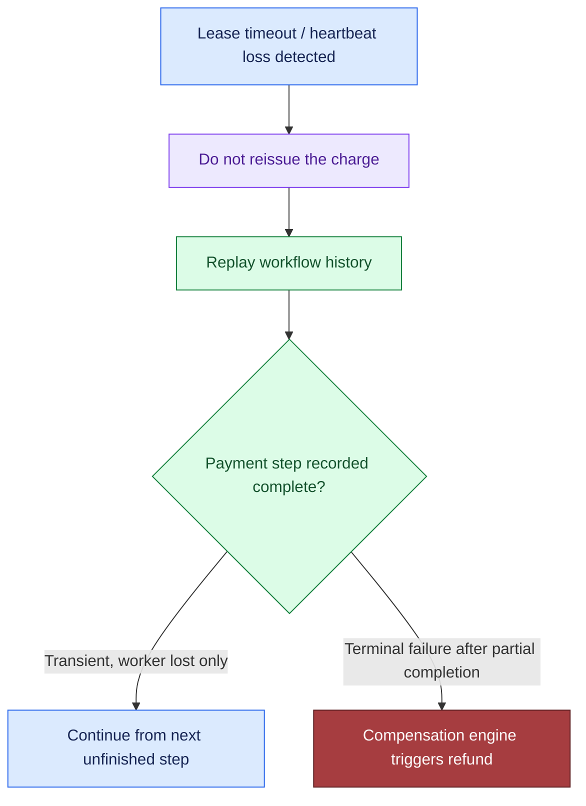
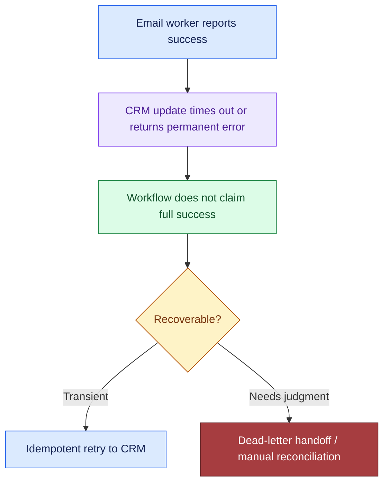
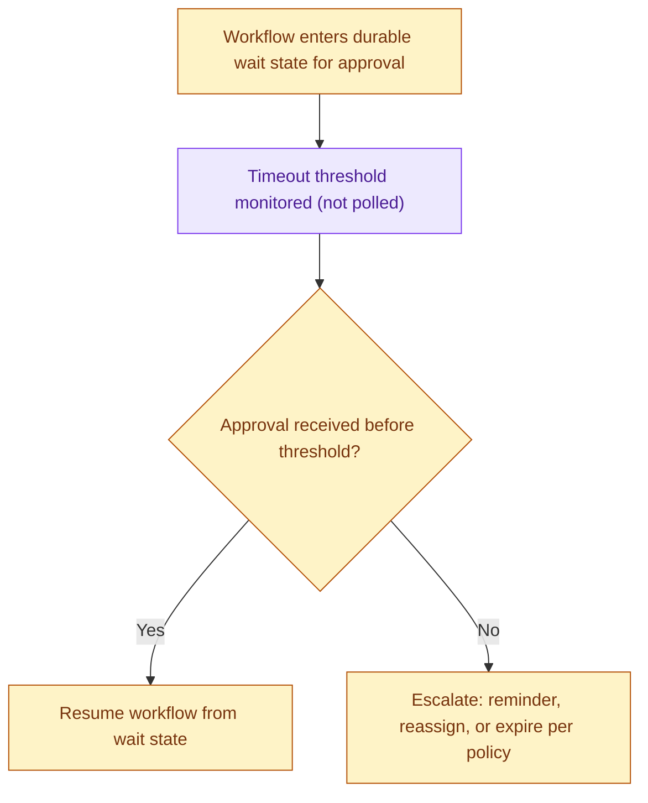
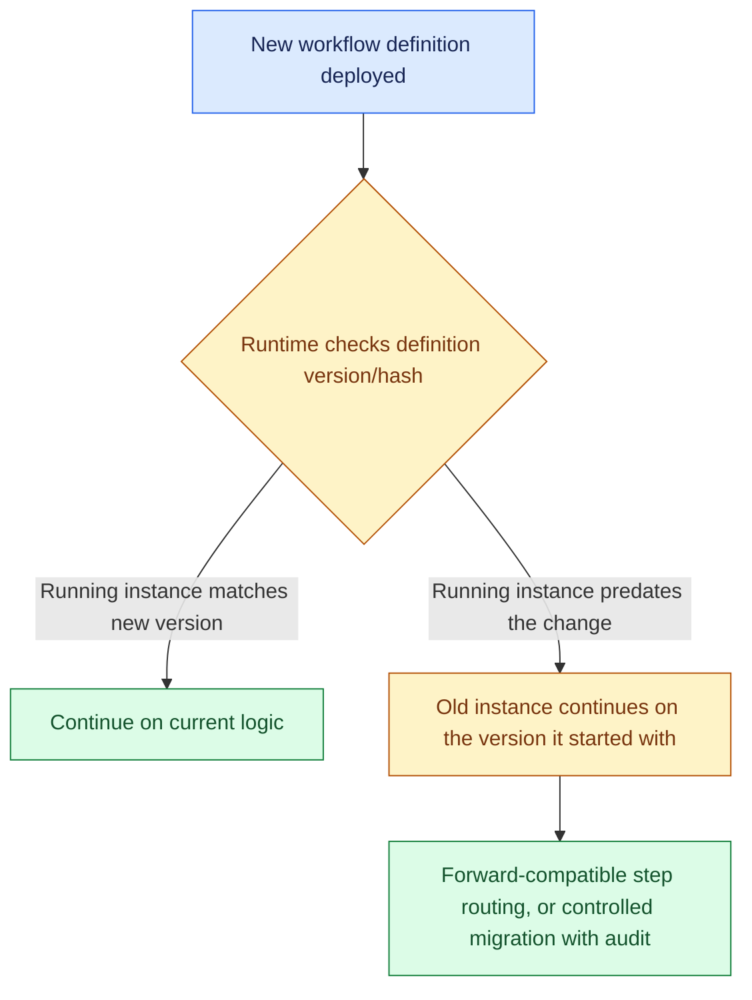
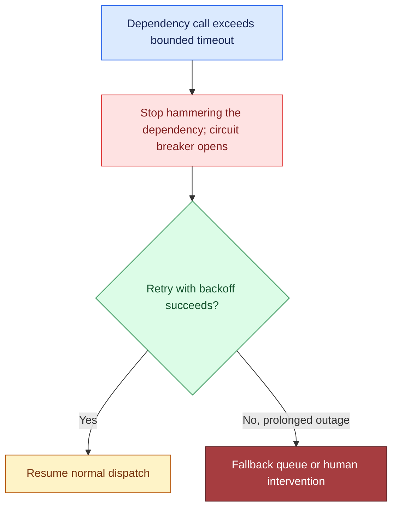

# Design a Reliable Workflow Orchestration System, part 6

## 6. Security, Reliability, and Failure Handling

### The Uncomfortable Question That Anchors This Section

- Picture the design review. Security, operations and the customer's admin are all in the room, and within minutes someone asks the hard one: the payment went through, then the worker died. Now what?
- That one injected fault teaches more than twelve questions about the happy path. It shows where the system's real edges lie.
- Think about what the orchestration layer protects: money movement, approval state, messages to customers and the integrations further downstream. It must keep each of them safe from half-finished runs, replays, operator mistakes and hostile access. A design that fails this drill is a best-effort script with a database behind it.

### Threat Model Before Failure Policy

- The design rests on four security controls:
  - **Authorise starts, signals, and repairs at the correct strength.** Anyone who starts a workflow needs at least the permission required to read the customer object that workflow will change. Each signal (approval, rejection, resubmission, cancellation, override) must carry authentication, be limited to the right tenant and workflow instance, and pass a check against the current state machine. Repairs need the tightest control of all, because they can skip the normal sequence and change a business effect after it has already happened.
  - **Keep secrets out of history.** History is how the system remembers, which also makes it a target. A token, API key, password or full payment artifact stored there can be replayed or exported. It can also be shown to operators who need to see state but have no reason to see credentials. The safer pattern keeps only opaque references in history. At execution time the worker pulls a short-lived secret from a secret manager or a KMS-backed vault, with the narrowest scope and a clear expiry.
  - **Restrict operator mutation paths.** An operator's job is to pause, inspect and resume. It is not to rewrite state transitions at will, or to quietly record money as collected. Any manual change goes through a narrow repair API that validates input, checks versions and logs the approval. This is defence in depth: authenticated admin access, permission checks based on role, immutable audit logs and state-machine rules each guard one boundary from a different side.
  - **Audit every compensation and manual override.** Reversed payments, voided document approvals and hand-repaired CRM records must all leave a trail. Record who started the action, the reason, the instance it touched and the state version it aimed at. With that evidence, the post-incident review rests on facts rather than guesses.

### Failure Policies Are Design Decisions, Not Afterthoughts

- In the interview, say out loud which branches fail open, which fail closed, which degrade, which queue and which need a person. Using those words with care is itself a sign of judgement.
- Here is where the common branches land:
  - **Fail closed**: approval completion, payment authorisation, repair mutations, and any step that could record a business effect that never happened.
  - **Degrade**: if the customer is happy with eventual delivery, email can fall back to queued sending or a later notice.
  - **Queue**: CRM sync, internal analytics updates and noncritical enrichment can wait in line while a transient outage clears.
  - **Human intervention**: approvals that are unclear, poison messages that keep failing, and policy exceptions that code cannot settle safely.
  - **Fail open only with extreme caution**: occasionally acceptable for a read-only status view; never acceptable for an external side effect that cannot be undone.
- Treat blast radius as a working control. Partition every retry queue, dead-letter stream and repair lane by tenant, region, workflow type and dependency. Then a stuck CRM connector cannot block document approvals for tenants it has nothing to do with. Likewise, a regional outage must not quietly spill over a region line unless both the customer contract and the data policy say it may.

### Failure Drill: Worker Crashes After Payment Succeeds

- **Detection**: the lease expires, heartbeats stop arriving, or the orchestrator's own timeout fires.
- **Containment**: never send the charge a second time.
- **Recovery**: replay the history, see that the charge step finished, and pick up at the first step that has not.
- **Prevention**: put an idempotency key on the payment request. Keep a durable history that writes the intent before the call and the completion once the acknowledgement arrives.
- Of all the incident drills, this one matters most. Security and operations inject the crash. The candidate has to show how the system limits the damage and keeps the evidence intact, not how they would scramble to get things running again.



> **Interview pointer:** If you are asked what happens when the worker dies after the payment goes through, build the answer on one sentence: the durable history and the completion receipt decide whether to redeliver or compensate; worker memory never does. A lost worker is not a lost business action. Tie detection, containment, recovery and prevention back to durable history every time.

### Failure Drill: Email Succeeds but CRM Fails

- **Detection**: track side effects per step rather than per job. The email worker may report success while the CRM update times out or comes back with a permanent error.
- **Containment**: rather than pretend the whole process worked, the workflow moves into a state that can be compensated or repaired.
- **Recovery**: retry the CRM call idempotently, hand the item off to dead-letter handling, or open a manual reconciliation task when a person must validate the CRM record.
- **Prevention**: keep a status for each step and carry explicit correlation IDs. Set a policy that workflow state is authoritative and notifications are not.



### Failure Drill: Approval Waits Seven Days

- In orchestration, a long wait is ordinary, not exceptional. The system has to provide durable timers, state that people can see, and a way to deal with stale instances.
- **Detection**: this raises no failure alarm. A timeout threshold routes the instance to the queue that should act on it.
- **Containment**: do not burn worker capacity on polling that never ends.
- **Recovery**: depending on policy, send the reminder again, escalate to a manager, or let the request expire.
- **Prevention/design intent**: waiting is a first-class state in the workflow, not a sleep loop improvised for the occasion.



### Failure Drill: Definition Changes While Instances Run

- Treat this as a versioning problem, not only a deployment concern.
- **Detection**: the runtime notices that the definition hash or version does not match.
- **Containment**: each old instance keeps running on the version it began with, unless someone has defined an explicit migration path.
- **Recovery**: either route steps by version so old instances stay forward compatible, or run a controlled migration that is tested and audited.
- **Prevention**: each durable instance stores its definition version. Each new deployment either publishes a compatible contract or declares a deliberate break.



### Failure Drill: External API Times Out Indefinitely

- Four things are needed here: timeouts with a bound, retries that back off, a circuit breaker, and a route to dead-letter handling or escalation.
- **Detection**: no progress inside a known limit.
- **Containment**: stop pounding the dependency, and shield the worker pool.
- **Recovery**: a scheduled retry, a fallback queue, or a person stepping in when the downstream system stays down for a long stretch.
- **Prevention**: put a time bound on every call to a dependency. Have the orchestration policy treat transient and permanent failures differently.



### Evidence the Interviewers Want to Hear

- Before go-live, you should be able to walk through the audit evidence and the runbooks. Who may start a workflow? How does someone ask for a repair, and who signs it off? Where do compensation logs live? How does support get a replay explained to them? How do you prove that a crash did not lead to a duplicate payment?
- Make that evidence searchable by tenant and workflow id. Keep it for as long as the customer's policy and jurisdictional rules require.
- For observability, trace each transition with correlation ids. Emit counters for retries, compensations, dead-letter items and manual overrides. Raise an alert when the counts of requested, completed and compensated steps drift apart.
- Beyond knowing that something is broken, you want to know which tenant, which dependency and which failure policy is soaking up the impact right now.

### Interview-Sized Code Sketch: No-Double-Charge Invariant

- The test is narrow: crash the workflow at the worst moment, and replay must still not repeat an irreversible side effect.
- Treat this as a teaching sketch sized for an interview. It leaves out persistence details, dependency wiring and the full workflow engine. A production build would put the event log on durable storage, add validation and pin library versions.

```python
import pytest


class FakePayments:
    def __init__(self):
        self._charges = {}

    def charge(self, order_id: str) -> str:
        self._charges[order_id] = self._charges.get(order_id, 0) + 1
        return f"charge-{order_id}"

    def charge_count(self, order_id: str) -> int:
        return self._charges.get(order_id, 0)


class CrashAfterCharge(Exception):
    pass


class WorkflowEngine:
    def __init__(self, payments: FakePayments):
        self.payments = payments
        self.history = []
        self.completed = set()

    async def run_until_crash(self, order_id: str, crash_after: str | None = None):
        if "charge" not in self.completed:
            self.history.append(("intent", "charge", order_id))
            self.payments.charge(order_id)
            self.history.append(("done", "charge", order_id))
            self.completed.add("charge")
            if crash_after == "charge":
                raise CrashAfterCharge()

    async def resume_workflow(self, order_id: str):
        if "charge" not in self.completed:
            self.history.append(("resume", "charge", order_id))
            self.payments.charge(order_id)
            self.history.append(("done", "charge", order_id))
            self.completed.add("charge")
        self.history.append(("next", "crm", order_id))


@pytest.mark.asyncio
async def test_crash_after_payment_does_not_charge_twice():
    payments = FakePayments()
    engine = WorkflowEngine(payments)
    order_id = "order-123"

    with pytest.raises(CrashAfterCharge):
        await engine.run_until_crash(order_id, crash_after="charge")

    await engine.resume_workflow(order_id)
    assert payments.charge_count(order_id) == 1
```

- The workflow has to keep enough state to tell "attempted" apart from "completed". Recovery must check that state before it decides to repeat the side effect.
- A production version would also validate arguments, persist state, log in a structured format, handle timeouts, and pass an explicit idempotency key through to the payment gateway request.

### What to Say When the Interviewer Pushes on Trade-offs

- Customer wants faster recovery → automate more of the compensations, and accept a higher chance that an automated undo gets it wrong.
- Business wants stronger correctness → fail closed more often, and accept deeper queues and more work for people.
- Platform has to serve many tenants → draw sharper blast-radius boundaries and tighten operator permissions.
- An FDE is accountable for safe rollout, support and incident response as well as the happy path. A good answer keeps the customer's business effect safe, holds on to evidence for the postmortem, and still pushes the workflow forward without repeating any irreversible action.
