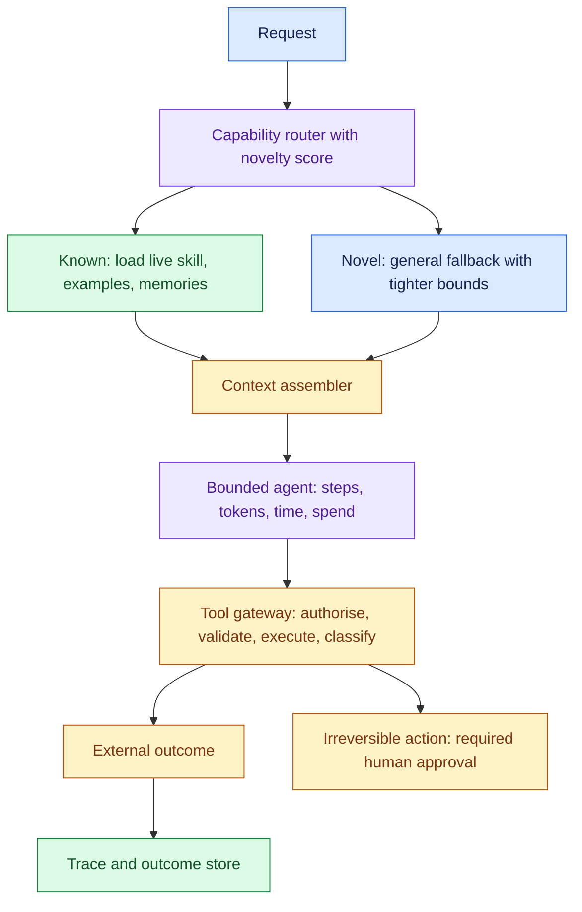
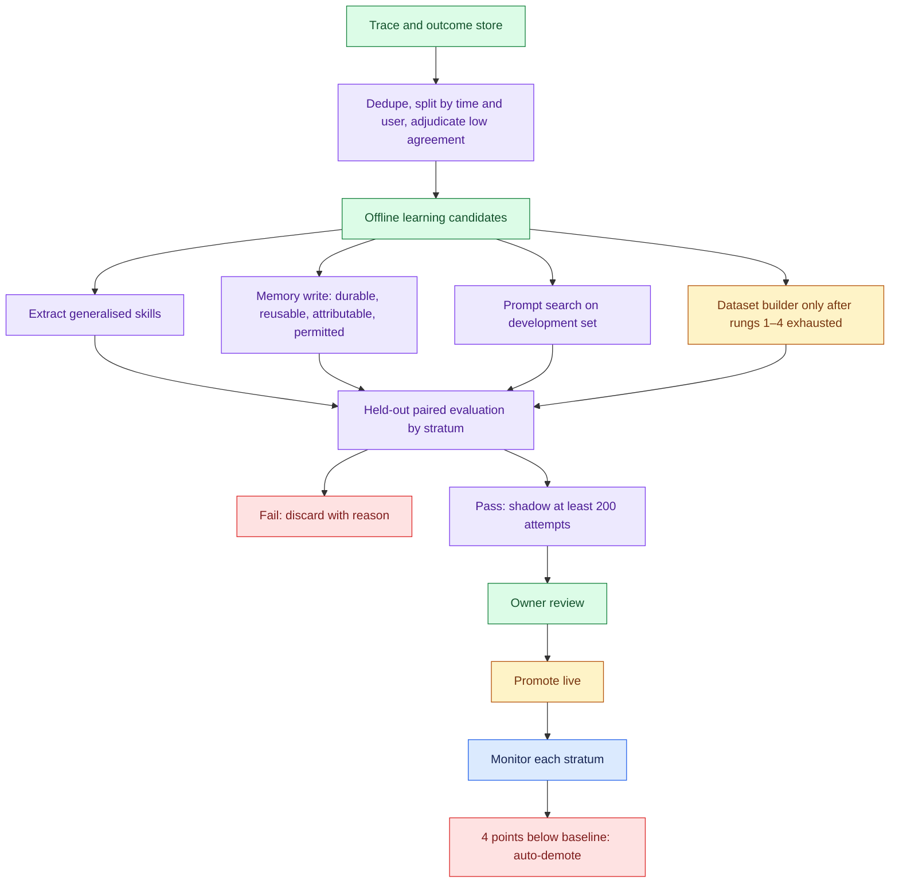
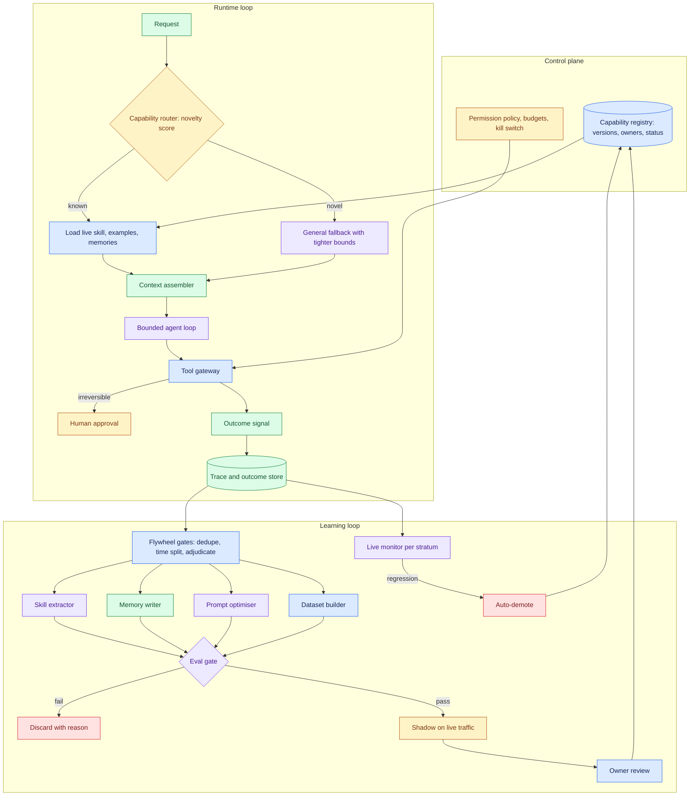

# Self-Adapting Agent

*An agent that adapts to new tasks without supervision needs the freedom to change its own behaviour, and every change it makes is a regression nobody reviewed.*

"Autonomously adapt" does not mean "retrain itself". Most adaptation belongs in cheap, reversible places, such as context, memory and procedures. Each change passes the same evaluation gate a human change would. This page is the day-before pack for this case.

| Case | What it contributes here |
|---|---|
| Design an agentic AI system that can autonomously adapt to new tasks | Sections 1 to 14: the whole design on one running example |
| Cost self-drill | Section 15 |

No worked answer exists for this prompt. The prompt comes from a problem decomposition question bank. The spine comes from the learning chapter of a book on agentic system design, whose four learning surfaces, skill promotion gate and data flywheel answer most of this prompt. The memory write policy comes from its memory chapter, and the release gate from its validation chapter. Every number marked *(assumption)* is a whiteboard illustration, not a sourced figure.

The running example is the book's own: an internal operations agent. It handles requests such as "restart service X" and "roll back flag Y", and new request types appear every week as teams ship new systems.

---

## 1. Pin Down What "Adapt" Means Before Drawing Anything

You cannot design toward a verb nobody defined. "Adapt to new tasks" hides at least five mechanisms, which differ by an order of magnitude in cost and in how easily you can undo a change.

The book names four places an agent's improvement can live: context, memory, procedure and parameters. Each is roughly ten times slower and costlier to iterate on than the one before. This page adds prompt optimisation as a separate rung between procedure and parameters. It changes behaviour broadly, like training, but stays reversible, like a prompt.

| Rung | What changes | Example in the ops agent | Iteration time | Undo |
|---|---|---|---|---|
| 1. Context | Which instructions, examples and skills are loaded for this request | Load the "feature flags" skill and three similar past runs | Minutes | Instantly |
| 2. Memory | Stored facts, preferences, corrections | "Service X restarts need a drain first" | Immediate | Supersede the fact |
| 3. Procedure | Validated tool sequences saved as named skills | A promoted "safe restart" workflow | Hours | Pin the previous version |
| 4. Prompt optimisation | Instructions and examples searched against a scored dev set | A rewritten planner prompt that raises tool-choice accuracy | Hours to a day | Revert the prompt version |
| 5. Parameters | Model weights | A tuned small router for the top task types | Days to weeks | Redeploy the old model |

The book's rule is to work down this table, not up. In the book's view, most teams that reach for fine-tuning have not yet fixed their tool schemas, retrieval or example selection, and fine-tuning bakes those defects into weights that take weeks to change.

Ask these questions before committing.

| Question | Why it changes the design |
|---|---|
| What counts as a "new task": a new request type, a new tool, or a new domain? | A new request type is a context problem; a new tool needs an onboarding path; a new domain needs knowledge and evaluation data |
| Is there an external signal of success, such as a test, a validator or a ticket closed without reopening? | Without one, the agent cannot learn safely, because it has nothing trustworthy to learn from |
| Which actions are reversible? | Reversible actions can be tried and learned from; irreversible ones need a human before and after |
| Who owns each capability? | An owner reviews promotions and is paged when a skill regresses |
| How fast must a new task become reliable: hours, days or a quarter? | Hours forces the cheap rungs; a quarter permits training |
| Is the adaptation per user, per tenant or global? | Per-tenant learning needs isolation in every store |

If the interviewer does not answer, state a safe default aloud: new request types arrive weekly, most have a checkable outcome, writes to production systems are partly reversible, and adaptation is global but each skill has a team owner.

> *"Before I design anything I want 'adapt' pinned down. There are five places learning can live, from the context of one request up to the model's weights. Each rung costs roughly ten times more than the last and is harder to undo. I'll design from the cheap end and only climb when a measured gap forces it."*

## 2. State Requirements as Testable Constraints

A requirement that cannot fail a test is a wish. "Gets better over time" is a wish. "Success on a new task type reaches the baseline within 14 days without a regression on any existing type" is a constraint *(thresholds are assumptions)*.

- There are six functional must-haves. Recognise when a request does not match any known capability.
- Attempt it safely with a general fallback, escalating when confidence is low.
- Record every run with its outcome, so learning has evidence. Turn repeated successes into candidate skills, memories or prompt changes.
- Evaluate each candidate before it affects real traffic. Remove learned behaviour automatically when it starts to fail.

The should-haves come later: per-tenant specialisation, a tuned small model for high-volume task types, and a dashboard that shows owners what the agent learned this week.

| Non-functional constraint | Stated so it can be tested |
|---|---|
| No regression | No existing task stratum drops more than 3 points after any promotion *(the per-stratum floor is sourced from ch12's segment-collapse fix)* |
| Promotion bar | Candidate beats baseline by 5 points offline, then survives at least 200 live shadow attempts *(sourced: the book's reference gate values)* |
| Demotion | A skill falling 4 points below baseline is removed automatically *(sourced)* |
| Time to competence | New task type reaches baseline success within 14 days of first sighting *(assumption)* |
| Safety | Zero promotions that widen tool permissions; every irreversible action approved by a person |
| Traceability | Every behaviour change has a version, a source trace set, an evaluation report and an owner |
| Latency | Runtime adaptation adds at most 150 ms at p95 before the first model call *(assumption)* |
| Cost | Learning-plane spend capped as a share of serving spend; cap breach blocks new candidates *(assumption: 10%)* |

Each must-have needs an owner in the architecture.

| Requirement | Primary component |
|---|---|
| Recognise the unknown | Capability router with a novelty score |
| Attempt safely | Bounded agent loop behind the tool gateway, with escalation |
| Record evidence | Trace and outcome store |
| Turn success into candidates | Learning plane: skill extractor, memory writer, prompt optimiser, dataset builder |
| Evaluate before traffic | Evaluation gate plus shadow runner |
| Remove failures | Live monitor with automatic demotion |

## 3. Size the Adaptation Before Choosing a Rung

Arithmetic decides which rungs you can afford *(every input is an assumption, arithmetic is exact)*.

| Quantity | Assumed value | Consequence |
|---|---|---|
| Requests per day | 20,000 across 40 known task types | Average 500 per type, heavily skewed |
| New task types per week | 3 | About 150 a year; the catalogue must evict as well as grow |
| Traffic for a new type | 30 requests a day | 200 shadow attempts take about 7 days at full shadow |
| Cost per agent run | $0.03 | Serving is about $600 a day |
| Offline eval suite per candidate | 640 cases, paired with baseline | 1,280 runs = $38.40 per candidate |
| Candidates generated per week | 50 | $1,920 a week, about 46% of the $4,200 weekly serving bill |

- Two lessons fall out of the table. First, rare task types cannot be promoted quickly.
- At 30 requests a day the shadow minimum alone takes a week, which sets the honest time to competence.
- Second, candidate volume drives learning cost, not training. Fifty candidates a week breaks a 10% learning budget almost five times over, so the extractor must deduplicate and pre-filter before anything reaches the paid evaluation.

- The sample-size arithmetic sets what the gate can detect at all. The validation chapter gives it as n ≈ 15.7 × p(1−p) / δ² per arm.
- At a baseline of 0.8, 200 cases detect only differences of about 11 points.
- A 5-point gain needs about 1,000 cases per arm. So the 200-attempt shadow proves "not much worse", not "5 points better".
- Say that aloud; few candidates do.

## 4. Draw the Architecture as Two Loops With One Gate

The runtime loop serves requests. The learning loop proposes changes. They meet at one place, the evaluation gate, and nothing learned reaches live traffic without passing it.

- Version capability ownership, status, permissions, budgets, and kill switches. Runtime reads only live skills, memories, prompts, and models.
- Candidate statuses are candidate, shadow, live, and demoted. Evaluation has an absolute safety floor and visible cost.

The same design for viewers that render Mermaid:

| Component | Job | Fails how |
|---|---|---|
| Capability registry | Holds every learned artefact with version, owner, status and evidence | Without it, nobody can say what the agent learned or undo it |
| Capability router | Matches a request to live skills; scores novelty | Misroutes silently; a novel request forced into a wrong skill |
| General fallback | Attempts unknown tasks with tighter bounds and earlier escalation | Given the same bounds as known tasks, it explores dangerously |
| Context assembler | Loads skill instructions, examples and memories under per-section budgets | Loads everything; context rots and costs climb |
| Bounded agent loop | Plans and acts within step, token, time and spend caps | Loops forever on a task it cannot do |
| Tool gateway | Authorises, validates and executes every action; routes irreversible ones to a person | Learned procedures call tools the agent was never allowed to call |
| Outcome signal | Provides an external verdict: test, validator, ticket state | Self-graded success teaches confident errors |
| Trace and outcome store | Records trajectory, versions used and outcome for every run | Learning has nothing trustworthy to learn from |
| Flywheel gates | Dedupe, split by time and user, adjudicate | Duplicates inflate every offline number |
| Skill extractor | Generalises successful trajectories into parameterised skills | Library fills with skills that worked once |
| Memory writer | Admits only durable, reusable, attributable, permitted facts | Memory fills with noise and contradictions |
| Prompt optimiser | Searches prompt and example variants against a scored dev set | Overfits the dev set; the prompt wins offline and loses live |
| Dataset builder | Prepares training data for rung 5 | Trains in the old system's errors |
| Eval gate | Blocks candidates that regress any stratum or touch safety | Gating on the mean hides a segment collapse |
| Shadow runner | Runs the candidate beside live behaviour without acting | Shadow on too little traffic proves nothing |
| Live monitor | Tracks per-stratum success and auto-demotes | Stale skills keep running after an API changes |

## 5. Detect the Unknown Before Trying to Handle It

An agent cannot adapt to a task it has not noticed is new. The hardest failure is confidently forcing a new request into the nearest known skill; "I do not know how" is the easy case.

- Score novelty on three signals. First, the router's retrieval score against the skill catalogue falls below a threshold.
- Second, the request names a system, tool or entity absent from every live skill.
- Third, the router's top two candidates are close, so its choice is a coin flip.
- Any one signal routes the request to the general fallback instead of a skill.

Treat the fallback as a different operating mode. Cut the step budget. Allow read-only tools freely and require approval for writes. Escalate earlier. The first dozen runs of a new task type are the riskiest and the most valuable, because they carry the evidence every later rung learns from.

- A standard skill-loading pattern supports this. The agent starts with a lightweight catalogue of skill names and triggers.
- It loads one skill's full instructions only when selected, then releases that context.
- Trigger descriptions need counterexamples as well as examples, or the wrong skill activates.
- Evaluate triggering separately from execution: a skill that runs perfectly after the wrong trigger is still a wrong answer.

## 6. Adapt Within One Request Before Changing Anything Permanent

The cheapest adaptation changes nothing that outlives the request. Rung 1 covers two mechanisms, both runtime-only.

**Dynamic example selection.** A fixed set of examples in the system prompt is chosen for the average request, so it is optimal for none. Retrieve past runs similar to this request instead. Then rank them by recorded outcome as well as similarity. A similar run that went badly teaches the model to go badly. Enforce diversity so three near-duplicates do not crowd out the useful one. The book's scoring formula is λ × relevance − (1−λ) × redundancy + 0.15 × outcome score.

One cost follows. Examples sit above the user's turn, so swapping them per request breaks the prompt prefix cache from that point on. Only what sits above them (tool definitions, the fixed system prompt) still hits the cache. Where traffic clusters, cache one example set per cluster rather than choosing per request.

**Reflexion.** A failed attempt becomes a written lesson placed in context for the next attempt; the model does not change. The book says it works reliably only with three conditions: an external failure signal, a lesson specific enough to change behaviour, and a hard cap on attempts. "Expected ISO 8601 UTC, I sent local time" is a lesson. "Be more careful" is not. A model grading its own attempt without an external signal tends to write confidently wrong lessons, which then contaminate every later retry.

A Reflexion implementation splits the pattern into actor, evaluator and self-reflection roles. For this case, one design rule sits on top: the evaluator must be external. A validator, a test or an API response counts. The same model's opinion does not.
